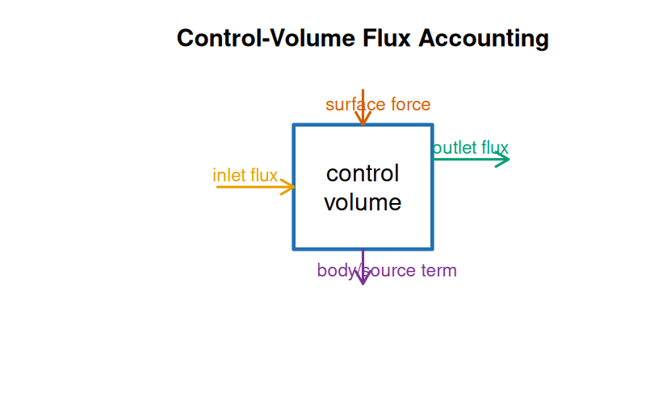
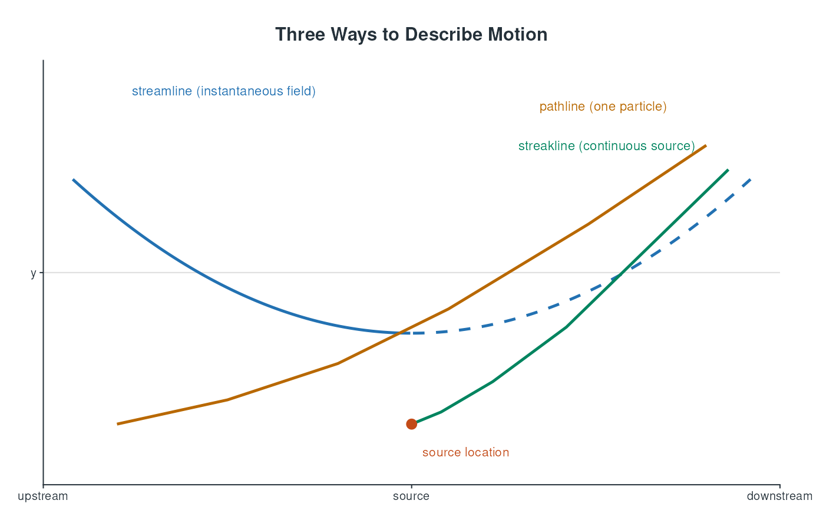
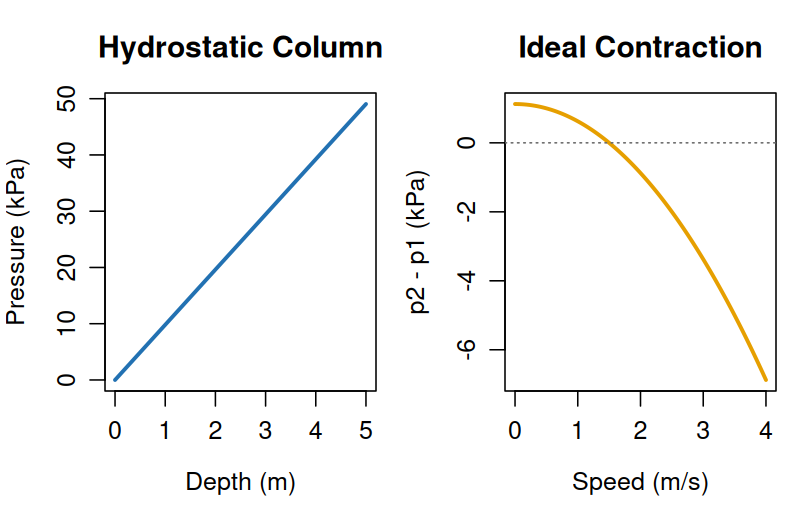
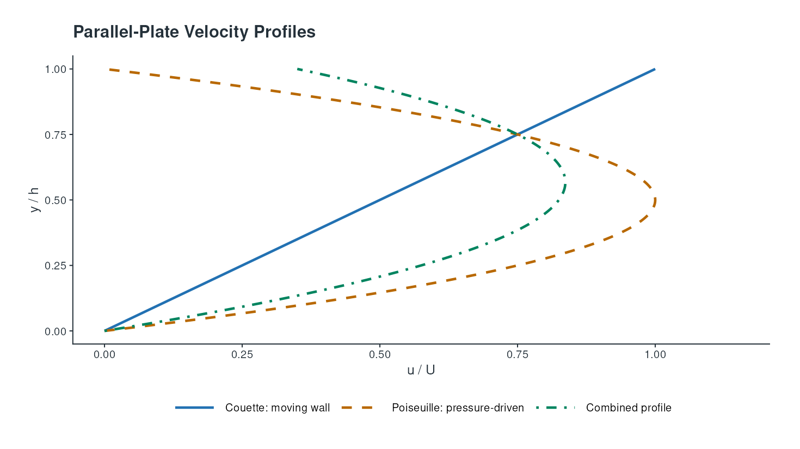
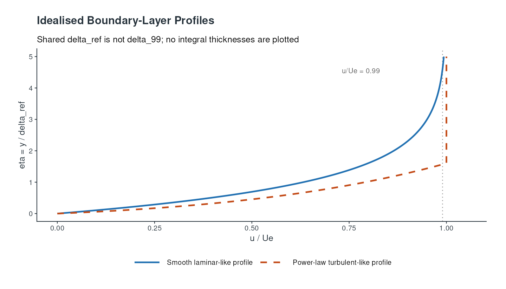
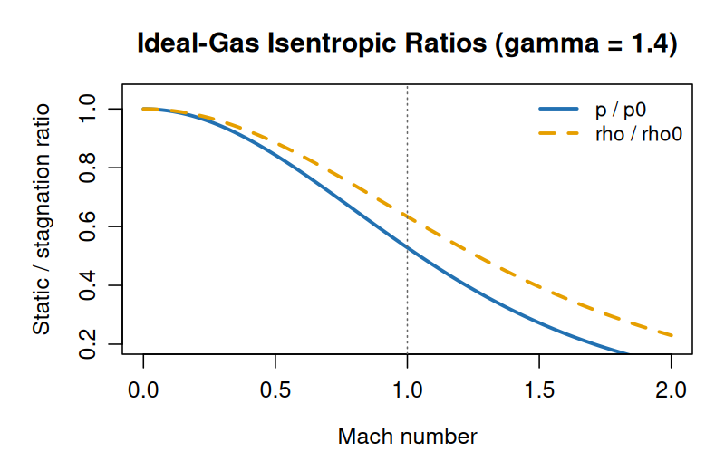
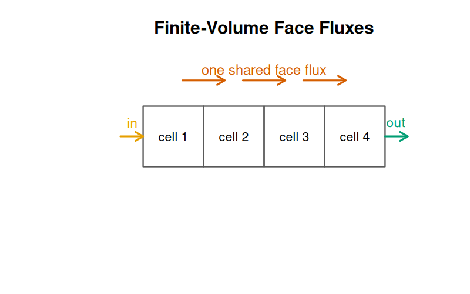
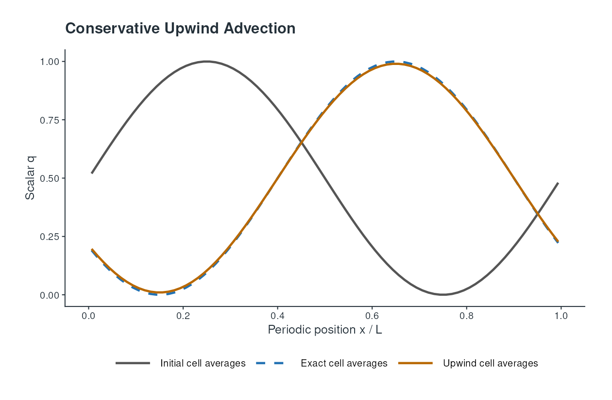
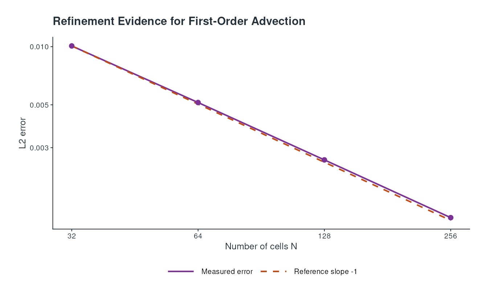

# Fluid Mechanics: From Conservation Laws to Verified Flow Models

## Orientation, Notation, and Reading Routes

Fluid mechanics describes how liquids and gases move and how their motion interacts with forces, boundaries, and other physical processes. A useful route through the subject is to start with the continuum model, learn how to describe motion at a point, and then apply balances of mass, momentum, and energy. Constitutive relations — such as a relation between viscous stress and rate of deformation — close those balances for a particular material. Boundary and initial conditions then define a problem whose equations can be analysed or solved numerically. Later sections can build on this route towards verified flow models: a plausible computed picture is not enough unless the governing assumptions, numerical evidence, and relevant physical checks are also clear.

Readers primarily interested in physical interpretation can follow the prose and worked calculations, treating the differential equations as compact statements of the same balances. Readers preparing to model a flow should follow the assumptions in order: identify the system and control volume, select a material description, specify the constitutive model, then state the boundary and initial data. Readers focused on computation should first understand the integral balances; these expose what a numerical method must conserve across a finite region, including when the solution is not smooth. The sections are cumulative, but the worked examples can be read independently as checks on units, signs, and limiting cases.

This foundation uses classical, non-relativistic continuum mechanics. It treats matter as continuously distributed at scales large compared with molecular spacing and observation times long compared with molecular collision times. It does not imply that every fluid is Newtonian, incompressible, or even well described by a single-phase continuum. Each of those is an additional modelling choice. Unless stated otherwise, fields are smooth enough for the displayed differential forms; integral balances remain the safer starting point at shocks, interfaces, and other locations where derivatives may not exist.

This is not a production-CFD manual or a complete treatment of turbulence, multiphase flow, reacting flow, non-Newtonian rheology, shock theory, mesh generation, or high-performance computing. It does not claim physical validation without independent measurements. The numerical-analysis primer supplies broader discretisation theory; this document applies a small amount of that theory to fluid balances and checks. The complex-analysis primer already develops ideal potential flow around a cylinder, so that case is treated here only as context for the limits of inviscid models. You should be comfortable with derivatives, integrals, vectors, matrices, elementary differential equations, and reading short Python, R, or Julia programs. The primer introduces fluid-specific notation before its first derivation. Readers interested mainly in physical interpretation can follow the prose and worked calculations; readers building models should track the assumptions and boundary conditions; readers focused on computation should pay particular attention to integral balances and the verification section.

*Verified against primary sources for all sections; unverified claims are flagged inline.*

### Notation

The following table establishes the notation used in this section. Symbols are defined again where a local calculation introduces a narrower meaning.

| Symbol | Meaning | First use |
|---|---|---|
| $t$ | Time | Continuum fields |
| $\mathbf{x}$ | Position vector in physical space | Continuum fields |
| $\mathbf{u}(\mathbf{x},t)$ | Fluid velocity field | Kinematics |
| $\rho(\mathbf{x},t)$ | Mass density | Mass conservation |
| $p(\mathbf{x},t)$ | Thermodynamic pressure | Stress and momentum |
| $T(\mathbf{x},t)$ | Absolute temperature | Thermodynamic state |
| $V(t)$, $\partial V(t)$ | A material volume and its boundary | Integral balances |
| $\mathbf{n}$ | Outward unit normal to a surface | Fluxes |
| $D/Dt$ | Material derivative following the motion | Kinematics |
| $\boldsymbol{\sigma}$ | Cauchy stress tensor; tension is positive | Momentum balance |
| $\mathbf{b}$ | Body force per unit mass | Momentum balance |
| $\mathbf{q}$ | Heat flux vector, directed towards decreasing temperature | Energy balance |

Bold lowercase symbols denote vectors and bold Greek symbols denote tensors. The operator $\nabla$ is the spatial gradient, $\nabla\cdot$ is divergence, and $\nabla^2$ is the Laplacian. The identity tensor is $\mathbf{I}$. A dot between vectors denotes the Euclidean inner product; a colon between second-order tensors denotes double contraction. Surface integrals use the outward normal. These conventions fix the signs in the flux and stress equations below.

### Scales Before Equations

Before manipulating a governing equation, write down the characteristic scales of the problem. Let $L$ be a length, $U$ a speed, $t_c$ a time, $\rho_c$ a density, and $p_c$ a pressure. Common candidates include the advection time $L/U$, viscous diffusion time $L^2/\nu$, thermal diffusion time $L^2/\alpha$, and acoustic time $L/c$. Their ratios tell us whether a field can adjust rapidly relative to the process being studied.

For a small channel with $L=0.2\,\mathrm{m}$ and $U=0.02\,\mathrm{m\,s^{-1}}$, the advection time is $10\,\mathrm{s}$. With water kinematic viscosity $10^{-6}\,\mathrm{m^2\,s^{-1}}$, viscous diffusion across the full length would take $40{,}000\,\mathrm{s}$, but diffusion across a $1\,\mathrm{mm}$ gap takes about $1\,\mathrm{s}$. The relevant viscous scale is therefore the gap for the wall-normal profile, not necessarily the device length. A scale calculation can prevent a model from retaining or removing the wrong term.

Pressure also needs a scale. Dynamic pressure $\rho U^2$, hydrostatic pressure $\rho gL$, viscous pressure $\mu UL/h^2$ in a thin channel, and thermodynamic pressure $p_0$ can differ by many orders of magnitude. A nondimensional pressure that appears small under one scale may be the leading quantity under another. Choose the scale from the balance being tested and state the reference pressure separately.

An order-of-magnitude estimate need not be accurate to be useful. If a measured pressure drop is $50\,\mathrm{Pa}$ and the neglected hydrostatic correction is $30\,\mathrm{kPa}$, the proposed comparison is ill-posed. If the predicted viscous stress is $0.2\,\mathrm{Pa}$ and the instrument resolution is $1\,\mathrm{Pa}$, a wall-stress validation claim is unsupported. Scales connect equations to experimental design and to the precision that a result can reasonably carry.

## Foundations: Continuum and Kinematics

In the continuum model, quantities such as density, velocity, pressure, and temperature are fields: they assign a value to every position and time in the model domain. They represent averages over a small sampling volume that is large relative to molecular scales but small relative to the length scales of interest. This scale separation is an assumption, not a claim that fluids are microscopically continuous. Near rarefied gases, very small devices, sharp interfaces, or molecularly thin films, a continuum description can fail or require specialised boundary models.

The state of a fluid is not specified by velocity alone. Density and temperature can vary, and stress generally contains both pressure and viscous contributions. For a simple fluid at rest, the stress is isotropic and equals $-p\mathbf{I}$ under the tension-positive convention. During motion, deformation can produce additional stresses. The balance laws constrain how fields evolve but do not determine every stress, heat flux, or thermodynamic response; those require constitutive and state relations. For example, the Newtonian-fluid relation between deviatoric stress and strain rate is a material model, not a conservation law.

### Material, Spatial, and Reference Descriptions

There are three related choices behind the notation. A material description follows a particle labelled by its reference position $\mathbf{X}$ and records its current position $\mathbf{x}(\mathbf{X},t)$. A spatial, or Eulerian, description fixes a location $\mathbf{x}$ and records whichever particle happens to be there. A control-volume description integrates the spatial fields over a selected region. The first is natural for tracking a droplet or parcel; the second is natural for a laboratory sensor or grid; the third is natural for conservation and measurement.

The deformation gradient

$$
\mathbf{F}=\frac{\partial\mathbf{x}}{\partial\mathbf{X}}
$$

maps an infinitesimal reference line element to its current line element. Its determinant $J=\det\mathbf{F}$ is the local volume ratio. A material density therefore obeys $\rho J=\rho_0$ when mass is conserved, where $\rho_0$ is the density in the reference configuration. The spatial continuity equation and this material relation are two descriptions of the same fact. The determinant is not a pressure or a strain measure by itself; it becomes informative only with a specified reference state and constitutive model.

The distinction is useful even in elementary flow. A fixed probe may observe a changing velocity because a transient pattern passes it, whereas a particle may experience a different change because it moves through that pattern. Confusing the two leads directly to an incorrect material derivative. A numerical implementation also has a choice: a moving-mesh method follows changing cells, while a fixed-grid method accounts for transport through cell faces. Neither is intrinsically more physical; the balance and geometric terms must be consistent with the choice.

### Local Versus Integral Statements

Differential equations are local limits of integral balances. To obtain a local equation, assume enough regularity to apply the divergence theorem and then require the balance to hold for every sufficiently small region. This operation is powerful but has a cost: it can conceal the boundary fluxes and can fail at discontinuities. A shock, contact surface, or material interface is better treated by a control volume that straddles the feature.

For a scalar conservation law with density-like quantity $a$ and flux $\mathbf{j}$,

$$
\frac{\partial a}{\partial t}+\nabla\cdot\mathbf{j}=s,
$$

the integral form is

$$
\frac{d}{dt}\int_\Omega a\,dV+\int_{\partial\Omega}\mathbf{j}\cdot\mathbf{n}\,dA
=\int_\Omega s\,dV.
$$

The source $s$ may represent generation, reaction, or a body contribution. The signs are transparent: accumulation plus outward flux equals production. Writing a balance in this form before simplifying it is one of the safest ways to avoid losing a boundary term or reversing an inlet sign.



*Figure: a control-volume balance separates accumulation, inlet and outlet fluxes, surface forces, and body/source terms. The arrows are schematic; the outward-normal convention in the equations determines the signs.*

A system is a fixed collection of matter. A control volume is a chosen region in space through which matter may pass. The material volume $V(t)$ moves and deforms with the same fluid particles, so no mass crosses its boundary. A fixed control volume is often more convenient for measurements and computation, but its balance must include fluxes through its surface. The Reynolds transport theorem connects these viewpoints. For a specific extensive property whose amount per unit mass is $\phi(\mathbf{x},t)$, it states:

$$
\frac{d}{dt}\int_{V(t)}\rho\phi\,dV
=\frac{\partial}{\partial t}\int_{\Omega}\rho\phi\,dV
+\int_{\partial\Omega}\rho\phi\,\mathbf{u}\cdot\mathbf{n}\,dA,
$$

where $\Omega$ is a fixed control volume. The last term is the net outward advective flux. This form assumes the fields are integrable and the moving boundary travels with the local fluid velocity. It is the bridge from particle-following physics to fixed-region accounting.

### Kinematics: Describing Motion

Let a particle labelled by its initial position $\mathbf{X}$ occupy position $\mathbf{x}(\mathbf{X},t)$ at time $t$. Its velocity is the time derivative at fixed particle label. The Eulerian velocity field $\mathbf{u}(\mathbf{x},t)$ instead records velocity at a location in space. For any scalar field $f$, the rate experienced by a moving particle is the material derivative:

$$
\frac{Df}{Dt}=\frac{\partial f}{\partial t}+\mathbf{u}\cdot\nabla f.
$$

The first term measures change at a fixed location; the second is advection, the change caused by the particle moving through spatial variation. The same operator applies componentwise to vectors and tensors. It is not interchangeable with the local time derivative when the field varies in space.

For example, let the one-dimensional temperature field be $T(x,t)=300+2x+0.5t$ kelvin, with $x$ in metres and $t$ in seconds, and let a particle move at $u=3\,\mathrm{m\,s^{-1}}$. Its local temperature change is $0.5\,\mathrm{K\,s^{-1}}$, while the spatial gradient is $2\,\mathrm{K\,m^{-1}}$. Therefore:

$$
\frac{DT}{Dt}=0.5+3(2)=6.5\,\mathrm{K\,s^{-1}}.
$$

The particle warms faster than a stationary thermometer because it also moves into warmer fluid. This calculation assumes the stated smooth field and constant particle velocity over the instant considered; it distinguishes temporal change from transport without implying that temperature itself is conserved.

The velocity gradient $\nabla\mathbf{u}$ describes local changes in velocity across neighbouring points. Its symmetric part is the rate-of-deformation tensor, and its antisymmetric part describes local rigid-body rotation:

$$
\mathbf{D}=\frac{1}{2}\left(\nabla\mathbf{u}+(\nabla\mathbf{u})^{\top}\right),
\qquad
\mathbf{W}=\frac{1}{2}\left(\nabla\mathbf{u}-(\nabla\mathbf{u})^{\top}\right).
$$

The divergence $\nabla\cdot\mathbf{u}=\operatorname{tr}(\mathbf{D})$ is the fractional rate of change of a small material volume. Positive divergence means local expansion; negative divergence means compression. A rigid translation or rotation has $\mathbf{D}=\mathbf{0}$ and zero divergence, even though its velocity need not vanish. Incompressible motion has zero divergence, but incompressibility of motion and constant density are related only with the appropriate mass-conservation assumptions.

Consider the planar velocity field $u_x=ax$, $u_y=-ay$, where $a$ is a constant with units $\mathrm{s^{-1}}$. Its velocity gradient is diagonal with entries $a$ and $-a$, hence $\nabla\cdot\mathbf{u}=a-a=0$. A small material element stretches in the $x$ direction and contracts in the $y$ direction at matching fractional rates; its area is unchanged to first order. Zero divergence therefore means no local volume change, not absence of deformation.

### Deformation, Rotation, and Rigid Motion

The velocity gradient can be decomposed into translation, rotation, and deformation only locally. In two dimensions, a solid-body rotation with angular speed $\Omega$ has $u_x=-\Omega y$ and $u_y=\Omega x$. Its rate-of-deformation tensor is zero, but its vorticity is $2\Omega$ under the convention above. A pure planar extension can have zero vorticity and non-zero deformation. These examples show why neither divergence nor vorticity alone describes the complete local motion.

For a Newtonian fluid, the stress responds to the symmetric rate of deformation, not to a rigid translation or a rigid rotation. This is required by frame indifference: an observer who rotates uniformly with the fluid should not infer a viscous stress merely from that change of coordinates. At introductory level, the practical test is simple: a rigid-body motion should produce no Newtonian shear stress, while a velocity difference across adjacent layers should.

The distinction also affects boundary conditions. No-slip at a stationary solid wall sets the fluid velocity equal to the wall velocity at the wall in the usual continuum model. It does not say that the velocity gradient vanishes there. In fact, wall shear is often proportional to the normal derivative of tangential velocity, so a no-slip condition and a non-zero viscous traction are compatible. A free-slip idealisation sets the normal velocity and tangential traction differently; it should not be substituted silently for no-slip because it changes the near-wall solution.

### Vorticity and Flow Descriptions

The vorticity is

$$
\boldsymbol{\omega}=\nabla\times\mathbf{u}.
$$

It measures local rotation of the velocity field, but it should not be identified too casually with the angular velocity of a finite fluid parcel. A rigid-body rotation has a direct relation between the two, while a general flow can have shear and strain at the same time. In two dimensions, vorticity is normal to the plane and can help identify recirculation, shear layers, and the influence of boundaries.

Streamlines are curves tangent to the instantaneous velocity field. Pathlines are the trajectories of individual particles, and streaklines are the locations of particles that have passed through a fixed source. In steady flow these curves coincide; in unsteady flow they need not. A plot labelled “streamline” from an instantaneous numerical field is not automatically a prediction of a particle trajectory. The distinction matters when interpreting dye, smoke, or particle-image measurements.

The circulation around a closed curve $C$ is

$$
\Gamma=\oint_C\mathbf{u}\cdot d\mathbf{l}.
$$

By Stokes' theorem it equals the flux of vorticity through a spanning surface, subject to the required smoothness. Circulation is therefore a useful integral diagnostic, but its evolution depends on viscosity, body-force structure, baroclinic effects, and the motion of the curve. A flow with zero vorticity in an ideal region can still have non-zero circulation around a singular or excluded region. This is one reason potential-flow examples need their domain and boundary assumptions stated carefully.

For an incompressible two-dimensional velocity field, a streamfunction $\psi$ may be defined by $u=\partial\psi/\partial y$ and $v=-\partial\psi/\partial x$ under one common sign convention. The divergence constraint is then satisfied identically. The streamfunction difference between two streamlines represents volume flux per unit depth. This is useful for visualisation and analytical work, but it does not remove the need to enforce momentum or wall conditions. A streamfunction field can be divergence-free and still have the wrong pressure or stress.



*Figure: the three curves coincide in a steady flow but can differ in an unsteady field. The source point shown here continuously emits the streakline, while the pathline follows one marked particle.*

## Conservation Laws

Mass, momentum, and energy balances describe different quantities crossing the same chosen boundary. The local equations show how those quantities change at a point, while control-volume balances account for their accumulation, fluxes, and sources over a region. The following derivations use both views; each requires a stated system boundary, force or flux convention, and set of material assumptions before its result can be applied to a flow model.

### Mass Conservation

Mass conservation says that the mass of every material volume remains constant. Applying transport to a fixed control volume gives the integral balance, and for smooth fields the local continuity equation:

$$
\frac{d}{dt}\int_{V(t)}\rho\,dV=0,
\qquad
\frac{\partial\rho}{\partial t}+\nabla\cdot(\rho\mathbf{u})=0.
$$

Equivalently, $D\rho/Dt+\rho\nabla\cdot\mathbf{u}=0$. Density of a moving parcel changes when the parcel expands or contracts. If density is constant along every particle path, continuity implies $\nabla\cdot\mathbf{u}=0$. Conversely, a divergence-free velocity field only implies constant density along paths when the continuity equation applies and its initial density is consistent; the word "incompressible" is sometimes used for the kinematic constraint and sometimes for the material approximation, so the intended meaning should be stated.

As a steady one-dimensional example, consider flow through a duct with uniform density $\rho=1000\,\mathrm{kg\,m^{-3}}$. At section 1, area $A_1=0.020\,\mathrm{m^2}$ and mean speed $U_1=1.5\,\mathrm{m\,s^{-1}}$. The mass flow rate is $\dot m=\rho A U$, so $\dot m=30\,\mathrm{kg\,s^{-1}}$. If section 2 has area $A_2=0.010\,\mathrm{m^2}$, steady mass conservation gives $U_2=\dot m/(\rho A_2)=3.0\,\mathrm{m\,s^{-1}}$. The speed doubles as the area halves. This is a section-averaged result; it does not establish a uniform velocity profile or apply unchanged to a compressible flow with varying density.

### Momentum Conservation

Newton's second law for a material volume equates the rate of change of its momentum to surface forces and body forces. With $\boldsymbol{\sigma}$ the tension-positive Cauchy stress and $\mathbf{b}$ body force per unit mass, the local balance is:

$$
\rho\frac{D\mathbf{u}}{Dt}=\nabla\cdot\boldsymbol{\sigma}+\rho\mathbf{b}.
$$

For a simple fluid, split stress into isotropic pressure and deviatoric stress $\boldsymbol{\tau}$:

$$
\boldsymbol{\sigma}=-p\mathbf{I}+\boldsymbol{\tau},
\qquad
\rho\frac{D\mathbf{u}}{Dt}=-\nabla p+\nabla\cdot\boldsymbol{\tau}+\rho\mathbf{b}.
$$

This is a balance, not yet a closed flow equation. A constitutive law supplies $\boldsymbol{\tau}$ as a function of motion and possibly other state variables. For an incompressible Newtonian fluid with constant dynamic viscosity $\mu$, one common model is $\boldsymbol{\tau}=2\mu\mathbf{D}$; inserting this relation and $\nabla\cdot\mathbf{u}=0$ yields the familiar viscous term $\mu\nabla^2\mathbf{u}$. The assumptions of Newtonian response, constant viscosity, and incompressibility must travel with that simplification.

The integral momentum balance clarifies force and flux accounting. For a fixed control volume $\Omega$, its rate of momentum accumulation equals net inward momentum flux plus the total surface and body forces:

$$
\frac{\partial}{\partial t}\int_{\Omega}\rho\mathbf{u}\,dV
+\int_{\partial\Omega}\rho\mathbf{u}(\mathbf{u}\cdot\mathbf{n})\,dA
=\int_{\partial\Omega}\boldsymbol{\sigma}\mathbf{n}\,dA
+\int_{\Omega}\rho\mathbf{b}\,dV.
$$

The advective term is outward-positive, while the stress traction $\boldsymbol{\sigma}\mathbf{n}$ is the force exerted across the boundary on the matter inside. In steady, one-dimensional flow with uniform inlet and outlet profiles, the flux contribution reduces to $\dot m(\mathbf{u}_{\mathrm{out}}-\mathbf{u}_{\mathrm{in}})$. For a horizontal jet with $\dot m=2\,\mathrm{kg\,s^{-1}}$ entering at $4\,\mathrm{m\,s^{-1}}$ and leaving at $1\,\mathrm{m\,s^{-1}}$ in the same direction, the net external force on the fluid is $2(1-4)=-6\,\mathrm{N}$ along that direction. The negative sign means the net force points opposite to the flow. A support or vane experiences the opposite reaction, provided the chosen control surface includes all relevant pressure and shear forces.

### Control-Volume Force Calculations

Control-volume analysis is particularly useful when the detailed field is unavailable or unnecessary. Choose a surface that cuts the inlet and outlet where the velocity and pressure are known or can be approximated, and include all forces crossing the surface. The result depends on the chosen control volume only through terms that are consistently included; a convenient boundary does not permit omitted pressure thrust or wall reaction.

For a steady jet turning through a vane, the force follows from the difference between outlet and inlet momentum fluxes. If the inlet and outlet profiles are non-uniform, the momentum correction factor is not necessarily one. Replacing $\int_A\rho\mathbf{u}(\mathbf{u}\cdot\mathbf{n})\,dA$ with $\rho A\mathbf{U}(\mathbf{U}\cdot\mathbf{n})$ is a profile approximation that should be stated. In laminar pipe flow, the momentum flux based on the centreline speed would overstate the bulk momentum transfer; the profile correction can be derived from the known velocity distribution.

Pressure forces also require a reference. Atmospheric pressure acting uniformly on a closed external surface may cancel in a net force calculation, but it does not cancel on an open control surface unless the corresponding sections are included. Gauge pressure is convenient when the same reference acts on all exposed surfaces; absolute pressure is required for thermodynamic state and cavitation checks. A force balance with mixed gauge and absolute pressures can be numerically tidy and physically wrong.

The control-volume method and a finite-volume discretisation share the same accounting idea. The former integrates over a chosen macroscopic region; the latter applies the balance to many small regions. This is why a global force or mass balance is a strong diagnostic for a CFD calculation: summing the discrete cell equations should recover the control-volume result up to source, boundary, and solver tolerances.

### Energy Conservation

Energy conservation tracks changes in kinetic and internal energy due to work and heat transfer. With specific internal energy $e$, total specific energy $E=e+\tfrac{1}{2}\mathbf{u}\cdot\mathbf{u}$, heat flux $\mathbf{q}$, and body force $\mathbf{b}$, a common local statement is:

$$
\rho\frac{DE}{Dt}
=\nabla\cdot(\boldsymbol{\sigma}\mathbf{u})
-\nabla\cdot\mathbf{q}
+\rho\mathbf{b}\cdot\mathbf{u}
+\rho r,
$$

where $r$ is heat added per unit mass per unit time. The stress-power term includes pressure work and viscous work under the stated stress convention; Fourier conduction is one possible closure, $\mathbf{q}=-k\nabla T$, for thermal conductivity $k>0$. An equation of state and caloric relation are also needed to connect pressure, density, temperature, and internal energy. The precise energy equation may be rearranged into internal-energy, enthalpy, or temperature form, but the accounting must retain the same physical transfers. For many low-speed incompressible calculations a simplified energy treatment is adequate; that is a regime-specific approximation, not a universal property of fluid flow.

Conservation statements are useful both for modelling and for checking. Units must agree on every term, fluxes must use a consistent outward-normal convention, and internal exchanges across adjacent subregions must cancel when their balances are added. Integral balances remain meaningful when local derivatives are singular or discontinuous; jump conditions across an idealised shock or interface follow by applying them to a shrinking control volume. A numerical result can satisfy a discretised conservation law and still be physically wrong if its constitutive model, boundary data, or resolution is unsuitable. Verification therefore asks whether the equations were solved correctly; validation asks whether those equations adequately represent the physical situation. Later sections should connect these balances to explicit model checks rather than treating conservation as a certificate of physical truth.

### Reynolds Transport Theorem in Practice

The Reynolds transport theorem is easiest to use when the extensive property is named before any algebra begins. For mass, set $\phi=1$. For linear momentum, set $\phi=\mathbf{u}$. For total energy, set $\phi=E$. The same geometric statement then produces different balances because the property per unit mass and its sources differ. This modularity is more reliable than memorising three unrelated equations.

Suppose a fixed tank is filled through one pipe and drained through another. Applying the mass theorem gives

$$
\frac{dM}{dt}=\dot m_{\mathrm{in}}-\dot m_{\mathrm{out}},
$$

where each mass flow rate is positive in the direction into or out of the tank as labelled. If the liquid is incompressible and the tank cross-sectional area is $A_T$, then $A_T\,d\eta/dt=Q_{\mathrm{in}}-Q_{\mathrm{out}}$ for liquid depth $\eta$. The pressure field inside the tank is not needed to obtain the level balance. If the outlet law is $Q_{\mathrm{out}}=C\sqrt{\eta}$, the level evolves according to a nonlinear ordinary differential equation; conservation has reduced the spatial problem because the tank is assumed well mixed and hydrostatic.

The same tank illustrates why the system boundary matters. If the pipe is included inside the control volume, its stored mass and momentum are part of the accumulation term. If the control volume cuts across the pipe, the pipe flow appears as a surface flux. Both descriptions can agree, but combining the accumulation term from one boundary with the fluxes from the other double-counts material. Draw the boundary before writing the equation.

### Jump Conditions and Interfaces

Consider a surface moving with normal speed $S$. Applying a conservation law to a thin pillbox around the surface gives a jump condition. With $[a]=a_2-a_1$ denoting the value on side 2 minus side 1, the scalar condition is

$$
S[a]=[\mathbf{j}\cdot\mathbf{n}]
$$

when there is no singular surface source. For mass, this becomes $S[\rho]=[\rho\mathbf{u}\cdot\mathbf{n}]$. A material interface moves with the fluid, so the normal relative flux vanishes on both sides. A shock is different: mass, momentum, and energy cross a moving discontinuity with a non-zero relative flux, and the jump conditions constrain the allowable states.

This distinction is important for numerical work. A method that differentiates a discontinuous field pointwise may generate an undefined or oscillatory derivative, while a conservative finite-volume method can represent the integral flux across the discontinuity. The numerical solution still needs an appropriate flux, entropy condition, and resolution, but the integral form supplies the correct bookkeeping foundation.

### Three Small Balance Derivations

It is useful to practise the same balance pattern on different physical properties. Consider a perfectly mixed tank of volume $V$ containing a dissolved scalar at concentration $c(t)$. A liquid flow rate $Q$ enters with concentration $c_{\mathrm{in}}$ and leaves at the tank concentration. With constant volume, the scalar balance is

$$
V\frac{dc}{dt}=Q(c_{\mathrm{in}}-c).
$$

The characteristic replacement time is $V/Q$. If the inlet concentration is suddenly changed, $c(t)$ approaches the new value exponentially. This result assumes perfect mixing and constant volume; a real tank may have dead zones or short-circuiting. A spatial CFD result should be reduced to a comparable volume average before it is judged against this model.

For a steady control volume around a pipe bend, the force on the fluid is the momentum flux difference plus pressure and wall forces. In vector form,

$$
\mathbf{F}_{\mathrm{wall}}-\sum_k p_kA_k\mathbf{n}_k+\int_\Omega\rho\mathbf{b}\,dV
=\sum_{\mathrm{out}}\dot m\mathbf{u}-\sum_{\mathrm{in}}\dot m\mathbf{u}.
$$

The pressure terms now use the pressure traction on the fluid, $-p\mathbf{n}$, under the outward-normal convention. A common error is to use the force on the fluid at one section and the force exerted by the fluid at another. Draw the arrows and apply the same traction convention at every section. The support reaction is the negative of the net external force on the chosen fluid volume only after the force on the control surface has been defined.

For a one-dimensional thermal slab with constant conductivity and no volumetric source, the steady equation is $d^2T/dx^2=0$. Prescribed temperatures $T(0)=T_0$ and $T(L)=T_L$ give a linear profile and constant heat flux $q_x=-k(T_L-T_0)/L$. If $T_L>T_0$, the flux is negative: heat travels towards decreasing temperature. This elementary sign check should be the first test of a more complicated energy implementation. Adding a volumetric source changes the profile to a parabola and changes the integrated boundary fluxes by the total generated heat.

These examples share the same structure: define the stored quantity, identify the flux through each boundary, state the source, and choose the geometry that makes the desired average meaningful. A solver or derivation that cannot be reduced to this accounting pattern deserves scrutiny before more physics is added.

## Hydrostatics and Inviscid Models

Hydrostatics is the limiting case in which the fluid acceleration is negligible. With a stationary fluid and body acceleration $\mathbf{b}$, the momentum balance reduces to

$$
\nabla p=\rho\mathbf{b}.
$$

Near the Earth's surface, choose the vertical coordinate $z$ upwards and $\mathbf{b}=-g\mathbf{e}_z$. For a constant-density liquid,

$$
\frac{dp}{dz}=-\rho g,
\qquad
p(z)=p(z_0)-\rho g(z-z_0).
$$

Pressure therefore increases with depth. The result is local: it assumes negligible acceleration, a known density field, and a body-force model that is approximately uniform over the region. It does not say that pressure is a property of depth alone in a moving or strongly stratified fluid.

For water with $\rho=1000\,\mathrm{kg\,m^{-3}}$, a point $3\,\mathrm{m}$ below a free surface exposed to atmospheric pressure has gauge pressure $\rho g h\approx29.4\,\mathrm{kPa}$. Gauge pressure subtracts the reference atmospheric pressure; absolute pressure retains it. This distinction matters when comparing with a cavitation limit or an equation of state. The same balance explains buoyancy: integrating pressure traction over a submerged body gives an upward resultant equal to the weight of displaced fluid when the surrounding fluid is static. The body need not be uniform, and the result does not require the body itself to be fluid.

When a fluid accelerates, pressure is no longer determined by depth alone. An inviscid model removes viscous stress from the momentum balance, leaving

$$
\rho\frac{D\mathbf{u}}{Dt}=-\nabla p+\rho\mathbf{b}.
$$

For steady, incompressible flow with a conservative body force, integration along a streamline gives Bernoulli's relation,

$$
\frac{p}{\rho}+\frac{1}{2}|\mathbf{u}|^2+gz=\text{constant along a streamline}.
$$

The hypotheses are doing the work. The relation assumes steady flow, constant density, negligible viscous dissipation, and no unrepresented shaft work or heat transfer. It is generally a streamline statement; it becomes a field-wide constant only under additional conditions such as irrotational flow. It cannot be used to infer a pressure rise through a viscous pump or across a shock without adding the missing physics.

As a sanity check, consider a horizontal contraction with the same incompressible flow rate through areas $A_1=0.020\,\mathrm{m^2}$ and $A_2=0.010\,\mathrm{m^2}$. If $U_1=1.5\,\mathrm{m\,s^{-1}}$, continuity gives $U_2=3.0\,\mathrm{m\,s^{-1}}$. Ignoring losses, Bernoulli predicts

$$
p_2-p_1=\frac{1}{2}\rho(U_1^2-U_2^2)=-3375\,\mathrm{Pa}
$$

for $\rho=1000\,\mathrm{kg\,m^{-3}}$. The faster section has lower static pressure in this ideal model. A real contraction has a loss, and a real measurement also includes the placement and shape of pressure taps; the ideal answer is a baseline, not a guaranteed reading.



*Figure: hydrostatic pressure increases with depth, whereas the ideal horizontal-contraction curve shows static pressure decreasing as speed increases. The reference levels and assumptions are different, so the curves are a comparison of mechanisms rather than one combined solution.*

### Pressure, Head, and Reference Levels

Engineering calculations often divide pressure by $\rho g$ and report a pressure head. This is convenient for a constant-density liquid, but the conversion is not a new conservation law. Pressure head, elevation head, and velocity head have the same dimensions of length only after the density and gravitational acceleration have been chosen. In a gas, a large density change makes a constant-density head interpretation questionable. In a rotating frame or a non-uniform gravitational field, the potential term must be defined consistently with the body force.

The pressure field in a stationary connected liquid is determined up to the chosen reference pressure. If one reservoir is open to atmosphere, gauge pressure at its free surface is zero under the idealisation that atmospheric pressure is uniform. A second reservoir at a different elevation can have a different pressure only if the liquid is accelerating, has a density variation, or is connected to another pressure source. Pressure sensors report a local quantity; a pressure difference between two taps should be corrected for elevation when the desired output is a loss rather than a total pressure difference.

Stagnation pressure is another distinct quantity. In an inviscid, incompressible, steady flow, bringing a local stream to rest reversibly gives $p_0=p+\tfrac12\rho U^2$ at the same elevation. In a viscous flow, a probe or tap can measure a value affected by losses, alignment, and local gradients. Calling every pressure reading “stagnation pressure” obscures the measurement model. State whether the quantity is static pressure, total pressure, gauge pressure, or a pressure difference between specified locations.

### Buoyancy and Stability of Stratification

The buoyancy force follows from integrating hydrostatic pressure over a closed surface. For a body displacing volume $V_b$ of a constant-density fluid, the net upward force is $\rho_f gV_b$. The force acts through the centre of buoyancy, while the body's weight acts through its centre of mass. Stability of a floating body depends on the relative geometry of these lines of action and on how the displaced volume changes when the body tilts; buoyancy magnitude alone does not determine stability.

A continuously stratified fluid adds another scale. If density decreases in the direction of gravity, a displaced parcel can be heavier or lighter than its surroundings and may oscillate or overturn. The Boussinesq approximation treats density as constant except in the buoyancy term when density variations are small but dynamically important. This is a targeted model reduction: it preserves a buoyancy mechanism while neglecting density variation in mass and inertia. It should be justified by a small relative density variation and a stated temperature or composition range.

In environmental and geophysical flows, rotation, stratification, and topography can be as important as viscosity. The present primer only uses buoyancy to show how a body force enters the balances. A rotating or stratified application should add the relevant Rossby, Richardson, or buoyancy scales and validate the reduced model against observations appropriate to that setting.

## Viscosity and Internal Flow

Viscosity describes momentum transport associated with velocity gradients. For a Newtonian fluid, the deviatoric stress is proportional to the rate of deformation. In the incompressible constant-viscosity case used repeatedly below,

$$
\boldsymbol{\tau}=2\mu\mathbf{D},
\qquad
\nabla\cdot\boldsymbol{\tau}=\mu\nabla^2\mathbf{u},
$$

where $\mu$ is dynamic viscosity. This is a constitutive assumption, not a consequence of momentum conservation. It works well for many ordinary liquids and gases over specified ranges, but it is not a universal definition of a fluid. A non-Newtonian material may have a stress that depends on shear history, rate, or an internal state.

Substituting the Newtonian relation into momentum gives the incompressible Navier–Stokes equations,

$$
\nabla\cdot\mathbf{u}=0,
$$

$$
\rho\left(\frac{\partial\mathbf{u}}{\partial t}+\mathbf{u}\cdot\nabla\mathbf{u}\right)
=-\nabla p+\mu\nabla^2\mathbf{u}+\rho\mathbf{b}.
$$

The terms have different roles: local acceleration, advection, pressure force, viscous diffusion of momentum, and body force. Their units must agree. The equation is difficult not because each term is mysterious, but because they couple a vector field to a pressure constraint and boundary conditions. Omitting a term is a model decision that must be justified by scale analysis or evidence.

The no-slip condition sets the fluid velocity equal to a stationary solid wall in the usual continuum model. A moving wall supplies its own velocity. No-slip is often an excellent approximation at macroscopic scales, but rarefied gases, lubricated contacts, and microfluidic surfaces can require a slip model. At an inlet one may prescribe velocity, mass flow, or a developed profile; at an outlet one may prescribe pressure or an appropriate traction. Specifying incompatible data at every boundary can overconstrain the problem.

### Couette Flow

Two stationary parallel plates separated by distance $h$ contain a Newtonian fluid. The upper plate moves at speed $U_w$ and there is no imposed pressure gradient. A steady, fully developed solution has only a streamwise velocity $u(y)$, and the streamwise momentum balance becomes $\mu d^2u/dy^2=0$. Applying $u(0)=0$ and $u(h)=U_w$ gives

$$
u(y)=U_w\frac{y}{h},
\qquad
\tau_{xy}=\mu\frac{U_w}{h}.
$$

The profile is linear, the mean speed is $U_w/2$, and the wall stress is uniform. If $U_w=0.4\,\mathrm{m\,s^{-1}}$, $h=2\,\mathrm{mm}$, and $\mu=0.001\,\mathrm{Pa\,s}$, then $\tau_{xy}=0.20\,\mathrm{Pa}$. This result does not describe the start-up transient, edge effects, turbulence, or a pressure-driven component.

### Plane Poiseuille Flow

For a wide channel with stationary plates, steady fully developed flow driven by a constant pressure gradient satisfies

$$
0=-\frac{dp}{dx}+\mu\frac{d^2u}{dy^2}.
$$

Taking $y\in[-h/2,h/2]$ and $u(\pm h/2)=0$ gives

$$
u(y)=\frac{-1}{2\mu}\frac{dp}{dx}\left(\frac{h^2}{4}-y^2\right).
$$

The profile is parabolic. Its mean value is $U=-h^2(dp/dx)/(12\mu)$, so the pressure drop over length $L$ is $\Delta p=12\mu LU/h^2$. The wall shear magnitude is $|\tau_w|=6\mu U/h$. These equations provide a useful manufactured benchmark because their assumptions can be written down and their outputs can be integrated independently. They are not a universal wall law: entrance regions, side walls, roughness, temperature variation, and transition all change the problem.

The pressure-driven example also shows why a visually plausible velocity plot is weak evidence. A solver can produce a smooth parabola with the wrong pressure gradient, wrong units, or wrong boundary condition. Check the integrated flow rate, wall shear, momentum balance, and convergence with grid refinement. Agreement with this analytical solution verifies a code against an idealised model; it does not validate a real channel assembly.



*Figure: the moving-wall contribution is linear, the pressure-driven contribution is curved, and their sum can have a different mean flow from either local profile alone. The figure is generated by `generate_plots.R`.*

### Transient Viscous Diffusion

The steady profiles hide an important timescale. If a wall suddenly moves, the rest of the fluid does not acquire the Couette profile instantaneously. In a one-dimensional start-up idealisation with no pressure gradient, the streamwise velocity satisfies

$$
\frac{\partial u}{\partial t}=\nu\frac{\partial^2u}{\partial y^2},
\qquad \nu=\frac{\mu}{\rho},
$$

where $\nu$ is kinematic viscosity. Momentum diffuses over a distance of order $\sqrt{\nu t}$, so a characteristic diffusion time across a gap $h$ is $t_\nu=h^2/\nu$. This is a timescale estimate rather than a promise that the profile is fully developed at exactly that time. The initial condition, wall history, and chosen measure of “developed” determine the relevant constant.

For water with $\nu\approx10^{-6}\,\mathrm{m^2\,s^{-1}}$ in a $2\,\mathrm{mm}$ gap, $t_\nu=h^2/\nu\approx4\,\mathrm{s}$. A simulation that takes time steps of $0.1\,\mathrm{s}$ is not automatically accurate: the spatial grid and the stability limit for the selected time integrator also matter. A coarse time series can miss the early wall layer even if its final state looks correct.

The diffusion equation is a useful bridge between fluid physics and numerical analysis. With grid spacing $\Delta y$ and an explicit centred second derivative, a simple update is

$$
u_j^{n+1}=u_j^n+\frac{\nu\Delta t}{\Delta y^2}
\left(u_{j+1}^n-2u_j^n+u_{j-1}^n\right).
$$

The dimensionless coefficient $r=\nu\Delta t/\Delta y^2$ controls stability for this standard one-dimensional scheme; a conservative teaching implementation should enforce a bound rather than silently accepting an unsafe time step. Refining $\Delta y$ while leaving $\Delta t$ fixed can therefore make an explicit calculation unstable. Conversely, reducing the time step without refining space cannot remove spatial truncation error. The example is deliberately simple, but it teaches a general diagnostic: report which error source was changed in a refinement study.

Transient flow also clarifies the difference between a boundary condition and an initial condition. The wall velocity may be prescribed for all $t\geq0$, while the initial field may be at rest. Those statements are not interchangeable. A solver that initialises every cell to the eventual steady profile has removed the transient problem before it begins. When comparing with a laboratory start-up, record the wall motion, fluid temperature, and whether the measurement begins before or after the actuation delay.

### Internal-Flow Diagnostics

Mean speed is an area-weighted quantity, not necessarily the speed at the centreline. For a cross-section $A$,

$$
U=\frac{1}{A}\int_A u\,dA,
\qquad
Q=\int_Au\,dA=UA
$$

for an incompressible flow whose velocity is normal to the section. In a pipe, the fully developed laminar profile is parabolic in radius, so the centreline speed is twice the mean speed. Reporting the wrong speed in a Reynolds number or pressure-loss formula introduces a factor-of-two error before any numerical method is involved.

The hydraulic diameter extends internal-flow scaling to non-circular ducts:

$$
D_h=\frac{4A}{P},
$$

where $P$ is the wetted perimeter. It is a useful geometry scale for correlations, but it does not make every non-circular duct behave like a circular pipe. Aspect ratio, corners, developing flow, and secondary motion can matter. State whether a correlation uses hydraulic diameter, gap width, or another length.

The entrance region is another common source of overclaiming. At an inlet, the velocity profile may be imposed or nearly uniform, while viscosity develops wall gradients downstream. A fully developed formula applies only after the profile has become independent of the streamwise coordinate to the required accuracy. A short channel may spend most of its length developing. A pressure drop measured between taps can include contraction, expansion, fittings, and entrance losses in addition to the straight-section friction term.

For a model comparison, separate three questions: does the computed profile satisfy the specified boundary conditions; does its integral produce the intended flow rate; and does the pressure work balance wall dissipation and any acceleration? Passing the first question alone is a weak test. For steady incompressible channel flow with no body force, multiplying the streamwise momentum equation by velocity and integrating produces an energy statement in which pressure work is converted into viscous dissipation. This gives an independent sign and units check on a numerical solution.

### Wall Stress and Force Accounting

For a Newtonian fluid next to a stationary wall, the tangential traction is related to the local velocity gradient through the stress tensor. In the simple parallel-flow limit, $\tau_w=\mu\,du/dy$ with the sign set by the chosen normal and tangential directions. The magnitude is often reported without the sign, but a force balance needs the direction. A wall that removes streamwise momentum from the fluid experiences an equal and opposite force from the fluid.

The total drag on a wetted surface can contain both pressure and viscous contributions. On a streamlined attached body, skin friction may be important even when pressure drag is small; after separation, the wake can create a large pressure contribution. Integrating only the wall shear is therefore not a general drag calculation. A CFD post-processing routine should integrate the traction vector over the complete surface and report the pressure and viscous components separately when the distinction matters.

Wall quantities are often less converged than bulk quantities because they depend on a derivative at the boundary. If the wall-normal spacing is $\Delta y$, a first-order estimate of shear from the first cell can have an error that is much larger than the error in the cross-sectional flow rate. A grid study should include the actual requested wall output and should state whether the wall value is extrapolated, reconstructed, or obtained directly from a boundary flux. “The velocity field looks converged” does not establish wall-stress convergence.

### Entrance Length and Fully Developed Flow

The phrase “fully developed” means that the velocity profile is no longer changing in the streamwise direction, not simply that the flow has travelled a convenient number of diameters. For laminar internal flow, viscous diffusion from the wall gives an entrance-length scale that grows with Reynolds number. The exact coefficient depends on geometry and the criterion used to define development. For turbulent flow, inlet turbulence and wall treatment add further dependencies.

A computational inlet can be handled in several ways. Impose an analytical developed profile if the entrance is not part of the question; include a long enough development region if the inlet evolution is important; or prescribe measured or synthetic inlet data when upstream conditions matter. Each choice changes the problem. A uniform inlet followed by a short pressure tap can overpredict or underpredict the pressure drop relative to a developed-profile assumption because the measured interval includes acceleration and profile formation.

To diagnose development, compare cross-sections using a norm of the profile difference after normalising by the mean speed. Also track the integrated flow rate and pressure gradient. A profile can look stable while a slowly varying pressure field continues to adjust, particularly in a geometry with area changes or recirculation. Use the output-specific criterion rather than a visual judgement.

### Losses and Network Models

In a system of pipes, local components are often represented by a loss coefficient $K$ through $\Delta p=K\rho U^2/2$. The reference speed and area must be stated. A fitting's coefficient based on upstream mean speed cannot be combined with one based on downstream speed without conversion. The coefficient can depend on Reynolds number, geometry ratio, valve position, and whether the component is isolated or installed near another disturbance.

Network models are useful because they solve for flow rates without resolving every cross-section. They are not automatically more accurate than CFD; they move uncertainty into correlations and junction rules. A network calculation should conserve mass at every node, use compatible pressure references, and include the uncertainty of resistance coefficients. Comparing a network prediction with a detailed simulation is meaningful only if both represent the same measurement interval and component losses.

## Scaling and External Flow

Nondimensionalisation turns a long equation into a comparison of mechanisms. Let $L$ and $U$ be characteristic length and speed, and scale pressure by $\rho U^2$. The ratio of inertial to viscous terms in momentum is

$$
Re=\frac{\rho U L}{\mu}.
$$

Low $Re$ flows are strongly damped by viscosity and often respond smoothly to changes in forcing. At high $Re$, inertia can dominate in the bulk while viscous effects remain essential in thin layers near walls and wakes. The number is a guide, not a transition law: geometry, roughness, disturbances, and the selected length scale matter.

With gravity as a competing acceleration, the Froude number is $Fr=U/\sqrt{gL}$. It compares inertia with gravity and is central to free-surface waves and hydraulic transitions. The Mach number $Ma=U/c$ compares speed with sound speed and indicates when compressibility and acoustic propagation may matter. Other groups should be introduced only when they correspond to a mechanism in the question; a list of dimensionless numbers is not a substitute for model selection.

Boundary layers illustrate the singular-looking high-$Re$ limit. Away from a wall, an inviscid approximation may predict the outer pressure field, but the no-slip condition requires a rapid velocity change near a solid surface. Viscosity remains important in that thin layer and in the wake. If the layer separates, the outer inviscid prediction may cease to describe the downstream pressure and drag. This is why an inviscid cylinder calculation can be mathematically elegant yet fail to predict the drag of a real viscous flow.

For external flow, report which length defines $Re$, whether $U$ is free-stream or bulk speed, and which force coefficient is being compared. A drag coefficient such as $C_D=F_D/(\tfrac12\rho U^2A)$ is a dimensionless reporting convention, not a material constant. The reference area, orientation, surface condition, and flow regime belong with the number. Comparing coefficients with different reference choices can create a false disagreement.

### Nondimensional Equations and Model Tests

Nondimensionalisation is more than a way to produce a dimensionless number. It exposes which terms are small under a declared scaling and therefore makes a reduction auditable. Write

$$
\mathbf{x}=L\mathbf{x}',\qquad t=\frac{L}{U}t',\qquad
\mathbf{u}=U\mathbf{u}',\qquad p=p_\mathrm{ref}+\rho U^2p'.
$$

Substitution into the incompressible momentum equation, with primes retained temporarily, gives

$$
\frac{\partial\mathbf{u}'}{\partial t'}+\mathbf{u}'\cdot\nabla'\mathbf{u}'
=-\nabla'p'+\frac{1}{Re}\nabla'^2\mathbf{u}'+\frac{L}{U^2}\mathbf{b}.
$$

If gravity is the body force and $|\mathbf{b}|=g$, the last coefficient can be written $1/Fr^2$. The equation now shows that viscosity is multiplied by $1/Re$ and gravity by $1/Fr^2$. A low-$Re$ approximation is therefore not the same as a high-$Re$ approximation, and removing a term is meaningful only after the scale ratio has been estimated.

The pressure reference deserves care. In a low-speed incompressible flow, pressure variations associated with viscous or gravitational effects may be much smaller than $\rho U^2$, so a dynamic pressure scale can make the pressure variable numerically small. That is not a reason to discard pressure; it is a signal to choose a scale that reflects the balance being studied. In hydrostatics, $\rho gL$ may be the more informative pressure scale. A good nondimensionalisation makes the dominant balance order one.

Dimensionless equations also expose similarity requirements. Two geometrically similar experiments with the same $Re$ and $Fr$ can have related flow fields if the remaining relevant ratios and boundary conditions match. Matching one number while changing roughness, inlet disturbance, compressibility, or surface condition does not guarantee dynamic similarity. Similarity is a statement about the complete nondimensional problem, not a licence to scale one reported number.

Dimensionless numbers are not labels to attach after the calculation. Choose characteristic scales $L$, $U$, $\rho_0$, and a pressure scale before nondimensionalising. With $\mathbf{x}=L\mathbf{x}^*$, $t=(L/U)t^*$, and $\mathbf{u}=U\mathbf{u}^*$, the incompressible momentum equation becomes, schematically,

$$
\frac{\partial\mathbf{u}^*}{\partial t^*}+\mathbf{u}^*\cdot\nabla^*\mathbf{u}^*
=-\nabla^*p^*+\frac{1}{Re}\nabla^{*2}\mathbf{u}^*+\frac{1}{Fr^2}\mathbf{b}^*.
$$

The Reynolds number $Re=UL/\nu$ compares inertia with viscous diffusion, while the Froude number $Fr=U/\sqrt{gL}$ compares inertia with gravity. If the relevant motion is a small-amplitude wave, $L$ may be a wavelength rather than a device length. If the important length is a boundary-layer thickness, using the full apparatus length can obscure the dominant balance. A dimensionless group is meaningful only with its scale definitions.

For free-surface problems, the Weber number $We=\rho U^2L/\gamma$ compares inertia with surface tension, where $\gamma$ is interfacial tension. The capillary length $\ell_c=\sqrt{\gamma/(\rho g)}$ separates gravity-dominated and surface-tension-dominated deformations. A Bond number $Bo=\rho gL^2/\gamma$ is equivalent to $We/Fr^2$ under the same scales. These numbers help choose a free-surface model: a nearly flat interface with $Bo\gg1$ may support a gravity-led approximation, whereas a microfluidic meniscus can be controlled by capillarity even at modest speeds.

The Strouhal number $St=fL/U$ compares an imposed or observed oscillation frequency with the advection rate. A small $St$ can support a quasi-steady approximation only if the other terms and boundary conditions are compatible. A large $St$ does not automatically mean that advection is negligible; it says that unsteady change is rapid relative to the chosen advective scale. Always return to the dimensional terms after using a dimensionless number. “$Re$ is large” is incomplete unless the length, speed, property, and output affected by that statement are named.

### Transition and Turbulence as a Boundary

At sufficiently high Reynolds number, disturbances can be amplified and a flow may become turbulent. Turbulence contains a range of fluctuating scales and transports momentum through correlations such as the average of velocity fluctuations. A time-averaged momentum equation then contains an additional stress-like term. Closing that term is a modelling problem, not a matter of refining the same laminar equation.

This primer uses laminar cases because their assumptions, reference solutions, and error checks are inspectable. It introduces the boundary rather than pretending turbulence is absent from fluid mechanics. A turbulent calculation needs a definition of the averaging operation, a turbulence model or a resolution strategy, appropriate wall treatment, inlet fluctuations or a reason to omit them, and validation evidence for the regime. A laminar solver with a finer grid does not become a turbulence model.

Transition is also not determined by one universal Reynolds threshold. Pipe flow, boundary layers, jets, rotating flows, and flows with curvature have different disturbance mechanisms and reported transition behaviour. If a calculation is near a transition range, represent the classification as uncertain and test how the requested output changes across plausible regimes. This is often more honest than assigning a binary label from a single number.

### Instability as a Modelling Boundary

An instability is a growth mechanism, not merely a failure of a steady solver. A small disturbance may be amplified by a shear layer, adverse pressure gradient, buoyancy, rotation, or an interface. The resulting unsteadiness can change the mean force, mixing rate, pressure loss, or heat transfer. A steady solution may still be a mathematically valid base state, but it is not necessarily the observed state.

The first diagnostic is to perturb the initial or inlet condition slightly and compare the evolution. If the perturbation decays, the base state is stable over the tested time and numerical resolution. If it grows, determine whether the growth rate changes with grid, time step, domain length, or physical parameters. Numerical noise can seed an instability, but a grid-dependent growth rate may be a numerical artefact rather than a physical mode. A reproducible unsteady result needs a defined perturbation, time window, and observable.

Boundary conditions can create or suppress instability. A short outlet can reflect disturbances; a perfectly symmetric inlet can exclude a physical asymmetry; excessive numerical diffusion can damp a mode. These effects should be part of a sensitivity study. The right response to an unstable calculation is not automatically to force steady convergence; it may be to use a transient model and report a statistically converged quantity, or to narrow the claim to the stable regime.

### Boundary-Layer Reasoning

For a flat plate aligned with a uniform stream, the no-slip wall condition and the outer-flow condition cannot both be satisfied by an inviscid solution at the wall. The boundary-layer approximation resolves this by retaining viscous derivatives normal to the wall while neglecting selected streamwise viscous terms when the layer is thin. The resulting equations still retain streamwise inertia and pressure variation imposed by the outer flow. This is an approximation with a geometric rationale, not a general licence to delete the Laplacian.

The boundary-layer thickness is a convention-dependent measure. One common definition is the distance $\delta$ at which the streamwise velocity reaches a selected fraction of the external speed; another uses the displacement thickness,

$$
\delta^*=\int_0^\infty\left(1-\frac{u}{U_e}\right)dy,
$$

which measures the apparent displacement of the outer stream caused by the slower near-wall fluid. A momentum thickness is defined by

$$
\theta=\int_0^\infty\frac{u}{U_e}\left(1-\frac{u}{U_e}\right)dy.
$$

These integral measures are not interchangeable. When a source reports a boundary-layer thickness, check its definition before comparing values.

An adverse pressure gradient is one in which the outer pressure increases in the direction of the flow. The near-wall fluid has less streamwise momentum and may not overcome that pressure rise. The wall shear stress can decrease to zero and then reverse sign: this is separation. Separation changes the outer pressure distribution and creates a wake, so an inviscid outer solution coupled to an attached boundary layer may fail after the separation point. Surface roughness, free-stream turbulence, curvature, and three-dimensionality alter the result.

The practical lesson is not to memorise one critical Reynolds number. Ask which flow region controls the quantity of interest. A drag measurement may be dominated by pressure differences created by the wake, while heat transfer may be dominated by a much thinner near-wall layer. A two-dimensional laminar calculation can be a valuable teaching model and still be inadequate for a turbulent three-dimensional component. The model statement should name the mechanism omitted and explain why the omission is acceptable for the stated output.



*Figure: boundary-layer thickness and integral measures depend on the selected profile and definition. The curves are illustrative, not a universal laminar–turbulent transition prediction.*

### Worked Flat-Plate Scaling Estimate

As a bounded external-flow estimate, take air with $U=10\,\mathrm{m\,s^{-1}}$, kinematic viscosity $\nu=1.5\times10^{-5}\,\mathrm{m^2\,s^{-1}}$, density $\rho=1.2\,\mathrm{kg\,m^{-3}}$, and a smooth plate of length $L=0.5\,\mathrm{m}$ and width $b=0.2\,\mathrm{m}$. The Reynolds number based on length is $Re_L=UL/\nu\approx3.3\times10^5$. A simple laminar flat-plate estimate uses $\delta/L\sim5/\sqrt{Re_L}$, giving a trailing-edge thickness scale of roughly $4.3\,\mathrm{mm}$. It is a scale estimate, not a resolved profile.

For a laminar plate with a zero-pressure-gradient idealisation, the mean skin-friction coefficient is often approximated as $\overline C_f\approx1.328/\sqrt{Re_L}$. The corresponding integrated skin-friction drag estimate is $D_f=\tfrac12\rho U^2(bL)\overline C_f$, which is about $0.015\,\mathrm{N}$ for these values. The estimate excludes pressure drag, leading-edge details, roughness, free-stream turbulence, transition, and three-dimensional edge effects. Since the Reynolds number is near a regime where disturbances can matter, the result should be treated as a laminar lower-order baseline. A measured drag substantially above it would not be surprising and would not, by itself, identify the missing mechanism.

### Similarity and Scaling Limits

Two flows are dynamically similar when their nondimensional governing equations, geometry ratios, boundary conditions, and initial conditions match closely enough for the requested output. Matching Reynolds number alone is not sufficient when gravity, compressibility, surface tension, or heat transfer matters. A wind-tunnel model may match Reynolds number and Mach number only by changing pressure, temperature, or speed; a free-surface model may need to match both Froude and Weber numbers, which can be impossible at the same scale without changing the fluid.

Scaling also changes which measurements are trustworthy. A small model may have a relative roughness different from the full device, and its wall layer may occupy a different fraction of the geometry. A low-speed water experiment may not reproduce compressible aerodynamic effects even if its streamline pattern looks similar. Similarity analysis should therefore be written as a list of matched groups and unmatched groups, followed by a statement of how the mismatch affects the decision.

## Canonical Flow Families

Canonical flows are deliberately simplified problems that isolate one mechanism. Their value is not that real apparatuses look exactly like them; it is that the assumptions, scales, and limiting behaviour can be inspected. A canonical result should be used as a benchmark with its geometry and regime attached.

### Couette and Pressure-Driven Flow Together

If a parallel-plate channel has both a moving wall and a pressure gradient, linearity of the steady constant-property equation allows the velocity to be written as the sum of a Couette contribution and a Poiseuille contribution:

$$
u(y)=U_w\frac{y}{h}-\frac{1}{2\mu}\frac{dp}{dx}y(h-y),
\qquad 0\leq y\leq h.
$$

The wall speeds set the linear part and the pressure gradient sets the curvature. The mean flow can therefore be zero even while fluid circulates because the moving-wall transport and pressure-driven transport cancel in the integral. This is a useful warning against inferring local motion from the net flow rate alone. It also provides a simple test for a solver that must handle a non-zero wall velocity and a body or pressure forcing at once.

### Stokes Flow

When $Re\ll1$, inertia is small relative to viscosity. The momentum equation becomes approximately linear,

$$
0=-\nabla p+\mu\nabla^2\mathbf{u}+\rho\mathbf{b},
$$

with incompressibility supplying the constraint. Reversing the forcing reverses the velocity field in the same geometry, subject to the same boundary data. This reversibility is a diagnostic for creeping-flow calculations; inertial flows do not generally retrace their field when the forcing is reversed. The approximation does not mean that pressure disappears. Pressure remains the field that balances the viscous and body-force terms.

A small particle settling slowly through a viscous fluid illustrates the scale. If the particle Reynolds number is small, drag is approximately proportional to speed rather than speed squared. The terminal speed follows from a force balance between weight corrected for buoyancy and viscous drag. The result is sensitive to particle shape, wall proximity, and Brownian motion at small scales, so the spherical unbounded-fluid formula should be labelled as a baseline.

### Potential Flow

An inviscid, incompressible, irrotational region admits a velocity potential $\phi$ with $\mathbf{u}=\nabla\phi$ and $\nabla^2\phi=0$. This reduces the vector problem to a scalar elliptic equation and can provide an outer-flow approximation. The price is that a stationary solid wall can enforce only no penetration, not no slip. The model therefore cannot directly provide the viscous wall stress and can miss separation and wake formation.

Potential flow remains useful when the question concerns a region outside a thin boundary layer or when it provides an analytical comparison. It becomes misleading when its drag prediction is presented as a real viscous force without explaining the missing dissipation. The complex-analysis primer's cylinder example is a good mathematical case; the fluid-mechanics lesson is to pair it with the boundary-layer and separation limits.

### Gravity-Driven Free Surfaces

Free-surface problems introduce gravity, a moving interface, and often surface tension. A Froude number compares inertia with gravity, while a Weber number compares inertia with surface-tension forces. The interface is not a fixed boundary: its position must be solved or tracked, and the kinematic condition requires the fluid velocity to move it. A dynamic condition balances stress and surface tension across the interface.

This primer does not develop a free-surface solver. The case belongs in the boundary map because a shallow-water approximation, a fully resolved interface, and a gas–liquid multiphase calculation answer different questions. For a preliminary hydraulic estimate, a depth-averaged model may be justified; for spray breakup or capillary dynamics it is not. State whether the free surface is prescribed, approximated, or solved.

### Lubrication and Thin-Gap Flow

Lubrication theory is a particularly useful reduced model because it shows how geometry changes the dominant balance. Let a gap have thickness $h$ and streamwise length $L$ with $h/L\ll1$. If the walls are nearly parallel and the flow is slow enough that inertia is small, pressure varies mainly along the long direction while velocity varies strongly across the gap. The leading-order momentum balance reduces to a pressure gradient balanced by viscous diffusion across the gap, producing a local Poiseuille-like profile.

For a slowly varying gap, the flow rate is constrained by continuity while the pressure gradient adjusts to the local resistance. A narrowing gap can therefore create a large pressure gradient even when the local speed is modest. If one wall moves, the Couette contribution can transport fluid in a direction that opposes the pressure-driven contribution. This competition underlies bearings, coating flows, and many microfluidic devices.

The approximation fails when the gap changes abruptly, inertia is not small, slip or rarefaction is important, or three-dimensional side leakage matters. Its validity should be checked using the aspect ratio, Reynolds number based on the gap, and the variation scale of the wall. A fine numerical mesh in the streamwise direction does not make a lubrication assumption valid if the geometry violates its ordering.

### Rotating and Swirling Flow

Rotation introduces a body-like acceleration in a rotating frame and can produce a radial pressure gradient. For steady solid-body rotation with angular velocity $\Omega$, the tangential speed is $u_\theta=\Omega r$ and radial momentum requires $dp/dr=\rho\Omega^2r$. Integrating gives a pressure increase proportional to $r^2$. The flow has non-zero vorticity but zero rate of deformation, so an ideal Newtonian fluid experiences no viscous shear from the solid-body rotation itself.

A free vortex has a different velocity scaling, approximately $u_\theta\propto1/r$ in an inviscid region. Its circulation is nearly constant outside a core, but the singular idealisation cannot represent the centre. Real rotating flows contain viscous cores, end-wall effects, and often secondary circulation. The example shows why a velocity formula should always be paired with its domain and excluded region.

Rotating systems require careful choice of frame. In an inertial frame, centripetal acceleration appears in the material derivative. In a rotating frame, Coriolis and centrifugal terms appear explicitly. The two descriptions agree when the transformation is applied consistently. Mixing a rotating-frame velocity with inertial-frame acceleration is a common source of sign errors.

Canonical families are most useful when they form a test ladder: start with hydrostatics, add uniform translation, add wall shear, add a pressure gradient, add unsteadiness, then add geometry or property variation. At each step retain the previous checks. This makes the effect of a new mechanism visible and prevents a complex case from becoming the only evidence for a solver.

### Pipe Flow and Pressure Loss

The circular-pipe analogue of plane Poiseuille flow is a useful bridge from exact solutions to engineering correlations. For a fully developed Newtonian flow of radius $R$, the axial velocity is

$$
u(r)=-\frac{1}{4\mu}\frac{dp}{dx}(R^2-r^2),
$$

and the mean velocity satisfies $U=-R^2(dp/dx)/(8\mu)$. Over a length $L$, the pressure drop is $\Delta p=8\mu LU/R^2$, or equivalently $32\mu LU/D^2$ with diameter $D=2R$. The centreline speed is twice the mean speed. The wall shear magnitude is $|\tau_w|=4\mu U/R=8\mu U/D$.

These relations are often written with a friction factor. In laminar circular-pipe flow, the Darcy friction factor is $f_D=64/Re_D$, where $Re_D=\rho UD/\mu$, and the Darcy–Weisbach loss is $\Delta p=f_D(L/D)\rho U^2/2$. Substitution reproduces the exact pressure-drop result. This equivalence is a check on definitions: the Darcy factor and the Fanning factor differ by four, and a formula that does not state which convention it uses is incomplete.

At higher Reynolds number, the laminar relation no longer supplies the friction factor. Correlations for turbulent pipe flow depend on Reynolds number and relative roughness, and their validity range and uncertainty must be retained. A correlation is a reduced model calibrated for a regime, not a replacement for the conservation laws in every geometry. Entrance losses, fittings, contractions, and expansions should be added as separate terms only when the correlation definitions support that decomposition.

### Jets, Wakes, and Mixing Layers

A free jet issues into a surrounding fluid and entrains ambient fluid as it develops. A wake is a momentum deficit downstream of a body. A mixing layer lies between streams with different velocities. These flows share a central feature: the external region may be nearly inviscid in a local sense while shear layers and entrainment control the macroscopic force or mixing rate. Their characteristic widths grow downstream, and the flow can become strongly unsteady and turbulent.

The integral momentum balance is often more reliable than a pointwise closure for an introductory estimate. Choose a cross-section, account for the momentum flux and pressure, and track how entrainment changes the mass flux. A two-dimensional picture can conceal the distinction between a plane jet and an axisymmetric jet because their spreading and dilution laws differ. State the geometry and the quantity being averaged. A scalar mixing calculation also needs a diffusivity or turbulent scalar closure; drawing a concentration contour does not determine the mixing time.

These families are included to clarify the limit of the present numerical examples. The primer's periodic scalar solver demonstrates conservative transport and refinement, but it does not model entrainment or turbulence. A reader can transfer the balance logic and verification habits to a jet or wake study while recognising that a new closure and validation data are required.

## Introductory Compressible Flow

Compressibility is a coupling between density, pressure, velocity, and often temperature. The continuity equation remains valid, but $\rho$ is now an evolving field rather than a fixed constant. A compressible model needs an equation of state, such as the ideal-gas relation $p=\rho R T$, plus an energy closure and a heat-transfer model. The low-speed incompressible equations are a limit under particular scaling; they are not obtained by removing density from every equation.

The sound speed is the speed of a small pressure disturbance relative to the local fluid. For an ideal gas in an isentropic perturbation, $c=\sqrt{\gamma p/\rho}$. The Mach number $Ma=U/c$ therefore compares the flow speed with information propagation. A low Mach number often supports a constant-density approximation, but large heating, strong buoyancy, acoustics, or a large pressure range can invalidate that shortcut. Around and above sonic conditions, density changes can dominate the behaviour and boundary conditions become more delicate.

For a steady, adiabatic, one-dimensional, isentropic nozzle flow, the stagnation enthalpy is constant and the area controls how velocity and density change. In a converging nozzle, subsonic flow accelerates as area decreases. Once the throat reaches $Ma=1$, the mass flow is choked for fixed upstream stagnation state and sufficiently low downstream pressure. Lowering the downstream pressure further does not increase the mass flow through the throat in the ideal model; it changes the downstream supersonic development and may introduce shocks.

For an ideal gas, the isentropic pressure relation is

$$
\frac{p}{p_0}=\left(1+\frac{\gamma-1}{2}Ma^2\right)^{-\gamma/(\gamma-1)},
$$

and the corresponding density relation is

$$
\frac{\rho}{\rho_0}=\left(1+\frac{\gamma-1}{2}Ma^2\right)^{-1/(\gamma-1)}.
$$

For air with $\gamma=1.4$ at $Ma=0.5$, the pressure ratio is approximately $0.843$ and the density ratio is approximately $0.885$. These figures are an analytical consistency check under the stated isentropic assumptions. They are not a prediction of a nozzle with wall friction, heat transfer, separation, or a shock.



*Figure: the ideal-gas isentropic relations decrease static pressure and density relative to stagnation values as Mach number increases. The vertical marker at $Ma=1$ is a regime boundary, not a shock solution.*

The compressible case makes the hierarchy of models visible. Start with the full conservation laws and state the equation of state. Add the ideal-gas and adiabatic assumptions only when justified. Use the isentropic relations for a smooth region, and then state explicitly that a shock is a discontinuity requiring integral conservation and entropy production rather than the smooth isentropic formula. This primer stops at that boundary: detailed shock-capturing schemes and high-speed CFD deserve a separate treatment.

### Worked Isentropic Nozzle Estimate

For a quasi-one-dimensional, steady, adiabatic, isentropic ideal-gas nozzle, continuity gives $\rho uA=\dot m$. Combining this with the differential momentum and isentropic state relation gives the area–velocity relation

$$
\frac{dA}{A}=(Ma^2-1)\frac{du}{u}.
$$

For subsonic flow, $Ma<1$, a decrease in area gives $du>0$: the converging section accelerates the flow. At $Ma=1$, the relation requires a throat or a limiting area for a smooth solution. Downstream of a sonic throat, a diverging section can accelerate supersonic flow. The same geometry decelerates a subsonic flow in a diverging section. This is why the throat is not merely the narrowest point visually; it is the location where the characteristic speed and area constraint can become compatible with choking.

For a reservoir with stagnation pressure $p_0$, stagnation temperature $T_0$, and throat area $A_t$, the ideal choked mass-flow rate is

$$
\dot m_* = A_t\,p_0\sqrt{\frac{\gamma}{RT_0}}
\left(\frac{2}{\gamma+1}\right)^{(\gamma+1)/(2(\gamma-1))}.
$$

Take air with $p_0=200\,\mathrm{kPa}$, $T_0=300\,\mathrm{K}$, $A_t=1.0\times10^{-4}\,\mathrm{m^2}$, $\gamma=1.4$, and $R=287\,\mathrm{J\,kg^{-1}\,K^{-1}}$. The ideal result is approximately $0.0466\,\mathrm{kg\,s^{-1}}$. Choking requires the downstream back pressure to be below the critical ratio

$$
\frac{p_b}{p_0}=\left(\frac{2}{\gamma+1}\right)^{\gamma/(\gamma-1)}\approx0.528
$$

for air. If $p_b$ is above this threshold, the throat remains subsonic and the choked formula overstates the mass flow. If it is below the threshold, further reducing $p_b$ does not increase the ideal throat mass flow, although the downstream state may contain a shock or other non-isentropic feature. Wall friction, heat transfer, boundary layers, and a non-uniform reservoir invalidate the ideal calculation in identifiable ways. The estimate is therefore a decision baseline for nozzle sizing, not a production nozzle prediction.

The calculation also illustrates how a back-pressure experiment can diagnose a model. Hold reservoir state and throat area fixed while reducing downstream pressure. A subcritical case should respond to back pressure through the entire nozzle; a choked case should approach a mass-flow plateau at the throat. If the measured plateau is lower than the ideal value, inspect boundary-layer displacement, heat transfer, reservoir losses, and the effective throat area. A single measured mass flow cannot identify which correction dominates, so pressure and temperature measurements along the nozzle are valuable complementary evidence.

### Thermodynamic State and Stagnation Quantities

Static quantities describe the local state seen by a fluid moving with the flow. Stagnation quantities describe the state obtained by bringing that fluid to rest through an idealised adiabatic, reversible deceleration. They are not measurements at a special physical point unless the apparatus actually creates the assumed process. For an ideal gas with constant $\gamma$, the stagnation temperature relation is

$$
\frac{T_0}{T}=1+\frac{\gamma-1}{2}Ma^2,
$$

and the pressure and density relations follow from the isentropic equations. The kinetic-energy term is converted into enthalpy during the ideal deceleration. A shock, viscous layer, or heat exchanger changes the relation because entropy or heat transfer is present.

Use these quantities as a bookkeeping device. If a computed compressible field has a large increase in stagnation temperature in an adiabatic inviscid region, inspect the energy flux, equation of state, and boundary treatment. If stagnation pressure falls, determine whether the model contains a shock or viscous loss that can explain the entropy increase. A static pressure decrease is not by itself evidence of energy loss: acceleration in a smooth nozzle can lower static pressure while preserving stagnation enthalpy.

### Boundary Data Across Mach Regimes

The number of independent inlet and outlet conditions changes with the local Mach number because characteristics carry information in different directions. A subsonic inlet admits some information from the boundary and receives the rest from the interior; a supersonic inlet admits all characteristic information from upstream. At a supersonic outlet, the interior determines the outgoing state, whereas a subsonic outlet generally needs a pressure-like condition. These are qualitative rules that should be translated into the chosen formulation's characteristic or conservative variables.

An imposed static pressure at a subsonic outlet can reflect waves if the outlet is too close to the region of interest. Moving the outlet farther away, using a non-reflecting treatment, or reporting only a region unaffected by the boundary can be appropriate, but each is a modelling choice. A converged solution with an outlet reflection is still the solution of the stated truncated problem. The model ledger should record the distance to the outlet and any evidence that the result is insensitive to it.

### Low-Mach and High-Mach Limits

The incompressible limit is subtle because pressure may contain a rapidly adjusting component that enforces the divergence constraint while density changes remain small. A low Mach number does not mean that every pressure variation is small relative to the thermodynamic reference pressure. In numerical work, using a compressible formulation at very low Mach number can introduce a stiffness between acoustic and flow time scales; using an incompressible formulation at a speed where density changes matter removes the relevant physics. The appropriate choice depends on the output, time scale, and thermodynamic coupling.

At high Mach number, pressure disturbances propagate only within characteristic cones, shocks can form, and smooth derivatives are no longer sufficient. A shock converts ordered kinetic energy into internal energy and increases entropy. The Rankine–Hugoniot relations follow from mass, momentum, and energy conservation across a moving discontinuity, while an entropy condition selects the physically admissible direction. These statements explain why the isentropic formula must not be applied through a shock, without requiring a full shock-theory treatment here.

Numerically, a compressible scheme must manage positivity of density and pressure, wave propagation, and discontinuity resolution. A high-order smooth-flow method may oscillate near a shock; a monotone method may smear it. The choice of numerical flux and limiter is therefore part of the model and verification evidence. A shock location that changes substantially under grid refinement is not a converged engineering prediction, even if the global mass flow is conserved.

### A Compressible Calculation Checklist

For an ideal-gas example, check the following in order: the units and sign of the equation of state; positivity of $p$, $\rho$, and $T$; consistency of total energy with internal and kinetic energy; the sound speed used in the CFL number; and the expected stagnation quantities in smooth adiabatic regions. Then perturb the grid and time step. If the pressure ratio agrees but the density ratio does not, inspect the exponent and state relation rather than accepting the result because one scalar is correct.

The checklist is deliberately redundant. A code can calculate a pressure ratio from a hard-coded formula while its conservative update uses a different energy convention. Independent calculation and executable assertions reduce that risk. The example in this primer remains an analytical isentropic calculation rather than a shock solver, so its contract is limited to the stated relations.

## Constitutive Behaviour, Properties, and Energy

Conservation laws constrain changes in mass, momentum, and energy, but they do not tell us how a particular material responds. Constitutive relations close the model. The choice of relation is part of the physics and should be recorded with the equations, not hidden inside a library call or solver option.

For a Newtonian fluid, the stress response is local and proportional to the rate of deformation. For an incompressible fluid with constant viscosity, the relation used earlier is concise. In a compressible Newtonian fluid, the isotropic part of the viscous stress can also depend on the velocity divergence. A common linear form is

$$
\boldsymbol{\tau}=2\mu\mathbf{D}+\lambda(\nabla\cdot\mathbf{u})\mathbf{I},
$$

where $\lambda$ is a second viscosity coefficient. The exact relation and thermodynamic restrictions depend on the material model. One should not insert an incompressible stress law into a high-speed calculation merely because the code accepts the tensor dimensions.

The dynamic viscosity $\mu$ has units of $\mathrm{Pa\,s}$, while kinematic viscosity $\nu=\mu/\rho$ has units of $\mathrm{m^2\,s^{-1}}$. Confusing them changes Reynolds number by a factor of density. Viscosity can also depend strongly on temperature. A calculation that treats water as having a constant viscosity may be reasonable over a narrow temperature range and poor over a heated bearing or a cryogenic flow. Report the property value, source, temperature, and whether it was held constant.

Thermal transport has an analogous structure. Fourier's law is $\mathbf{q}=-k\nabla T$, with thermal conductivity $k$. A temperature field requires a heat-capacity relation as well as conductivity. The thermal diffusivity $\alpha=k/(\rho c_p)$ controls the rate of thermal diffusion, and a thermal Péclet number compares advection with that diffusion. Momentum and heat may therefore have different boundary-layer thicknesses even in the same flow. Assuming an isothermal fluid is a model reduction, not a statement that viscous dissipation and compression generate no heat.

For an ideal gas, the equation of state connects $p$, $\rho$, and $T$, but it does not by itself determine internal energy. A caloric relation such as $e=c_vT$ is an additional approximation when heat capacities are treated as constant. Enthalpy $h=e+p/\rho$ is often convenient in flow problems because pressure work is grouped with internal energy. The notation should distinguish specific enthalpy from geometric height, even when both are informally called “head” in engineering discussions.

### Non-Newtonian Behaviour at the Boundary

Some fluids do not have a stress that is proportional to the instantaneous shear rate. A simple power-law model may write the apparent viscosity as a function of the magnitude of the deformation rate. Viscoelastic fluids can retain memory of their deformation history. Suspensions can develop microstructure and migration. These behaviours affect wall stress, pressure loss, start-up, and possibly stability.

The purpose of mentioning them here is to define a boundary, not to provide a catalogue. If the decision involves paint, blood, polymer melt, slurry, foam, or another complex material, a Newtonian calculation may be a useful baseline but is not automatically a valid model. The relevant constitutive data may need to be measured under the same shear, temperature, and time scales as the application. A more detailed fluid equation cannot compensate for an unsupported material law.

### Units and Property Checks

Before solving, make a property table with symbols, values, units, temperature, and source. Check dimensions independently. For example, $\rho UL/\mu$ is dimensionless because $\mathrm{kg\,m^{-3}}\times\mathrm{m\,s^{-1}}\times\mathrm{m}/(\mathrm{kg\,m^{-1}\,s^{-1}})=1$. The pressure-gradient term $\nabla p$ and viscous term $\mu\nabla^2\mathbf{u}$ both have units of force per volume. These checks are cheap and catch many errors that a solver will otherwise convert into a plausible plot.

Property interpolation can introduce another source of error. If viscosity is interpolated from a table, document whether interpolation is in temperature, pressure, or another variable and whether values are extrapolated. If a property is uncertain, propagate that uncertainty through the requested output rather than reporting a long decimal value that the data do not support.

### Energy, Heat, and Coupled Flow

Low-speed fluid problems are often introduced without an energy equation because the velocity and pressure field can be solved under an isothermal or constant-property approximation. That simplification is useful, but it has a boundary. Viscous dissipation, compression, phase change, imposed heating, and temperature-dependent properties can couple the energy field back to momentum and density.

For a material parcel, a compact total-energy statement is

$$
\rho\frac{DE}{Dt}=\nabla\cdot(\boldsymbol{\sigma}\mathbf{u})
-\nabla\cdot\mathbf{q}+\rho\mathbf{b}\cdot\mathbf{u}+\rho r,
$$

with $E=e+|\mathbf{u}|^2/2$. The stress-power term contains pressure work and viscous work. Rearranging the equation into internal-energy or enthalpy form changes the grouping, not the physical accounting. A derivation should say which form is being used and which terms are neglected.

Consider a fluid moving through a heated channel. A prescribed wall temperature can create a thermal boundary layer; the resulting viscosity variation changes the velocity profile and pressure drop. If density changes appreciably, buoyancy can alter the velocity field as well. An isothermal calculation may still be useful for an initial estimate, but it should identify temperature as an unresolved input and state which output is sensitive to it.

### Energy Balances and Boundary Work

The sign convention for heat flux is easy to reverse. Here $\mathbf{q}$ points in the direction of heat conduction, so Fourier's law is $\mathbf{q}=-k\nabla T$. On a control surface with outward normal $\mathbf{n}$, the outward conductive heat flux is $\mathbf{q}\cdot\mathbf{n}$. A positive heat input to the control volume therefore appears with the opposite sign in an outward-flux balance. The convention should be tested on a one-dimensional heated slab before it is used in a coupled solver.

Pressure work is not an optional correction in a compressible flow. When a parcel expands, pressure work can change internal energy and temperature; when it is compressed, the reverse can occur. The ideal-gas isentropic relations used earlier are a special reversible, adiabatic limit. Heat conduction, wall friction, shocks, and mixing produce entropy and move the solution away from that limit.

The first law is a conservation statement, not a guarantee that a flow is thermodynamically reversible. A numerical method can conserve total energy while violating positivity of temperature or pressure if its fluxes and time step are unsuitable. Positivity checks are therefore part of verification for compressible examples. If a scheme clips a negative density after the update, the clipping is a modification of the equation and must be reported; it is not evidence that the original update was physically admissible.

### When a Coupled Calculation Is Justified

Use an energy equation when the requested output depends on temperature, density changes, compressibility, phase state, or heat transfer; when the work and heat terms are comparable to the intended accuracy; or when material properties vary over the domain. Do not add a coupled equation merely because a solver offers one. Extra fields add boundary conditions, property data, initialisation choices, and failure modes.

A staged approach is often clearer. First solve an isothermal baseline and record its pressure, velocity, and conservation checks. Then add the energy equation while holding the geometry and inlet condition fixed, and compare the change in the output of interest. This sensitivity experiment shows whether thermal coupling matters for the decision. It also provides a regression case: if adding a weak thermal perturbation changes the baseline flow by orders of magnitude, inspect the scaling and implementation before trusting the result.

### Temperature Boundary Conditions

Thermal boundary conditions are physical statements about the surface and the surrounding environment. A prescribed temperature represents a wall with enough thermal capacity or active control to maintain that value. A prescribed heat flux represents a known heating rate. A convective condition, often written $-k\nabla T\cdot\mathbf{n}=h_c(T-T_\infty)$, represents an exchange with an external environment through an empirical transfer coefficient. These choices are not interchangeable, and using both temperature and heat flux at the same boundary generally overdetermines the thermal problem.

At an interface between two conducting materials, temperature and normal heat flux may be continuous in an ideal perfect-contact model. A contact resistance introduces a temperature jump proportional to the heat flux. At a fluid–solid interface, the no-slip velocity condition and thermal condition are separate pieces of the model. A wall can be stationary and isothermal, stationary with a heat flux, or moving with a prescribed temperature; the mechanical and thermal choices should be stated independently.

### Thermal and Momentum Boundary Layers

The momentum diffusion time uses kinematic viscosity $\nu$, while the thermal diffusion time uses $\alpha$. Their ratio is the Prandtl number $Pr=\nu/\alpha$. When $Pr$ is large, thermal diffusion is slower than momentum diffusion and the thermal boundary layer may be thinner; when $Pr$ is small, heat diffuses farther. This qualitative comparison helps decide whether an isothermal approximation or a coupled thermal mesh can resolve the relevant gradients.

The analogy is limited. Momentum has a pressure constraint and vector components; temperature has a scalar source and a material property that may depend on state. Viscous dissipation converts mechanical work to heat, while thermal gradients do not generally create momentum without buoyancy or property coupling. Similar-looking diffusion operators do not justify copying boundary conditions or numerical stabilisation choices without checking the underlying fluxes.

### Phase Change and the Boundary of the Model

A phase-change problem adds an interface condition involving latent heat and the interface speed. The temperature may be near a saturation value while heat flux determines how quickly the interface moves. A single-phase energy equation with a temperature-dependent heat capacity can be a useful regularised approximation, but it should be labelled as such. Cavitation similarly requires a pressure comparison with a vapour-pressure or nucleation model; a negative gauge pressure is not automatically cavitation.

These cases demonstrate why “include energy” is not the same as “model thermal physics”. The state variables, property data, interface conditions, and phase relation all need support. If the decision is only a pressure drop in a temperature-controlled single-phase channel, a constant-property isothermal model may be the most transparent choice. If boiling, condensation, or cavitation controls the outcome, the scope must expand and the validation evidence must change.


## Choosing a Flow Model

A flow calculation begins with a question, not a solver. “What is the pressure drop through this duct?” and “Will a jet mix uniformly before reaching a sensor?” require different outputs and may require different models even when the fluid and geometry are identical. State the quantity of interest, the spatial and temporal scales that matter, the acceptable uncertainty, and what evidence could contradict the answer. A model is useful when its assumptions are adequate for that decision; adding equations or mesh cells does not repair a missing physical mechanism.

Start by classifying the fluid and regime. Estimate density variation using the Mach number, $Ma=U/c$, where $U$ is a representative speed and $c$ is sound speed. For $Ma$ well below about 0.3, constant-density modelling is often a useful engineering approximation, but the threshold is not universal: heating, large pressure changes, or acoustics can make density variation important at lower speeds. Compare inertial and viscous effects with $Re=\rho UL/\mu$. Reynolds number guides expectations about boundary layers and transition; it does not itself predict the exact state of a real flow, which also depends on disturbances, roughness, and geometry. Use a Froude number when gravity and free-surface motion compete. Add dimensionless groups only when they express a mechanism relevant to the question.

Then specify geometry, constitutive behaviour, initial conditions, boundary conditions, and the requested outputs. Is the domain long and uniform enough for a fully developed internal-flow model? Is a wall shear stress or pressure field needed, or only a bulk flow rate? Is the fluid Newtonian, single-phase, and approximately isothermal? Are inlet profiles known, and is the outlet far enough away not to control the answer? These are physical and mathematical choices, not details to postpone until meshing.

A decision tree can narrow the model. A hydrostatic balance may suffice when motion is negligible. Bernoulli's equation can estimate pressure-speed trade-offs along a streamline when viscous losses, shaft work, and relevant unsteadiness are negligible or handled separately. A pipe friction correlation can estimate a mean pressure loss without resolving the velocity field, within its documented regime. A laminar Navier–Stokes solution is appropriate when viscous structure matters and the flow remains laminar. A Reynolds-averaged turbulence model, large-eddy simulation, or direct numerical simulation introduces additional assumptions and computational cost; none is justified merely by labelling a case “complex”. Compressible equations become necessary when density and energy coupling matter. Multiphase, reacting, non-Newtonian, or strongly coupled thermal flows require corresponding physics.

Before selecting computational fluid dynamics (CFD), ask whether a measured relation, analytical solution, or lower-order model already answers the decision. If CFD is warranted, define the model scope before selecting a discretisation: equations, properties, dimensionality, closure assumptions, boundary data, and outputs. A steady solver is not evidence that the physical flow is steady. A two-dimensional calculation is not automatically a valid slice of a three-dimensional flow. Record unresolved assumptions and carry them into interpretation.

### Boundary and Initial Data

The boundary condition must match the differential model and the physical boundary. A no-slip wall specifies velocity, but it does not by itself specify temperature, heat flux, species concentration, or surface reaction. A thermal problem may use a prescribed wall temperature, a prescribed heat flux, or a transfer relation; those choices produce different solutions. At an inlet, a velocity profile and pressure cannot usually both be prescribed independently without a compatibility condition. At an outlet, a pressure condition may be natural for one formulation and destabilising for another if disturbances are entering the domain.

Initial data matter even when the final question concerns a steady state. A steady nonlinear solver may converge to one branch, fail to converge, or hide an instability that a time-dependent calculation would expose. A transient calculation started from an implausible field can spend most of its runtime relaxing an artificial start-up. Initialisation is therefore part of the experiment design: record it, test sensitivity to it when multiple states are possible, and distinguish a converged steady solution from a time average.

Well-posedness is a modelling concern as well as a mathematical one. The number and type of boundary conditions depend on the characteristics of the equations and the direction of information transport. A subsonic compressible inlet and a supersonic compressible inlet do not accept the same data because different numbers of waves enter the domain. The primer does not develop characteristic boundary conditions in detail, but the principle is important: boundary data should follow the model's information structure, not a generic template copied from a different regime.

### A Model Ledger

Before writing a solver, record a model ledger. It should include the question, geometry, coordinate system, dimensionality, fluid properties, equations, constitutive laws, state or equation-of-state relations, initial conditions, boundary conditions, source terms, characteristic scales, expected symmetries, and outputs. Add a list of quantities that will be checked independently. If the calculation is intended to inform a design, record the decision threshold and the uncertainty that would change the decision.

The ledger prevents a common failure mode in which the mesh becomes the first concrete object and the physics is filled in around it. It also makes review possible. A colleague can challenge the assumption of constant viscosity or a periodic boundary without having to reverse-engineer a solver. When the model changes, record which conclusions remain valid and which checks must be repeated. Versioning the ledger alongside executable code is more useful than relying on a notebook cell or an informal conversation.

### Choosing Dimensionality

Dimensionality is a physical approximation, not just a display setting. A two-dimensional model assumes invariance or a controlled reduction in the third direction. Plane flow between wide plates can justify this when side-wall effects are small. A nominally two-dimensional cross-section of a pipe does not represent the full three-dimensional velocity field unless the symmetry and quantity of interest make the reduction valid. Axisymmetric modelling is another distinct approximation: it assumes rotational symmetry and changes the geometric weighting of fluxes and diffusion terms.

Ask what three-dimensional mechanism is being removed. Side-wall friction, secondary flow, vortex stretching, swirl, spanwise instability, and end effects can all change a result. If a 2D model is used for a 3D component, compare an aspect-ratio or spanwise-length scale with the output sensitivity. A short 3D pilot calculation or a measured cross-section may be more informative than a very fine 2D grid. State whether the reported flow rate is per unit depth, integrated over a width, or an axisymmetric volume rate.

### Steady, Unsteady, and Averaged Models

“Steady” can mean three different things: the equations have no explicit time derivative; a transient has reached a time-independent state; or a fluctuating physical flow has been replaced by a statistical average. These meanings should not be conflated. A turbulent mean field is not a steady instantaneous solution, and a periodic flow may have a stable cycle but no steady state.

Use a time scale to decide whether unsteady terms matter. Compare the forcing period, residence time, diffusion time, and response time of the output. A quasi-steady approximation can be appropriate when forcing changes slowly relative to the flow's adjustment time, but it should be checked at the operating extremes. Hysteresis, separation, or nonlinear storage can invalidate a quasi-steady estimate even when the forcing frequency is low.

When reporting a time average, specify the averaging interval, initial transient discarded, sampling interval, and whether the average is mass-, volume-, or time-weighted. A mean pressure drop and a mean of instantaneous pressure drops are usually equivalent only under a linear measurement operation. Nonlinear quantities such as kinetic energy, drag based on squared speed, or reaction rates require the averaging operation to be written explicitly.

### Reduced Models and Closure

Depth-averaged shallow-water equations, lubrication theory, boundary-layer equations, pipe-network models, and potential flow all remove dimensions or mechanisms to gain tractability. Each reduction leaves a closure or an ordering assumption. Lubrication theory assumes a thin gap and slowly varying geometry so that pressure is nearly uniform across the gap; shallow-water models assume a vertical structure that can be represented by depth averages; network models replace distributed losses with component relations.

The safest use of a reduced model is as one member of a hierarchy. Derive or estimate its small parameter, test a limit in which a higher-fidelity model is available, and compare the output that drives the decision. If the reduced model and detailed model disagree, inspect the assumptions before selecting the more expensive answer by default. A reduced model may be more reliable for a bulk quantity if the detailed model introduces poorly known closure parameters.

The reduced model is often the most useful first answer. If a required output is insensitive to an omitted effect within the decision uncertainty, resolving that effect adds cost without adding evidence. If it is sensitive, the sensitivity result identifies what to measure or model next. Model selection is therefore an iterative experiment-design problem rather than a one-time choice made from a solver menu.

### Model Hierarchies and Escalation

An escalation plan should state what observation would justify moving to a more detailed model. For a channel, begin with a one-dimensional resistance relation; move to a two-dimensional laminar calculation if wall or entrance structure matters; add three-dimensional geometry if side walls or junctions affect the output; and add thermal or multiphase physics only when a scale or measurement shows that those mechanisms are consequential. Each step should inherit a test from the previous level.

This approach avoids two opposite failures. Starting with a production solver can hide a simple unit or sign error behind a large input file. Staying with a reduced model after it has failed a sensitivity test can produce a precise but irrelevant result. A hierarchy gives the analyst a documented stopping rule: stop when the remaining model uncertainty is below the decision tolerance, or escalate when it is not.

## Introductory CFD: Balances on Control Volumes

Finite-volume methods translate integral conservation laws into updates over small cells. Divide the domain into non-overlapping control volumes. For any conserved quantity with cell-average density $q$, the change in a cell equals sources inside it minus the net outward flux through its faces. In one dimension, for cell $i$ of width $\Delta x$,

$$
\frac{d(q_i\Delta x)}{dt} = F_{i-1/2}-F_{i+1/2}+S_i\Delta x.
$$



*Figure: an internal face flux must be computed once and used with opposite signs in its two neighbouring cells. This pairwise cancellation is the source of exact discrete conservation in the finite-volume update.*

The same face flux is used with opposite signs by the two cells that share that face. This simple bookkeeping is the reason a finite-volume method can conserve a quantity globally: interior fluxes cancel when cell balances are summed. Boundary fluxes and sources remain. A method that computes separate, inconsistent “left” and “right” fluxes at a shared face can lose this property even if each cell update looks plausible.

For mass conservation in a one-dimensional compressible flow, $q=\rho$ and $F=\rho u$. In multiple dimensions the face flux is the normal component of mass flux, $\rho\mathbf{u}\cdot\mathbf{n}$. Momentum and energy have their own advective and diffusive fluxes and source terms. Pressure contributes to momentum flux; viscous stresses contribute diffusive momentum transport; heat conduction and work enter energy. One must discretise the coupled fluxes consistently with the chosen equations and boundary conditions. Conservation alone does not guarantee a physically accurate solution: a method can conserve mass while smearing a front or producing an unstable oscillation.

A cell-centred educational solver can make these choices visible without pretending to be a production CFD package. In one dimension, store density, momentum, and total energy in each cell; reconstruct face states from cell values; calculate one numerical flux per face; update all cells from flux differences; and enforce boundary conditions in ghost cells or at boundary faces. Start with a first-order upwind flux for clarity, then compare a limited higher-resolution reconstruction. Use a time step satisfying a stated Courant–Friedrichs–Lewy (CFL) bound based on the fastest relevant wave speed. For incompressible viscous flow, pressure and velocity are coupled by the divergence-free constraint; an educational two-dimensional staggered-grid projection method can advance tentative velocity, solve a pressure Poisson equation, and correct the velocity to reduce its discrete divergence. Explain that pressure boundary conditions, compatibility, and solver tolerance affect the projection.

A small two-dimensional design should remain deliberately narrow: a rectangular cavity or periodic channel, uniform Cartesian grid, constant properties, explicit time integration, and simple no-slip or periodic boundaries. The incompressible projection solver is a teaching device for conservation, pressure-velocity coupling, and boundary treatment. It is not a substitute for a validated solver with reliable pressure solvers, complex meshes, turbulence closure, and careful wall treatment. Alternatively, keep the executable solver one-dimensional and use a two-dimensional diagram to explain face fluxes; depth and checkability matter more than dimensional marketing.

### Advection, Diffusion, and Fluxes

Transport terms are where a compact equation becomes a family of numerical choices. For a scalar concentration $c$ carried by an incompressible velocity field, a representative advection–diffusion equation is

$$
\frac{\partial c}{\partial t}+\nabla\cdot(\mathbf{u}c)
=\nabla\cdot(D\nabla c)+s,
$$

where $D$ is a diffusivity and $s$ is a source. In one dimension, an upwind face value selects the upstream cell for the advective flux; a centred face value averages neighbouring cells. Upwinding is often more diffusive but can be reliable, while centred advection may preserve smooth features at the price of oscillations when the effective cell Peclet number is large. Neither label is a guarantee: stability, boundedness, order, and conservation must be measured for the actual scheme and boundary conditions.

For diffusion, a face flux is commonly approximated from a gradient between neighbouring cell centres. On a uniform grid,

$$
F^{\mathrm{diff}}_{i+1/2}=-D\frac{c_{i+1}-c_i}{\Delta x}.
$$

The same flux enters cell $i$ with a plus sign and cell $i+1$ with a minus sign. On a non-uniform grid, the distance and interpolation weights must reflect the geometry. A scheme can be locally consistent and still fail a global conservation test if boundary faces or source integration use a different convention.

The dimensionless ratio of advection to diffusion for this scalar problem is a Péclet number, $Pe=UL/D$. It plays a role analogous to Reynolds number but refers to scalar transport. A fluid can have high $Re$ and low $Pe$ for a strongly diffusing scalar, or low $Re$ and high $Pe$ for a weakly diffusing one. Do not transfer a numerical choice from momentum to temperature or concentration without checking the relevant transport scale.

### Time Integration and Stability

An explicit update computes the new state from known old values. It is easy to inspect and often easy to execute in a teaching example, but its time step is constrained by the fastest numerical process. For advection, a CFL number such as $C=U\Delta t/\Delta x$ must remain within the stability region of the selected method. For diffusion, a coefficient proportional to $D\Delta t/\Delta x^2$ controls stability. Refining the mesh can therefore make an explicit simulation much more expensive even when the physical time interval is unchanged.

Implicit methods relax the stability restriction by solving a system at each step, but they do not make an inaccurate spatial discretisation accurate. A nonlinear or coupled implicit solve also introduces residual tolerances and iteration errors. Report whether the time step is selected by a physical accuracy target, a stability bound, or a solver tolerance. If a run changes the time step adaptively, record the accepted steps and the criterion that rejected a candidate.

For a steady calculation, a pseudo-time iteration can be useful, but pseudo-time is not physical time. A residual that decreases under pseudo-time stepping demonstrates progress towards a discrete steady state, not agreement with a transient experiment. Conversely, a periodic physical solution should not be declared failed merely because a steady residual cannot reach zero. Identify the expected temporal behaviour before selecting the stopping rule.

### Pressure and Incompressibility

In an incompressible formulation, pressure enforces the divergence constraint rather than evolving through an independent compressible equation of state. A projection method illustrates the structure. First compute a tentative velocity $\mathbf{u}^*$ without the new pressure correction. Then solve a Poisson equation for a pressure increment $\phi$ and correct

$$
\mathbf{u}^{n+1}=\mathbf{u}^*-\frac{\Delta t}{\rho}\nabla\phi.
$$

Taking the divergence and imposing $\nabla\cdot\mathbf{u}^{n+1}=0$ produces a pressure equation whose boundary conditions follow from the normal-velocity condition. The discrete gradient and divergence operators should be compatible; otherwise a nominally divergence-free correction can create pressure-velocity checkerboarding or a residual mass flux. A staggered arrangement, in which pressure and velocity components occupy related but distinct locations, is one way to reduce this problem. Collocated arrangements need another stabilisation or interpolation strategy.

Pressure is defined only up to an additive constant in many closed incompressible problems. Fixing a reference pressure or imposing a zero-mean constraint removes that null space without changing velocity. A solver that reports a singular matrix is not necessarily revealing a physical instability; it may be exposing an unremoved pressure gauge freedom. Conversely, arbitrarily pinning a pressure value at a boundary can alter the intended pressure-drop problem. State the gauge choice separately from physical pressure differences.

The pressure Poisson equation in an incompressible projection method has a solvability condition. The prescribed normal fluxes and volume sources must be compatible with zero net volume accumulation in a closed domain. If the inlet flow rate exceeds the outlet flow rate in an incompressible fixed-volume domain, no pressure field can make the velocity divergence-free without an additional storage or compressibility mechanism. A linear solver may expose this as a singular or inconsistent system, but the underlying issue is physical compatibility.

The pressure correction also depends on the discrete boundary treatment. A Neumann condition derived from a wall-normal velocity is not the same as imposing a static pressure. At a periodic boundary, pressure differences and velocity fluxes must be paired consistently; otherwise the pressure null space can be disturbed. Check the net corrected flux after the pressure solve rather than relying only on the linear residual.

Checkerboard pressure modes illustrate a different failure. On some collocated arrangements, pressure values can oscillate between neighbouring cells while producing weakly coupled face velocities. The resulting pressure contour may look structured, but the mass flux is wrong. Face interpolation or a staggered arrangement should be chosen with this coupling in mind. A pressure visualisation is not a substitute for a discrete divergence norm.

A minimal pressure-correction example makes the compatibility condition concrete. Suppose two equal cells have a tentative face flux of $+2$ at the internal face, an inlet flux of $+1$, and an outlet flux of $+3$, with outward flux positive. The tentative cell balances are not both zero: the pressure correction must alter the internal and boundary face fluxes so that each cell has zero net accumulation. If the inlet and outlet are instead both $+2$, the total boundary flux is compatible with a closed incompressible domain and the correction can redistribute flux internally without changing the domain volume.

In a real discretisation the correction comes from a pressure equation assembled from the discrete divergence and gradient. The pressure is determined only up to a constant, so one cell value or the domain mean must be fixed. The important diagnostic is not the absolute corrected pressure but the residual net flux and the cellwise divergence. If the boundary fluxes imply a net volume increase in a fixed domain, no pressure gauge choice can make the system compatible; the model needs storage, a moving boundary, compressibility, or corrected boundary data.

### Meshes, Geometry, and Resolution

The grid is part of the numerical model. A mesh must resolve the scales relevant to the requested output: a wall shear stress needs near-wall gradients, while a bulk flow rate may tolerate a coarser interior. Refining uniformly is not always efficient, but local refinement introduces interfaces and interpolation choices that require their own checks. A visually smooth mesh is not evidence that the boundary layer, wake, or scalar front is resolved.

The simplest grid should be chosen first for a verification case. Cartesian cells make flux accounting and expected symmetry transparent. Once the implementation agrees with an analytical or manufactured solution, geometric complexity can be introduced one element at a time. If a solver fails only after adding curved boundaries, the change has narrowed the search: investigate geometry representation, face normals, metric factors, and boundary fluxes before changing the physical model.

For an educational primer, a two-dimensional cavity is attractive because it exposes wall boundary conditions and pressure coupling, but it also invites overinterpretation. The steady cavity flow depends on Reynolds number, lid treatment, grid, and numerical method; a colourful streamline plot is not a universal benchmark. A periodic scalar advection example is less visually impressive but makes conservation and convergence easier to measure. Choose examples for the evidence they can support, not for the complexity of their pictures.

Mesh quality is more than cell count. Skewness, aspect ratio, non-orthogonality, abrupt size changes, and alignment with a boundary layer affect the accuracy and stability of flux approximations. A structured grid with many cells can be less useful than a modest grid aligned with the dominant gradient. A refinement study should preserve a meaningful family of meshes so that changes in cell shape do not masquerade as resolution effects.

Near a wall, choose the first-cell distance from the requested wall treatment and output. A wall-resolved calculation needs enough points across the relevant viscous layer; a wall-function approach assumes a different near-wall structure and should not be compared as though it were the same discretisation. The dimensionless wall distance used by a solver is a diagnostic, not a universal target independent of the turbulence model and property regime.

The domain boundary is also part of resolution. A wake truncated too close to a body can reflect pressure disturbances or constrain the recirculation region. A periodic direction that is too short can force coherent structures to interact with their own copies. Increase the domain as a sensitivity test when the quantity of interest depends on an outer boundary or a long downstream development region.

### Boundary Conditions in a Discrete Balance

A boundary condition is implemented through a numerical flux, not merely by assigning a value to the nearest cell. For a scalar Dirichlet condition, the face value may be reconstructed from the prescribed boundary value and the adjacent cell. For a Neumann condition, the normal gradient determines a diffusive flux. Advective inflow needs data because information enters the domain; advective outflow normally needs an extrapolation or characteristic treatment rather than an arbitrary fixed value. The correct choice depends on the equation and the direction of information travel.

This distinction explains why a boundary can be “specified” in a problem statement and still be implemented incorrectly. A no-slip wall sets velocity, but the wall also exerts a viscous traction and blocks normal mass flux. A pressure outlet sets a pressure reference or traction, but it does not necessarily prescribe every velocity component. A periodic boundary pairs the outgoing flux from one face with the incoming flux at the other; copying a cell value without pairing the fluxes can destroy conservation.

Boundary conditions should be tested in isolation. With uniform initial data and matching periodic boundaries, the field should remain uniform. With a zero-flux wall and no source, the domain integral should remain constant. With a prescribed inflow and a passive scalar, the inflow value should influence the interior only after the expected transport time. These tests are more diagnostic than immediately running a complicated geometry.

### A Minimal Finite-Volume Update

For a one-dimensional conservation law on cells of width $\Delta x$, let $q_i^n$ denote the cell average at time level $n$. A conservative explicit update is

$$
q_i^{n+1}=q_i^n-\frac{\Delta t}{\Delta x}
\left(F_{i+1/2}^n-F_{i-1/2}^n\right)+\Delta t\,S_i^n.
$$

The same face flux appears with opposite signs in its two neighbouring cells. This is the central structural property of a finite-volume method. Summing all cells cancels internal faces, leaving only physical boundary fluxes and sources. If a code computes a separate right-face flux for the left cell and left-face flux for the right cell, it has abandoned exact pairwise cancellation even if the formulas look identical.

For linear advection $q_t+uq_x=0$ with positive $u$, first-order upwinding uses $F_{i+1/2}=u q_i$. The update is stable for $0\leq C=u\Delta t/\Delta x\leq1$ and introduces numerical diffusion. A centred flux has a different truncation error and stability behaviour. The right comparison is not “upwind versus centred” in the abstract; it is the measured conservation, boundedness, phase error, and convergence of the complete update under the stated boundary and time-step choices.

### Solvers, Residuals, and Stopping Rules

Coupled flow calculations often contain linear systems from diffusion, pressure, or implicit time integration. An iterative solver returns an approximate solution, so the residual norm is an additional numerical error source. A residual scaled by the right-hand side is more interpretable than an unscaled number, but scaling does not remove the need to check the physical balance. A small algebraic residual can coexist with a large discretisation error; a converged linear solve cannot repair a coarse mesh.

For a steady problem, distinguish three stopping events: the nonlinear or pseudo-time residual has reached a threshold; the requested output has stopped changing materially; and the global physical balances close to tolerance. These thresholds need not coincide. A residual may stagnate above its target because the boundary data are incompatible, or it may decrease while the output remains under-resolved. Report all three when they matter. For a transient calculation, do not use a steady residual as the only success criterion.

Solver tolerances should be selected relative to the uncertainty required in the output. If the pressure drop must be accurate to one percent, driving an algebraic residual to machine precision may be unnecessary, while a residual that allows a ten percent mass imbalance is unacceptable. Perform a tolerance perturbation on at least one representative case and include the result in the verification record.

### Conservation at Interfaces and Refinement Boundaries

A mesh with local refinement has faces between cells of different size. The numerical flux across that interface must be single-valued and the area-weighted contribution must cancel in the neighbouring control volumes. Interpolation can preserve a point value while violating a flux balance. For a conservative scalar, sum the total over all cells on both sides of the refinement interface and check that the interface contributes no artificial source.

The same issue appears when coupling different physical regions, such as fluid and porous media or a fluid and a moving solid. Interface conditions may require continuity of mass flux, traction, temperature, or heat flux, but not necessarily continuity of every primitive variable. The interface model should name which quantities are continuous and which jump. Treating an interface as an ordinary internal face without checking those conditions can produce a smooth but non-conservative result.

## Verification and Validation

Verification asks whether the equations have been solved correctly. Validation asks whether those equations and assumptions represent the physical system well enough for the intended use. A small residual, a smooth plot, or agreement between two codes is not physical validation. Validation needs relevant independent measurements, with their uncertainty and the comparison conditions stated.

Begin verification with conservation. For a closed or periodic domain, compute the total conserved quantity $Q^n=\sum_i q_i^n\Delta V_i$. With sources and boundary flows, compare its observed change against the integrated source and net boundary flux. Report the residual

$$
r_Q^n = Q^{n+1}-Q^n-\Delta t\left(\sum_i S_i\Delta V_i-\sum_{f\in\partial\Omega}F_f A_f\right),
$$

using one documented sign convention. Check absolute and suitably scaled residuals over the run, not just at the final time. For incompressible flow, track the cellwise discrete divergence and its norm after pressure correction, as well as net boundary mass flux. A pressure solver stopping criterion can make these checks pass only to its tolerance; disclose it.

Next test accuracy against an independent answer. For a smooth manufactured solution, derive forcing terms by substituting a chosen field into the governing equations, then compare the numerical field with that exact field. For a simple laminar channel, compare the computed velocity profile and flow rate with the plane Poiseuille solution under matching assumptions. Refine the grid and, for transient calculations, the time step. If the method is order $p$ in a regime where the solution is smooth and the asymptotic range has been reached, an error measure should decrease by approximately $2^p$ when the spacing is halved. Estimate observed order from at least three resolutions; a single finer run cannot establish convergence. Check that temporal and spatial errors are not being confused by refining both without a plan.

Verification also includes limiting and failure tests: uniform flow remains uniform; zero velocity with no forcing remains at rest; periodic fluxes cancel; a deliberately excessive time step triggers a stability or CFL guard; and boundary conditions produce the intended face flux. Test positivity where the model requires positive density or pressure. State norms, tolerances, units, and whether comparisons use cell averages or point values. Distinguish round-off, iterative-solver error, discretisation error, and uncertainty in physical inputs.

Validation compares model predictions with measurements that were not used merely to tune the same model. Compare like with like: sensor location, averaging interval, inlet state, wall condition, and operating regime must match. Plot residuals or errors against the measured uncertainty and look for systematic patterns, not only a single aggregate score. If parameters were calibrated using the data, reserve independent cases for validation. If no suitable measurements exist, say “verified against the stated numerical tests; not physically validated”. A model can be well verified and poorly validated, or vice versa.

### Error Norms and Observed Order

Suppose a numerical field $u_h$ is compared with a reference field $u$. A discrete $L_1$-type error weights absolute errors by cell volume, a discrete $L_2$-type error measures a root-mean-square difference, and an $L_\infty$-type error records the largest local discrepancy. The choice affects the conclusion. A narrow boundary layer can dominate the maximum error while contributing little to an average norm; a global average can hide a local violation that matters to a wall sensor. State the norm and the sampling locations.

For grid sizes $h$ and $h/2$, an observed order estimate is

$$
p_{\mathrm{obs}}=\log_2\left(\frac{E_h}{E_{h/2}}\right),
$$

provided the two errors are in the asymptotic range and the same physical and numerical problem is being solved. If the reference itself is a numerical solution, its error must be smaller than the errors being compared or the estimate can be misleading. Three or more resolutions help reveal a pre-asymptotic regime, an implementation error, or a change in the dominant error source. A straight line on a log–log plot is useful evidence, not a substitute for understanding the discretisation.

### Separating Error Sources

A refinement study is most informative when one numerical choice changes at a time. If the grid is refined while the time step, solver tolerance, and geometry representation all change, the observed difference is a mixture of errors. A practical sequence is to reduce the linear-solver tolerance on a fixed grid until the requested output stops moving; then reduce the time step at fixed grid; then refine the grid. The first plateau identifies which error dominates at that resolution. This sequence can be reversed for an implicit steady calculation, but the separation should remain explicit.

The distinction between discretisation error and model-form error is essential. A solution can converge perfectly to the wrong equations. For example, a no-slip simulation may converge to a smooth channel profile while the physical surface has measurable slip or roughness. Conversely, a physically appropriate model can appear non-convergent because the grid does not resolve a boundary layer or because the time window is too short to reach the relevant state. Report the numerical limit and the physical uncertainty separately.

### Symmetry, Conservation, and Invariants

Expected symmetries are inexpensive verification tests. A centred channel with symmetric forcing should have a symmetric velocity profile; an antisymmetric perturbation should not create a spurious mean flow in a symmetric, deterministic calculation. The test should be made quantitative, for example with the maximum difference between mirrored samples. A symmetry violation may indicate mesh asymmetry, boundary implementation, solver tolerance, or a physical instability, so it is a diagnostic rather than an automatic failure.

Invariants provide related checks. A periodic advection problem conserves the scalar integral. An inviscid, steady, conservative flow may preserve a Bernoulli-like quantity along appropriate streamlines. A closed incompressible domain preserves volume. Not every quantity is invariant in every formulation: viscosity dissipates kinetic energy, heat conduction changes temperature gradients, and numerical diffusion may dissipate a scalar variance. Name the expected invariant and the mechanism that can break it before using it as a test.

### Regression Tests and Reproducibility

Once a case has passed its independent checks, preserve a small set of scalar outputs as regression tests. Store the inputs, code version, runtime, tolerances, and expected ranges. Exact bitwise equality is usually too strong across languages and platforms; a physically scaled tolerance is more meaningful. A regression failure is a prompt to inspect the change, not a reason to update the expected value automatically.

Reproducibility also includes environment and data provenance. Record package versions, random seeds, compiler or interpreter versions where relevant, and the commands used to run the examples. A deterministic example should not depend on network access or on a user's working directory. If a result requires external data or a proprietary solver, make that dependency explicit and provide a smaller offline check where possible.

The refinement ratio should be reported with the measured output. If halving $\Delta x$ changes the velocity profile but barely changes the integrated flow rate, the two outputs have different practical resolution requirements. This is not a contradiction. It is a reason to tie the acceptance criterion to the question: a design pressure drop may be converged while a peak wall shear is not.

For example, suppose a deliberately labelled verification run gives $L_2$ errors $1.60\times10^{-2}$, $8.05\times10^{-3}$, and $4.02\times10^{-3}$ on grids with $N=40,80,160$. The observed orders are approximately $0.99$ and $1.00$, consistent with a first-order method in this smooth regime. If the output of interest is a pressure drop with a one-percent tolerance, the table is useful only if the pressure drop itself changes by less than one percent over the same refinement. A scalar error order does not transfer automatically to every coupled output.

The table should also record the time step or CFL, the boundary treatment, solver tolerance, and final physical time. A refinement result without those columns is difficult to reproduce and easy to misinterpret. If the finest grid takes a different number of time steps or uses a different outlet treatment, it is not a pure grid comparison. The visual convergence plot is most useful when the accompanying table makes those choices explicit.

### Manufactured Solutions

When no convenient analytical flow exists, choose a smooth field, substitute it into the differential equations, and derive the source term that makes it exact. This manufactured solution tests the implementation of derivatives, fluxes, source terms, and boundary conditions together. It is not a claim that the forcing is a natural experiment. The source should be calculated independently of the numerical solver, and the expected convergence rate should be predicted from the selected discretisation.

For example, choose a divergence-free two-dimensional velocity field from a streamfunction, impose compatible boundary values, and derive a body force for the momentum equation. A non-polynomial trigonometric field is useful because a low-degree polynomial may be represented exactly by a centred stencil and falsely suggest higher accuracy. The forcing must be included consistently in the discrete balance. If the manufactured case converges at the wrong order, inspect sign conventions, face locations, source quadrature, and the comparison between point and cell-average values.

### Verification Evidence Is Layered

No single check proves a solver correct. A useful ladder begins with syntax and dimensional checks, then tests limiting cases, local balance, global conservation, comparison with an independent solution, grid and time refinement, and finally sensitivity to solver tolerances. Each layer catches a different failure. A unit error can survive a smooth plot; a boundary-flux error can survive an interior convergence test; an insufficient linear-solver tolerance can contaminate a pressure field while leaving a coarse integral apparently stable.

Record failures as evidence rather than hiding them by loosening tolerances. If the expected convergence rate is not reached, report the observed rate and investigate whether the solution is smooth enough, whether the mesh is in the asymptotic regime, and whether another error dominates. If a conservation residual is larger than round-off because of a deliberate source approximation, quantify that approximation. A check that is impossible to satisfy exactly can still be useful when its expected scale is documented.

### Validation and Uncertainty

Validation begins with a measurement model. Identify what the instrument measures, where it measures it, its spatial and temporal averaging, calibration uncertainty, and the conditions under which the data were collected. A pointwise numerical value should not be compared directly with a volume-averaged sensor without applying a comparable averaging operator. Likewise, a simulation using a measured inlet profile should not be judged against data from a different upstream conditioning arrangement.

Separate parameter calibration from validation. Fitting viscosity, roughness, or a turbulence parameter to the same pressure-drop data that are later described as validation measures agreement with the calibration set. Reserve an independent geometry, operating condition, time interval, or measurement channel for validation. If only one data set exists, say that the model has been compared with that data set and avoid implying a general validation result.

Uncertainty enters through properties, dimensions, boundary conditions, measurement error, and the model form itself. A narrow numerical discretisation error does not quantify uncertainty caused by an uncertain inlet velocity or an omitted side wall. A useful report lists input ranges, propagates the dominant ones where practical, and distinguishes stochastic variability from systematic bias. For a consequential decision, the question is not whether the plotted curve looks close; it is whether the uncertainty interval changes the decision threshold.

## Worked Decision: Pressure Drop in a Laminar Channel

Suppose a design team must estimate the pressure drop required to drive water through a long, wide, shallow channel at a specified flow rate. The target is the mean pressure drop over a straight section, not the entrance region or a local junction. We first check whether a lower-order model is adequate. For a Newtonian fluid with constant density and viscosity, steady fully developed laminar flow between stationary parallel plates has a parabolic velocity profile. Let plate spacing be $h$, width be $w\gg h$, length be $L$, and mean speed be $U$. The ideal pressure drop is $\Delta p=12\mu LU/h^2$. This result assumes negligible entrance effects, no slip, no-slip stationary walls, and a width large enough to ignore side walls.

Take $h=1.0\,\mathrm{mm}$, $w=20\,\mathrm{mm}$, $L=0.20\,\mathrm{m}$, water viscosity $\mu=1.0\times10^{-3}\,\mathrm{Pa\,s}$, density $\rho=1000\,\mathrm{kg\,m^{-3}}$, and target mean speed $U=0.020\,\mathrm{m\,s^{-1}}$. Then $Re_h=\rho U h/\mu=20$, consistent with a laminar model for this idealised geometry, and $\Delta p=48\,\mathrm{Pa}$. The volumetric flow rate is $Q=Uwh=4.0\times10^{-7}\,\mathrm{m^3\,s^{-1}}$. This is a transparent baseline. It may not capture a short inlet, roughness, temperature-dependent viscosity, or side-wall effects.

If the decision needs only an initial pressure estimate, the analytical relation may be enough. If it needs a profile or tests the sensitivity to geometry, compute a two-dimensional cross-section using a finite-volume discretisation of the steady streamwise momentum balance, with no-slip walls and periodic or fully developed streamwise treatment. Verify that the integrated wall and pressure forces balance, that the cross-sectional mass flow matches the prescribed value, and that the numerical profile approaches the parabolic solution under grid refinement. If a full entrance region is modelled instead, compare only sufficiently downstream values and refine the streamwise as well as wall-normal spacing. Do not interpret agreement with the analytical solution as validation of a manufactured component; it verifies the numerical implementation against an ideal model.

The outcome is a decision with conditions: use the analytical prediction for preliminary sizing under the stated assumptions; use a verified calculation if spatial detail or departures from the ideal geometry matter; measure pressure drop on a representative assembly before relying on the result for a consequential design. The model choice follows the output and risk, and the next evidence-gathering step is explicit.

### Sensitivity of the Channel Estimate

The formula also makes sensitivity visible. Holding $L$, $h$, and $U$ fixed, the pressure drop is proportional to viscosity. A five percent uncertainty in viscosity produces a five percent uncertainty in the predicted pressure drop before numerical error is considered. The gap enters quadratically: a five percent error in $h$ changes the pressure estimate by approximately ten percent in the opposite direction for small perturbations. If the channel height is measured less precisely than the water temperature, improving the height measurement may be more valuable than adding solver resolution.

The flow-rate form is

$$
Q=\frac{w h^3}{12\mu L}\Delta p,
$$

under the same wide-channel assumptions. This rearrangement is useful because experiments may control pressure and measure flow rather than control flow and measure pressure. It also exposes an identifiability issue: a measured $Q$ and $\Delta p$ can estimate an effective viscosity only if width, gap, length, entrance losses, and wall condition are independently known. Calling the resulting value a fluid viscosity when it actually includes an entrance correction is a model error.

Suppose the channel is shortened until $L/h$ is no longer large. The fully developed approximation may then cease to dominate. The measured pressure drop can be decomposed conceptually into straight-channel friction, entrance and exit losses, and local geometry effects. A single pressure-drop number cannot identify all three contributions without additional measurements or a model of the assembly. The analytical result remains a limiting baseline, but the decision must change from “is the formula correct?” to “which contributions are included in the measured quantity?”

### An Audit Table for a Result

Before publishing the estimate, an audit table can record the claim and its evidence:

| Claim | Evidence | Remaining qualification |
|---|---|---|
| The code evaluates the plane-channel formula | Independent Python, R, and Julia implementations agree | Agreement does not test a real device |
| The nominal pressure drop is 48 Pa | Dimensional calculation and assertion | Property and geometry uncertainty remain |
| The flow is in the intended laminar regime | $Re_h=20$ for the ideal scale | Disturbances and entrance effects are not measured |
| The numerical method conserves a transported scalar | Periodic finite-volume total and refinement checks | This is not a channel-flow validation |
| The design assembly will meet a pressure limit | Not established by the baseline alone | Requires representative measurements or a validated model |

The table prevents a narrow verification result from being silently promoted into a broad physical claim. It is also a compact handover for the next analyst: each unresolved qualification names the next useful piece of work.

## Common Modelling Failures

Fluid calculations often fail through small inconsistencies rather than through an inability to solve a difficult equation. A review should look for the following patterns.

### Assumptions and Comparison Quantities

**Changing Assumptions Silently:** An argument may begin with an incompressible fluid, use a constant-density continuity equation, introduce an ideal-gas sound speed, and end with a compressible pressure ratio without identifying the transition. Each formula can be correct in its own setting while the chain is incoherent. Mark the boundary between models and repeat the inputs that change. The same applies to viscosity: a property held constant in a laminar benchmark cannot silently become a temperature-dependent quantity in a later comparison.

**Confusing Local and Mean Quantities:** Centreline velocity, bulk velocity, area-averaged velocity, mass-averaged velocity, and a sensor reading are different quantities. A pressure gradient can be uniform while the velocity profile is not. A simulation may report a cell-centre value where an experiment reports an average over a finite probe. Define the averaging operator and use the same operator in the comparison.

**Treating a Correlation as a Law:** A friction factor, drag coefficient, or heat-transfer correlation summarises data and assumptions over a range of regimes. It is not a conservation law. Check its geometry, roughness, property range, reference length, transition range, and uncertainty. If it is used outside its documented range, label the result as an extrapolation and test sensitivity to the choice.

### Interpreting Results and References

**Mistaking Solver Convergence for Physical Adequacy:** Reducing a nonlinear residual proves only that the discrete equations have been approached under the selected algorithm and stopping rule. It does not prove that the mesh resolves the wall, the time interval is long enough, the boundary condition is realistic, or the turbulence closure is appropriate. Report both solver convergence and model evidence.

**Overinterpreting a Picture:** Streamlines, contours, and animations are useful ways to inspect a field, but colour scales can hide conservation errors and interpolation can create visual smoothness. Every important picture should have a numerical companion: a balance, an integral quantity, a reference solution, or a measured comparison. Use a fixed scale when comparing cases and state whether the field is instantaneous, time averaged, or ensemble averaged.

**Forgetting the Reference State:** Pressure is often defined up to a constant in an incompressible calculation, while pressure differences drive many decisions. Gauge and absolute pressure are not interchangeable in a compressible or cavitating problem. Likewise, potential energy depends on a selected datum even though a difference is observable. State the reference and compare invariant differences where possible.

### Reporting and Model Checks

**Reporting Precision Unsupported by the Model:** If viscosity is known to two significant figures and the inlet flow rate is uncertain by several per cent, printing a pressure drop to twelve decimal places is presentation rather than information. Numerical tolerances should be tighter than the accuracy needed to distinguish decisions, but output precision should reflect input and model uncertainty. A precise numerical solution of an uncertain model is not a precise physical prediction.

The review response to a failure should be specific. Name the violated assumption, the affected output, the evidence needed to repair it, and whether the current result remains useful as a bounded baseline. “The CFD is inaccurate” is less useful than “the grid is adequate for flow rate but not for wall shear, so the pressure result is retained and the shear claim is withdrawn”.

**Misreading Conservation as Accuracy:** Conservation is necessary for a trustworthy flow calculation, but it is not sufficient. A conservative scheme can preserve total mass while using an incorrect wall flux, excessive numerical diffusion, or an invalid equation of state. Pair global balances with an independent solution, refinement, limiting-case tests, and a physical measurement where relevant. If only one check can be run, choose the one tied most directly to the decision and state what it leaves untested.

**Treating Software Defaults as Physics:** Solver defaults can select a turbulence closure, pressure reference, wall function, limiter, property correlation, or convergence criterion without making the choice visible in the report. Defaults are convenient for exploration, not a substitute for a model ledger. Record the version, selected schemes, boundary conditions, and tolerances. When a result changes after a software upgrade, compare the effective settings rather than assuming the physical model stayed fixed.

## A Reproducible Flow-Study Workflow

The equations and code are only one part of a defensible flow study. A reproducible workflow keeps the physical question, numerical model, evidence, and reported decision connected.

1. **State the Decision.** Write the output in a form that can be checked: pressure drop below a limit, mean temperature at a location, time to fill a volume, or a qualitative question such as whether separation occurs before a sensor. State the operating range and what would count as a materially different answer. This prevents a study from expanding into a general-purpose simulation without a decision criterion.

2. **Establish a Baseline.** Use a dimensional estimate, conservation balance, correlation, or analytical solution before opening a solver. Calculate characteristic scales and dimensionless groups. The baseline provides an order-of-magnitude check and often reveals that a complex calculation is unnecessary. If a later result differs by three orders of magnitude, investigate units, reference areas, pressure gauges, and geometry before attributing the difference to an interesting physical effect.

3. **Write the Model Ledger.** Record the equations, properties, geometry, dimensionality, boundary and initial conditions, sources, and outputs. Mark assumptions as measured, supplied by a standard, inferred, or provisional. A provisional assumption is not a weakness when it is visible; an invisible assumption is difficult to challenge and impossible to audit.

4. **Build the Smallest Verification Case.** Start with a geometry and forcing that has a reference solution or a simple global balance. Exercise one new feature at a time: first an interior flux, then a wall, then a source, then a variable property or complex geometry. Keep the case deterministic and cheap enough to run after every code change. The first objective is not a realistic picture but a trustworthy balance.

5. **Refine and Perturb.** Vary the grid, time step, solver tolerance, and important physical inputs separately. Compare the requested output and diagnostic quantities. A grid refinement that changes the answer is information: the current result is not resolution-independent. A parameter perturbation that changes the answer more than numerical refinement identifies a physical input that deserves measurement or uncertainty analysis.

6. **Compare with Independent Evidence.** Use a second implementation, an analytical solution, a manufactured solution, a benchmark, or measurements. Independence matters. Comparing two programs that share the same discretisation mistake is weaker than comparing one program with a derivation based on a different method. Explain what the comparison tests and what it cannot test.

7. **Report the Boundary of the Claim.** The final report should state the model, result, uncertainty, verification evidence, validation evidence, and excluded mechanisms. A useful conclusion has the form: under assumptions A–D, the computed quantity is X with numerical sensitivity Y; the result has been verified against Z; physical validation remains open because Q was not measured. This is more valuable than a single high-resolution image with no statement of scope.

The workflow is iterative. A failed check may require a new boundary condition, a different constitutive law, or a narrower claim rather than a smaller residual tolerance. Keeping the record of those decisions makes the calculation reusable and prevents the same modelling error from being rediscovered in a later project.

### A Compact Handover Record

At the end of a study, a second person should be able to reproduce the result without a conversation with the original analyst. The handover should contain the repository or project revision, command used to run it, input file, property sources, mesh or grid description, solver settings, output definitions, and the verification table. Include one sentence describing the physical claim and one sentence describing what the calculation does not establish.

A useful filename or run identifier can encode the case, but the identifier should not be the only metadata. Store human-readable units and references beside the numerical values. If a result depends on a generated mesh, preserve the generator inputs or the mesh itself. If a random perturbation or stochastic inlet is used, preserve the seed and distribution. Reproducibility is a property of the complete workflow, not only of the governing equations.

When a result is superseded, retain the old result with its reason for replacement. A changed viscosity source, corrected boundary condition, or new measurement should be traceable. Do not overwrite a baseline merely because the new result looks better. The comparison between old and new outputs can reveal which assumption was controlling the earlier conclusion.

### A Review Meeting in Questions

An effective technical review can be structured as questions. What exactly is the quantity of interest? What is the control volume? Which terms are retained and why? What are the characteristic scales? Which inputs are measured and which are assumed? Which boundary conditions enter the domain? What independent result would falsify the implementation? What measurement would falsify the physical model? Which output has actually converged?

The questions are intentionally repetitive across flow types. They work for a hydrostatic estimate, a pipe network, a compressible nozzle, or a finite-volume solver because they trace the same chain from physical decision to conservation law to evidence. A review that discusses only mesh density or residuals has skipped the model and measurement parts of the chain.

## Measurements and Model Comparison

Measurements connect a model to a physical system, but they do not arrive as perfect values at mathematical points. A pressure tap samples a local pressure only under assumptions about its port, tubing, and flow disturbance. A thermocouple has finite size and response time. Particle-image or smoke measurements infer velocity through image processing and seeding assumptions. The comparison operator belongs in the model ledger.

### Sampling and Averaging

A numerical field can be sampled at a sensor location, averaged over a probe volume, or averaged over a time window. These operations are different. If the flow is unsteady, the time average of a nonlinear function is not generally the same as the function evaluated at the time-averaged field. For example, dynamic pressure depends on $u^2$, so $\overline{u^2}$ and $\overline{u}^{,2}$ differ when velocity fluctuates. Compare the measured quantity with the corresponding numerical quantity, not with a convenient surrogate.

Spatial resolution also affects gradients. A wall-shear estimate from two velocity samples depends on their separation and uncertainty; differentiating noisy data amplifies high-frequency error. A simulation that resolves a gradient more sharply than the instrument can measure should be filtered or averaged before a like-for-like comparison. This is not hiding information; it is applying the measurement model.

### Pressure and Force Measurements

Pressure data should identify the reference, tap location, elevation, and whether the reported value is static, stagnation, or a reconstructed quantity. In a vertical apparatus, hydrostatic correction can be larger than the pressure drop of interest. In a fast flow, a probe aligned with the stream can measure a quantity influenced by local deceleration. In a curved or separated region, a single tap may not represent a cross-sectional mean.

Forces can be obtained by integrating pressure and shear over a surface, by a load cell, or by a control-volume momentum balance. These are not automatically equivalent in practice because the measurement surfaces and unmeasured supports differ. A validation plan should state which force definition is being compared and how omitted surfaces are handled.

### Designing a Comparison for Flow Models

Choose comparison cases that vary the mechanism being tested. One operating point can show agreement by accident. A small matrix of speeds, viscosities, pressure gradients, or geometries can expose an incorrect exponent or an omitted effect. Keep some cases for development and reserve others for assessment. If the data are used to tune a parameter, label them calibration data and do not call the same comparison independent validation.

Plot the difference against the measurement uncertainty, not only as a percentage of the measured value. A small absolute error can be large relative to a near-zero quantity, while a large percentage error may be irrelevant to a high-value design threshold. Include the uncertainty of both model input and measurement. If a systematic residual grows with Reynolds number or distance from the inlet, treat that pattern as evidence about the model rather than averaging it away.

The aim of comparison is not to force a model to match every observation. A disagreement can identify a missing wall condition, a property error, three-dimensional flow, an unsteady regime, or an instrument bias. The useful outcome is a revised model ledger and a clearer claim about which physical mechanism has been tested.

An experiment should be designed around the model discrepancy it is intended to resolve. If the uncertainty is whether the straight-channel relation applies, measure pressure at several streamwise stations rather than only at the inlet and outlet. A linear pressure trend supports a fully developed segment; curvature or local jumps identify entrance, fitting, or separation effects. If the uncertainty is the velocity profile, a bulk flow meter is insufficient because many profiles can have the same integral flow rate.

Vary one controlling scale at a time where possible. Changing speed changes Reynolds number, dynamic pressure, residence time, and often the measurement signal. Changing fluid viscosity can separate viscous scaling from inertial scaling but may also change wetting and temperature. A design matrix should list the intended variation and the mechanisms it changes. Replicates at one condition estimate repeatability; they do not establish the trend across conditions.

Instrument placement should be part of the model. A pressure tap near a contraction measures a local pressure affected by gradients and possibly separation. A velocity probe has a finite sensing volume and can disturb a small flow. Optical methods require seeding, illumination, and image-correlation assumptions. Document the coordinate transform and filtering used to turn raw data into the compared quantity. If preprocessing removes fluctuations, the simulation should be averaged or filtered in a comparable way.

### Uncertainty Budgets

An uncertainty budget lists the inputs and modelling choices that can move the output. For the plane-channel estimate, viscosity, gap, length, width, and mean speed are obvious inputs; entrance losses and side-wall effects are model-form contributions. A first-order local sensitivity can be read from the logarithmic derivatives of the formula:

$$
\frac{\partial\log\Delta p}{\partial\log\mu}=1,
\quad
\frac{\partial\log\Delta p}{\partial\log L}=1,
\quad
\frac{\partial\log\Delta p}{\partial\log U}=1,
\quad
\frac{\partial\log\Delta p}{\partial\log h}=-2.
$$

If input uncertainties are independent and small, a linearised variance estimate can combine their squared contributions. Correlation between inputs changes the result, and model-form uncertainty is not automatically represented by the same arithmetic. The purpose of the budget is prioritisation: identify the measurements and checks that can change the decision, not manufacture a spurious decimal precision.

For nonlinear or threshold decisions, sample the uncertain inputs through the model and record the fraction of cases that cross the decision boundary. Use physically plausible ranges and preserve correlations where they are known. A sensitivity run is not a replacement for a probability model when probabilities are needed, but it is often enough to show that a proposed design margin is dominated by one property or one omitted mechanism.

### Reporting a Negative Result

A failed verification or validation check is a result. Report the case, expected behaviour, observed behaviour, tolerance, and likely cause. If a grid refinement does not reduce the error, say whether the solution is pre-asymptotic, the reference is insufficient, the boundary condition is inconsistent, or the implementation may be wrong. Do not describe a failed check as “noise” without an independent estimate of the noise scale.

Likewise, an experiment that disagrees with the model can be valuable even when no replacement model is immediately available. Preserve the raw comparison, the measurement conditions, and the model ledger. A systematic residual that grows with speed may point to an omitted inertial or roughness effect; a constant offset may indicate a pressure reference or calibration issue. The next action should follow the residual pattern rather than the desire to make the plot look closer.

### Dimensionless Comparison of Data

Plotting dimensional data can hide similarity. If pressure drop is expected to scale with $\rho U^2$, plot a pressure coefficient; if a laminar channel relation predicts $\Delta p\propto\mu LU/h^2$, plot the measured ratio against the corresponding Reynolds number or geometry ratio. Use dimensionless plots only after defining the reference scales. A collapse is evidence for the proposed scaling over the tested range, not proof that all omitted mechanisms are absent.

Residual plots are often more revealing than parity plots. Plot measured minus predicted pressure against speed, position, temperature, and Reynolds number. A residual with zero mean but a clear trend is not random agreement. Also inspect residuals against the instrument uncertainty: if the trend is smaller than the uncertainty, it may not affect the decision; if it is larger, the model or experiment needs attention.

### Figures and Contours as Evidence

A figure should answer a question stated in its caption. A velocity-profile plot can show whether a boundary condition and shape are plausible; it cannot show that the pressure gradient has the right units. A pressure-versus-position plot can show entrance development or a local loss; it cannot identify a property error without an independent property estimate. A convergence plot can show numerical sensitivity; it cannot validate a turbulence closure. Captions should name the data, reference, assumptions, and quantity that the reader should inspect.

Use visual encodings that preserve comparison. Keep units on axes, use the same scale when comparing cases, distinguish initial, exact, and numerical states in the legend, and avoid colour gradients that imply a physical ordering not present in the data. For a field plot, state whether values are cell-centred, interpolated, instantaneous, or averaged. For a line plot, state whether the line is an analytical relation, a measurement, a fit, or a numerical result.

The primer's figures are generated from scripts rather than edited by hand. This makes them part of the reproducible evidence: a change to the equation, input, or plotting convention can be reviewed and rerun. The figures are intentionally modest. A clean profile, pressure baseline, or refinement curve often carries more diagnostic information than a photorealistic flow rendering with no reference quantity.

Contours are useful for locating gradients, recirculation, fronts, and approximate symmetry. They are also easy to misread. Interpolation can create extrema between cells, a nonlinear colour scale can hide sign changes, and an automatic range can make two cases appear equally different when their physical magnitudes differ. Use fixed colour limits for comparisons, mark the zero level when sign matters, and report extrema from the stored field rather than from a rendered image.

Streamlines show the direction of an instantaneous vector field, not necessarily the path followed by a marked particle. In unsteady flow, a streakline from a continuous source and a pathline from one particle can differ. If a visualisation is used to support a transport claim, label which construction was plotted and compare it with an integral or particle diagnostic. A contour is an aid to reasoning, not a substitute for the governing balance.

## Computational Examples and Evidence

The periodic-advection example provides a small numerical laboratory. Consider a scalar $q(x,t)$ on $0\leq x<L$ satisfying

$$
\frac{\partial q}{\partial t}+u\frac{\partial q}{\partial x}=0,
\qquad q(x+L,t)=q(x,t),
$$

with constant positive speed $u$. The exact solution is a translation, $q(x,t)=q_0(x-ut)$, so the shape and integral are preserved. A smooth periodic sine wave is convenient because its exact translated value can be evaluated at any time without an interpolation reference. The numerical method is not being asked to discover the exact solution; it is being tested against a known answer.

Divide the domain into $N$ equal cells and store cell averages. With first-order upwinding, the face flux leaving cell $i$ is $u q_i$ for positive $u$. The periodic face after the last cell uses the first cell as its neighbour. One complete step is therefore a cyclic shift of information with a weighted old value. The total discrete scalar is conserved exactly in floating-point arithmetic up to round-off because every internal face occurs once with each sign. The wave amplitude is not exact: the upwind scheme diffuses it, and the error grows with the number of steps.

The test should report at least four quantities: total scalar change, the error norm against the translated exact field, the CFL number, and the error for a sequence of grid sizes. Conservation is an algebraic property of the update; convergence is an accuracy property. A method can conserve the wrong solution. Conversely, an implementation can have good pointwise accuracy for a short run while losing mass through a boundary bookkeeping error. Keeping the diagnostics separate makes the result interpretable.



*Figure: first-order upwinding preserves the periodic integral but diffuses the translated wave. The exact translation is the independent reference; the numerical curve is not expected to retain its amplitude exactly.*

### Reading the Refinement Result

Run the same physical problem to the same final time while using $N$, $2N$, and $4N$ cells. If the scheme is in its asymptotic regime, the error should decrease at a rate consistent with its formal order. First-order upwind is expected to show approximately first-order convergence for a smooth problem when the time-step choice does not introduce a different dominant error. If the CFL is held fixed, halving the grid also halves the time step, so the observed result reflects the combined space-time method. If the time step is held fixed instead, the CFL changes and the comparison answers a different question.

Use the cell-average exact solution when the numerical state is a cell average. Comparing a cell average with the exact value at its centre introduces an additional quadrature error. For a smooth sine wave this may be small, but the mismatch can obscure the expected order at fine resolution. The example should state which comparison is used and use the same definition in all three language implementations.



*Figure: a log–log refinement plot makes the observed first-order trend visible. The generated example uses the same error definition and physical final time at each resolution.*

### A Language-Parity Contract

The R and Julia channel scripts are not separate scientific models. They are independent implementations of the same dimensional calculation, chosen to demonstrate that a short formula can be reproduced without hidden language-specific state. The parity contract fixes the input values, units, equations, output names, tolerance, and expected limiting cases. It does not require identical syntax or formatting.

For the channel case, the limiting checks are straightforward. If mean speed is zero, the pressure drop is zero. If viscosity or length doubles with all other inputs fixed, the pressure drop doubles. If the gap doubles at fixed mean speed, pressure drop decreases by a factor of four in the plane-channel relation. These checks test the algebra more strongly than a single expected value. In code, assert the nominal case and use a small table of perturbations for the scaling checks.

Python is convenient for the numerical-analysis example because array operations and plotting are widely familiar. R is useful for tabular analysis and statistical comparison with measurements. Julia gives a compact route to compiled numerical loops and multiple dispatch. The language choice does not change the physics. A fourth language is not needed for this primer unless the repository already has a supported runtime and the additional example tests a genuinely different capability.

### What the Examples Do Not Establish

The executable examples verify their own stated calculations. They do not establish that a particular water channel is laminar, that a real wall is smooth, that an ideal-gas nozzle is adiabatic, or that a first-order scalar scheme is suitable for a production CFD calculation. Those are physical and numerical claims outside the examples' contracts. This boundary should be printed near the code, not inferred from the fact that the scripts exit successfully.

### Executable Example Specification

Keep the examples short, deterministic, offline, and assertion-driven. Register them in `examples/manifest.toml`, using only existing Python base, R, and Julia profiles. A suitable set of identifiers and contracts is:

The analytical channel calculation is intentionally small enough to translate without changing the mathematics. Each version computes the same Reynolds number, pressure drop, and volumetric flow rate independently. The scripts in `examples/` add assertions; the abbreviated listing shows the language-neutral structure.

**Python:**

```python
h, width, length = 1.0e-3, 20.0e-3, 0.20
mu, rho, mean_speed = 1.0e-3, 1000.0, 0.020
re = rho * mean_speed * h / mu
pressure_drop = 12.0 * mu * length * mean_speed / h**2
flow_rate = mean_speed * width * h
assert abs(pressure_drop - 48.0) < 1e-10
```

**R:**

```r
h <- 1.0e-3; width <- 20.0e-3; length <- 0.20
mu <- 1.0e-3; rho <- 1000.0; mean_speed <- 0.020
re <- rho * mean_speed * h / mu
pressure_drop <- 12 * mu * length * mean_speed / h^2
flow_rate <- mean_speed * width * h
stopifnot(abs(pressure_drop - 48) < 1e-10)
```

**Julia:**

```julia
h, width, length = 1.0e-3, 20.0e-3, 0.20
mu, rho, mean_speed = 1.0e-3, 1000.0, 0.020
re = rho * mean_speed * h / mu
pressure_drop = 12.0 * mu * length * mean_speed / h^2
flow_rate = mean_speed * width * h
@assert abs(pressure_drop - 48.0) < 1e-10
```

| ID | Language and purpose | Inputs | Required assertions |
|---|---|---|---|
| `channel-poiseuille-python` | Python analytical baseline | $h,w,L,\mu,\rho,U$ as above | $Re_h=20$ and $\Delta p=48\,\mathrm{Pa}$ within relative tolerance $10^{-12}$; $Q=4.0\times10^{-7}\,\mathrm{m^3\,s^{-1}}$; units and assumptions appear in comments. |
| `fv-periodic-advection` | Python conservative finite-volume demonstration | Periodic smooth initial scalar field, fixed domain, declared velocity and CFL values | Periodic total scalar changes by at most $10^{-12}$ relative over a fixed run; the update uses one shared flux per face; an $N,2N,4N$ study reports an error norm and shows decreasing error against the translated exact field; a CFL violation is rejected. |
| `channel-poiseuille-r` | R parity implementation | Same six physical inputs, equations, SI units, boundary assumptions, and tolerances as Python baseline | Same Reynolds number, pressure drop, and flow rate assertions; no input or expected value is silently language-specific. |
| `channel-poiseuille-julia` | Julia parity implementation | Identical parity case | Same asserted outputs and relative tolerance; stable output labels facilitate comparison. |

Use the parity case to test mathematical equivalence, not syntax similarity. Each implementation should independently calculate the same quantities in idiomatic language, use named inputs and explicit units in comments, and assert tolerances rather than compare formatted strings. The shared inputs and outputs must be documented once beside the examples. Python is the reference presentation, but R and Julia must not call Python or read its results. Avoid adding a CFD package for this case. The advection example tests a discrete conservation property and refinement behaviour; it does not validate the incompressible channel model. A separate manifested educational incompressible solver is reasonable only if it remains bounded, has a meaningful independent check, and can run quickly in the existing runtime. Otherwise present its algorithm as carefully labelled pseudocode and keep executable coverage focused on the verifiable scalar solver and analytical case.

### Finite-Volume Code in Three Languages

The following snippets show the core periodic upwind update in three languages. They intentionally use plain arrays and explicit loops so that the face pairing is visible. They are teaching fragments rather than replacements for the registered script, which also computes the exact translated solution and refinement diagnostics. The common contract is a periodic domain, positive constant speed, cell-centred values, and one shared flux per face.

**Python:**

```python
import numpy as np

def upwind_step(q, speed, dt, dx):
    flux = speed * q
    return q - dt / dx * (flux - np.roll(flux, 1))

def run(q, speed, dt, dx, steps):
    for _ in range(steps):
        q = upwind_step(q, speed, dt, dx)
    return q
```

The `roll` operation makes the periodic neighbour explicit: the flux leaving the previous cell enters the current cell. The function does not silently clip values or repair a CFL violation; the caller should check $0\leq u\Delta t/\Delta x\leq1$ before calling it. For a negative velocity, the upwind face state changes and the implementation must use the opposite neighbour rather than relying on a sign-insensitive formula.

**R:**

```r
upwind_step <- function(q, speed, dt, dx) {
  n <- length(q)
  flux <- speed * q
  previous <- c(flux[n], flux[-n])
  q - dt / dx * (flux - previous)
}

run <- function(q, speed, dt, dx, steps) {
  for (step in seq_len(steps)) {
    q <- upwind_step(q, speed, dt, dx)
  }
  q
}
```

R's vector construction places the final face flux before the remaining fluxes, implementing the same periodic pairing as `np.roll`. The returned vector is a new state, so the old state remains available for diagnostics if required. A production R implementation should make the indexing convention and cell ordering part of its test fixture rather than relying on a reader to infer them.

**Julia:**

```julia
function upwind_step(q, speed, dt, dx)
    n = length(q)
    flux = speed .* q
    next = similar(q)
    for i in 1:n
        previous = i == 1 ? flux[n] : flux[i - 1]
        next[i] = q[i] - dt / dx * (flux[i] - previous)
    end
    next
end

function run(q, speed, dt, dx, steps)
    for _ in 1:steps
        q = upwind_step(q, speed, dt, dx)
    end
    q
end
```

Julia's one-based indexing makes the periodic wrap explicit in the conditional. The three fragments should agree on a small vector before they are used with a smooth wave. A useful unit test is $q=(1,2,4,8)$ with one selected CFL value, for which the expected result can be calculated by hand. A second test should use a constant vector: every update must return the same constant vector to round-off.

### Code Review Questions

Review a numerical example by asking where the physical state is stored, where each face flux is computed, which sign represents outward flux, how periodic or wall boundaries are represented, and which assertions would fail if a face were omitted. Then ask whether the code's array operations preserve the mathematical order of operations. Vectorisation can make a program concise while hiding a copy, a shifted indexing convention, or a boundary special case.

The examples should report units in comments or surrounding prose even when the numerical update is dimensionless. In the advection case, $q$ can be a concentration, temperature perturbation, or passive tracer, but the interpretation changes the admissible range and source terms. If $q$ is a concentration, negative values may be physically impossible; if it is a signed perturbation, negative values can be valid. The code contract should state which interpretation is intended.

## Practice Problems and Extensions

The following problems are intended to turn the chapter into a working checklist. Each has a short analytical route and a verification question; none requires a production CFD package.

### Problem 1: A Tank with a Controlled Outlet

A tank has cross-sectional area $A_T$ and receives a constant volumetric flow $Q_{mathrm{in}}$. Its outlet flow is $Q_{mathrm{out}}=C\sqrt{\eta}$, where $\eta$ is the liquid depth. Derive the equilibrium depth and linearise the depth equation around that equilibrium. The characteristic relaxation time should depend on the local slope of the outlet law, not simply on $A_T/Q_{\mathrm{in}}$. Verify the result by integrating the scalar ordinary differential equation from two initial depths and checking that both trajectories approach the same equilibrium.

The modelling questions are as important as the algebra. Is the tank well mixed? Is the outlet law valid over the entire depth range? Does the inflow contain momentum or a scalar that makes the well-mixed assumption poor? If the measured depth does not follow the predicted exponential near equilibrium, inspect the outlet relation and the sensor response before adding a spatial solver.

### Problem 2: A Pressure-Driven Channel

Use the plane-channel profile to derive the flow rate, mean speed, wall shear, and viscous dissipation per unit width. Check that pressure power supplied over a length equals the integrated viscous dissipation in a steady isothermal flow. Then perturb the gap, viscosity, and pressure gradient independently. A numerical implementation should reproduce the analytical scaling and should converge in both velocity and wall shear under grid refinement.

This problem exposes an output-specific requirement. The flow rate is an integral and can converge quickly; wall shear is a derivative and can converge more slowly. Report both. If a code fits the mean flow rate by adjusting pressure gradient on every grid, the pressure result is not an independent convergence test; compare the profile and wall traction as well.

### Problem 3: A Passive Scalar Pulse

Use the periodic finite-volume update to transport a smooth pulse. Measure total scalar, peak value, centroid, and error against the exact translation. The total should remain constant, the centroid should move at the prescribed speed modulo the periodic domain, and the peak should decay under first-order numerical diffusion. Repeat with a smaller CFL at fixed grid and with a refined grid at fixed physical time.

The expected outcomes distinguish time-step and spatial errors. If changing CFL changes the error substantially at fixed grid, temporal error is visible. If refining the grid changes the centroid but not the total, transport accuracy is improving while conservation was already satisfied. If the peak grows or develops negative undershoots for a positive pulse, inspect the flux and CFL guard.

### Problem 4: A Compressible State Check

For a chosen ideal-gas state, calculate pressure, density, sound speed, Mach number, and isentropic stagnation ratios independently in a spreadsheet or a second language. Perturb Mach number while holding stagnation state fixed. The static pressure and density should decrease with increasing subsonic Mach number under the isentropic relation, while stagnation temperature remains fixed in the adiabatic model. Compare the independent calculations with the executable assertion.

The problem is deliberately algebraic. It checks exponents, units, and the distinction between static and stagnation quantities without introducing a shock solver. An extension can add a prescribed heat input and ask which stagnation quantity is no longer constant. The answer should be derived from the energy balance rather than inferred from a plot.

### Problem 5: A Verification Plan

Write a one-page verification plan for a hypothetical two-dimensional incompressible solver. Include a constant-state test, a periodic advection test, a manufactured solution, a laminar channel solution, a pressure-velocity divergence check, a grid-refinement table, and a solver-tolerance perturbation. For each test, state the failure it could reveal and the evidence it cannot provide.

The plan should include an exit criterion. For example, accept the implementation for the stated educational scope when mass imbalance is below a documented tolerance, the manufactured solution shows the predicted order over three grids, the channel flow matches the analytical profile, and the output changes less than the decision tolerance under a solver-tolerance perturbation. If a criterion fails, narrow the claim or repair the implementation; do not simply remove the test.

### Extension Paths

Readers who need more depth can extend one mechanism at a time. Add variable viscosity to the channel and compare with a numerical quadrature or a manufactured solution. Add a thermal scalar and compare momentum and thermal diffusion times. Add a body force and verify hydrostatic pressure. Add a non-uniform mesh and check flux cancellation across unequal cells. Add a moving boundary only after the fixed-boundary conservation tests pass.

Each extension should have an independent expected behaviour. A larger code base without a new check is not a stronger model. The extension path also makes clear what is outside this primer: turbulence closure, multiphase interface dynamics, reacting chemistry, shock-capturing design, and production-scale parallel performance each need their own assumptions and evidence.

## Final Checklist

Before accepting a fluid calculation, ask the following questions and record the answers.

### Physical Question

- Is the quantity of interest defined, including its location, averaging operation, units, and decision threshold?
- Are the relevant length, speed, time, density, pressure, viscosity, thermal, gravity, and acoustic scales identified?
- Are the fluid phase, material properties, temperature range, and constitutive law appropriate to the regime?
- Are the mechanisms omitted from the model named, with a reason why they are unimportant or a plan to test them?

### Mathematical Model

- Are mass, momentum, and energy balances written with one consistent sign and reference convention?
- Are initial and boundary data compatible with the chosen equations and information direction?
- Are pressure, gauge references, body forces, and interface conditions specified rather than left to defaults?
- Does the dimensionality or reduced model have a stated small parameter and a known limit?

### Numerical Evidence

- Does a constant-state, limiting-case, or symmetry test pass?
- Do global mass, momentum, scalar, and energy balances close at a documented tolerance?
- Has the requested output been checked against an analytical solution, manufactured solution, benchmark, or independent implementation?
- Does grid, time-step, domain, and solver-tolerance refinement show the required sensitivity?
- Are positive quantities such as density, pressure, temperature, and concentration kept within their physical domain?

### Physical Evidence

- Is the comparison made with the same spatial and temporal averaging as the measurement?
- Are calibration data separated from validation data?
- Are measurement uncertainty, input uncertainty, and model-form uncertainty distinguished?
- Do residuals show a systematic dependence on speed, position, temperature, Reynolds number, or geometry?
- Does the conclusion state what was verified, what was validated, and what remains open?

The checklist is not a bureaucratic gate. It is a compact way to prevent a calculation from answering a different question than the one that motivated it. A result can be useful with unresolved uncertainty if the uncertainty is visible and does not change the decision. A result becomes unsafe when its assumptions, references, and evidence are hidden behind a polished plot or a small solver residual.

The central habit is to keep three layers connected. The first layer is the physical story: fluid, geometry, forcing, boundaries, scales, and desired output. The second is the mathematical model: conservation laws, constitutive relations, state equations, reductions, and initial data. The third is the evidence: executable checks, figures, refinement studies, measurements, and uncertainty. A change in one layer should prompt a review of the others. Adding compressibility changes the state variables and boundary information; adding a wall measurement changes the output definition; changing the grid changes the numerical evidence but not the physical model.

The figures serve the same purpose as the code. The profile plots make local shape and boundary conditions visible; the pressure plot separates hydrostatic and acceleration effects; the boundary-layer plot shows why a thickness definition matters; and the isentropic plot places a numerical ratio in a wider Mach-number context. The advection plots then connect a discrete update to its qualitative effect and its quantitative convergence. The conceptual schematics show how the same flux idea appears in a control volume, a finite-volume cell, and the description of particle motion. In each case the visual is paired with a formula or check so that it supports reasoning rather than replacing it.

The visual review should ask whether a reader can identify the independent variable, dependent variable, units, reference state, and source of every curve. It should also ask whether a caption prevents a common misreading. For example, the boundary-layer figure is not a transition map, the pressure panels do not share an x-axis, and the convergence line is a reference slope rather than a fitted law. These distinctions are part of technical correctness. A figure that is attractive but ambiguous can create more error than a short table.

A useful flow result is therefore conditional but not vague. It says what was calculated, under which assumptions, with which reference quantities, how the implementation was checked, and where the result may fail. That form of precision is more durable than an unexplained number and more transferable than a solver-specific screenshot. The examples and figures in this primer are deliberately small so that the reader can reproduce the chain from equation to computation to interpretation before applying the same discipline to a larger flow study.

## Further Reading

The following route is deliberately task-oriented rather than a bibliography without guidance.

- **Fluid mechanics and derivations:** The [MIT OpenCourseWare fluid mechanics course](https://ocw.mit.edu/courses/2-25-advanced-fluid-mechanics-fall-2013/) provides lecture material for readers who want a more mathematical treatment of continuum mechanics, vorticity, and viscous flow. Use it to extend the derivations, not as a substitute for checking the assumptions of a particular application.
- **Compressible flow:** NASA Glenn's [Beginner's Guide to Aeronautics: Nozzle Design](https://www1.grc.nasa.gov/beginners-guide-to-aeronautics/nozzle-design/) gives an accessible route into Mach number, choking, and nozzle reasoning. It is useful for intuition; detailed high-speed modelling needs a specialist text and shock relations.
- **Finite-volume CFD:** The [MFiX documentation](https://mfix.netl.doe.gov/products/mfix/mfix-documentation/) and the [OpenFOAM User Guide](https://doc.openfoam.com/2306/) show how mature solver software exposes meshes, fields, boundary conditions, and discretisation controls. They document particular software systems, so they should not be treated as neutral definitions of numerical validity.
- **Verification and validation:** The [ASME V&V 20 standard](https://www.asme.org/codes-standards/find-codes-standards/standard-for-verification-and-validation-in-computational-fluid-dynamics-and-heat-transfer/2009/print-book) is the relevant standards route for comparing CFD results with benchmark or experimental data. It is more formal than this primer and is aimed at defensible validation studies rather than introductory coding exercises.
- **Advanced models:** The [NASA Turbulence Modeling Resource](https://turbmodels.larc.nasa.gov/) collects turbulence-model descriptions and benchmark cases. It is an appropriate next step for readers who need Reynolds-averaged modelling, but its presence does not make turbulence a single settled closure choice.

Use a textbook for systematic derivations, a standards document for claims about verification and validation practice, and software documentation for implementation details. Keep those roles distinct. Further reading can expose a model's alternatives and limitations; it cannot turn an unmeasured calculation into physical validation.
