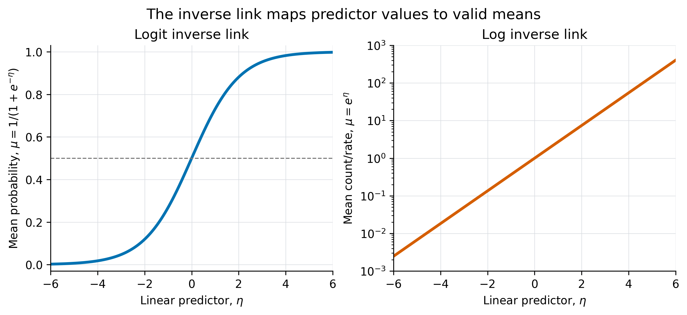
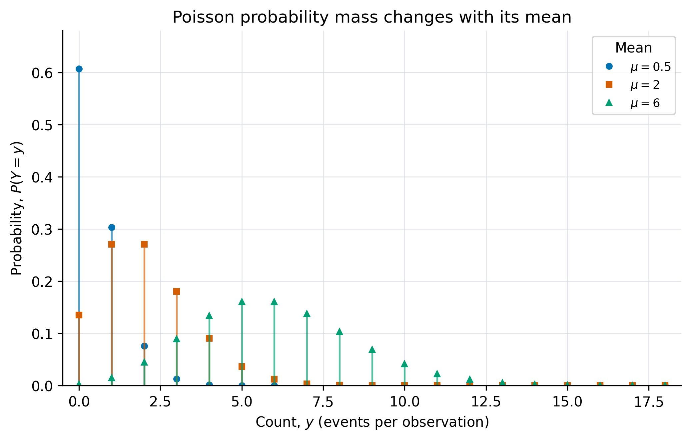
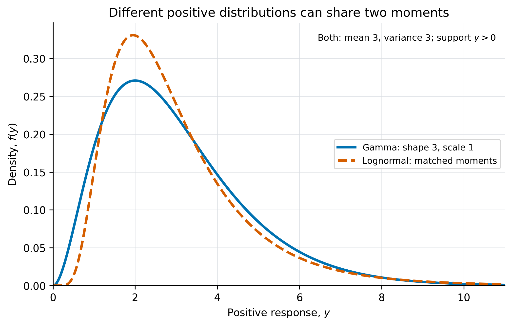
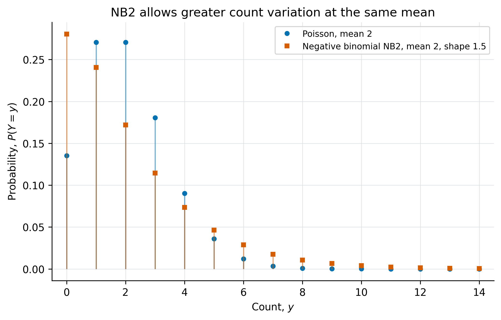
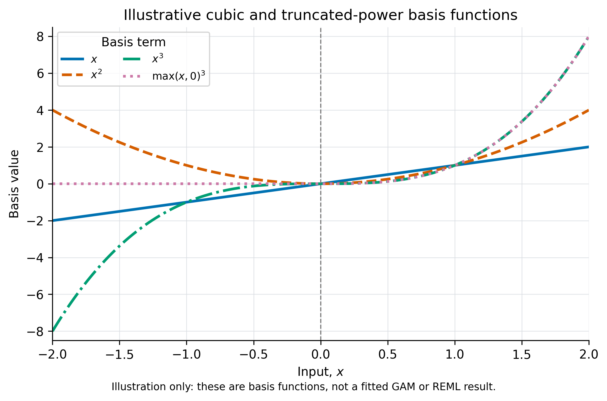
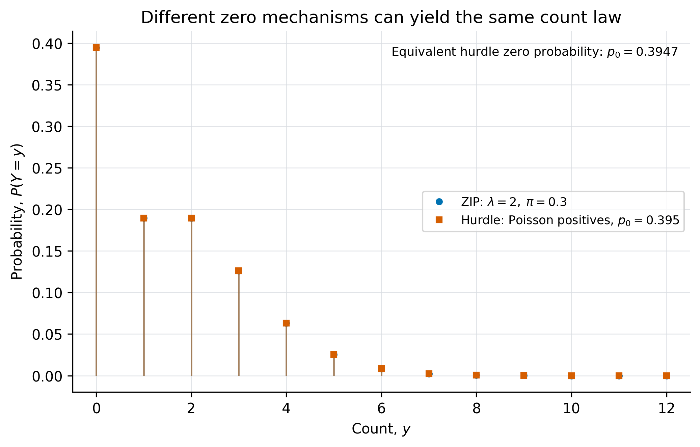
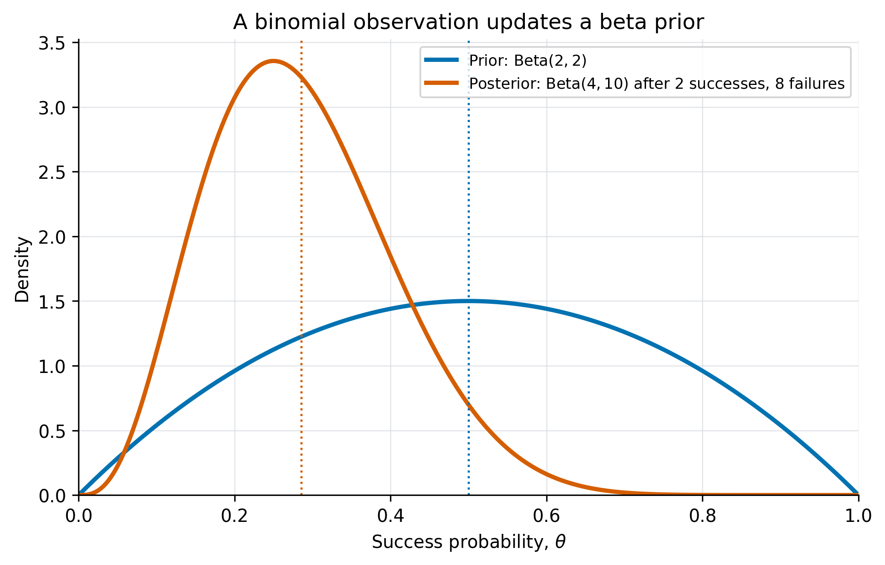

# Generalised Linear Models: How the Pieces Fit Together

## Introduction {#orientation}

An ecologist visits streams and records the number of salamanders seen. Another researcher weighs adult penguins and asks how body mass varies among species. A third wants to predict whether a survey will detect a species at all. Each has observations and predictors, but the observations do not have the same possible values. Counts are non-negative integers, detection is binary, and a measured body mass is positive and continuous. A model that ignores these distinctions may predict an impossible value or give uncertainty that does not describe the measurement process.

Generalised linear models, or GLMs, combine three decisions: a probability distribution for an observation, a systematic predictor built from its covariates, and a link connecting that predictor to the conditional mean. This primer explains why each decision exists, how the pieces determine a fit and its interpretation, and what to do when the assumptions fail.

The running setting is ecological monitoring, but no ecology background is required. A *site* is a location selected for study, a *visit* is a sampling occasion, and a *detection* means that an organism was recorded during that visit. A non-detection need not mean the organism was absent: an observer may miss it. Likewise, a recorded count need not equal the number present. Small hypothetical calculations can be checked by hand.

You should be comfortable with algebra, logarithms, elementary probability, derivatives, and the idea of a matrix. We refresh each tool as it becomes necessary. Read the main route in order: the later extensions build on problems exposed by the core models and return their results to the ecological question. R is the primary language. Complete examples and matched implementations in Python and Julia are described alongside the published example files; a code fragment is a teaching illustration unless its execution is recorded in the example manifest. The following cases use calculations and checks together.


The route moves from a question and ordinary regression to four response models, then explains fitting, uncertainty and model checking. Count extensions address different discrepancies: variability, shared sites, nonlinear means and zeros. These components can coexist, as the later [combined case](#combined-count-case) shows. The [categorical](#categorical-responses) and [Bayesian](#bayesian-models) chapters are optional branches for those response types and inferential questions; the synthesis returns to the decisions made along the way.

The cases do not all use the same observations. Penguins are a real positive-measurement study; Salamanders are a separate real repeated-count study. Neither observational study should be treated as a causal experiment. The Gamma holdout, the independent negative-binomial sample, the eight-site mixed-model illustration, the zero-process experiment and the combined monitoring survey are separately generated simulations. Their known mechanisms help diagnose a model; none establishes how the real studies were generated.

Keep a short analysis ledger as you read. For the penguins, the question is a species-specific mass mean and a future individual measurement; 342 rows supply both, while a sex comparison uses 333. For the real GP salamanders, a visit-level recorded count is nested in a site; the initial Poisson fit and later NB comparison use 92 visits at 23 sites, and evaluating predictions for new sites requires holding entire sites out. The independently simulated Gamma and count cases below have their own rows and validation splits. A result from one case is not a measurement from another.

### Computation and Data Files {#computation-and-data-files}

R carries the main narrative. The companion scripts in `examples/` include
matched R, Python and Julia implementations of the four core families,
fixed-dispersion negative binomial fitting and a fixed-penalty spline. These
are deliberately small algorithms checked against stated reference results;
they are not replacements for general-purpose statistical software. More
specialised examples use R. Package-specific snippets explicitly marked
illustrative require their stated dependencies and are not covered merely
because a different example passed.

The two real studies are separate from the synthetic monitoring programme.
See [data provenance](data/README.txt) for the frozen sources, reuse
records and transformations, and [example instructions](examples/README.txt)
for commands and execution limits. From the repository root, `just examples
glm` runs the registered examples in the pinned containers. A registered
example checks its particular calculation; it does not establish ecological
adequacy or validate every formula in this document.

*Verified against primary sources for cited dataset descriptions and statistical method and software reference summaries; unverified claims are flagged inline.*

### Notation {#notation}

The table introduces the symbols used in the main route. Additional symbols are defined where needed; a subscript identifies an observation, not an exponent.

| Symbol | Meaning | First Use |
|---|---|---|
| $i$, $n$ | Observation index and number of observations | Sampling and regression |
| $Y_i$, $y_i$ | Random response and its observed value | Conditional mean |
| $\mathbf{x}_i$, $\mathbf{X}$ | Predictor vector for observation $i$ and design matrix | Linear predictor |
| $\boldsymbol{\beta}$ | Vector of regression coefficients | Linear predictor |
| $\mu_i$ | Conditional mean of response $i$ | Conditional mean |
| $\eta_i$ | Linear predictor for observation $i$ | GLM components |
| $g$, $g^{-1}$ | Link and inverse-link functions | GLM components |
| $\phi$ | Dispersion parameter in a specified family | Exponential family |
| $\theta$, $b$, $a$, $c$ | Canonical parameter and functions in an exponential-family density | Exponential family |
| $\ell$, $\mathbf{U}$, $\mathbf{I}$ | Log likelihood, score and expected information | Fitting |
| $\mathbf{W}$, $\mathbf{z}$ | Working weights and response for a fitting iteration | IRLS |
| $p_i$, $m_i$ | Success probability and number of binomial trials | Binary and grouped data |
| $t_i$, $r_i$ | Positive exposure and rate per exposure unit | Count offsets |
| $\widehat{\cdot}$ | Estimate computed from observed data | Estimation |
| $\kappa$ | Negative-binomial shape, or explicitly declared fixed beta concentration | Dispersion models / Bayesian hierarchy |
| $\mathbf{b}$, $\mathbf{G}$ | Latent group effects and their covariance | Multilevel models |
| $\lambda$, $\mathbf{S}$ | Smoothing strength and penalty matrix | Smooth effects |
| $\pi$, $q$ | Structural-zero mixture probability and hurdle positive-count probability | Zero processes |
| $K$, $\tau_k$ | Number of categories and ordered thresholds | Categorical responses |

Vectors and matrices are bold; the transpose $\mathbf{x}_i^{\top}$ turns a column vector into a row. We use $\log$ for the natural logarithm. A probability law is a model for uncertainty, not a promise that nature generated the data exactly according to that law.

## From an Ecological Question to Regression {#regression-foundations}

Before choosing a formula, identify what was sampled and what you want the model to say. A question about average recorded counts on future visits is different from a question about the number of animals present, and both differ from a claim that mining caused a change. The first may be described by a count regression; the second needs assumptions about detection; the third also needs a design or causal assumptions that address confounding.

### Observations, Means, and Predictions

Let $Y_i$ be a response from a sampled unit with predictors $\mathbf{x}_i$. Its conditional mean is $\mu_i=\operatorname{E}(Y_i\mid\mathbf{x}_i)$: the average the model assigns to observations with those predictor values. An observed $y_i$ is one realised value, not the mean itself. For a count, a fitted mean of 1.4 is a valid expectation even though no visit produces 1.4 salamanders. For binary detection, a mean of 0.7 is a modelled probability, not a prediction that a single observation will be 0.7.

The word *conditional* matters. If habitat and season both influence the response, the mean for one habitat at a specified season differs from an average over the mix of seasons in a population. State which population, site, visit, season, and measurement process your prediction concerns. A model may estimate an association within the observed sample and still fail to predict a different region or answer a question about an intervention.

Imagine that each independent site contributes one measured water-quality value and one salamander count. If the monitoring team selects easily accessible sites, an average over those sites need not represent remote streams. If the same site is visited four times, there are four observations but not four independent sites. The distinction affects both how much information the data provide and how we should split them for validation.

### Ordinary Regression and Its Design Matrix

For a continuous response, ordinary linear regression starts with a mean that is linear in its coefficients. For example, with centred temperature $x_i$ and an indicator $h_i$ equal to one for a restored site and zero for a reference site, write

$$
\mu_i=\beta_0+\beta_1x_i+\beta_2h_i+\beta_3x_i h_i.
$$

Here the intercept is the reference-site mean at the centring temperature; $\beta_1$ is its temperature slope. The restored-site mean differs by $\beta_2$ at that temperature, and its slope is $\beta_1+\beta_3$. The interaction does not say that the habitat difference is always $\beta_2$: it is $\beta_2+\beta_3x_i$. Centring temperature changes the intercept and the point at which the habitat coefficient is interpreted, while preserving fitted values if the model is otherwise unchanged.

Suppose the coefficients are 10, 2, 3, and -0.5 in the units of the measurement. At $x_i=2$, the reference mean is 14 and the restored mean is $10+4+3-1=16$. The difference is 2, not 3. An interaction is useful when a scientific comparison may change with a predictor; it also requires data with enough overlap across predictor values to support that comparison.

The same model can be written $\mu_i=\mathbf{x}_i^{\top}\boldsymbol{\beta}$ with $\mathbf{x}_i=(1,x_i,h_i,x_i h_i)^{\top}$. Stack rows to form the design matrix $\mathbf{X}$. A categorical variable with three levels can be represented by an intercept and two indicator columns. The omitted level is the reference; choosing another reference changes the coefficients' labels and values, not the fitted model space. A numerical code such as 1, 2, 3 would instead impose equal spacing and an ordering unless converted to categories.

Given a response vector $\mathbf{y}$, ordinary least squares chooses coefficients to minimise $\|\mathbf{y}-\mathbf{X}\boldsymbol{\beta}\|^2$. If $\mathbf{X}$ has full column rank, the normal equations are $\mathbf{X}^{\top}\mathbf{X}\widehat{\boldsymbol{\beta}}=\mathbf{X}^{\top}\mathbf{y}$. This equation explains the solution; in computation, a QR factorisation is generally preferable to explicitly inverting $\mathbf{X}^{\top}\mathbf{X}$, which can magnify conditioning problems. Rank deficiency means that at least one column is a linear combination of others: the data cannot distinguish every coefficient in the chosen parameterisation. Dropping a redundant column can yield estimable predictions for observed combinations, but it does not create information for an unobserved combination.

For conventional Gaussian regression we add $Y_i\mid\mathbf{x}_i\sim N(\mu_i,\sigma^2)$ independently, with constant positive variance $\sigma^2$. The mean model and the noise model make different promises. A least-squares fit can be computed without normality, but ordinary normal-theory intervals and likelihood comparisons require their respective assumptions or an appropriate alternative. A confidence interval for a mean reflects uncertainty about the fitted mean; a prediction interval for a new observation also includes variation around it. Even a perfectly known mean does not make future measurements identical.

**Checkpoint.** With the four-column design above, what is the row for a restored site at $x=2$, and which number does it multiply to obtain the habitat difference? The row is $(1,2,1,2)$: its habitat terms contribute $\beta_2+2\beta_3$. If the coefficients were known exactly, that would determine the model mean, but a new measurement would still vary around it.

### Three Levels and an Interaction in Rows

Suppose habitat has three categories: meadow, forest, and wetland, with meadow as reference. With continuous $x$ and a separate slope for each habitat, choose columns $(1,x,I_{\mathrm{forest}},I_{\mathrm{wetland}},xI_{\mathrm{forest}},xI_{\mathrm{wetland}})$. The design rows for meadow at $x=2$, forest at $x=2$, and wetland at $x=-1$ are respectively

$$
(1,2,0,0,0,0),\quad(1,2,1,0,2,0),\quad(1,-1,0,1,0,-1).
$$

For coefficients $(10,2,3,-1,-0.5,1)$, their mean predictors are 14, 16, and 6. The forest-minus-meadow difference at $x=2$ is $3+2(-0.5)=2$; at $x=0$ it is 3. For a GLM these are contrasts on the link scale, not necessarily differences in outcome units. The three displayed rows alone cannot identify six coefficients: there must be sufficient data spanning predictor values within each category. Even with enough rows, a category seen only at one $x$ cannot identify its own slope separately from its intercept. A change of reference category produces another full-rank basis for the same model space when all relevant columns are estimable.

### A Real Design: Penguin Mass

The [Palmer penguin data](https://allisonhorst.github.io/palmerpenguins/reference/penguins.html) contain adult measurements from three species and three islands. The packaged data come from work by Gorman and the Palmer Station Long Term Ecological Research programme; the [package authors provide source citations and reuse information](https://github.com/allisonhorst/palmerpenguins/blob/8957207b78d6ccd1b4654a9dd9c9041b657478ab/README.md). The source contains 344 records, of which 342 have body mass; sex is missing in 11 records, leaving 333 with both mass and sex. Missingness is information about the analysis, not a reason to quietly change the denominator.

On those 342 records, the observed species-by-island table has Adelie counts 44, 56, and 51 on Biscoe, Dream, and Torgersen; Chinstrap occurs only on Dream (68), and Gentoo only on Biscoe (123). An intercept, species, island, and all interactions create nine columns, but the matrix has rank five. Missing cells cannot support all nine coefficients. The additive species-plus-island matrix has rank five of five because the observed overlap connects the levels, but the fit still relies on the additive assumption and the particular observations. Full rank is not proof that species and island effects have been causally separated.

The following complete R example examines the intended rows and checks rank. The file is the frozen curated package dataset; paths are relative to this primer's directory.

```{#cb1 .r}
penguins <- read.csv("data/penguins.csv", na.strings = "NA")
penguins$species <- factor(penguins$species,
                           levels = c("Adelie", "Chinstrap", "Gentoo"))
penguins$island <- factor(penguins$island,
                          levels = c("Biscoe", "Dream", "Torgersen"))
p <- subset(penguins, !is.na(body_mass_g) & !is.na(species))
stopifnot(nrow(p) == 342)
table(p$species, p$island)
X <- model.matrix(~ species * island, data = p)
c(rank = qr(X)$rank, columns = ncol(X))
g <- lm(body_mass_g ~ species, data = p)
d <- p  # Same 342 analysis rows for later nested-model comparisons.
coef(g)
```
The fitted species means are approximately 3,701 g for Adelie, 3,733 g for Chinstrap, and 5,076 g for Gentoo. These describe the sampled adults under the stated model, not a controlled species experiment. Variation in sex, sampling, time, and location remains relevant. Later we compare a Gaussian and a Gamma model on exactly these same 342 rows rather than confusing a change of family with a change of sample.

The same 342 penguins with observed mass and species make the distinction between a confidence interval for a mean and a prediction interval for one new observation concrete. Use the fitted model `g` above, with Adelie as the reference, and request predictions at `species = "Adelie"`. The fitted Adelie mean is 3,700.7 g. Under the model's independent Gaussian errors with common variance, the 95% confidence interval for that population mean is approximately 3,626.7–3,774.7 g; the 95% prediction interval for one further Adelie penguin is 2,788.4–4,613.0 g. Both use the same fitted coefficients, residual standard deviation and 339 residual degrees of freedom. The second interval is much wider because it includes individual variation in addition to estimation uncertainty. These are model-based intervals for a comparable future observation, not evidence that all penguins in a wider population are represented by this sample.

```{#cb2 .r}
new <- data.frame(species = factor("Adelie", levels = levels(d$species)))
predict(g, new, interval = "confidence", level = 0.95)
predict(g, new, interval = "prediction", level = 0.95)
```
The precision of the mean interval should not be mistaken for a narrow distribution of individual masses. The common Gaussian variance and independent sampling assumptions need scrutiny; uneven species–island coverage, missing values and the observational design limit generalisation. A new group, location, season or protocol could have additional variation not represented by this prediction interval.

The descriptive figure shows the sampled measurements before any regression fit.

{#fig-penguin-measurements width=85%}

## How a Generalised Linear Model Fits Together {#glm-components}

A GLM retains the design matrix and linear combination from ordinary regression, but it separates that combination from the mean and gives the response a distribution appropriate to its support. This division lets us ask what changes when we change the family, the link, or the predictors, instead of treating a named regression as an indivisible recipe.

<a id="distribution-predictor-and-link"></a>
<a id="toc-distribution-predictor-and-link"></a>

### From Design Row to Response Mean

For each observation, the systematic predictor is $\eta_i=\mathbf{x}_i^{\top}\boldsymbol{\beta}$, possibly with a known offset added. The response distribution describes the conditional variation around its mean $\mu_i$. The link relates the two:

$$
g(\mu_i)=\eta_i,\qquad \mu_i=g^{-1}(\eta_i).
$$

Take a design row $\mathbf{x}=(1,2)^{\top}$ and coefficients $\boldsymbol{\beta}=(-1,0.5)^{\top}$. The linear predictor is $-1+2(0.5)=0$. With a logit inverse link, the response mean is the detection probability $1/(1+e^0)=0.5$; with a log inverse link it is the expected count $e^0=1$. Now increase the covariate from 2 to 3, keeping the coefficients fixed. The new predictor is $-1+3(0.5)=0.5$: the logit model gives probability $e^{0.5}/(1+e^{0.5})\approx0.622$, while the log-linked count model gives mean $e^{0.5}\approx1.649$. The coefficient is the same change on the predictor scale, but the inverse link determines its interpretation on the response scale. These are illustrative fixed coefficients, not fitted ecological effects; an interaction or offset would change the calculation.

A Gaussian identity model has $g(\mu)=\mu$ and can assign any real mean. A Bernoulli logit model has $g(\mu)=\log\{\mu/(1-\mu)\}$ for a probability between zero and one. A Poisson log model uses $g(\mu)=\log\mu$ for a positive expected count. A Gamma log model also has a positive mean, but its continuous response and variance relationship differ from those of a Poisson count.

Consider the same numerical predictor $\eta=1$ for two different observations. With a Bernoulli logit model the mean is a probability $e/(1+e)\approx0.731$; with a Poisson log model it is an expected count $e\approx2.718$. The same predictor value therefore has different meanings after the link is inverted. Even when two families share a log link, as Poisson and Gamma can, a mean of $e$ describes a non-negative integer count in one case and a positive continuous measurement in the other. Their conditional variances also differ: the Poisson variance is $e$, while the Gamma variance is $\phi e^2$. Choosing a link controls the mean scale; choosing a family adds assumptions about possible observations and their variation. Neither choice establishes that the covariates or sampling design are adequate.

The inverse links in the next figure show how the same predictor scale maps to different mean domains.

{#fig-inverse-links width=85%}

The linearity is in the predictor and coefficients, not necessarily in the response. A log-linked mean can curve exponentially as a covariate changes. A predictor may include a squared covariate, indicator, or interaction and remain linear in the coefficients. The inverse link transforms a mean; it does not transform a realised response and then assume ordinary errors. In particular, $g\{\operatorname{E}(Y\mid X)\}$ is generally not $\operatorname{E}\{g(Y)\mid X\}$. We return to the practical consequences for positive measurements below.

### What the Distribution Adds

The mean alone does not specify the possible outcomes or their spread. Hold the conditional mean at $0.5$ in three models. A Bernoulli response can only be zero or one, with variance $0.5(1-0.5)=0.25$. A Poisson response can be any non-negative integer, with variance $0.5$. A Gamma response is continuous and strictly positive, with variance $\phi(0.5)^2=0.25\phi$ under the mean–dispersion parameterisation. For example, $\phi=2$ gives the Gamma the same variance as this Poisson, yet their supports and probabilities of individual outcomes differ: the Poisson can produce exactly zero and the Gamma cannot. Matching a mean, or even a mean and variance, does not make the distributions interchangeable.

The family supplies a probability model for outcomes around the mean; the link specifies how the mean changes with the predictor. A Poisson and a Gamma model can both use a log link, but a log-linked mean by itself does not decide whether the observation is a count or a positive measurement. Conversely, the same family can use different valid links, giving different mean curves. The family assumptions must be checked against the observation process and data; a compatible support alone does not establish the proposed variance, independence, or adequacy of the model.

The distribution and link are separate choices, although not every pairing is valid for every range of predictors. The *canonical link* makes the linear predictor equal to the exponential family's canonical parameter under its chosen parameterisation. It is useful for algebra and computation, not a requirement that makes every other link invalid or scientifically inferior. For example, Bernoulli's canonical logit and the noncanonical probit both map probabilities to a real-valued predictor; they imply different response curves.

## Probabilities, Counts, and Exposure {#probabilities-and-counts}

A probability model should respect what each row records. Is it one visit, ten trials, a count in a fixed period, or a rate observed for varying lengths of time? The answer determines the denominator and likelihood before a formula is fitted.

### Binomial Observations and the Meaning of Odds

A Bernoulli observation is one zero-or-one trial. A binomial observation is the number of successes among $m_i$ trials with common conditional probability $p_i$, under the model's independent-trial assumption. Its conditional mean is $m_i p_i$ and variance $m_i p_i(1-p_i)$. A measured fraction is not automatically binomial: a proportion of land cover, for example, need not be the result of a known count of exchangeable successes and failures. The trial count affects uncertainty even when two observed fractions are identical.

In logistic regression, a coefficient changes the log odds. If a probability is 0.2, its odds are $0.2/0.8=0.25$. An odds ratio of two changes those odds to 0.5 and the probability to $0.5/(1+0.5)=1/3$, not 0.4. At a baseline probability of 0.8, doubling the odds gives $8/9$. The same odds ratio has a different absolute probability effect at each baseline. Report predicted probabilities and their contrast for specified covariates as well as coefficients when the reader's question concerns risk or detection.

A binomial likelihood assumes the stated trials share the modelled probability and have the dependence structure assumed in the model. Four repeat visits at one site can share weather, habitat, and unmeasured occupancy; four detections are not necessarily independent Bernoulli trials. A detection model concerns what the survey records. Inferring true occupancy requires a distinct observation process and identifying assumptions; a zero in a visit is not proof of absence.

### A Binomial Likelihood You Can Calculate

Suppose a simple, deliberately idealised survey has eight independent visits under the same conditions, and three visits produce a detection. If the detection probability is $p$, the binomial likelihood is proportional to $p^3(1-p)^5$; the binomial coefficient describes the number of sequences with three successes but does not depend on $p$. At $p=0.375$, this probability model has its largest likelihood. To see why, differentiate the log likelihood $3\log p+5\log(1-p)$: its score is $3/p-5/(1-p)$, which vanishes at $p=3/8$. The second derivative is negative inside the unit interval. The data do not determine the probability without uncertainty: another set of eight visits would usually have a different count.

Now compare three detections in eight visits with 30 in 80. Both have the same maximum-likelihood estimate, 0.375. The second experiment has more information under the independent, equal-probability binomial model. Treating both fractions as equally precise discards their denominators. Conversely, multiplying a count of visits by ten on paper does not create information: if the visits are correlated or the 80 records contain repeated measurements of the same sites, the independent-trial likelihood can overstate the effective information. The data collection unit and dependence assumptions must travel with the denominator.

The following model uses successes and failures as two columns. Each row is one hypothetical group of independent visits with a shared probability; an observation of two successes from four visits contributes a different likelihood from one success in two, even though both fractions are one half.

```{#cb4 .r}
trials <- data.frame(
  habitat = factor(c("reference", "reference", "restored", "restored")),
  successes = c(1, 2, 3, 4),
  visits = c(4, 4, 4, 4)
)
trials$failures <- trials$visits - trials$successes
binomial_fit <- glm(cbind(successes, failures) ~ habitat,
                    family = binomial(link = "logit"), data = trials)
predict(binomial_fit, type = "response")
```
This is a syntax and arithmetic example, not a real study or a test of independence. The implied estimates are 3/8 for the reference group and 7/8 for the restored group. The first group's odds are $3/5$; the second group's odds are $7$. Their fitted odds ratio is $35/3$, even though the probability difference is one half. With only two group probabilities and two coefficients, the fitted means reproduce the group fractions exactly. Uncertainty and assessment of the equal-probability and independence assumptions remain essential.

**Checkpoint.** The grouped data above contain three detections in eight reference visits. If a second dataset had 30 detections in 80 independent comparable visits, both sample fractions would be 0.375, but the latter likelihood is more concentrated. The denominator records information only if those are distinct, conditionally independent trials.

### Poisson Counts and a Worked Offset

The following distributions show how the Poisson count probabilities change as the mean increases.

{#fig-poisson-means width=85%}

For a Poisson observation, the mean and variance are both $\mu_i$ under the model. With a log link, increasing a predictor by one unit multiplies the conditional mean by $e^{\beta_j}$ when other terms are fixed. If an interaction includes that predictor, its effect also depends on the interacting values. The support is a non-negative integer, but support alone does not establish a Poisson variance or independence.

Suppose an illustrative monitoring protocol records counts over different positive durations $t_i$. If a constant within-visit rate is $r_i$, then the expected count is $\mu_i=t_i r_i$. A log-linked rate regression therefore has

$$
\log\mu_i=\log t_i+\mathbf{x}_i^{\top}\boldsymbol{\beta}.
$$

The term $\log t_i$ is an *offset*: its coefficient is fixed at one, not estimated. If two visits have the same rate of 0.4 detections per hour but last two and five hours, their expected counts are 0.8 and 2.0. A comparison of raw counts would obscure their equal modelled rates. The proportionality assumption matters: doubling duration must double the expected count after conditioning on predictors. Fatigue, depletion, changing conditions, or variable detectability can violate it. Zero duration cannot be logged and usually contains no count exposure; negative duration is invalid. Model the actual effort and its units, and test the plausibility of proportionality rather than inventing a duration for a dataset that lacks one.

The following synthetic example simulates an explicit Poisson law, fixes a seed, and fits a log-rate model. It demonstrates syntax; its particular printed values are not evidence about any real survey.

```{#cb3 .r}
set.seed(467)
survey <- data.frame(
  habitat = factor(rep(c("reference", "restored"), each = 40)),
  hours = rep(c(1, 2, 3, 4), 20)
)
survey$count <- rpois(nrow(survey), survey$hours *
                        ifelse(survey$habitat == "restored", 1.5, 1))
count_fit <- glm(count ~ habitat + offset(log(hours)),
                 family = poisson(link = "log"), data = survey)
summary(count_fit)
exp(coef(count_fit))
```
The intercept's exponent is a rate for the reference habitat in the chosen unit; the other exponent is a rate ratio. A new visit's expected count requires both its predicted rate and its duration. To forecast an actual count, include the assumed count distribution and uncertainty in fitted parameters; a confidence interval for the rate is not itself a prediction interval for the count.

**Checkpoint.** Two visits of one and four hours have the same expected rate of 0.8 recorded events per hour. Their expected counts are 0.8 and 3.2. The second is four times the first because the offset assumes proportionality to recorded effort; it is not evidence that detection is constant within a visit.

### A Poisson Likelihood and Its Assumptions

Suppose independent counts $y_i$ are observed at equal known exposure and the model assigns all of them the same Poisson mean $\mu$. Leaving the factorial terms visible, the log likelihood is $\sum_i\{y_i\log\mu-\mu-\log(y_i!)\}$. Its derivative is $\sum_i y_i/\mu-n$, so an interior maximum has $\widehat\mu=\sum_i y_i/n$. Thus the sample mean is not an arbitrary summary here: it is the maximum-likelihood estimate under this particular model. If all counts are zero, the maximum occurs at the boundary $\mu=0$; a finite log-mean parameter does not attain it, although it can approach it.

With unequal known exposure, the intercept-only rate estimate is total events divided by total exposure. For instance, counts 1 and 3 over one and three hours give a fitted rate of one event per hour, not the unweighted mean of the two observed hourly rates by accident or convention. With covariates the fitted rate changes across observations, and the corresponding coefficient score must be solved jointly. If effort is unknown, replacing it with an assumed constant can confound rate with time spent looking.

A Poisson model can arise from a constant-rate process with independent increments, but ecological counts may violate these conditions through aggregation, dependence, varying detection, or unobserved habitat differences. A good fit to the average does not prove the underlying event process.

## Positive Measurements and the Meaning of a Transformation {#positive-measurements}

A positive measurement calls for a choice about both the response distribution and the quantity being modelled. We first compare a Gamma mean model with regression on transformed measurements, then examine the Gamma density and its implications.

### Gamma and Log-Transformed Measurements

A positive continuous outcome can have variability that grows with its mean. A Gamma model is one way to represent that pattern; it is not justified simply because all values happen to be positive. Its conditional density is supported on positive values. In a common mean–dispersion parameterisation, $\operatorname{Var}(Y_i\mid\mathbf{x}_i)=\phi\mu_i^2$ for $\phi>0$. A log link sets $\mu_i=\exp(\mathbf{x}_i^{\top}\boldsymbol{\beta})$. A one-unit coefficient change multiplies the conditional arithmetic mean by $e^{\beta_j}$, subject to interactions and the other terms being fixed.

Contrast this with fitting an ordinary Gaussian regression to $\log Y$. That model describes the mean of the transformed outcome, $\operatorname{E}(\log Y\mid X)$, rather than the log of its arithmetic mean. If $\log Y$ is normal with conditional mean $m$ and variance $s^2$, then $\operatorname{E}(Y\mid X)=e^{m+s^2/2}$, while $e^m$ is the conditional median. For $m=0$ and $s^2=1$, those are approximately 1.649 and 1. The nonlinearity of the exponential causes the distinction; Jensen's inequality tells us that transforming an average and averaging transformed values need not agree. If the log-scale variance changes with covariates, a single retransformation factor is not generally adequate. A Gamma/log fit and a lognormal fit both preserve positive support but specify different distributions, variance structures, and interpretations.

Return to `p`, the same 342 penguins prepared in the regression section. Fit Gaussian identity and Gamma log with the same species predictor; the data do not change when the family changes:

```{#cb5 .r}
normal_mass <- glm(body_mass_g ~ species, family = gaussian(), data = p)
gamma_mass <- glm(body_mass_g ~ species, family = Gamma(link = "log"), data = p)
new_species <- data.frame(species = factor(c("Adelie", "Chinstrap", "Gentoo"),
                                         levels = levels(p$species)))
data.frame(species = as.character(new_species$species),
      gaussian_g = predict(normal_mass, new_species, type = "response"),
      gamma_g = predict(gamma_mass, new_species, type = "response"))
```
Both fits reproduce the three group means here because the species-only predictor supplies one mean per species. Equal fitted means do not make their assumptions, likelihoods, residuals, or prediction intervals the same. The Gaussian fit's estimated residual standard deviation is about 462 g; the Gamma dispersion estimate is about 0.0124 in the stated variance parameterisation. Neither result by itself selects a family. A check of residual behaviour, influential individuals, and predictive performance is needed. If sex is added, use the explicitly defined 333 complete records for both candidate models or explain why their samples differ. In that subset a Gaussian additive model estimates a male-minus-female difference of about 668 g conditional on species; a Gamma/log fit estimates a male log ratio of 0.159, or a mean ratio of about 1.17. The different scales answer different questions, and neither coefficient alone establishes a causal effect of sex.

A Gamma response cannot include exact zeros. A recorded zero could represent a true value, censoring below a detection limit, rounding, or a separate process; the scientific distinction determines a defensible model. Adding an arbitrary constant solely to make a logarithm work changes the model and the question. A two-part model may be useful for some zero-plus-positive outcomes, but a data-processing trick does not establish a two-process mechanism.

**Checkpoint.** Under a lognormal measurement model with $m=0$ and $s^2=1$, exponentiating the mean log measurement gives the median, 1; the arithmetic mean is $e^{1/2}\approx1.649$. This correction requires the assumed conditional lognormal model. A Gamma/log model links its arithmetic mean directly and makes a different variance claim.

### The Gamma Density and Its Consequences

For a positive response, choose shape $k=1/\phi$ and scale $\phi\mu$, with both $\phi$ and $\mu$ positive. The density at $y>0$ is

$$
f(y\mid\mu,\phi)=\frac{y^{1/\phi-1}e^{-y/(\phi\mu)}}{\Gamma(1/\phi)(\phi\mu)^{1/\phi}}.
$$

The shape and scale imply mean $\mu$ and variance $\phi\mu^2$. If a hypothetical fitted mean is 10 g and $\phi=0.25$, the shape is 4, the scale is 2.5 g, the variance is 25 square grams, and the response standard deviation is 5 g. If a log-linked coefficient is $\log 2$ for a one-unit predictor increase, the mean doubles to 20 g, the variance becomes 100 square grams, and the response standard deviation becomes 10 g. This relative spread follows from the model; it is a testable modelling implication, not a physical law. A coefficient uncertainty interval would add uncertainty about the mean, while these response standard deviations condition on fixed parameters.

The next figure compares two positive-response distributions with the same first two moments.

{#fig-positive-distributions width=85%}

In the standard exponential-family representation the natural parameter is $-1/\mu$ with scale $\phi$, so the canonical relationship is an inverse mean with a sign determined by convention. Software often calls the positive reciprocal $1/\mu$ an inverse link; an unconstrained linear predictor under either sign must still give an admissible positive mean. The log link is noncanonical but maps every real predictor to a positive mean, and its coefficients express multiplicative changes. A fit with the log link still maximises the Gamma likelihood for its specified shape and mean; the link does not transform each observed mass into a Gaussian outcome.

For a fixed dispersion, the density says how a proposed mean assigns relative support to each positive measurement. Fitting the mean and dispersion uses all observations, not only whether they are positive. A diagnostic should compare the implied mean-dependent spread and tail with observations, consider measurement precision and zero mechanisms, and examine whether independent observations are plausible. A Gamma model can fit the mean adequately while misrepresenting its tails or vice versa. The [R family documentation](https://stat.ethz.ch/R-manual/R-devel/library/stats/html/family.html) specifies the supported link choices and implementation conventions.

The independently simulated diagnostic and held-out repair below return to this Gamma mean and variance model.

**Checkpoint.** A positive response has conditional mean $\mu=4$. A Poisson law is a model for an integer count with variance 4; Gamma with $\phi=0.25$ is a model for a positive continuous measurement with variance $0.25(4^2)=4$. Matching the first two moments at one mean does not make their support or density the same. A log link can be used for either conditional mean; it does not make their observations interchangeable.

The matched fixed-design calculations for the four core families are available in [R](examples/core.R), [Python](examples/core.py) and [Julia](examples/core.jl). They compare bounded calculations on common inputs; the translations are teaching algorithms, not a claim of equivalent production package fits.

## Likelihood, Fitting, and the Working Least-Squares Step {#glm-fitting}

The binomial example chose $p=3/8$ because it gave the observed result the greatest likelihood. A regression makes the same choice jointly for coefficients: a model becomes a fitted model when data are used to choose its unknown parameters. The likelihood measures the relative support that the specified probability model assigns to different parameter values for the observed data. It is a function of the parameters with the observations held fixed; it is not, by itself, a probability distribution over parameters.

### Why the Exponential Family Is Useful

A conventional GLM uses a response distribution expressible in an exponential-family form. For a scalar observation, write its probability mass or density as

$$
f(y_i;\theta_i,\phi)=\exp\left\{\frac{y_i\theta_i-b(\theta_i)}{a(\phi)}+c(y_i,\phi)\right\}.
$$

Here $\theta_i$ is a canonical parameter, $\phi$ is a dispersion parameter where the family has one, and $a$, $b$, and $c$ are functions chosen for the distribution and parameterisation. Known prior weights can change the denominator; we use the common unweighted form for this derivation. The formula covers densities and probability masses with respect to an appropriate base measure; it does not say a continuous density is itself a probability at one exact value.

Assume the support does not depend on $\theta_i$ and differentiation can pass through the normalising integral or sum. Differentiating the log density gives the score for $\theta_i$, $(y_i-b'(\theta_i))/a(\phi)$. Its expectation is zero under the model, so $\mu_i=b'(\theta_i)$. A second differentiation, or the score variance identity under the same regularity conditions, gives $\operatorname{Var}(Y_i)=a(\phi)b''(\theta_i)$. This is the mechanism by which a family supplies a mean–variance relationship. It is not a general formula for arbitrary distributions or non-regular support.

To see the first identity rather than memorise it, the log-density derivative is $(y-b'(\theta))/a(\phi)$. The integral of the density is one for each admissible $\theta$; differentiating that identity under the stated regularity conditions gives an expected score of zero. Therefore $E(Y)-b'(\theta)=0$. Differentiating again gives expected negative curvature $b''(\theta)/a(\phi)$; equating it to the score variance gives $\operatorname{Var}(Y)/a(\phi)^2=b''(\theta)/a(\phi)$. The assumption about exchanging differentiation and integration is doing real work here.

For a Poisson observation, $\theta=\log\mu$, $b(\theta)=e^\theta$, and $a(\phi)=1$. Thus both mean and variance are $e^\theta=\mu$. The canonical link is the log. For a Bernoulli observation, $\theta=\log\{p/(1-p)\}$ and $b(\theta)=\log(1+e^\theta)$, giving mean $p$ and variance $p(1-p)$. The Gaussian family with fixed variance has an identity canonical link. A Gamma distribution can also be put in exponential-family form; its canonical link is an inverse-mean form, whereas the log link used in the positive-response example is noncanonical and often convenient for multiplicative interpretation. A scale factor and sign convention must be stated when comparing canonical parameter definitions.

A distribution's variance relationship is a model restriction. If observed counts vary substantially more than the Poisson model predicts, a Poisson mean may still be useful, but its likelihood-based uncertainty and predictive distribution may be misleading. [Dispersion models](#dispersion-models) examine quasi-likelihood and negative binomial alternatives; [multilevel models](#multilevel-models) address a different possible source of variation, shared site effects. These explanations can coexist, so checking one does not automatically settle the other.

### From Likelihood to Score and Information

For independent observations with fitted means determined by coefficients, multiply their model probabilities or densities. The log likelihood $\ell(\boldsymbol{\beta})$ converts that product to a sum. Maximum likelihood chooses a parameter value that maximises the sum, provided a finite, identifiable maximum exists. The score $\mathbf{U}=\partial\ell/\partial\boldsymbol{\beta}$ is its gradient; the expected information $\mathbf{I}$ is the negative expected Hessian, measuring local curvature under regularity conditions. Near a well-behaved maximum, more curvature generally means more information about a parameter combination. It does not protect against confounding, a wrong model, or a maximum at infinity.

For independent Bernoulli observations with canonical logit, $p_i=1/(1+e^{-\mathbf{x}_i^{\top}\boldsymbol{\beta}})$. Ignoring no terms that depend on the coefficients, the log likelihood, score, and expected information are

$$
\ell=\sum_i\{y_i\log p_i+(1-y_i)\log(1-p_i)\},\quad
\mathbf{U}=\mathbf{X}^{\top}(\mathbf{y}-\mathbf{p}),\quad
\mathbf{I}=\mathbf{X}^{\top}\mathbf{W}\mathbf{X},
$$

where $\mathbf{W}$ is diagonal with entries $p_i(1-p_i)$. The score compares observed outcomes with fitted probabilities, multiplied by the design columns. The weights are largest at probability one half and approach zero near either boundary. For the canonical Bernoulli logit, this expected information is also the observed negative Hessian. Other family–link combinations need not have that equality.

### One Logistic IRLS Iteration by Hand

Consider four independent hypothetical binary detections. The first two have $x=0$, the second two $x=1$, and the outcomes are $(0,1,1,1)$. Fit an intercept and slope, starting both coefficients at zero. Every initial predictor is zero and every initial probability is one half. With rows $(1,x_i)$, the score is $(1,1)^{\top}$: one more success was observed overall than the two expected, and one more success was observed in the $x=1$ group than the one expected.

Each initial weight is $1/4$. Therefore the information matrix and its inverse are

$$
\mathbf{I}=\begin{pmatrix}1&1/2\\1/2&1/2\end{pmatrix},\qquad
\mathbf{I}^{-1}=\begin{pmatrix}2&-2\\-2&4\end{pmatrix}.
$$

The Fisher-scoring update adds $\mathbf{I}^{-1}\mathbf{U}=(0,2)^{\top}$ to the old coefficients. After one step the intercept is zero and the slope is two, giving fitted probabilities 0.5 at $x=0$ and approximately 0.881 at $x=1$. This is an iteration, not the final fit. All observed $x=1$ responses are successes; in this tiny example the unpenalised slope has no finite maximum, so repeated iterations do not settle on a finite estimate. A numerical stopping message alone cannot repair that statistical boundary.

The same update is a weighted least-squares calculation. At a current iterate, define the working response $z_i=\eta_i+(y_i-p_i)/\{p_i(1-p_i)\}$. Here it is $(-2,2,2,2)$ and each weight is $1/4$. Regressing these working responses on the intercept and $x$ with those weights yields the same new coefficients $(0,2)^{\top}$. The algorithm updates the probabilities, weights, and working responses, then repeats: hence *iteratively reweighted least squares*, or IRLS. The working response is an algebraic device on the predictor scale; it is not a newly observed biological measurement. Small weights near zero or one explain why extreme fitted probabilities can make curvature weak and estimation unstable.

More generally, with a differentiable inverse link and conditional variance $\operatorname{Var}(Y_i)=\phi V(\mu_i)$, the working response is $z_i=\eta_i+(y_i-\mu_i)/(d\mu_i/d\eta_i)$ and weights are proportional to $(d\mu_i/d\eta_i)^2/\{\phi V(\mu_i)\}$. These formulae require a nonzero derivative and finite, valid variance at the current mean. In practice, use a stable linear solve, inspect convergence and rank, and recognise that a noncanonical link can make a Newton step differ from Fisher scoring. The original GLM formulation connects exponential-family responses and iterative weighted regression; see [Nelder and Wedderburn](https://doi.org/10.2307/2344614) and the [R `glm` documentation](https://stat.ethz.ch/R-manual/R-devel/library/stats/html/glm.html).

<span id="why-the-irls-weights-take-their-form" style="display:block;scroll-margin-top:calc(var(--nav-h) + 1rem)"></span>

The working weights are not arbitrary importance scores. They follow from the way a change in a coefficient changes the mean and thus the likelihood. For independent observations in the unweighted exponential-family form above, take $a(\phi)=\phi$ and write $V(\mu_i)=b''(\theta_i)$. The chain rule gives $d\mu_i/d\theta_i=V(\mu_i)$ and $d\eta_i/d\beta_j=x_{ij}$. Consequently the score for coefficient $j$ is

$$
U_j=\sum_i x_{ij}\frac{y_i-\mu_i}{\phi V(\mu_i)}\frac{d\mu_i}{d\eta_i}.
$$

The expected information follows from the covariance of these scores under the independent model. In matrix form it is $\mathbf{X}^{\top}\mathbf{W}\mathbf{X}$, with $w_i=(d\mu_i/d\eta_i)^2/\{\phi V(\mu_i)\}$. The weight increases where changing the predictor moves the mean substantially relative to its variance. It does not mean an individual is more valuable, and it changes as the fitted means change. Known observation weights and binomial denominators need their own representation; do not multiply by a trial count twice.

Let a known offset be $o_i$, so $\eta_i=o_i+\mathbf{x}_i^{\top}\boldsymbol{\beta}$. Fisher scoring solves $\mathbf{X}^{\top}\mathbf{W}\mathbf{X}\,\Delta\boldsymbol{\beta}=\mathbf{U}$ and sets the new coefficients to the old ones plus $\Delta\boldsymbol{\beta}$. Defining $z_i=\eta_i+(y_i-\mu_i)/(d\mu_i/d\eta_i)$ converts the update into the working weighted least-squares normal equations

$$
\mathbf{X}^{\top}\mathbf{W}\mathbf{X}\boldsymbol{\beta}_{\mathrm{new}}
=\mathbf{X}^{\top}\mathbf{W}(\mathbf{z}-\mathbf{o}).
$$

The known offset remains in the working predictor; it is subtracted from the working response when solving for the free coefficients. It is never fitted as another free column. The same equations can be solved with a stable weighted QR factorisation without explicitly forming an inverse. An iterate may require step control or fail to exist if the matrix is singular.

The bridge to weighted least squares follows by substituting $z-\eta=(y-\mu)/(d\mu/d\eta)$ into $X^{\top}W(z-\eta)$. With the stated weights this is the score, so $X^{\top}WX\Delta\beta=U$ becomes $X^{\top}WX\beta_{\mathrm{new}}=X^{\top}W(z-o)$. In the four-observation example, $z=(-2,2,2,2)$ and $W=I/4$. The two columns of $X$ sum the weighted working responses to $(1,1)$; solving the previously displayed information system yields $(0,2)$. This is the same first scoring step, not a second fit to new observations.

**Checkpoint.** If two grouped rows have the same fraction and current probability but the second has twice as many independent trials, their working responses are the same. Its weight doubles: under the binomial assumptions the larger denominator supplies more information, not a different observed proportion.

For a Gaussian identity model, $d\mu/d\eta=1$ and $V=1$, giving constant weight $1/\phi$. For a Bernoulli logit model, $d\mu/d\eta=p(1-p)$ and $V=p(1-p)$, giving $p(1-p)$. For a Poisson log model, both derivative and variance function are $\mu$, giving weight $\mu$. For Gamma/log with variance $\phi\mu^2$, the derivative is $\mu$ and the weight is the constant $1/\phi$. These apply to individual observations under the specified parameterisations. A common positive multiplier in all weights does not change a weighted least-squares coefficient update, but dispersion still affects uncertainty.

For a grouped binomial row with $m=10$, observed success fraction $0.7$, and current probability $p=0.4$, use the fraction as response and its variance $p(1-p)/m$. The working response is $\operatorname{logit}(0.4)+(0.7-0.4)/(0.4\cdot0.6)\approx0.8445$, and its weight is $m p(1-p)=2.4$. A second row with the same observed fraction and $m=20$ has the same working response but weight 4.8. These weights encode independent trials with a common probability, not a guarantee that the trials were actually independent.

### Separation and Penalisation

If predictors perfectly separate successes from failures, coefficients can diverge while fitted probabilities approach zero or one. This is a property of the unpenalised likelihood, not evidence for a scientifically infinite effect. Near separation, a finite but very large estimate and standard error can be just as misleading. Examine cross-tabulations, coefficient magnitude, warnings, and fitted probabilities rather than checking only whether the solver stopped.

One remedy changes the objective by adding a penalty. For example, maximise $\ell(\boldsymbol{\beta})-\lambda\sum_{j\geq1}\beta_j^2/2$ with $\lambda>0$, leaving the intercept unpenalised if the implementation does so. The penalty discourages large slopes and can produce a finite estimate in a separated example, subject to the treatment of the intercept and data. It changes the estimator and objective, generally introduces regularisation bias, and requires a tuning decision; the scientific estimand need not change. Select the penalty within the training process, not on the final test set. Standard unpenalised confidence intervals do not automatically apply to a penalised estimate. Alternative bias-reduction methods and explicit Bayesian priors are different approaches, not synonyms for the same penalty; [Bayesian models](#bayesian-models) make the prior assumption visible.

Consider a related separated example: ten observations have $x=0$, with four successes and six failures, and ten have $x=1$, all successes. With an intercept and slope, the finite group probability at $x=0$ is 0.4, while increasing the slope drives the probability at $x=1$ towards one and continues to improve the unpenalised likelihood. Fitting with a maximum of 15 iterations gives a slope near 16.97; allowing 25 gives about 19.97 and predicted probabilities approximately 0.4 and 0.999999997. Software's numerical stopping rule can declare convergence even though the mathematical maximum occurs only at an infinite slope. The exact coefficient printed depends on numerical tolerance, not an identified finite effect.

For a concrete repair, minimise the negative Bernoulli log likelihood plus $\lambda(\beta_0^2+\beta_1^2)/2$, explicitly penalising the intercept as well as the slope in this illustration. With $\lambda=1$, the fitted intercept is about 0.156 and slope 1.544, giving probabilities 0.539 and 0.846 at $x=0$ and $x=1$. This is a finite estimate because the penalty makes large coefficients costly; its probability is not the unpenalised maximum-likelihood answer. The intercept was included in the penalty here to make the objective explicit, though many implementations choose otherwise. With $\lambda=0.25$ the corresponding probabilities are about 0.471 and 0.932; with $\lambda=4$ they are 0.568 and 0.724. The strength and choice of regularisation matter substantially in this small separated sample. Select and validate the penalty according to the intended prediction task, ideally within training data; extra data or a justified prior are other possible routes.

```{#cb6 .r}
x <- c(rep(0, 10), rep(1, 10))
y <- c(rep(0, 6), rep(1, 4), rep(1, 10))
X <- cbind(1, x)
unpenalised <- glm(y ~ x, family = binomial(),
                   control = glm.control(maxit = 25))
objective <- function(b, lambda) {
  eta <- drop(X %*% b)
  sum(log1p(exp(eta)) - y * eta) + lambda * sum(b * b) / 2
}
penalised <- optim(c(0, 0), objective, lambda = 1, method = "BFGS")
plogis(c(penalised$par[1], sum(penalised$par)))
```
The direct `log1p(exp(eta))` calculation is sufficient for this bounded illustration but can overflow at extreme predictors; use a numerically stable loss and a validated implementation for production. Penalisation does not repair an unrepresentative sample, unmeasured confounding or a missing observation process.

## Uncertainty, Prediction, and Model Comparison {#inference-and-validation}

A fit is the beginning of an analysis. We need to know which uncertainty is being reported, what evidence challenges the model, and whether a proposed repair answers the same scientific question. No single diagnostic converts a model into a fact.

### Coefficients, Contrasts, and Intervals

A standard error describes variation in an estimator under a stated procedure and assumptions. Near a regular, identifiable maximum and with enough information, inverse information estimates coefficient covariance. A Wald interval adds and subtracts a critical multiple of the standard error on the coefficient scale. For a log-rate coefficient, exponentiating the interval endpoints produces an interval for a rate ratio; for a logit coefficient it produces an interval for an odds ratio. Neither directly gives an interval for an absolute difference in probability.

A response-scale prediction depends on all coefficients. For a scenario $\mathbf{x}$, calculate the linear predictor and its covariance using the entire coefficient covariance matrix, then transform endpoints where a monotone inverse link makes that appropriate. For a contrast between two predictions, account for their shared estimated coefficients. Simulation from an approximate coefficient distribution or an appropriate bootstrap can carry a nonlinear contrast through the inverse link; neither replaces checking whether the approximations and resampling design are justified. Sampling sites as independent resampling units may be more appropriate than sampling individual visits when sites are the independent units.

A confidence interval is constructed by a procedure whose repeated-sampling coverage is defined under its assumptions. It is not a probability that a fixed parameter lies in the realised interval under ordinary frequentist interpretation. A prediction interval for a future observation also incorporates response variability and depends on the future unit, exposure, and distribution. For the salamanders, a future visit to an already sampled site and a visit to a new site can have different predictive uncertainties once site variation is modelled.

### Tests and Model Comparisons

A Wald test divides an estimate by its standard error. A likelihood-ratio test compares twice the difference in maximised log likelihoods of nested models; its familiar reference distribution requires conditions such as comparable data, an appropriate likelihood, and regular parameters away from problematic boundaries. A variance component at zero, separation, small samples, or data-dependent selection can invalidate a routine reference approximation. State the hypothesis and assumptions, report an effect and uncertainty, and avoid interpreting a non-significant result as proof of no effect.

Deviance compares a fitted likelihood with a saturated benchmark under a defined family; its numerical meaning depends on the response and likelihood. AIC combines maximised log likelihood and a parameter-count penalty to estimate a relative predictive criterion under assumptions. Compare AIC only for models fitted to the same response observations using commensurable, fully specified likelihoods, including consistent treatment of normalising constants and transformations. A log-transformed response requires the appropriate Jacobian before likelihoods on different response scales can be compared. Quasi-likelihood does not supply an ordinary full probability likelihood and therefore does not supply an ordinary likelihood AIC. Neither a small AIC difference nor an isolated p-value establishes a biological mechanism.

Prediction can be a separate objective from coefficient inference. Choose the estimand, the relevant loss or score, and validation unit before optimising a metric. Mean absolute error is interpretable in response units but does not test an entire predictive distribution; a log score assesses probability assigned to the held-out realised value but is sensitive to extreme overconfident predictions. Report the score's direction and handle zero assigned probabilities deliberately.

Returning to the penguin data `d` and fitted Gaussian model `g`, compare models on the same 342 rows. For a concrete nested likelihood comparison, compare the intercept-only Gaussian model with the species-means model. Both maximise their Gaussian likelihood including a common residual variance, and their log-likelihood degrees of freedom include that variance parameter. The species model adds two mean parameters: twice the fitted log-likelihood difference is 378.82, compared with a chi-squared reference distribution with two degrees of freedom, giving approximately $p=5.5\times10^{-83}$ under the usual likelihood-ratio approximation. In this sample, the common-mean model is very difficult to reconcile with the observed species differences under these model assumptions. This is not a test of whether species causes body-mass differences, nor does it validate a common variance or the sampling design.

```{#cb7 .r}
g0 <- lm(body_mass_g ~ 1, data = d)
stopifnot(nobs(g0) == nobs(g))
LR <- 2 * as.numeric(logLik(g) - logLik(g0))
df <- attr(logLik(g), "df") - attr(logLik(g0), "df")
c(statistic = LR, df = df, p_value = pchisq(LR, df, lower.tail = FALSE))
```
Use the same observations and response scale, check that the models really are nested, and state the reference distribution's regularity assumptions. If model choices were made by repeatedly inspecting these data, the nominal $p$-value does not account for that selection. For these normal models a classical equal-variance nested F test is another available procedure; its finite-sample reference and statistic are not identical to the asymptotic likelihood-ratio calculation.

<span id="comparing-likelihoods-on-the-same-measurement-scale" style="display:block;scroll-margin-top:calc(var(--nav-h) + 1rem)"></span>

A numerical comparison needs the same underlying observations and probability measure. In the synthetic Poisson example below, the two log likelihoods include the same $\log(y!)$ constants, the saturated likelihood is common, and Poisson dispersion is fixed at one. The deviance difference therefore equals twice the fitted log-likelihood difference. AIC adds $2k$ to negative twice the log likelihood, where $k$ is the number of independently estimated parameters. The comparison trades the extra parameter against the likelihood improvement; it does not turn a selected model into the data-generating truth.

For a Gaussian or Gamma likelihood, dispersion is ordinarily an estimated nuisance parameter as well as the regression coefficients. It must be counted and fitted consistently when calculating likelihoods and AIC; a residual degrees-of-freedom estimate and a maximum-likelihood dispersion estimate are not always the same. Do not manually compare a likelihood using one convention with an AIC generated under another without checking the implementation. R's model-specific likelihood and AIC details are documented in [`logLik`](https://stat.ethz.ch/R-manual/R-devel/library/stats/html/logLik.html) and [`AIC`](https://stat.ethz.ch/R-manual/R-devel/library/stats/html/AIC.html).

Suppose $Z=\log Y$ has normal density $f_Z$ and a competing model supplies a Gamma density for the original positive $Y$. The lognormal density on the original scale is $f_Y(y)=f_Z(\log y)/y$: the factor $1/y$ is the Jacobian of the change of variable. Thus the log likelihood for observed original-scale values subtracts $\sum_i\log y_i$ from the Gaussian log likelihood computed for the logs. Omitting that term makes a nominal AIC comparison mix likelihoods for different measurement scales. The adjustment does not settle whether either model is appropriate, and a sample change caused by missing values remains a separate obstacle.

The usual chi-squared likelihood-ratio approximation can be unreliable for small samples, separated logistic data, and parameters on a boundary, such as a zero random-effect variance or a zero mixture weight. Penalised fits and quasi-likelihoods also require methods matched to their objectives. A suitable simulation or bootstrap under a clearly specified null can sometimes provide a reference distribution; this costs computation and inherits the null model assumptions. Do not apply a routine degrees-of-freedom rule to every comparison merely because software prints a deviance.

### A Worked Covariance, Interval, and Prediction

Suppose a fitted logistic intercept and slope are $-1$ and $0.8$, and their estimated covariance matrix is

$$
\widehat{\boldsymbol{\Sigma}}=\begin{pmatrix}0.04&-0.015\\-0.015&0.09\end{pmatrix}.
$$

For the hypothetical prediction at $x=2$, the linear predictor is $-1+2(0.8)=0.6$. Its variance is $(1,2)\widehat{\boldsymbol{\Sigma}}(1,2)^{\top}=0.04+4(0.09)+4(-0.015)=0.34$; the standard error is approximately 0.583. The off-diagonal covariance contributes -0.06. Ignoring it would give variance 0.40, and in another fit the covariance could have the opposite sign. For a slope contrast between $x=2$ and $x=1$, the intercept cancels, so the link-scale contrast is 0.8 with variance 0.09. These are different questions and use different contrast vectors.

A 95% normal-approximation interval on the first linear predictor is $0.6\pm1.96(0.583)$. Applying the logistic inverse link to its endpoints gives approximately 0.368 to 0.851, with point prediction 0.646. This transformation preserves the interval's ordering and keeps it within the probability domain; its coverage still depends on the underlying approximation. The delta method instead uses the inverse-link derivative $p(1-p)$ to obtain response-scale standard error $0.646(1-0.646)(0.583)\approx0.133$. A symmetric response-scale normal interval would be about 0.384 to 0.907. It is not identical, and for a more extreme probability it can leave the valid range. Neither method is automatically reliable for separation or a small sample.

The following reproducible calculation also draws 20,000 coefficient vectors from the *approximate normal sampling distribution* with this covariance. Its 2.5% and 97.5% probability quantiles are about 0.368 and 0.850. This is a simulation of a normal approximation, not a nonparametric or parametric bootstrap refitting the original data.

```{#cb8 .r}
beta <- c(-1, 0.8)
V <- matrix(c(0.04, -0.015, -0.015, 0.09), 2, 2)
new_x <- c(1, 2)
eta <- sum(new_x * beta)
se_eta <- sqrt(drop(t(new_x) %*% V %*% new_x))
p_hat <- plogis(eta)
c(estimate = p_hat, plogis(eta + c(-1, 1) * 1.96 * se_eta))
set.seed(467)
draws <- matrix(rnorm(40000), ncol = 2) %*% chol(V) +
  matrix(beta, nrow = 20000, ncol = 2, byrow = TRUE)
quantile(plogis(draws[, 1] + 2 * draws[, 2]), c(0.025, 0.975))
```
A genuine parametric bootstrap instead simulates a fresh response under a fitted sampling model, refits every simulated dataset, and recomputes the quantity. A nonparametric bootstrap resamples the sampled units and refits. Both expose fitting failures and may capture asymmetry missed by a normal approximation, but a parametric bootstrap inherits its generative assumptions and a nonparametric bootstrap must respect clusters and the original design. Compare the three approaches for the same target and record failed refits. With a fitted probability of 0.646, one future Bernoulli observation is either 0 or 1, with those model probabilities conditional on the fitted parameters; its conditional variance is about 0.229. The interval for the probability is not an interval asserting that a future binary observation will be between 0.368 and 0.851. For future data, account for both outcome variation and parameter uncertainty in a predictive distribution.

Interactions add another reason to work with a stated contrast rather than read a coefficient in isolation. Consider four independent groups of 100 simulated visits, one at each combination of $x\in\{0,1\}$ and habitat indicator $h\in\{0,1\}$. Their observed detections are 20, 40, 55 and 85 in the order $(x,h)=(0,0),(1,0),(0,1),(1,1)$. Fit a grouped-binomial logit model with an intercept, both main effects and their interaction. The fitted probabilities in this saturated four-cell example are 0.20, 0.40, 0.55 and 0.85. This construction makes the calculations transparent; it does not establish an ecological effect or test goodness of fit because the model has one fitted probability per cell.

The estimated habitat log-odds contrast is 1.587 at $x=0$ and $1.587+0.553=2.140$ at $x=1$. On the probability scale, the habitat contrasts are $0.55-0.20=0.35$ and $0.85-0.40=0.45$, respectively: the difference of these differences is 0.10. The logit interaction is a change in log odds, whereas 0.10 is a change in probability differences for these particular covariates. Even with no logit-scale interaction, nonlinearity can yield a non-zero probability-scale difference of differences; neither quantity is a universal effect across baselines.

The two coefficients in the habitat contrast at $x=1$ come from the same fitted model and are correlated. In this fit their estimated covariance is $-0.1029$. The variance of their sum is approximately 0.1201 after including twice that covariance; adding only their separate variances gives 0.3259. Omitting covariance would materially change the uncertainty calculation. This is a link-scale contrast; obtaining an interval for a response-scale difference requires the joint coefficient covariance, for example with a delta-method gradient or joint coefficient draws, and the relevant approximation and sampling assumptions.

```{#cb9 .r}
cells <- expand.grid(x = c(0, 1), habitat = c(0, 1))
cells$success <- c(20, 40, 55, 85)
cells$failure <- 100 - cells$success
m <- glm(cbind(success, failure) ~ x * habitat,
         family = binomial(), data = cells)
b <- coef(m)
V <- vcov(m)
prob <- predict(m, cells, type = "response")
c(contrast_x0 = prob[3] - prob[1], contrast_x1 = prob[4] - prob[2])
c(link_x1 = b["habitat"] + b["x:habitat"],
  variance_x1 = V["habitat", "habitat"] + V["x:habitat", "x:habitat"] +
    2 * V["habitat", "x:habitat"])
```
## Diagnosing, Validating, and Revising Models {#model-diagnostics}

A model check becomes useful when it changes a decision: identify the target, inspect a discrepancy, revise a specified component, and evaluate the same target again. The Gamma example below uses independent simulated measurements; the real salamander visit example requires site-aware validation.

### Residuals, Calibration, and Influence

A raw residual is $y_i-\widehat\mu_i$. A Pearson residual divides this difference by the modelled standard deviation, while a deviance residual relates an observation's likelihood to a saturated fit under the family. They answer related but different questions. Plot residuals against fitted means, important covariates, time, and site where meaningful; look for nonlinearity, unequal variability, clusters, outliers, or systematic residual patterns. Discrete outcomes do not yield a continuous normal residual cloud even under a correct model. Simulated residual or posterior-predictive comparisons can make discrete distributions easier to assess, but depend on the model and simulation scheme.

For a probability model, calibration compares predicted probabilities with observed frequencies across suitable groups or through a calibration model. If all visits predicted near 0.7 contain detections around 70% of the time in a representative validation sample, that is evidence about calibration in that sample, not a guarantee for every site or subgroup. Calibration alone does not prove good discrimination, useful decisions, or correct causal interpretation. For counts, compare observed and simulated count distributions, zeros, dispersion, and patterns by site and exposure, not just the overall mean.

Influence asks whether an observation or cluster materially changes a result when removed or perturbed. A large residual need not be influential if its predictor is ordinary; a high-leverage point may have a small residual but determine a slope. Check data quality, then perform sensitivity analyses at the unit that could be influential, such as the site rather than one repeated visit. Removing inconvenient observations without a documented reason is not diagnosis. If a biologically real observation changes the conclusion, report the sensitivity and consider whether the model or the data collection needs improvement.

### Numerical Residuals and Calibration

For an illustrative Poisson observation with count $y=5$ and fitted mean $\mu=2$, the Pearson residual is $(5-2)/\sqrt{2}\approx2.121$. The signed deviance residual is

$$
\operatorname{sign}(y-\mu)\sqrt{2\{y\log(y/\mu)-(y-\mu)\}}\approx1.778.
$$

It comes from twice the log-likelihood difference between a saturated model with mean $y$ and the fitted mean; the factorial terms cancel. For $y=0$, define $y\log(y/\mu)$ by its limit zero. The total deviance is the sum of squared deviance residuals; Pearson residual squares instead scale raw differences by fitted variances. Neither should be treated as a normal z-score without a justified approximation, particularly for small fitted counts.

Suppose a held-out detection model gives ten visits probabilities near 0.2 and ten near 0.8. If the first group contains two detections and the second contains seven, the observed bin frequencies are 0.2 and 0.7, compared with average predicted probabilities near 0.2 and 0.8. This is a small illustrative calibration table, not strong evidence of calibration: bin boundaries and the sampling variability of ten trials matter, and visits sharing a site are not independent replicates. Inspect the distribution of predictions, report bin sizes and uncertainty, and use held-out data or a suitable grouped cross-validation scheme. A calibration curve or intercept and slope can avoid an arbitrary small number of bins, but also needs enough data and a declared validation population.

Influence is a change in a result, so calculate it on the target scale. Suppose a fitted rate ratio is 1.40 using all sites and 1.05 after removing one site. The 0.35 change in that contrast is a sensitivity result, not a reason by itself to remove the site. Check recording errors, compare site characteristics, repeat the analysis with a suitable site-level model, and show both results if the observation is valid. The values here are hypothetical; no such deletion analysis has been claimed for the salamander data.

### A Diagnostic, Repair, and Re-Evaluation {#a-diagnostic-repair-and-re-evaluation}

This seeded simulation supplies a known nonlinear Poisson mean. The initial log-linear model omits the quadratic term; the repair includes it. Both are fitted to the same 40 synthetic observations, eight at each predictor value. We inspect mean raw residuals at each value before and after the change and compare likelihoods; we do not select the repair by repeatedly searching many candidate models.

```{#cb10 .r}
set.seed(467)
x <- rep(0:4, each = 8)
y <- rpois(length(x), exp(0.25 + 0.15 * x + 0.2 * x^2))
survey <- data.frame(x, y)
linear <- glm(y ~ x, family = poisson(), data = survey)
curved <- glm(y ~ x + I(x^2), family = poisson(), data = survey)
aggregate(residuals(linear, type = "response") ~ x, survey, mean)
aggregate(residuals(curved, type = "response") ~ x, survey, mean)
c(linear_logLik = as.numeric(logLik(linear)),
  curved_logLik = as.numeric(logLik(curved)),
  linear_deviance = deviance(linear), curved_deviance = deviance(curved),
  linear_AIC = AIC(linear), curved_AIC = AIC(curved))
```
The linear fit's mean raw residuals at $x=0,1,2,3,4$ are approximately 1.102, 0.000, -0.875, -2.660, and 2.432. Their systematic pattern is a reason to inspect the mean function. After adding the prespecified quadratic, they are 0.278, -0.485, -0.214, 0.771, and -0.350; the remaining fluctuations are not all zero. The log likelihoods are -99.835 and -90.830, and residual deviances are 64.708 and 46.698. The likelihood-ratio statistic is $2(-90.830+99.835)=18.010$, also the deviance difference because the saturated reference and observed data are identical. The quadratic model uses one additional coefficient; its AIC is 187.660 versus 203.670 for the linear model, using 2 and 3 free regression coefficients respectively. Under regular large-sample and independent-Poisson assumptions a one-degree-of-freedom likelihood-ratio reference is a possible approximation, but this constructed example is primarily a diagnostic demonstration.

The source mechanism was defined as quadratic, so a model that includes it can recover the correct mean form in expectation; the realised sample still contains Poisson noise. Improved in-sample deviance does not establish out-of-sample performance or the correctness of a real ecological mechanism. Re-evaluate with independently simulated or held-out units, inspect dispersion and influential points, and use site-blocked validation if the observational design includes repeated sites. The example has no site structure and cannot test that concern.

### Validation and Selection

A model intended for future observations at known sites poses a different validation task from prediction at new sites. A random row split can put visits from the same site in both sets. It may be suitable for a precisely defined within-site target, but it does not test transport to an unseen site. A grouped split holds complete sites out; temporal blocking may be needed for future years, and spatial blocking may be needed for new regions. Estimate preprocessing, imputation, transformations, and tuning on training data only, then apply them to validation data without looking at its responses.

For the real GP salamander case, define the target as recorded counts at new sites under a comparable survey protocol. Reserve whole sites as a final test set before fitting; keep all visits from each reserved site together. Within the remaining sites, use grouped folds to choose among prespecified model structures or tuning settings. In each fold, estimate any imputation or transformation from the fold's training sites, fit the candidate there, and apply those choices to the validation sites. Compare predictions at the site level using a declared score and inspect count, zero and site-total discrepancies; for a shared-site model, the joint predictive distribution must retain the shared effect. Select the procedure using these folds, refit it on all non-test sites, then evaluate once on the held-out sites. Record the split and uncertainty: with only 23 sites, results may be sensitive to which sites are held out. This is a proposed workflow for the real case, not a claim that these calculations were performed or that a single split establishes transport to other regions.


### Missing Data and Model Revision

Complete-case analysis is easy to run and can be appropriate under particular assumptions, but it changes the analysed population if missingness depends on measurements, response, or unobserved values. In the penguin example, adding sex reduces the analysis from 342 mass records to 333 complete records. Compare models on the same defined sample when comparing fits, describe who was excluded, and investigate the pattern of missingness. Imputation, weighting, sensitivity analysis, or collecting better measurements may be appropriate, but each requires assumptions and a method suited to the design; replacing a missing value with zero silently asserts a measurement that was not made.

A useful modelling ledger records the question, sampling unit, response, predictor and variance assumptions, diagnostic concern, chosen change, and what happened after re-evaluation. If count residuals reveal site clustering, a negative-binomial variance adjustment alone does not necessarily address correlation; if the mean is nonlinear, inflating a standard error does not repair the mean. Add a site model or smooth only when the design and question justify it, then repeat the checks and state the limits that remain. See [smooth effects](#smooth-effects), [zero processes](#zero-processes), and [categorical responses](#categorical-responses) for further changes to the model.

The next case has a different role from the penguin analysis. Its generated data supply a known mean function, so we can tell whether an apparent repair addresses the constructed mistake. The training and held-out observations below are independent synthetic units, not penguins or salamander visits.

### A Gamma Mean Repair and Its Remaining Uncertainty {#gamma-repair}

The penguin fit illustrates a real positive response; a separate simulation lets us know which structural mistake generated a diagnostic pattern. Generate 400 independent positive measurements with $x$ uniformly distributed on $[-1,1]$, conditional mean $\mu(x)=\exp(1+1.1x)$ and a Gamma shape of 4. This implies conditional variance $\mu^2/4$. The fixed-seed script uses the first 250 observations for training and the remaining 150 for a held-out check; this random independent split is appropriate only for the simulated independent units, not automatically for repeated ecological sites.

Start with a Gamma/log model containing only an intercept. On the held-out observations, the mean residual is $-1.52$ for $x\leq0$ and $1.28$ for $x>0$: the one-mean model systematically overpredicts the first group and underpredicts the second. This discrepancy points to the missing gradient, not necessarily to the Gamma variance assumption.

Add the already observed $x$ as a linear term in the log mean and refit using the same training set. The fitted intercept and slope are 0.968 and 1.076, respectively; held-out group mean residuals become 0.13 and $-0.21$.

The held-out mean negative log predictive density changes from 2.033 to 1.645, and mean absolute error from 1.920 to 1.227. Smaller is better for both scores. Here the known generating mean includes $x$; improvement in one simulated split does not establish that adding a variable will improve an unrelated real-data analysis.

The apparent repair is incomplete. Construct 95% *plug-in* observation intervals from each fitted Gamma distribution using its fitted mean and estimated dispersion. In this test set they cover 98.0% of observations for the intercept-only model and 89.3% for the model with $x$.

The wider misspecified model happens to cover more observations, while its log score and residual pattern are worse. Neither a single coverage percentage nor one log score establishes calibration. The refitted model's estimated dispersion is 0.190 versus the generating value 0.25; uncertainty in dispersion and sampling variation are not included in the plug-in interval. A wider validation sample, diagnostics of the conditional distribution and assessment of dispersion uncertainty are needed before interpreting its 95% label as reliable.

At $x=0.8$, the revised model's estimated mean is 6.225 in the simulation's measurement units.

A 500-replicate parametric bootstrap resimulates the training responses under that fitted Gamma model, refits both mean and dispersion and, for each successful refit, simulates one future observation at $x=0.8$. The approximate percentile interval for the estimated mean is 5.657–6.826; the simulated future-observation interval is 1.974–12.547. No refits failed in this particular run. These intervals use the same fitted model and target covariate, but answer different questions: the future value adds outcome variation. The bootstrap assumes the fitted Gamma model is the generator, and 500 replicates make tail endpoints noisy; report failed refits, check Monte Carlo stability and do not treat this conditional illustration as a validated coverage guarantee.

```{#cb11 .r}
set.seed(222468)
n <- 400
x <- runif(n, -1, 1)
y <- rgamma(n, shape = 4, scale = exp(1 + 1.1 * x) / 4)
train <- data.frame(x = x[1:250], y = y[1:250])
test <- data.frame(x = x[251:400], y = y[251:400])
m0 <- glm(y ~ 1, family = Gamma(link = "log"), data = train)
m1 <- glm(y ~ x, family = Gamma(link = "log"), data = train)
mu <- predict(m1, newdata = test, type = "response")
shape <- 1 / summary(m1)$dispersion
bounds <- cbind(qgamma(0.025, shape, scale = mu / shape),
                qgamma(0.975, shape, scale = mu / shape))
mean(test$y >= bounds[, 1] & test$y <= bounds[, 2])
```
The displayed code takes the revised training fit through the held-out interval check. The other reported diagnostics require the companion script: first compute predictions for both models on the identical test rows, then aggregate residuals within the two gradient ranges and score the held-out responses. The bootstrap instead repeatedly regenerates training responses, refits, and predicts at the stated $x=0.8$; it is a distinct operation from calculating the plug-in bounds.

The complete [`examples/core-repairs.R`](examples/core-repairs.R) adds the baseline comparison, both scores, the group residual calculation and the fixed-seed bootstrap. It records the complete result, including failed refits; the displayed fragment shows the held-out interval calculation and does not by itself reproduce the bootstrap endpoints.

## When Counts Vary More Than the Poisson Model Allows {#dispersion-models}

A Poisson regression makes two claims, not one: the conditional mean is linked to the predictors, and the conditional variance equals that mean. A sensible fitted mean does not guarantee the second claim. Ecological counts can vary because sites differ in unmeasured habitat, animals cluster, survey conditions change, observations share a site, or the recording process creates extra zeros. These explanations do not all imply the same repair. Here we separate a limited claim about the mean and its uncertainty from a complete probability model for counts. The distinction matters when the goal changes from estimating a rate ratio to predicting how many zeros or very large counts a future survey will produce.

For this chapter let $Y_i$ be the count at observation $i$, $\mu_i=E(Y_i\mid x_i)$, and $\log\mu_i=x_i^{\top}\beta+\log e_i$, where $e_i>0$ is known exposure. The offset constrains a doubling of exposure to double the expected count, an assumption worth checking. Conditional means and variances refer to observations with the same covariates and exposure, not the raw mean and variance of a heterogeneous dataset. A raw variance exceeding its mean can arise even when every conditional Poisson assumption is correct.

The separate fixed-shape NB comparison has matched implementations in [R](examples/nb.R), [Python](examples/nb.py) and [Julia](examples/nb.jl). These isolate the count family and parameterisation; they do not fit the later site-and-smooth model.

### Real Repeated Counts and a First Diagnostic

The [glmmTMB Salamanders documentation](https://github.com/glmmTMB/glmmTMB/blob/c311085c19a50af9a8e930352885313897333b7f/glmmTMB/man/Salamanders.Rd) describes repeated stream counts from the [Price and colleagues study](https://doi.org/10.1111/1365-2664.12585) and cites its [Dryad data](https://doi.org/10.5061/dryad.5m8f6). Our frozen file is derived from the identified package object, not asserted byte-identical to the original Dryad file. It records 23 sites, four visits, seven species or life-stage labels, mining status, and scaled sampling covariates. The package documentation identifies `DOP` as scaled days since precipitation; a unit change in this field is not necessarily one day.

Select the prespecified `GP` group: 92 observations, four per site, with 12 reference and 11 mined sites. A Poisson model of recorded count on mining status and scaled `DOP`, ignoring site dependence for this initial illustration, gives a mined coefficient about -3.881. At `DOP = 0` its fitted means are about 2.206 observations per visit at reference sites and 0.0455 at mined sites. These are fitted observed counts under the model and observed sampling conditions, not estimates of true abundance or proof of a causal mining effect. The severe imbalance in observed counts and repeated visits make both uncertainty and model adequacy important.

```{#cb12 .r}
salamanders <- read.csv("data/salamanders-package.csv")
gp <- subset(salamanders, spp == "GP")
gp$mined <- factor(gp$mined, levels = c("no", "yes"))
stopifnot(nrow(gp) == 92, length(unique(gp$site)) == 23)
fit_gp <- glm(count ~ mined + DOP, family = poisson(), data = gp)
summary(fit_gp)
new_sites <- data.frame(mined = factor(c("no", "yes"),
                                      levels = levels(gp$mined)),
                        DOP = 0)
predict(fit_gp, newdata = new_sites, type = "response")
sum(residuals(fit_gp, type = "pearson")^2) / df.residual(fit_gp)
```
The Pearson residual sum of squares divided by residual degrees of freedom is approximately 2.147 in this fit. It is a warning to investigate, not a proof of a particular mechanism or a complete diagnostic test. Extra variation, site dependence, an incorrect mean function, unmodelled detection, and other mismatches can all matter. [Dispersion models](#dispersion-models) and [multilevel models](#multilevel-models) return to distinct possible responses. No survey-effort offset has been invented for these data.

For our real GP data, the sample variance of recorded counts is about 4.98 in reference sites while its sample mean is about 2.21; mined sites have much smaller recorded values. This simple grouping is not a model-based test of conditional overdispersion because the observations have different covariates and repeated sites. It does explain why comparing observed and model-predicted variation is a sensible next step.

In the preliminary GP salamander example, one seeded split of 24 test rows shared all 17 test sites with training. Another held out six whole sites, also 24 rows. Poisson mean absolute error was 0.708 for the row split and 1.185 for the held-site split. These are different test observations and only one split: the contrast illustrates the change in target, not a general estimate of bias or proof that a site-blocked score must be worse. Repeated, suitably grouped validation and uncertainty across splits would be needed for a stronger performance claim. The initial fit has no site random effect, but shared site conditions can still make row-level validation unrepresentative of new sites.

### Detecting a Discrepancy and Choosing Its Target {#detecting-a-discrepancy-and-choosing-its-target}

Fit the Poisson model, inspect residuals against predictors, fitted means, site and time, and compare observed features with simulated datasets from the fitted model. A common descriptive statistic is

$$
\widehat\phi_P=\frac{1}{n-p}\sum_{i=1}^n\frac{(y_i-\widehat\mu_i)^2}{\widehat\mu_i},
$$

where $p$ is the rank of the fitted mean model, including the intercept, and $n-p$ is its residual degrees of freedom. Values appreciably above one can flag excess conditional variation, but a threshold does not identify its cause. A wrong mean, outlier, dependence or omitted offset can produce the same signal. It is also possible to have a statistic near one while a specific feature, such as zero frequency, is badly predicted. Inspect the sampling design before adding a dispersion parameter.

Suppose the residual Pearson sum of squares is 180 for 90 residual degrees of freedom. Then $\widehat\phi_P=2$. Under the assumptions below, a quasi-Poisson standard error is approximately $\sqrt 2$ times its Poisson counterpart: a coefficient with standard error 0.10 has one of about 0.141. The estimated coefficient and its rate ratio do not change in this particular Poisson-versus-quasi-Poisson comparison, but the reported uncertainty does. This arithmetic assumes the same data, predictors, weights and log link, and a common scale; it does not repair dependence or a biased mean.

### Quasi-Likelihood: A Variance Relationship, Not a Count Distribution {#quasi-likelihood-a-variance-relationship-not-a-count-distribution}

A quasi-Poisson model asserts $E(Y_i\mid x_i)=\mu_i$ and $\operatorname{Var}(Y_i\mid x_i)=\phi\mu_i$, with common $\phi>0$, without specifying every count probability. For independent observations, the estimating equation for a log link is proportional to

$$
U(\beta)=\sum_i x_i(y_i-\mu_i)=0.
$$

The common factor $1/\phi$ does not alter its root. That is why `glm(..., family = quasipoisson)` and the corresponding Poisson fit have the same coefficients, subject to numerical tolerance. The scale estimate multiplies the model-based covariance, whose standard errors therefore change by its square root. The relation between mean and variance is an assumption across the range of fitted means, and the mean model and independence still matter. [Wedderburn's quasi-likelihood formulation](https://doi.org/10.1093/biomet/61.3.439) builds inference from a mean–variance relationship rather than requiring a full likelihood.

A *sandwich* covariance takes a different route. Let $u_i$ be an observation's estimating-function contribution and $A$ the derivative-based sensitivity matrix. A schematic estimate has the form $\widehat A^{-1}(\sum_i u_i u_i^{\top})\widehat A^{-\top}$. Its middle term uses observed score variation instead of requiring a single correctly specified proportional scale. If observations are dependent within sites, sum $u_i$ within each site before forming the outer products; the independent units are then sites, and few sites make the asymptotic approximation precarious. A sandwich covariance does not cure a misspecified mean, informative selection or lack of independent clusters. It can differ substantially from the quasi scale estimate; neither is a synonym for the other.

Because quasi-Poisson alone assigns no probability to each possible count, it does not supply an ordinary log likelihood, ordinary likelihood-ratio test, ordinary AIC or a full predictive distribution. R returns `NA` for its AIC. Do not simulate future counts by quietly assuming a Poisson distribution with inflated standard errors: that reintroduces a distribution whose variance is wrong. For mean inference, inspect residuals and uncertainty under the assumptions chosen; for probabilities of zeros or extremes, specify and check a complete distribution.

### Negative Binomial: A Complete Alternative {#negative-binomial-a-complete-alternative}

A negative-binomial model supplies such a distribution. For the NB2 convention with shape $\kappa>0$,

$$
\begin{aligned}
P(Y=y)&=\frac{\Gamma(y+\kappa)}{\Gamma(\kappa)y!}
\left(\frac{\kappa}{\kappa+\mu}\right)^\kappa
\left(\frac{\mu}{\kappa+\mu}\right)^y,\quad y=0,1,\ldots,\\
E(Y)&=\mu,\quad \operatorname{Var}(Y)=\mu+\frac{\mu^2}{\kappa}.
\end{aligned}
$$

The following distributions share a mean but differ in their predicted zeros and upper tails.

{#fig-poisson-nb2 width=85%}

One explanation is a Poisson count with a random rate $\Lambda$, where $\Lambda$ is Gamma distributed with mean $\mu$ and variance $\mu^2/\kappa$. The law of total variance gives $E(\Lambda)+\operatorname{Var}(\Lambda)$, the expression above. This is one generative construction, not evidence that the underlying ecological rate is Gamma distributed. As $\kappa\to\infty$, extra variance vanishes and NB2 approaches Poisson. At $\mu=4$ and $\kappa=2$, variance is $4+16/2=12$, and $P(Y=0)=(2/6)^2=1/9$, compared with $e^{-4}\approx0.0183$ under Poisson. A larger zero frequency can therefore arise from ordinary rate heterogeneity without a separate zero-producing class.

NB1 is different. One convention has $\operatorname{Var}(Y)=\mu(1+\alpha)$, $\alpha\geq0$, while NB2 has quadratic extra variance. At $\mu=2$ and $\alpha=1$, NB1 variance is 4; at $\mu=4$ it is 8. NB2 with $\kappa=2$ gives 4 and 12 respectively. These match at one mean but not across the range. Software names and dispersion directions differ: in the [glmmTMB family reference](https://cran.r-project.org/web/packages/glmmTMB/refman/glmmTMB.html), its NB1 dispersion increases extra variance, whereas its NB2 dispersion is the denominator of the quadratic term. `MASS::glm.nb` calls the NB2 shape `theta`; here we write $\kappa$ to distinguish it from the exponential-family canonical parameter. Read the actual variance formula before transferring a coefficient between packages.

`MASS::glm.nb` alternates between estimating regression coefficients for a given shape and estimating the shape from the likelihood given the current fitted means; iteration continues towards a joint fit. The likelihood includes the normalising terms involving $\kappa$, so changing shape affects more than a variance multiplier. Check convergence, profile or otherwise assess shape uncertainty, and recognise that a very large estimate can indicate a likelihood nearly flat towards the Poisson limit. A finite printed estimate does not ensure that shape is well determined. NB2 supplies a likelihood and hence likelihood-based AIC for comparable fits to the same response observations, provided the fitted likelihoods and constants are comparable. The estimated shape is a fitted parameter and belongs in the parameter count; software normally handles this. AIC compares relative expected predictive performance under its assumptions, not biological truth. NB2 is not automatically the best model when variance exceeds the Poisson mean: dependence, a misspecified mean or a detection process can remain.

### Simulated Comparison and a Real-Data Boundary {#simulated-comparison-and-a-real-data-boundary}

The following deliberately generates independent NB2 observations. It is a demonstration of a known simulation mechanism, not an ecological claim. `MASS` is a recommended R package. The fixed seed makes the generated sample reproducible within the stated R environment; print results from the actual run rather than taking the generating parameters as fitted estimates.

```{#cb13 .r}
set.seed(46705)
n <- 400
x <- runif(n, -1, 1)
effort <- runif(n, 0.5, 2)
mu <- effort * exp(0.4 + 0.7 * x)
y <- rnbinom(n, mu = mu, size = 2)
d <- data.frame(y, x, effort)
p <- glm(y ~ x + offset(log(effort)), poisson, data = d)
q <- update(p, family = quasipoisson)
nb <- MASS::glm.nb(y ~ x + offset(log(effort)), data = d)
stopifnot(isTRUE(all.equal(coef(p), coef(q), tolerance = 1e-6)))
cbind(Poisson = coef(summary(p))[, 2], quasi = coef(summary(q))[, 2],
      NB2 = coef(summary(nb))[, 2])
c(scale = summary(q)$dispersion, shape = nb$theta,
  poisson_AIC = AIC(p), NB2_AIC = AIC(nb), quasi_AIC = AIC(q))
# Compare observable zero counts to draws from each complete fitted model.
B <- 1000
zero_p <- replicate(B, sum(rpois(n, fitted(p)) == 0))
zero_nb <- replicate(B, sum(rnbinom(n, mu = fitted(nb), size = nb$theta) == 0))
rbind(observed = sum(y == 0), Poisson = quantile(zero_p, c(.025, .5, .975)),
      NB2 = quantile(zero_nb, c(.025, .5, .975)))
```
In the pinned R 4.5.3 runtime this seed gives Poisson and NB2 slope estimates 0.6694 and 0.6228 (rate ratios about 1.953 and 1.864). Their model-based slope standard errors are 0.0655 and 0.0955; quasi-Poisson has the Poisson slope and standard error 0.0949 with estimated scale 2.0944. NB2 estimates $\kappa=1.6373$, compared with the generating value 2; this is an estimate, not a known parameter, and its uncertainty should be examined. Poisson AIC is 1567.61, NB2 AIC 1440.76, and quasi AIC is unavailable. There are 136 observed zeros, compared with conditional simulated central 95% ranges 70–100 for Poisson and 112–147 for NB2. Thus Poisson badly misses this particular feature; NB2 is consistent with it in this check. This does not establish that its full distribution is correct.

For a numerical contrast with a sandwich, artificially group adjacent observations in pairs, calculate Poisson score contributions $u_i=x_i(y_i-\widehat\mu_i)$ and sum them within each pair, then use the sensitivity $A=X^{\top}\operatorname{diag}(\widehat\mu)X$. The resulting uncorrected cluster-sandwich slope standard error is 0.0990, versus 0.0949 from the common quasi scale. These pairs were independently generated and are an arithmetic illustration, not evidence of real clustering. With real shared sites, cluster by site and assess the number of independent sites; finite-cluster corrections and the choice of asymptotic reference distribution matter. The numerical difference is sample-specific: sandwich is not guaranteed to be larger. Both approaches require a correctly specified mean for the intended coefficient interpretation.

The final `rbind` recycles the single observed value across three columns, allowing direct comparison with the simulated 2.5%, median and 97.5% summaries. These simulations condition on fitted parameters: they do not include parameter uncertainty, and a fitted model can pass this one check while failing another. Also compare residuals against `x` and `effort` and check calibration beyond the features examined below. If the quasi scale changes with $\mu$, a single $\phi$ is inadequate even if its average seems plausible.

The earlier zero simulation used all 400 observations to fit and check the model; the next calculation changes the question to prediction on observations the model did not see. Retain the same synthetic input and randomly reserve 100 of the 400 independent observations before fitting either model. Define the upper tail in advance as counts of at least five, and simulate 3,000 held-out datasets at the test rows' observed covariates and efforts, using the training fits. The held-out sample contains 33 zeros and four counts of at least five. Poisson's simulated central 95% ranges are 11–24 zeros and 6–17 upper-tail counts; NB2's are 21–38 zeros and 8–22 upper-tail counts. The revision improves the zero check but overpredicts this particular upper tail even more.

Its mean held-out log probability is −1.651 per observation, versus −1.749 for Poisson: better aggregate predictive score does not mean every feature is calibrated. The fitted NB2 shape from the 300 training observations is 1.526. The chosen tail threshold, one random split and random simulation variation affect the result. These ranges condition on fitted parameters; they omit estimation uncertainty. This deliberately independent construction justifies a row split; use held-out sites when predicting new sites. Investigate the mean and the distribution, repeat with independent samples or suitable validation, and do not infer a biological mechanism from either score.

The complete reproducible calculation is in [`examples/extensions-bayes-repairs.R`](examples/extensions-bayes-repairs.R).

The bounded real-data calculations are also available in [R](examples/real_cases.R), [Python](examples/real_cases.py) and [Julia](examples/real_cases.jl). The Python and Julia translations check the stated fixed-design real-data fits; they do not estimate a site random effect or detection process.

The package-derived Salamanders data provide a useful counterexample to assuming independence. In a preliminary fit of the 92 observations for species `GP`, four visits at each of 23 sites were treated as independent. With `count ~ mined + DOP` and unmined as reference, the Poisson and NB2 estimates of the mined log rate ratio were approximately -3.881 and -3.873; the estimated NB2 shape was 1.731. These are associations in recorded counts, not causal effects or estimates of occupancy. Pearson sums of squares divided by residual degrees of freedom were about 2.147 and 1.408 respectively, but neither statistic establishes adequacy, and both fits ignore shared sites. `DOP` is scaled days since precipitation, not raw days; there is no invented survey-effort or detection measure here. The next chapter addresses site dependence. The observations and their provenance are described in the data documentation accompanying this primer.

**Try it.** Change the simulated NB2 shape to 0.5 and then 20. Compare the estimated rate ratio, quasi standard error, fitted shape and zero simulations. Why can a change in the variance model change NB coefficients but not quasi-Poisson coefficients? Now simulate site-specific effects and compare the result of a row split with a site split; which prediction target does each split approximate?

**Outline answer.** A smaller NB2 shape increases variance relative to its mean, while a larger shape approaches Poisson variation. NB maximum-likelihood coefficients can change because the likelihood weights observations differently; quasi-Poisson with one common scale leaves the Poisson mean score unchanged. A row split targets another visit from represented sites, while a site split tests prediction for held-out sites; neither split repairs an incorrect observation process.

## Repeated Sites and Generalised Linear Mixed Models {#multilevel-models}

Repeated surveys of the same pond are not independent replicates of ponds. They may share water chemistry, vegetation, survey access and animals. Treating every visit as an unrelated site can make a dataset appear more informative about the population of sites than it is. A generalised linear mixed model (GLMM) represents some dependence through latent site effects. It is an extension of a GLM: the conditional response distribution and link are GLM-like, but the likelihood for the observed data integrates over unobserved effects. Its extra structure answers a question about how sites vary; it also adds assumptions that a large number of visits at only a few sites cannot validate by itself.

### A Model for Visits Within Sites {#a-model-for-visits-within-sites}

Let $Y_{ij}$ be the recorded count on visit $j$ to site $i$, and $x_{ij}$ a measured covariate. A random-intercept Poisson model is

$$
Y_{ij}\mid b_i,x_{ij}\sim\operatorname{Poisson}(\mu_{ij}),\qquad
\log\mu_{ij}=\beta_0+\beta_1x_{ij}+b_i,\qquad
b_i\overset{\mathrm{iid}}\sim N(0,\sigma_b^2).
$$

Conditional on $b_i$ and the covariates, visits are independent in this model. Marginally, visits at the same site are dependent because they share $b_i$. A site whose latent intercept is high tends to have higher counts on all its visits. Different sites are independent under the stated model. Neither a random intercept nor a negative-binomial response automatically handles seasonal serial correlation, spatial dependence between nearby sites, changing detection or omitted predictors.

The random effects are assumed independent across sites and independent of the covariate process under this formulation; their covariance matrix must be positive semidefinite. If site characteristics affect both $b_i$ and $x_{ij}$, this independence assumption and the corresponding interpretation can fail. A random slope allows the relationship with $x$ to vary by site:

$$
\log\mu_{ij}=\beta_0+\beta_1x_{ij}+b_{0i}+b_{1i}x_{ij},\quad
\binom{b_{0i}}{b_{1i}}\sim N\!\left(\binom00,
\begin{pmatrix}\sigma_0^2&\sigma_{01}\\\sigma_{01}&\sigma_1^2\end{pmatrix}\right).
$$

Site-specific intercepts and slopes require replication and variation in $x$ within sites. If $x$ is constant within every site, its site-specific slope cannot be separated in the same way from a site intercept. Centre a continuous $x$ at a meaningful value: the random intercept and its correlation with the slope then refer to that value. A fixed site factor estimates an unrelated coefficient for each observed site; random effects instead posit a population distribution and allow predictions for new sites under that distribution. Neither choice removes confounding by variables that differ between sites.

### Partial Pooling and Prediction Targets {#partial-pooling-and-prediction-targets}

For a transparent calculation, temporarily use a Gaussian measurement model: $\bar y_i\mid b_i\sim N(b_i, 4/n_i)$ and $b_i\sim N(0,1)$, with both variances fixed and known. If a site has $n_i=1$ observation with $\bar y_i=2$, its unpooled estimate is 2 and its posterior mean is $[1/(1+4)]2=0.4$. With $n_i=16$ and the same average, the posterior mean is $[1/(1+4/16)]2=1.6$. Both are pulled towards zero, but the more informative site is pulled less. These are conditional estimates under the stated Gaussian model; real GLMM pooling is nonlinear and variance parameters are estimated, so those exact weights do not apply.

The random-effects distribution pulls weakly informed site estimates towards the population centre. This *partial pooling* is not an arbitrary adjustment: site data and the population distribution both enter the conditional distribution of $b_i$. A site with many informative visits can depart more strongly from zero than one with few, all else equal. Shrinkage depends on the estimated variance and observation model. It improves stability only if the assumed exchangeable population is appropriate.

With $\beta_0=\log 2$, $\beta_1=\log 1.5$, and $\sigma_b^2=0.5$, consider $x=1$. The conditional mean for a site with $b=0$ is $2\times1.5=3$. At a site with $b=\log 2$, it is 6. For a randomly selected new site, averaging over $b$ yields

$$
E(Y\mid x=1)=3E(e^b)=3e^{0.5/2}\approx3.852.
$$

The zero-effect site is therefore not the population average on the response scale. This is a consequence of the nonlinear inverse link, not a numerical quirk. For an observed site, a plug-in prediction at its estimated $b_i$ is conditional on that estimate; integrating over uncertainty in $b_i$ gives a different prediction. For a new site, one can report the population-average mean, or simulate a new $b$ and count to describe a future site's predictive distribution. The latter includes between-site and count variation; uncertainty in fitted parameters adds another layer. With random slopes, the marginal mean becomes $\exp(x^{\top}\beta+z^{\top}\Sigma z/2)$, where $z$ contains the random-effect covariates. Thus even the shape of a marginal effect may differ from its conditional counterpart.

### Fitting Integrates Over What Was Not Observed {#fitting-integrates-over-what-was-not-observed}

For independent sites, the observed-data likelihood is

$$
L(\beta,\sigma_b)=\prod_i\int_{-\infty}^{\infty}
\left[\prod_j p(y_{ij}\mid b_i,\beta)\right]
\varphi(b_i;0,\sigma_b^2)\,db_i.
$$

The inner product uses the conditional count density; the integral averages it over possible latent effects. Maximising a conditional likelihood after treating each estimated $b_i$ as known is not this marginal likelihood. Except in special cases the integrals have no closed form. Laplace approximation uses a local quadratic approximation near the integrand's mode; adaptive Gauss–Hermite quadrature evaluates strategically chosen points and can be more accurate for low-dimensional integrals at higher cost. Approximation quality depends on the data and model. Compare feasible settings and examine convergence, rather than treating a successful optimiser message as validation. The [lme4 GLMM vignette](https://cran.r-project.org/web/packages/lme4/vignettes/glmer.pdf) develops these approximations and their computational trade-offs.

The fitted variance can sit at zero, a boundary where ordinary interior normal and chi-square approximations may fail. A singular fit means one or more estimated random-effect variance directions are effectively zero; for example, an intercept–slope covariance matrix can be rank deficient. This may reflect a truly small component or insufficient information, not automatically an optimiser defect. Examine group counts and within-group covariate range, scale predictors, compare defensible simpler structures and fit diagnostics, and consider collecting more independent sites. Thousands of repeated visits do not replace independent sites for estimating between-site variation. Standard errors of variance components and predictions may be asymmetric; profile or parametric bootstrap intervals can be more informative when computationally and statistically feasible. Report boundary fits and sensitivity, not just the model that produced the preferred significance level.

### A Reproducible Simulation and the Salamander Case {#a-reproducible-simulation-and-the-salamander-case}

The following deliberately small numerical fit uses adaptive one-dimensional integration rather than a production mixed-model package. Eight sites each have twelve visits, with a fixed grid of $x$ and fixed generating effects; Poisson draws are random. This controlled illustration does not make the eight generated effects a random sample from a normal population. The code maximises the integrated likelihood and compares two numerical integration tolerances. It is educational, not production code: the integration domain used to locate the mode, direct exponentiation and optimisation need stronger safeguards for difficult data.

```{#cb14 .r}
set.seed(467)
x <- rep(seq(-1.5,1.5,length.out=12),8); group <- rep(1:8,each=12)
b <- rep(c(-.7,-.5,-.3,-.1,.1,.3,.5,.7),each=12)
y <- rpois(length(x), exp(.45+.35*x+b))
d <- data.frame(x,group,y)
pois <- glm(y~x, family=poisson, data=d)
quasi <- glm(y~x, family=quasipoisson, data=d)
nb <- MASS::glm.nb(y~x,data=d)
cat('poisson_quasi_coef_maxdiff',max(abs(coef(pois)-coef(quasi))),
    'quasi_dispersion',summary(quasi)$dispersion,'nb_theta',nb$theta,'\n')
stopifnot(max(abs(coef(pois)-coef(quasi)))<1e-8, summary(quasi)$dispersion>0, nb$theta>0)
gam <- mgcv::gam(y~s(x,k=6),family=poisson,method='REML',data=d)
cat('gam_edf',sum(gam$edf),'prediction',
    predict(gam,newdata=data.frame(x=0),type='response'),'\n')
stopifnot(is.finite(gam$gcv.ubre))
# Marginal random-intercept Poisson likelihood via one-dimensional adaptive integration.
ll_group <- function(par, k, tolerance=1e-7) {
 idx <- group==k; sig <- exp(par[3])
 log_integrand <- function(v)
   sum(dpois(y[idx],exp(par[1]+par[2]*x[idx]+v),log=TRUE))+
   dnorm(v,0,sig,log=TRUE)
 mode <- optimize(function(v) -log_integrand(v),c(-10*sig,10*sig))$minimum
 scale <- log_integrand(mode)
 f <- function(u) exp(vapply(u,log_integrand,numeric(1))-scale)
 scale + log(integrate(f,-Inf,Inf,rel.tol=tolerance)$value)
}
obj <- function(par) -sum(vapply(1:8,function(k) ll_group(par,k),numeric(1)))
fit <- optim(c(coef(pois),log(.4)),obj,method='BFGS',control=list(maxit=300,reltol=1e-9))
cat('glmm_convergence',fit$convergence,'conditional_mu0',exp(fit$par[1]),
    'marginal_mu0',exp(fit$par[1]+exp(2*fit$par[3])/2),
    'sigma',exp(fit$par[3]),'\n')
stopifnot(fit$convergence==0,is.finite(fit$value))
coarse <- sum(vapply(1:8,function(k)ll_group(fit$par,k,1e-5),numeric(1)))
fine <- sum(vapply(1:8,function(k)ll_group(fit$par,k,1e-9),numeric(1)))
cat('glmm_quadrature_loglik_difference',abs(coarse-fine),'\n')
stopifnot(abs(coarse-fine)<1e-5)
```
The code's integrated likelihood fits the population coefficients and site variance; it does not yet calculate a prediction for a particular site. The separate held-out calculation linked below evaluates a conditional density for site 1 using that site's twelve observations and the fitted population distribution. Its grid is a numerical way to average over plausible effects, while the held-out-site score integrates one shared effect over each group of visits.

The executed fit returns $\widehat\beta_0=0.5366$, $\widehat\beta_1=0.2503$ and $\widehat\sigma_b=0.4253$. At $x=0$, the fitted zero-effect mean is 1.7101 and the model-based new-site mean is 1.8720. The optimiser reports convergence and the two integration tolerances differ in log likelihood by $4.7\times10^{-11}$ at the solution. This checks numerical sensitivity at those tolerances, not parameter uncertainty or model adequacy. The site totals are 8, 12, 19, 23, 19, 28, 33 and 42; a common-intercept Poisson fit cannot model their shared site variation. The random-intercept revision allows it, but eight sites leave substantial variance uncertainty. A defensible next check compares simulated site totals and within-site patterns with the observations, and repeats fitting from different starts; if serial patterns remain, revise the within-site model or collect additional independent sites. Do not interpret the convergence code as a diagnostic pass.

Use the fitted eight-site example to distinguish two tasks at $x=0$. For observed site 1, combine its twelve counts with the fitted normal site distribution and integrate its conditional density on a fine grid. The conditional site-effect mode is −0.615, its mean −0.635, and its central 95% interval −1.132 to −0.176. Integrating this conditional distribution gives expected count 0.934 for a further visit and a simulated central 95% future-count interval 0–3. For a new site, integrate over a fresh normal effect: its population mean is 1.872 and its simulated future-count interval is 0–6. These are different targets; both intervals include count variation, while the observed-site interval also integrates uncertainty in that site's effect. They condition on fitted fixed effects and variance: uncertainty in those parameters is absent. With just eight sites, a parametric bootstrap or a fully specified posterior would be needed to assess that additional uncertainty, and may itself be unstable.

Now move from a single future count to the joint outcome for a new site. For a new-site check, refit using sites 1–6 only and score the joint vector of the twelve visits at each held-out site 7 and 8. The independent Poisson model's summed joint log score is −61.935; the integrated random-intercept model's is −52.123, higher here. The mixed fit estimates a site standard deviation of 0.298 on the training sites. The score integrates a *shared* random effect across each site's visits rather than multiplying independent marginal predictions. This one split has only two test sites, and the fixed generating effects in this teaching sample are a deterministic sequence, not independent normal draws; it illustrates prediction and a discrepancy, not reliable validation of the random-effects distribution. Repeat over sites or independent datasets, check integration and convergence, and assess serial, spatial and detection assumptions. A random intercept does not establish that they hold.

The complete reproducible calculation is in [`examples/extensions-bayes-repairs.R`](examples/extensions-bayes-repairs.R).

For the salamanders, a defensible next model for the `GP` subset is `count ~ mined + DOP + (1 | site)`, while keeping in mind only 23 sites and four visits each. This model would treat visits as conditionally independent given a site effect; it does not claim independent visits unconditionally. Before interpretation, inspect convergence, variance uncertainty and whether temporal patterns remain, and compare predictions for held-out sites. Mining is a site-level observational exposure, so replication for that association is fundamentally at site level, and a random intercept does not remove ecological confounding or establish causation. This proposal is not a reported salamander mixed-model fit. Recorded counts also conflate occurrence, abundance and detection.

**Try it.** For the numeric model above, calculate the new-site mean when $x=0$, then the conditional mean for $b=\log 2$. Explain which prediction you would report for a known site with prior visits, a randomly selected new site and a future count at that new site. If each site has only one visit, what evidence distinguishes persistent site heterogeneity from independent count overdispersion?

**Outline answer.** At $x=0$ the new-site marginal mean is approximately 1.872, whereas the conditional mean at $b=\log 2$ is $2e^{0.5366}\approx3.420$. For an observed site, integrate its effect conditional on previous visits; for a new site, integrate over the site-effect distribution, and for a future count include count variation as well. With one visit per site, persistent site variation and independent overdispersion can be hard to distinguish without further assumptions or replication.

## Flexible Effects With Generalised Additive Models {#smooth-effects}

An ecological response need not change at a constant rate along a temperature or elevation gradient. Cutting a continuous gradient into arbitrary low, medium and high categories discards ordering and can produce abrupt fitted jumps; adding many polynomial powers can produce unstable curves at the boundaries. A generalised additive model (GAM) replaces a rigid linear effect with a smooth function while retaining a response distribution, link and interpretable design. Flexibility is controlled by a penalty, and its amount must be estimated or chosen. A smooth is still conditional on the other variables, the sampling design and the response model: a curve alone does not establish a causal optimum.

### Building a Curve From Basis Functions {#building-a-curve-from-basis-functions}

For a count outcome, consider

$$
Y_i\sim\operatorname{Poisson}(\mu_i),\quad
\log\mu_i=\beta_0+f(x_i)+\gamma z_i,\quad
f(x)=\sum_{k=1}^{K}B_k(x)\alpha_k.
$$

Here $B_k$ are chosen basis functions and $\alpha_k$ their fitted coefficients. The basis converts curve fitting into a regression with columns $B_k(x_i)$; $K$ limits the available function space. To see this without specialist software, take $B_1(x)=x$, $B_2(x)=x^2$, and coefficients 2 and -1. Then $f(0)=0$, $f(1)=1$, $f(2)=0$. For $x=0,1,2$, the basis matrix is

$$
B=\begin{pmatrix}0&0\\1&1\\2&4\end{pmatrix},\qquad
B\binom{2}{-1}=\begin{pmatrix}0\\1\\0\end{pmatrix}.
$$

These two simple global polynomials explain the construction, not the basis chosen by `mgcv::s`. Spline bases typically combine locally supported or other smooth functions so a curve can bend in different parts of the observed range. Basis choice and dimension constrain what can be represented even before penalisation. A very small $K$ cannot express a complex curve; a large enough basis lets the penalty determine how much complexity the data support, subject to computational cost and identifiability.

### Penalising Roughness and Choosing Smoothness {#penalising-roughness-and-choosing-smoothness}

Instead of maximising the log likelihood $\ell$ alone, estimate coefficients by maximising

$$
\ell(\beta,\alpha)-\frac{\lambda}{2}\alpha^{\top}S\alpha,
$$

where $S$ is a positive semidefinite penalty matrix and $\lambda\geq0$ determines its strength. For a cubic smoothing spline a common roughness measure is $\int [f''(x)]^2\,dx$, which becomes a quadratic form in its basis coefficients. In the simple polynomial example above, on $[0,2]$, $f''(x)=2\alpha_2$, so the roughness integral is $8\alpha_2^2$. At $\alpha_2=-1$ it is 8; doubling the curvature coefficient makes it 32. A large penalty discourages unnecessary curvature. Functions in the penalty's null space, such as straight lines under a second-derivative penalty, need not shrink to zero as $\lambda$ grows.

For this two-column basis, the calculation is explicit: $\alpha=(\alpha_1,\alpha_2)^\top$ and $S=\begin{pmatrix}0&0\\0&8\end{pmatrix}$, so $\alpha^\top S\alpha=8\alpha_2^2$. The zero eigenvalue leaves the straight-line direction unpenalised; the other direction is the curvature being charged. Increasing $\lambda$ changes how much improvement in likelihood is needed to justify that curvature. It does not by itself tell us which ecological process produced the curve.

The choice of $\lambda$ therefore controls a trade-off between following the data and using a smoother curve. A selected value is not an observed ecological quantity: it depends on the basis, likelihood and selection criterion. The effective degrees of freedom (EDF) measure fitted flexibility, not simply the number of basis columns. A roughly straight one-dimensional smooth often has EDF near one after the usual centring constraint; a larger value reflects more flexibility, but is not a count of peaks or a proof that the curve is biologically nonlinear. The smoothing parameter can be selected by criteria including restricted maximum likelihood (REML) or generalised cross-validation (GCV), each with assumptions and possible finite-sample difficulties. For a Gaussian illustration, write the smooth as an unpenalised null-space part $X_0\gamma$ plus a penalised part $Zu$, and take $u\sim N(0,\tau^2I)$ with residual variance $\sigma^2$. Integrating over $u$ yields a marginal Gaussian model; REML then forms a likelihood for contrasts that eliminate the fixed coefficients $\gamma$ and estimates variance components. Their ratio $\lambda=\sigma^2/\tau^2$ determines the penalty, after which the coefficient estimates are obtained from the penalised fit. Generalised-response REML uses an approximate marginal criterion, not this exact Gaussian integral. Null-space components and constraints must be treated separately. Estimated smoothness is itself uncertain; ordinary plug-in bands can understate that uncertainty. This representation does not make the ecological sampling design random or correct. The [mgcv reference](https://cran.r-project.org/web/packages/mgcv/refman/mgcv.html) documents smooth construction, selection and diagnostics; [Wood (2011)](https://doi.org/10.1111/j.1467-9868.2010.00749.x) describes stable REML and likelihood-based smoothness estimation.

A truncated-power basis supplies another concrete example of columns used to construct a curve.

{#fig-spline-basis width=85%}

An intercept plus an unrestricted smooth can be non-identifiable: adding a constant to $f$ and subtracting it from the intercept gives the same predictor. Software commonly centres smooths to resolve this. Consequently the plotted smooth is generally a centred partial contribution on the link scale, not the expected count itself. Other covariates and the intercept must be included, followed by the inverse link, to obtain a response prediction. Confidence bands around a fitted smooth represent uncertainty in the estimated effect under the model and software's approximation; they are not prediction intervals for individual future counts. Pointwise bands also do not simultaneously cover an entire curve with the nominal probability.

### Fit, Inspect and Repair a Simulated Smooth {#fit-inspect-and-repair-a-simulated-smooth}

This example generates a curved mean on a known range. It uses independent Poisson observations and an exposure fixed at one; those assumptions make the demonstration interpretable, not realistic for every survey. Run it in an R environment with `mgcv` installed. The graph's vertical axis is the centred link-scale contribution. A rise in the plot means the fitted expected count rises while other terms stay fixed; the vertical zero is imposed by centring, not a no-effect ecological threshold.

```{#cb15 .r}
set.seed(46710)
n <- 300
x <- runif(n, -2, 2)
z <- rbinom(n, 1, 0.5)
eta <- 0.6 + 0.45 * x - 0.30 * x^2 + 0.35 * z
y <- rpois(n, exp(eta))
d <- data.frame(y, x, z)
linear <- glm(y ~ x + z, poisson, data = d)
g <- mgcv::gam(y ~ s(x, k = 10) + z, family = poisson,
               method = "REML", data = d)
summary(g)                   # smooth EDF and approximate uncertainty
plot(g, pages = 1, shade = TRUE, residuals = TRUE)
mgcv::gam.check(g)           # inspect basis check and residual patterns
mgcv::concurvity(g, full = TRUE)
new <- data.frame(x = seq(-2, 2, length.out = 100), z = 0)
pred <- predict(g, newdata = new, type = "link", se.fit = TRUE)
new$mean <- exp(pred$fit)
new$lower <- exp(pred$fit - 1.96 * pred$se.fit)
new$upper <- exp(pred$fit + 1.96 * pred$se.fit)
plot(new$x, new$mean, type = "l", ylim = range(new$lower, new$upper),
     xlab = "Gradient", ylab = "Expected count, z = 0")
lines(new$x, new$lower, lty = 2); lines(new$x, new$upper, lty = 2)
```
In the executed sample the smooth EDF is 3.531 and its basis-check k-index is 1.00. At $x\approx-0.0202$ and $z=0$, the fitted mean is 1.631 with approximate pointwise interval 1.330–1.999. In four ascending $x$ bins the linear fit's mean Pearson residuals are -0.365, 0.166, 0.524, -0.321: the middle is systematically underpredicted and the edges overpredicted. The smooth fit gives -0.038, -0.003, 0.066, -0.045. This is a visible improvement for this generated example, not proof of adequate uncertainty or out-of-sample prediction.

With `k=3`, EDF is 1.978 of the available 2; increasing to `k=10` permits EDF 3.531. The respective k-indices are 0.997 and 0.998, so this particular check does not flag the restricted basis despite its near-saturation. Compare the fitted curves and held-out predictions rather than interpreting one diagnostic as a verdict.

The transformed limits are approximate pointwise intervals for the conditional mean, not for a future observation, and generally do not fully capture every source of smoothing-parameter uncertainty. Compare predictions with the generating mean $\exp(0.6+0.45x-0.30x^2)$ for `z = 0`; the simulation truth is available here only because we made the data. Check whether the straight-line fit leaves systematic residual curvature. If `gam.check` suggests the basis dimension is restrictive, refit with a larger `k` and inspect whether EDF, the curve and held-out performance change. An adequate basis check does not prove the Poisson variance, independence, or curve is correct.

Smooths of strongly related predictors can reproduce one another, a nonlinear analogue of collinearity called *concurvity*. If $w=x$ exactly, $f(x)+g(w)$ is unchanged when a curve is added to $f$ and subtracted from $g$; the individual contributions are not identified from these data. Near equality makes the problem less obvious. In a separate synthetic example, draw 500 independent gradients $x$, make a second measurement $w=x+\varepsilon$ with noise standard deviation 0.04, and generate counts from a smooth function of $x$. Fit Poisson GAMs to 400 training observations: one has both `s(x)` and `s(w)`, the other only `s(x)`, each with `k=8` and REML smoothing. The two-smooth model's estimated concurvity measures are 0.9979 for both terms, close to one. Thus the two curves can mimic one another; a precise-looking individual smooth is not a reliable separate ecological attribution.

Suppose the study question and measurement protocol justify retaining $x$. The one-smooth repair gives mean held-out log probability −1.61064 per observation versus −1.61100 for two smooths, and their mean absolute difference in predicted counts is 0.0364 on the 100 held-out observations. This check supports retaining the simpler prediction in this sample; it does not prove that $w$ has no ecological effect. The split holds out one randomly assigned block of independent synthetic observations. It exercises block-level code, but has no spatial or site dependence and is not evidence of spatial generalisation. For genuinely grouped sites, years or spatial blocks, hold out entire relevant groups and repeat across blocks; if the target includes extrapolation, check predictor support. If both predictors are scientifically essential, collect observations that vary them independently or otherwise change the design. Basis size, smoothing choice, prediction uncertainty and alternative data-generating mechanisms remain consequential.

Inspect predictor support jointly, examine `concurvity`, compare defensible specifications, and avoid attributing separate ecological effects without enough independent variation. Sparse boundary data often yield wider, more assumption-sensitive bands; a smooth can appear deceptively confident outside the sampled range because basis behaviour and penalties determine extrapolation. Plot observations or a rug and report the support. Hold out entire sites, years or spatial blocks if those are the intended units of prediction; a random row split may be too optimistic for new groups.

The complete reproducible calculation is in [`examples/extensions-bayes-repairs.R`](examples/extensions-bayes-repairs.R).

The fixed-penalty spline calculation is also available in [R](examples/gam.R), [Python](examples/gam.py) and [Julia](examples/gam.jl). It verifies a shared bounded matrix calculation; it is not a cross-language refit of `mgcv`'s smoothing-parameter selection.

A GAM can include random effects or correlated error structures, producing a generalised additive mixed model (GAMM). Smoothness penalties and random-effect penalties share a mathematical representation, but a smooth of a predictor and a random site effect represent different scientific components. A flexible mean curve does not remove site dependence; conversely, a random intercept does not correct a misspecified gradient. Fit both only when the design supports their separate estimation, then inspect group-aware residuals and predictions.

**Try it.** Repeat the simulation using `k = 4` and `k = 20`, holding all other choices fixed. Compare the fitted curve, EDF and diagnostics, then hold out a block of the gradient and predict it. How does this differ from holding out random rows within the observed range? Add a second predictor almost equal to `x`; what happens to the individual effects and their combined prediction?

**Outline answer.** Compare the curves, EDF, uncertainty and diagnostics rather than assuming a larger basis is better. Holding out a continuous stretch of the gradient tests interpolation across a gap or extrapolation near an edge, whereas random rows mainly test prediction within observed support. Near-duplicate predictors can make individual curves unstable despite similar combined predictions; the two-smooth example above supplies a concrete check.

## Zeros, Hurdles and the Observation Process {#zero-processes}

An observed zero can mean that animals were absent, present but not detected, or present and detected on other occasions but not this one. A Poisson or negative-binomial model already assigns some probability to zero. If the fitted distribution predicts too few zeros, a separate zero component is one candidate, but the discrepancy can also come from rate heterogeneity, omitted covariates or dependence. A zero-inflated model and a hurdle model partition the same observable counts in different ways. Their parameters are useful only relative to their stated generative assumptions; counting zeros alone does not reveal the underlying biology.

### Two Complete Probability Models {#two-complete-probability-models}

Let $f(y;\mu)$ be any count probability mass function on $0,1,\ldots$, with mean $\mu$, variance $v$, and zero probability $f_0=f(0;\mu)$. Parameters can vary with covariates and exposure; we suppress subscripts for clarity. A zero-inflated model first assigns probability $\pi$ to a point-mass zero and otherwise draws from $f$:

$$
P(Y=0)=\pi+(1-\pi)f_0,\qquad
P(Y=y)=(1-\pi)f(y;\mu),\quad y\geq1.
$$

Both components can generate an observed zero. For an independent sample, the likelihood is the product of these masses at the observed $y_i$; use the first expression for each zero and the second for each positive count. Its mean and variance follow from the mixture:

$$
E(Y)=(1-\pi)\mu,\qquad
\operatorname{Var}(Y)=(1-\pi)v+\pi(1-\pi)\mu^2.
$$

To derive the variance, condition on the component indicator: the average conditional variance is $(1-\pi)v$, and the variance of conditional means is $\pi(1-\pi)\mu^2$. Their sum gives the stated expression. The count-component mean $\mu$ is not the overall mean, nor is it generally the mean among positive observations. A logit model for $\pi$ and a log model for $\mu$ produce coefficients with different interpretations. If a predictor appears in both, its overall effect combines both paths; calculate response-scale contrasts instead of interpreting either coefficient alone.

A hurdle model first decides whether the hurdle is crossed, then draws a *positive* count from the zero-truncated distribution. With $q=P(Y>0)$,

$$
P(Y=0)=1-q,\qquad
P(Y=y)=q\frac{f(y;\mu)}{1-f_0},\quad y\geq1.
$$

The denominator normalises the positive probabilities: their sum is $q$, not $q(1-f_0)$. The sample likelihood again multiplies the applicable mass for each observation. Its mean and variance are

$$
E(Y)=\frac{q\mu}{1-f_0},\qquad
\operatorname{Var}(Y)=\frac{q(v+\mu^2)}{1-f_0}-
\left(\frac{q\mu}{1-f_0}\right)^2.
$$

Truncation leaves the unnormalised first and second moments unchanged because zero contributes nothing: $E(Y\mid Y>0)=\mu/(1-f_0)$ and $E(Y^2\mid Y>0)=(v+\mu^2)/(1-f_0)$. Multiply both by $q$ and subtract the squared overall mean to obtain the variance. The parameter $\mu$ belongs to the *untruncated* base distribution; the mean conditional on a positive observation is $\mu/(1-f_0)$. That positive mean exceeds $\mu$ whenever $f_0>0$. The [Stan guide to zero-inflated and hurdle models](https://mc-stan.org/docs/2_28/stan-users-guide/zero-inflated.html) writes the two likelihoods explicitly.

### A Numerical Comparison and an Identification Surprise {#a-numerical-comparison-and-an-identification-surprise}

Let the base be Poisson with $\mu=2$, so $f_0=e^{-2}\approx0.1353$. With $\pi=0.25$, the zero-inflated model has zero probability $0.25+0.75e^{-2}\approx0.3515$, mean $1.5$, and variance $0.75(2)+0.25(0.75)(4)=2.25$. The conditional mean given a positive count is $2/(1-e^{-2})\approx2.313$. The point-mass-zero component is not directly observed for any particular zero.

Now use a hurdle model with the same Poisson base and set $q=0.75(1-e^{-2})\approx0.6485$. Its zero probability is again 0.3515. Its probability of every positive count is also identical:

$$
q\frac{f(y;2)}{1-e^{-2}}=0.75f(y;2).
$$

Therefore its mean, variance and entire observed count distribution are identical to the preceding zero-inflated model. No analysis of independent counts with this covariate pattern can distinguish these two stories from their probability mass functions. More data improve estimation of that common distribution but do not identify which story generated it. A Poisson hurdle can also represent zero *deflation* relative to its base by choosing $q>1-f_0$; a standard zero-inflated model with $\pi\geq0$ cannot. For covariates, equivalence requires $q(x)=[1-\pi(x)][1-f_0(x)]$ at every $x$. Even when $\pi(x)$ has a linear logit and $\mu(x)$ a linear log, the induced $q(x)$ generally does not have a linear logit. Consequently the two separately logit-linear regressions in the illustrative package code below need not fit identically. With different regression restrictions, covariates, base families or repeated observations, models may imply distinguishable distributions, but that is a property of the full design and assumptions, not proof of a biological mechanism.

For a different hurdle example, keep $\mu=2$ and set $q=0.4$. The probability of zero is 0.6 and the overall mean is $0.4(2)/(1-e^{-2})\approx0.925$. Among positive observations the mean remains about 2.313. By contrast, observing an overall mean of 0.925 does not imply that the mean positive count is 0.925. These quantities answer different questions: probability of any recorded count, expected count given a positive record, and expected count across all records.

### Fitting and Checking Models Without Overclaiming {#fitting-and-checking-models-without-overclaiming}

A practical fit must evaluate log probabilities stably, constrain probabilities and dispersion, and inspect convergence. At a zero, evaluate the log of a sum of component probabilities with stable log-sum-exp arithmetic; at small $\mu$, compute $\log(1-e^{-\mu})$ using a numerically stable function such as `log(-expm1(-mu))`. Weak separation of mixture components may give flat likelihoods, extreme coefficients, boundary estimates or singular Hessians. Starting values, multiple plausible initialisations, profile intervals or simulation can expose instability. A numerical optimum is not proof of identification; neither a single zero statistic nor a successful convergence flag establishes the assumed process.

The following bounded intercept-only fit makes the observable calculation explicit. It uses optimised probabilities on transformed scales; it is an educational likelihood, not a production fitting routine. In particular, the simple probability arithmetic can be unstable for extreme parameters.

```{#cb16 .r}
# Intercept-only mixture and hurdle likelihoods.
set.seed(468); raw <- rpois(300,2); z <- ifelse(runif(300)<.3,0,raw)
zip_obj <- function(par) {pi<-plogis(par[1]); mu<-exp(par[2]);
  -sum(ifelse(z==0,log(pi+(1-pi)*exp(-mu)),
              log1p(-pi)+dpois(z,mu,log=TRUE)))}
hur_obj <- function(par) {q<-plogis(par[1]); mu<-exp(par[2]);
  -sum(ifelse(z==0,log(q),
              log1p(-q)+dpois(z,mu,log=TRUE)-log1p(-exp(-mu))))}
zip <- optim(c(-1,.5),zip_obj,method='BFGS'); hur <- optim(c(-1,.5),hur_obj,method='BFGS')
cat('zi_convergence',zip$convergence,'zero_prob',
    plogis(zip$par[1])+(1-plogis(zip$par[1]))*exp(-exp(zip$par[2])),
    'hurdle_convergence',hur$convergence,'zero_prob',plogis(hur$par[1]),
    'observed_zero',mean(z==0),'\n')
stopifnot(zip$convergence==0,hur$convergence==0)
zip_mean <- (1-plogis(zip$par[1]))*exp(zip$par[2])
hurdle_mean <- (1-plogis(hur$par[1]))*exp(hur$par[2])/
  (1-exp(-exp(hur$par[2])))
cat('zi_mean',zip_mean,'hurdle_mean',hurdle_mean,'observed_mean',mean(z),'\n')
stopifnot(zip_mean>0,hurdle_mean>0)
```
For the executed sample, 113 of 300 counts are zero (0.3767), the observed mean is 1.4167, and 11 counts are at least 5. The zero-inflated fit gives $\widehat\pi=0.2731$ and $\widehat\mu=1.9491$, giving fitted zero probability 0.3766 and overall mean 1.4167. The hurdle fit estimates zero probability 0.3767 and base mean 1.9491, giving overall mean 1.4166; this is the same observable fit to numerical tolerance. The fitted zero-inflated model predicts about 10.51 counts at least 5, compared with 11 observed. This single tail comparison does not establish a good fit; simulate the full count distribution and compare several features with uncertainty. An ordinary Poisson model with fitted mean 1.4167 predicts zero probability $e^{-1.4167}\approx0.2425$, well below the observed 0.3767. The mixture or hurdle revision repairs that discrepancy in-sample, but does not establish the generating mechanism. Both optimisers reported convergence; parameter uncertainty and sensitivity to starting values remain to be assessed.

Refit the same 300 simulated counts after randomly holding out 100. Generate 3,000 test-sized datasets from each training fit. The held-out observations contain 41 zeros, five counts of at least five, and mean 1.53. The ordinary Poisson model predicts central 95% ranges of 17–35 zeros, 0–4 upper-tail counts and means 1.14–1.60. The zero-inflated fit predicts 27–45 zeros, 0–6 upper-tail counts and means 1.10–1.63. The hurdle fit gives 27–45, 0–6 and 1.11–1.63 respectively. Their mean held-out log probabilities are −1.832, −1.687 and −1.687. Thus the two-component revisions address the particular zero and upper-tail discrepancies in this split, without uniquely establishing the mechanism. Their near-identical observable predictions follow from the intercept-only equivalence derived above, not independent confirmation of structural zeros. The ranges condition on fitted parameters, and the single split and chosen summaries leave many possible failures untested. They do not account for site dependence or imperfect detection.

The complete reproducible calculation is in [`examples/extensions-bayes-repairs.R`](examples/extensions-bayes-repairs.R).

The figure below returns to the equivalence derived above with another set of component probabilities.

{#fig-zero-equivalence width=85%}

The following R code generates a known zero-inflated process and specifies comparable models using `glmmTMB`. It is illustrative until that package and the code are verified in the chosen runtime. The fits use the same rows and covariates, so their likelihood-based AIC values are comparable as statistical criteria if convergence and likelihood evaluation are sound. The simulation is not evidence that a real species has a structural-zero state.

```{#cb17 .r}
set.seed(46707)
n <- 600
x <- runif(n, -1, 1)
mu <- exp(0.5 + 0.6 * x)
pi_zero <- plogis(-1 + 0.5 * x)
y <- ifelse(rbinom(n, 1, pi_zero) == 1, 0L, rpois(n, mu))
d <- data.frame(y, x)
pois <- glmmTMB::glmmTMB(y ~ x, family = poisson, data = d)
zi <- glmmTMB::glmmTMB(y ~ x, ziformula = ~ x,
                       family = poisson, data = d)
hurdle <- glmmTMB::glmmTMB(y ~ x, ziformula = ~ x,
                           family = glmmTMB::truncated_poisson(), data = d)
AIC(pois, zi, hurdle)
summary(zi); summary(hurdle)
# Predicted overall mean versus component predictions; check package semantics.
new <- data.frame(x = c(-0.5, 0.5))
predict(zi, newdata = new, type = "response")
predict(zi, newdata = new, type = "conditional")
predict(zi, newdata = new, type = "zprob")
```
In this package's hurdle formulation the zero model represents the probability of zero, whereas the notation above uses $q$ for the probability of a positive observation. Read the package documentation for its prediction types and truncated-family semantics before interpreting them. Generate replicate datasets from each fitted model and compare zero proportions *by predictor*, the positive-count distribution and its upper tail, not just the total zeros. Compare held-out log scores or other decision-relevant predictions, with site-blocking where observations share sites. If Poisson misses zeros and the hurdle fits, that is evidence about predictive discrepancies under those fitted models, not proof that one ecological process exists. If a model also misses the positive tail, consider a negative-binomial base or omitted group dependence and repeat the checks; extra flexibility must remain supported by data.

### Detection Is a Separate Question {#detection-is-a-separate-question}

Suppose an animal is present with probability $\psi$, and conditional on presence is detected on a visit with probability $p$. With a single binary observation, $P(\text{detection})=\psi p$. The combinations $(\psi,p)=(0.8,0.5)$ and $(0.5,0.8)$ both give detection probability 0.4: a single detection/non-detection cannot separate occupancy from detection without additional assumptions or information. Counts introduce further complexities, including abundance and repeated detections. A statistical point mass at zero does not automatically estimate absence or detectability. Repeated visits with an explicit observation model, appropriate closure and independence assumptions, or external detection information can help, but require a design and analysis beyond this primer. Even repeated visits cannot rescue assumptions that are scientifically implausible.

For the salamanders, recorded zero counts and repeat visits make an observation-process question plausible; the package data alone and a generic zero-inflated count fit do not establish true absence, true abundance or detection probability. State the estimand as recorded counts, examine site dependence, and describe the missing detection information before assigning a biological label to a zero component.

**Try it.** With a Poisson base mean 1 and zero-inflation probability 0.3, compute the probability of zero, overall mean and positive-count mean. Construct a hurdle model with the same complete count distribution. Then ask whether a second survey of the same site, with explicitly modelled shared occupancy and visit-specific detection, would add information unavailable in independent one-visit counts; identify the assumptions required.

**Outline answer.** The zero probability is $0.3+0.7e^{-1}\approx0.5575$, the overall mean is $0.7$, and the mean conditional on a positive count is $1/(1-e^{-1})\approx1.582$. A hurdle model with zero probability 0.5575 and a zero-truncated Poisson(1) positive part has the same observable distribution. Repeated visits can add information about shared presence and detection, provided closure, the observation model and conditional dependence assumptions are justified.

## Combining Mean Shape, Site Dependence, and Count Variation {#combined-count-case}

This case brings the preceding modelling decisions together, from specifying a
shared-site count model to checking its predictions for sites not used in fitting.

### Model Components and Prediction Targets

The preceding chapters changed one component at a time. A survey can need several changes at once. Suppose site $i$ has visit $j$, recorded positive effort $e_{ij}$ and gradient $x_{ij}$. A combined model might specify

$$
Y_{ij}\mid b_i\sim\operatorname{NB2}(\mu_{ij},\kappa),\qquad
\log\mu_{ij}=\log e_{ij}+\beta_0+f(x_{ij})+b_i,\qquad b_i\sim N(0,\sigma_b^2).
$$

The offset scales the expected recorded count with effort. The smooth changes its mean across the gradient, while $b_i$ is shared across visits at site $i$. Conditional NB2 variation adds observation-level spread $\mu_{ij}+\mu_{ij}^2/\kappa$ even after the shared site effect is specified. A wrong mean can masquerade as either site variation or overdispersion, and few sites or visits may not distinguish the two variance components well. Compare models on the same outcome, covariates and held-out sites; quasi-Poisson alone cannot supply a full count probability for the log score.

To see why the site and NB components answer different questions, write $m_{ij}=E(Y_{ij}\mid x,e)=\exp(\eta_{ij}+\sigma_b^2/2)$ for the marginal mean, with $\eta_{ij}$ including the offset but not $b_i$. If two visits are conditionally independent given their shared $b_i$, then for distinct visits $j\ne k$,

$$
\operatorname{Cov}(Y_{ij},Y_{ik}\mid x,e)
=m_{ij}m_{ik}\{e^{\sigma_b^2}-1\}.
$$

The covariance comes from the same random multiplier $e^{b_i}$ appearing in both conditional means. Independent NB2 variation adds spread to each visit's conditional distribution but contributes no cross-visit covariance under this conditional-independence assumption. Thus a histogram of individual counts alone cannot separate every source of extra variation; repeated visits give evidence about the shared component. The derivation also assumes the random effect is independent of the covariates and that no additional serial dependence remains.

For an observed site, its prior visits inform its latent effect. For a new site, integrate over a fresh effect rather than treating the fitted effect of an unseen factor as known. If $\eta$ excludes the random intercept, the zero-effect count mean is $e^\eta$, whereas the new-site marginal mean is $e^{\eta+\sigma_b^2/2}$. To score a whole held-out site's visits, integrate the product of their conditional NB2 masses over one shared $b_i$; multiplying independently marginalised visit probabilities would discard the dependence the model was built to represent. A future-count interval adds outcome and new-site variation; fitted coefficients, dispersion and smoothing parameters bring further uncertainty.

### Simulated Survey and Candidate Models

The next synthetic monitoring programme makes these choices on one common dataset. It is a new case, not the independent NB2 sample or the eight fixed-effect sites above. With seed 4682026, generate 72 independent sites with four visits each. Each visit has a gradient $x$ uniformly distributed on $[-1,1]$ and known positive effort uniformly distributed on $[0.6,1.6]$. The generating site intercept has normal standard deviation 0.55; conditional counts have NB2 shape 2 and mean

$$
\mu_{ij}=e_{ij}\exp\{0.6+0.75\sin(\pi x_{ij})+b_i\}.
$$

Thus the conditional variance is $\mu_{ij}+\mu_{ij}^2/2$. This mechanism is known because we generated it, not because a field survey has confirmed it. Sites 1–54 provide 216 training visits; all four visits from each of sites 55–72 are held out. This split targets a new site, rather than an additional visit at a known one. The same response, covariates and held-out groups are used throughout.

Before inspecting held-out scores, specify five fits: a log-linear Poisson baseline; log-linear NB2; NB2 with a log-linear mean and site intercept; NB2 with a smooth gradient; and NB2 with both smooth and site intercept. The R fit uses `mgcv::gam`, `mgcv::nb()`, a seven-dimensional smooth basis, a site random-effect smooth, an effort offset and REML selection. Its NB2 shape and smoothing/site variance parameters are estimated, not fixed at their generating values. The [mgcv negative-binomial reference](https://stat.ethz.ch/R-manual/R-devel/library/mgcv/html/negbin.html) gives the family convention; the [random-effects reference](https://stat.ethz.ch/R-manual/R-devel/library/mgcv/html/random.effects.html) explains this penalised representation and its approximations. Non-Gaussian fitting uses an approximate marginal criterion: convergence does not establish identifiability or accurate variance-component uncertainty.

### Training Diagnostics

Before looking at the held-out outcomes, inspect discrepancies on the 54 training sites. Divide the gradient into four fixed bins: $[-1,-0.5]$, $(-0.5,0]$, $(0,0.5]$ and $(0.5,1]$. Within each bin, average the observed counts minus the model's *marginal* expected counts, and sum the four squared bin means. This is a crude summary of a remaining gradient, not a test that can uniquely identify the missing term. Also compare the variance of the 54 site totals, the number of zero counts and the number of counts at least six. The observed values of these last three statistics are 69.24, 62 and 32, respectively.

For each candidate, simulate 1,000 training-sized datasets at the observed training covariates and efforts. For a model with a site term, draw one fresh normal intercept per site and share it across that site's four visits; draw counts independently conditional on it. The following table gives each observed statistic and the 2.5%–97.5% range of its simulations. These are plug-in checks of marginal site samples with the training design, not simulations conditional on the fitted effects of the observed sites.

| Training model | Gradient discrepancy: observed; simulated range | Site-total variance: observed; range | Zeros: observed; range | Counts at least six: observed; range |
|---|---|---|---|---|
| Poisson, linear gradient | 4.199; 0.023–0.759 | 69.24; 13.01–26.95 | 62; 19–35 | 32; 16–31 |
| NB2, linear gradient | 5.508; 0.130–5.513 | 69.24; 34.27–121.20 | 62; 53–79 | 32; 23–43.03 |
| NB2, linear gradient and site | 5.048; 0.119–6.638 | 69.24; 35.70–178.39 | 62; 53–80 | 32; 21–41.03 |
| NB2, smooth gradient | 0.147; 0.079–4.046 | 69.24; 30.19–101.18 | 62; 53–77 | 32; 22–41 |
| NB2, smooth gradient and site | 0.221; 0.091–4.184 | 69.24; 32.12–132.52 | 62; 52–78 | 32; 20–40 |

The linear Poisson baseline misses several summaries: its simulated site-total variances and zero counts are below those observed, and its gradient discrepancy is much smaller. That gives a reason to investigate both count variation and mean shape, not a unique diagnosis of either. With the linear NB2 fit, zero and upper-tail counts fall within the simulated ranges, and the site-total variance does too. Its gradient discrepancy, 5.508, lies near the top of its simulated range. In the four ascending bins its mean residuals are $-0.197$, $-0.076$, $1.487$ and $-1.803$: the direction of the error changes across the gradient. This pattern motivates considering a smooth mean.

After adding both the smooth and the site term, the corresponding bin means are $-0.103$, $0.173$, $0.367$ and $-0.216$, and the squared-bin summary is 0.221. The simulated range for that statistic is 0.091–4.184. These calculations show that the particular training residual pattern is smaller; they do not establish a correct curve or a calibrated predictive distribution. The observed site-total variance was already inside the NB2-only range, so these summaries did **not** diagnose a site effect. The repeat-visit design and, in this simulation, the known shared generating intercept motivate considering that component; in field data its existence and distribution remain questions for the design and evidence. The NB2 checks also do not establish excess zeros or tails requiring a separate zero process. The [zero-process chapter](#zero-processes) explains why such a component needs a distinct model for the zero process and evidence beyond a count of zeros.

The simulation ranges condition on fitted parameters and do not include refitting or smoothing uncertainty. Their empirical tails use roughly 25 of the 1,000 replicates each, so endpoints have Monte Carlo uncertainty. Several summaries were inspected and they are exploratory; falling inside any one range is not a calibrated goodness-of-fit test or proof of adequacy. The combined example's complete script records the seeds and the same training design used here.

### Held-Out Comparison and Sensitivity

The table follows the same sites through the modelling decisions. The score is the sum, over 18 held-out sites, of the joint log predictive density of each site's four visits; larger is better for this realised split.

| Training model | Estimated NB2 shape | Site-effect SD | Effective degrees of freedom | Held-out joint log score |
|:------------------------------|------------------:|-------------:|-------------------:|-----------------:|
| Poisson, linear gradient | Not applicable | 0 | 2.000 | −246.089 |
| NB2, linear gradient | 1.016 | 0 | 2.000 | −155.489 |
| NB2, linear gradient and site | 1.197 | 0.366 | 17.224 | −154.160 |
| NB2, smooth gradient | 1.208 | 0 | 4.956 | −155.839 |
| NB2, smooth gradient and site | 1.428 | 0.338 | 19.326 | −152.448 |

Moving from the Poisson to the linear NB2 model improves this score substantially. Adding a site term gives a smaller further improvement. The smooth without a site term scores slightly worse than linear NB2, while the model containing both has the highest score here. These are differences for one split, not evidence that every component has been identified precisely, or that either smoothness or site variation is always useful. The fitted shape changes between specifications: omitted mean or group structure can be absorbed by a dispersion estimate. Model choice after looking at these scores uses this test set; an independent evaluation or an appropriately nested group-validation procedure would be needed for a fresh estimate of the selected procedure's performance.

The combined fit also has assumptions about the site variance and the available smooth. `gam.vcomp` reports a site-effect **standard deviation** of 0.3383, with approximate interval 0.1618–0.7070; the simulated generating standard deviation was 0.55. This interval reflects an approximate smoothing-parameter calculation, not a definitive test against zero. A variance of zero is a boundary, and a small number of groups can leave this component weakly informed. In this split the no-site smooth candidate's joint score is −155.839, compared with −152.448 for the combined fit; neither that difference nor the site-total check proves the latent variance.

The basis check for the combined fit gives `k`-prime 6, smooth EDF 3.942 and k-index 0.940. Its randomisation $p$-value is 0.6325 from 400 randomisations, with binomial Monte Carlo standard error approximately 0.024. A non-small value does not prove that the basis is sufficient, and the factor random effect does not have a k-index in this check. As a sensitivity comparison, refit with `k=10`: the NB2 shape is 1.4319, site SD 0.3404 and total EDF 19.6629, versus 1.4278, 0.3383 and 19.3262 for `k=7`. The larger-basis score is −152.349 on the **same** held-out sites, versus −152.448. This reuse is a sensitivity check, not an independent validation set or a warrant to tune the basis on the test outcomes and then call its score untouched evidence.

### Prediction for a New Site

For the first held-out site the four observed counts are $(0,0,1,2)$. Under the combined fit, the four plug-in zero-effect means are $(1.25173,1.21587,1.92562,1.04072)$. If its site effect were known to be $b=0.25$, the conditional means would be $(1.60725,1.56120,2.47255,1.33631)$. A genuinely new site has an unknown effect: integration over its fitted normal distribution gives marginal means $(1.32543,1.28746,2.03900,1.10199)$. The first visit's integrated predictive probability of zero is 0.409056. These predictions are different because the question changed, not because one is a corrected version of the other.

For one future count with that visit's covariates and effort, the plug-in new-site predictive interval is 0–6 counts at the 95% equal-tail quantiles. It integrates both a new site effect and conditional count variation. The cumulative probabilities at 5 and 6 are 0.969251 and 0.982517: the upper quantile is the first integer whose cumulative probability reaches 0.975. Integer outcomes need not provide exactly 95% coverage between the chosen quantiles. This interval conditions on the fitted model parameters; it does not include uncertainty in the estimated coefficients, smoothing, site variance or NB2 shape.

For all four counts together, the site's joint log predictive density is −5.200794. To compute it, form the product of the four conditional NB2 probabilities for a candidate site effect, then integrate that product against its normal density. A separate integral for each visit would effectively draw four different site effects and answer a different question. The numerical check compares midpoint quadrature grids and integration ranges; agreement below $10^{-7}$ per site in this case is reassuring for this calculation, not a universal accuracy guarantee. The full predictive distribution is a mixture of NB2 laws, not an NB2 law evaluated at the marginal mean. The numbers integrate new-site heterogeneity but condition on fitted coefficients, shape, smoothing and variance parameters; those extra uncertainty layers are not included.

The full fitted case is in [R](examples/combined.R). [Python](examples/combined.py) and [Julia](examples/combined.jl) reproduce the fixed fitted-input conditional and integrated predictions, future-count interval and joint score using [the shared fixture](examples/combined-fixture.csv). They do not independently refit the combined model. The synthetic example does not estimate detection, establish a biological zero-generating state, or validate a causal effect. All five fits reported convergence. The checks above expose particular residual, site-total, basis and variance-component questions; neither they nor a single predictive score establish overall adequacy. If a positive tail or zero discrepancy remains after checking those features, consider a different conditional distribution or a zero component with a stated observation model and evaluate it again; neither mechanism follows automatically from one score.

**Checkpoint.** If a smooth reduces a residual gradient but within-site residual dependence remains, what changed and what remains? The smooth repaired a candidate mean shape; shared-site dependence is a separate claim and needs its own model and group-aware check. A negative-binomial variance can model extra conditional count spread but does not by itself make visits at one site independent after marginalising over a shared site effect.

## Categorical Responses {#categorical-responses}

A binary response has two possible outcomes; many ecological observations have more. A survey might classify the substrate at a sampled point as rock, sand or vegetation. An assessment might record the condition of a stream reach as poor, moderate or good. These two examples do not have the same structure: substrate categories have no natural order, while condition categories do. In each case the response is one observation in one category, not three independent binary outcomes. The modelling task is to assign probabilities to all possible outcomes jointly, so that the probabilities are non-negative and sum to one. We then ask whether those probabilities change with the explanatory variables and whether the prediction applies to the population and survey design of interest.

### Unordered Categories and the Multinomial Model

Let $Y_i$ be the category observed for sampling unit $i$, let $K$ be the number of categories, and let $p_{ik}=P(Y_i=k\mid\mathbf{x}_i)$ be the probability of category $k$ for covariates $\mathbf{x}_i$. For independent categorical observations, the likelihood is

$$
L(\boldsymbol{\beta})=\prod_{i=1}^{n}\prod_{k=1}^{K}p_{ik}^{I(Y_i=k)},
$$

where the indicator $I(Y_i=k)$ equals one when the observed category is $k$ and zero otherwise. For grouped counts with a common covariate vector, the corresponding multinomial likelihood includes the multinomial coefficient and raises each category probability to its observed count. That coefficient is constant in the regression parameters when the observations and grouping are fixed, but it matters when comparing likelihood values with other conventions.

A convenient model chooses a reference category, say $K$, and sets

$$
\log\frac{p_{ik}}{p_{iK}}=\eta_{ik}=\mathbf{x}_i^{\top}\boldsymbol{\beta}_k,
\qquad k=1,\ldots,K-1.
$$

The $K-1$ linear predictors describe log probability ratios relative to the reference. Exponentiating and using the fact that probabilities sum to one gives

$$
p_{ik}=\frac{e^{\eta_{ik}}}{1+\sum_{j=1}^{K-1}e^{\eta_{ij}}},
\qquad
p_{iK}=\frac{1}{1+\sum_{j=1}^{K-1}e^{\eta_{ij}}}.
$$

This normalisation is often called the softmax. A model that gives every category an unconstrained linear predictor has the same probabilities after adding the same constant to all predictors; without a constraint, the individual coefficient vectors are not identifiable. Setting the reference predictor to zero removes this redundancy. Changing the reference changes the displayed coefficients but not fitted probabilities for the same fitted model. A software implementation may instead impose another identifying constraint, so compare predictions or convert parameterisations before comparing coefficients.

Suppose there are three substrate classes and the reference is vegetation. At a particular covariate value, the log ratios for rock and sand are $\log 2$ and $\log 3$. Their relative weights are therefore $2$, $3$ and $1$, so the fitted probabilities are $1/3$, $1/2$ and $1/6$. Rock is twice as probable as vegetation at this covariate value; it is not automatically twice as probable as sand. If an increase of one unit in a covariate adds $\log 2$ to the rock predictor and leaves the sand predictor unchanged, the weights become $4$, $3$ and $1$. The new rock probability is $1/2$, sand falls to $3/8$, and vegetation falls to $1/8$. The rock-to-vegetation ratio doubles, but the absolute probability changes from $1/3$ to $1/2$, not by a fixed amount. The change depends on all category predictors and the starting covariates.

With a fitted model, calculate contrasts in category probabilities for explicit covariate profiles, including uncertainty, instead of treating a coefficient as a probability difference. Interactions and categorical predictors work through the same design-matrix decisions as in binary regression. A category-specific interaction can change the relative association with a gradient; response-scale contrasts remain functions of all categories. The likelihood assumes independent observational units conditional on the model. Multiple observations from one site do not become independent just because their outcomes have several labels.

The multinomial part of `examples/extensions.R` constructs 240 simulated observations with three unordered labels, fits `nnet::multinom`, and calculates the probabilities at the centre of the covariate range. In the tested run the probabilities for the factor levels A, B and C were approximately 0.185, 0.345 and 0.469. The numbers add to one up to rounding. The simulation and fit are reproducible from the script's stated seed; they are one sample, not a proof that the fitted model is correct for an ecological population. [The `nnet` manual](https://cran.r-project.org/web/packages/nnet/nnet.pdf) describes `multinom` and its reference-category parameterisation. If a category has very few observations, estimated coefficients may be unstable; separation can cause coefficients to diverge just as in binary logistic regression. Examine category frequencies, convergence and held-out probabilities, and consider a scientifically justified simpler model, regularisation or more data rather than declaring a large coefficient to be a precise effect.

The following is a proposed application, not an executed analysis. A prediction-oriented penguin example poses a different question from modelling body mass as an outcome: given measured features of a bird, how accurately can we predict which of the three observed species was recorded? The Palmer penguins data contain species, island, year and body measurements; their collection and study context are described by [Gorman and colleagues](https://doi.org/10.1371/journal.pone.0090081) and the [data authors](https://allisonhorst.github.io/palmerpenguins/reference/penguins.html). Species as an outcome here is a classification exercise. It does not establish that a change in a measurement causes species membership. Nor does accuracy on these sampled birds establish performance on a different population, season or measurement protocol.

Before fitting, decide which predictors would genuinely be available when a future bird is classified. Island can be very predictive while also making the prediction target more restricted; species and island are unevenly represented, so an apparent effect can partly reflect the sampling design. Inspect missing values and report the number excluded, rather than describing complete cases as all sampled birds. Fit preprocessing steps using training data only. Randomly dividing individual birds estimates performance under a different target from holding out a year, field group or island; a split by an appropriate independent unit is needed when prediction for new units is the aim. In particular, do not use a value calculated from the held-out outcomes to construct a training feature. Compare held-out class probabilities and calibration as well as a confusion table; an accurate-looking classifier can still give overconfident probabilities. This is a proposed application, not a claim that such a penguin classification analysis has already been completed.

### Ordered Categories and Thresholds

Now suppose $Y_i$ takes the ordered values $1,\ldots,K$, such as poor, moderate and good. An ordinal model can use this ordering without assuming that the difference between poor and moderate has the same numerical meaning as the difference between moderate and good. Define ordered thresholds $\tau_1<\cdots<\tau_{K-1}$ and a linear predictor $\eta_i=\mathbf{x}_i^{\top}\boldsymbol{\beta}$. One common cumulative-logit convention is

$$
\operatorname{logit}\{P(Y_i\leq k\mid\mathbf{x}_i)\}=\tau_k-\eta_i,
\qquad k=1,\ldots,K-1.
$$

Here $\tau_k$ describes the baseline cumulative log odds at threshold $k$ when the non-intercept predictors are zero. The thresholds supply intercepts; including an unconstrained additional intercept in $\eta_i$ would be redundant. Some software writes a plus rather than a minus before the predictor, changing coefficient signs. Interpret a coefficient only after checking the stated convention and category order. With the minus convention above, a positive coefficient shifts probability towards higher categories.

Let $F(t)=1/(1+e^{-t})$. The cumulative probability at threshold $k$ is $F(\tau_k-\eta_i)$, and an individual category probability is the difference between adjacent cumulative probabilities. For example, for three ordered categories, $P(Y_i=1)=F(\tau_1-\eta_i)$, $P(Y_i=2)=F(\tau_2-\eta_i)-F(\tau_1-\eta_i)$ and $P(Y_i=3)=1-F(\tau_2-\eta_i)$. Ordering the thresholds ensures that these probabilities are non-negative.

Take $\tau_1=-1$, $\tau_2=1$ and first set $\eta_i=0$. The cumulative probabilities are about 0.269 and 0.731, so the category probabilities are approximately $(0.269,0.462,0.269)$. At $\eta_i=1$ the cumulative probabilities become about 0.119 and 0.500; the category probabilities become $(0.119,0.381,0.500)$. The model puts more probability on the highest outcome, although the change in the middle category is not described by a single odds ratio. For a one-unit increase in a predictor whose coefficient is one, the odds of being at or below either threshold are multiplied by $e^{-1}$. Equivalently, the odds of being above either threshold are multiplied by $e$. That common multiplier is the *proportional-odds assumption*; it concerns cumulative odds, not equal category probabilities or equal numerical distances between labels. [McCullagh's original ordinal regression paper](https://doi.org/10.1111/j.2517-6161.1980.tb01109.x) develops this family of models.

In `examples/extensions.R`, a simulated continuous latent score plus logistic noise is cut at two thresholds to create three ordered categories. A logistic `MASS::polr` fit gives, at $x=0$, probabilities approximately $(0.299,0.394,0.307)$ for low, medium and high. These values are a reproducible fit to that generated sample, rather than evidence about real stream condition. The following R fragment reproduces the ordered fit; the complete executable script also contains the multinomial and remaining examples.

**R:**

```{#cb18 .r}
set.seed(469)
N <- 240
x <- seq(-1.5, 1.5, length.out = N)
latent <- rlogis(N) + 0.7 * x
condition <- ordered(cut(latent, c(-Inf, -0.7, 0.7, Inf),
                         labels = c("low", "medium", "high")))
fit <- MASS::polr(condition ~ x, Hess = TRUE, method = "logistic")
predict(fit, newdata = data.frame(x = 0), type = "probs")
```
The [MASS `polr` documentation](https://stat.ethz.ch/R-manual/R-devel/library/MASS/html/polr.html) describes the ordered response and sign convention. Compare predicted probabilities at several covariate values, not only at the centre, and show uncertainty when interpreting fitted differences.

The proportional-odds restriction can be wrong. For example, restoration might make severely degraded reaches less common without changing the distinction between moderate and good reaches to the same degree. Compare observed and predicted cumulative probabilities across relevant covariate ranges, inspect threshold-specific binary fits as an exploratory diagnostic, and assess a less restrictive model with an appropriate test or validation strategy. The separate binary fits are correlated and can produce crossing cumulative probabilities; they are diagnostic comparisons, not automatically a coherent replacement. A partial proportional-odds model can allow selected slopes to vary by threshold while preserving ordered predicted cumulative probabilities in the intended range; a multinomial model is another option that gives up the ordering constraint and uses more parameters. Check that the data support the added flexibility and assess category probability calibration on held-out units.

The executable case `examples/ordinal-repair.R` makes that decision concrete. It simulates 3,000 independent observations with $x$ uniformly distributed from $-1$ to $1$. The lower cumulative logit is $-1-0.2x$ and the upper is $1-1.1x$. The cumulative probabilities remain ordered throughout this interval, but the two slopes are deliberately different. Fit both separate binary cumulative logits to the first 2,000 observations as a diagnostic: the observed slopes in this run are about $-0.128$ and $-1.241$. The proportional-odds model estimates one shared cumulative-logit slope, about $-0.684$ in this convention. The fitted diagnostic slopes need not equal their generating values exactly, but their difference reveals what the single shared slope is being asked to compress.

We pre-specify a multinomial model as the less restrictive alternative and evaluate both fitted models on the same remaining 1,000 observations. Lower is better for both scores: held-out mean log loss is 1.045 for proportional odds and 1.031 for multinomial; the multicategory Brier scores are 0.631 and 0.621. At $x=0.8$, for example, the true generating probabilities are approximately $(0.239,0.291,0.470)$; proportional odds predicts $(0.157,0.437,0.406)$ and multinomial predicts $(0.225,0.286,0.489)$. This is a comparison of probabilities for the same categories, not an estimate of one shared ordinal odds ratio from the multinomial fit. The multinomial alternative uses more parameters and gives up the proportional-odds ordering structure; its better score in this deliberately selected simulation is not a guarantee in another sample. A real analysis should state candidate models and validation design before comparing them, and report uncertainty in predictive performance rather than selecting a model by repeatedly searching the test set.

The grouped-binomial likelihood and the Poisson count likelihood are still the same sampling models when we change inferential approach. The next step adds a prior to each, then separates uncertainty in parameters from variation in a future observation.

## Bayesian Models {#bayesian-models}

A likelihood describes how the observations would vary for a specified parameter value. In Bayesian inference we combine that same sampling model with a probability distribution for the parameters before observing the current data. The resulting posterior distribution describes uncertainty about the parameters conditional on the model, prior and observed data. This does not remove the need to check sampling design, likelihood assumptions or computation. It adds an explicit question: which parameter values and observable outcomes were plausible before these data, and how much did the data change that judgement?

### Updating a Probability: Likelihood, Prior and Posterior

Let $Y$ be the number of observed detections in $n$ independent visits with the same detection probability $p$. Conditional on $p$, take $Y\sim\operatorname{Binomial}(n,p)$. This is a model for observed detections under the stated assumptions, not a model that establishes true occupancy. With observed value $y$, the likelihood as a function of $p$ is proportional to $p^y(1-p)^{n-y}$. Suppose the prior is $p\sim\operatorname{Beta}(a,b)$, with $a>0$ and $b>0$. Multiplying the likelihood by the prior density gives

$$
\pi(p\mid y)\propto p^{a+y-1}(1-p)^{b+n-y-1}.
$$

The normalised posterior is therefore $\operatorname{Beta}(a+y,b+n-y)$. The proportionality constant can be found by integrating the product over $0<p<1$; in this example recognition of the beta density supplies it. This is called a conjugate update because the prior and posterior belong to the same distribution family. Conjugacy is a useful calculation, not a requirement of Bayesian modelling.

With a $\operatorname{Beta}(2,2)$ prior and seven detections in ten visits, the posterior is $\operatorname{Beta}(9,5)$, with mean $9/14\approx0.643$. The data-only sample proportion is 0.7 and the prior mean is 0.5. The posterior mean lies between them because both the prior and the likelihood contribute. The script `examples/extensions.R` evaluates this mean both from the beta formula and by numerical integration; their difference in the tested run was about $1.1\times10^{-16}$. That check verifies this calculation, not the equal-probability or independence assumptions about actual visits.

The next figure gives a separate conjugate update with two successes and eight failures.

This second calculation deliberately changes the observed data: the same Beta(2,2) prior becomes Beta(4,10), not Beta(9,5). Comparing the two updates shows how the direction of the likelihood shifts a common prior; neither figure is the outcome of both datasets at once.

{#fig-beta-update width=85%}

A posterior credible interval for $p$ is an interval containing a stated fraction of the posterior probability under the prior and likelihood. It is conditional on the model and observed data. A frequentist confidence-interval procedure is instead assessed by its coverage over repeated datasets under its assumptions; its nominal coverage does not mean that, after the data are fixed, the unknown fixed parameter has that probability of lying in the computed interval. Both approaches can be useful, but their probability statements answer different questions. A credible interval's probability statement is not a guarantee that the sampling design was representative or that the prior was appropriate.

The posterior mean is not the complete answer if the next question concerns future counts. For $m$ future visits, draw $p$ from the posterior and then draw a future count from $\operatorname{Binomial}(m,p)$. Repeating both steps gives the posterior predictive distribution. The first step propagates uncertainty about $p$; the second includes variation in future observations even if $p$ were known. In this particular beta-binomial example the predicted number in $m$ visits has mean $m(a+y)/(a+b+n)$. For one further visit, the predictive detection probability is $9/14$; a future 0 or 1 remains uncertain even if the posterior for $p$ becomes very concentrated. If future visits differ in weather, observer or site, the single common-probability model does not account for those differences.

### Count-Model Updating and Predictive Checks

Consider twelve hypothetical independent equal-effort surveys with recorded counts `0, 0, 0, 0, 0, 0, 0, 3, 4, 5, 7, 9`: total 28. For a first model, $Y_i\mid\lambda\sim\operatorname{Poisson}(\lambda)$ with a shared rate, and $\lambda\sim\operatorname{Gamma}(2,1)$ using **shape and rate**. The prior mean is two counts per survey. Multiplying likelihood and prior gives $\lambda\mid y\sim\operatorname{Gamma}(2+28,1+12)=\operatorname{Gamma}(30,13)$. Its mean is 2.308 and central 95% credible interval is 1.557–3.204 counts per survey.

The frequentist Poisson maximum-likelihood rate is 28/12 = 2.333. The two estimates are close here, but the credible interval is conditional on the specified prior and model; it is not a frequentist confidence interval.

A future count varies even if the rate were known. Integrating its Poisson distribution over the posterior yields a negative binomial with size 30 and success probability $13/14$ in R's parameterisation. Its central 95% integer predictive interval is 0–6 counts, wider in purpose than the interval for the mean rate.

A stronger Gamma(10,5) prior has the same prior mean but yields posterior mean 2.235; compare intervals and predictions under scientifically plausible alternatives, rather than calling a prior automatically non-informative.

Predictive checking can challenge assumptions before and after the data. Had we initially used Gamma(2,10), whose prior mean is 0.2, 30,000 prior predictive datasets of twelve surveys have a central 95% total-count range 0–8. That clashes with the 28 counts observed here; it also prompts a pre-data question about whether totals that low were plausible for the intended monitoring programme. We instead examine Gamma(2,1), whose prior predictive total range is 2–69. This is a sensitivity demonstration, not a rule that priors should be tuned until observed data fit.

Under Gamma(2,1), posterior predictive replicated datasets have 0–4 zeros in their central 95% range, compared with seven observed.

The common-rate Poisson model misses that feature. One stated repair allows each survey its own independent Gamma-distributed rate with mean $\lambda$ and **fixed** shape one. Integrating the rate gives NB2 counts with mean $\lambda$ and variance $\lambda+\lambda^2$; keep the Gamma(2,1) prior for $\lambda$ and evaluate its one-dimensional posterior on a fine grid. Its posterior mean is 2.379, and its simulated posterior predictive zero range is 1–7; the corresponding tail-at-least-five range is 0–6 versus three observed. The revised check is compatible with these summaries, not proof that individual rates really are Gamma distributed. Fixed shape one is an illustrative assumption, not an estimated dispersion; assess shape and prior sensitivity, and collect replication to distinguish heterogeneity, dependence and detection. Checks use the same data twice and their central ranges are descriptive, not calibrated hypothesis tests.

The complete reproducible calculation is in [`examples/extensions-bayes-repairs.R`](examples/extensions-bayes-repairs.R). The repaired-model posterior mean changes by $2.12\times10^{-7}$ when the grid extends to 20; the wider grid assigns about $1.09\times10^{-7}$ probability above 11. This checks truncation for this target, not the fixed-shape assumption.

For the original common-rate calculation, the total 28 is the sufficient count entering the Gamma update, together with the twelve equal exposures. The posterior interval concerns the unknown common rate. To predict a future count, first draw a rate from that posterior and then a Poisson observation given that rate; the second draw adds variability that an interval for the rate alone cannot contain. The separate NB repair changes the sampling distribution, not merely the width of the original interval. The analytic count calculation also has [Python](examples/bayes_count.py) and [Julia](examples/bayes_count.jl) implementations; these check the stated conjugate target rather than the full hierarchical sampler.

### Priors and a Logistic Regression

For binary observation $Y_i$, use $Y_i\sim\operatorname{Bernoulli}(p_i)$ and $\operatorname{logit}(p_i)=\mathbf{x}_i^{\top}\boldsymbol{\beta}$. A Bayesian model supplies a joint prior for the regression coefficients $\boldsymbol{\beta}$. For example, after centring and scaling a continuous covariate, one might use independent normal priors with mean zero and a declared standard deviation on the intercept and slope. These are distributions on the log-odds scale: an apparently modest slope can imply a large odds ratio over the full observed covariate range. An intercept prior describes the probability at the predictor's reference value, not the overall prevalence unless the reference and target population make that interpretation appropriate.

Choose prior scales in the units actually used in the model. Before seeing the response values, draw coefficients from the proposed prior, transform through the inverse logit for plausible covariate profiles, and simulate observations. If ordinary-looking coefficient draws put almost every site at probabilities near zero or one, reconsider the scale or explain why such extremes are plausible. A prior predictive check can also expose implausible counts or combinations of categories. It does not use the observed outcome to estimate the posterior, although the domain, design and genuinely prior information must still be specified. When a prior is informed by earlier data, state the source and whether those data are independent of the present likelihood.

Separation shows why the prior is not cosmetic. Suppose every detection occurs at a positive covariate value and every non-detection at a negative value. An unpenalised logistic likelihood can approach its supremum while the slope tends to infinity; there is no finite maximum-likelihood slope in this simple separated case. A proper normal prior downweights arbitrarily large coefficients and yields a proper posterior for this bounded Bernoulli likelihood. The resulting finite estimate is not data alone: the strength and tails of the prior affect the answer, potentially substantially. Compare at least two defensible prior scales and report how the predicted probabilities and conclusions change. In the ten-observation case below, independent zero-centred normal priors with standard deviations 1, 2 and 3 on both intercept and slope give posterior predictive probabilities at $x=1$ of about 0.582, 0.593 and 0.595, respectively. These are sensitivity calculations for one prediction, not proof that all posterior features are insensitive.

The calculation expands the grid from $[-6,6]$ to $[-8,8]$ for the widest prior and obtains a difference below $10^{-8}$ for this prediction; wider tails or another summary can still require a different range. If the data do not distinguish plausible prior choices, that sensitivity is part of the result rather than a computational defect to hide. A prior cannot correct confounding, unrepresentative sampling or an unmodelled detection process merely by stabilising a fit.

For the ten simulated observations in `examples/bayes.R`, both the intercept and slope have independent $N(0,2^2)$ priors. The script evaluates the unnormalised posterior on a two-dimensional grid from $-6$ to $6$ and normalises the values. The tested grid gives posterior mean intercept about $-0.120$, mean slope $0.554$, and posterior predictive detection probability about 0.593 at $x=1$. A separate script compares grids with 161 and 321 points per dimension and checks posterior mass near the boundary. Grid agreement in this example supports the numerical approximation over the examined range; it does not establish that an arbitrary grid in a larger model captures every important region. In particular, refine spacing and expand the range when the posterior is narrow, heavy-tailed or close to a boundary.

### From a Grid to Markov Chain Monte Carlo

A grid with two coefficients is manageable. With twenty coefficients, evaluating even a modest number of points per dimension becomes impractical because the number of grid cells grows exponentially. Markov chain Monte Carlo (MCMC) instead constructs a sequence whose long-run distribution is the posterior under suitable conditions. It need not visit each point independently. Its attraction is that it can explore a high-dimensional posterior without enumerating a complete grid; its difficulty is that correlated draws and inadequate exploration can produce apparently precise but unreliable summaries.


In random-walk Metropolis, start at a coefficient vector $\boldsymbol{\beta}$ and propose a nearby vector $\boldsymbol{\beta}'$ from a symmetric proposal distribution. Evaluate the unnormalised posterior density at both. Accept the proposal with probability

$$
\min\left\{1,\frac{\pi(\boldsymbol{\beta}'\mid\mathbf{y})}{\pi(\boldsymbol{\beta}\mid\mathbf{y})}\right\};
$$

otherwise retain the current vector. The unknown posterior normalising constant cancels. In an implementation, calculate the log-density difference to reduce underflow. An asymmetric proposal needs the corresponding forward and reverse proposal-density ratio. Rejection is a repeated state, not an observation to discard: keeping repetitions is part of the chain's distribution. Small proposal steps may have high acceptance but move slowly; very large steps may be rejected often. Neither extreme nor an acceptable-looking acceptance rate proves that the chain has explored all important regions.

The accompanying `examples/bayes.R` starts four chains from dispersed locations for the simulated two-coefficient logistic model, discards the first 5,000 iterations of each as a simple warm-up and keeps 25,000 per chain. In the tested run the pooled posterior mean intercept was $-0.112$, the mean slope $0.553$, and the predictive probability at $x=1$ was 0.594. These are close to the grid's $-0.120$, 0.554 and 0.593, respectively. Acceptance was about 0.48 per chain, and lag-one autocorrelation for the intercept was about 0.83. This substantial autocorrelation means that 100,000 retained states do not contain the same information as 100,000 independent posterior draws. The grid is an independent numerical benchmark for this small target.

For the predictive probability, the script divides each retained chain into 50 consecutive batches of 500, estimates each chain mean variance from its batch means, and combines the four independent chain variances. This gives an estimated Monte Carlo standard error of 0.00169 for the pooled mean; its difference from the grid value is 0.00154. Batch-means accuracy depends on chains having reached stationarity, sufficiently long batches and reliable variance estimation; the comparison is evidence for this particular scalar calculation, not a general convergence guarantee.


Multiple chains and trace plots can expose failures that one chain hides. Compare chains started in dispersed plausible regions and inspect movement, stability and whether they visit similar regions. A conventional split-$\widehat{R}$ compares between-chain and within-chain variation after splitting chains; values noticeably above one indicate disagreement. Modern implementations also use rank normalisation and folding, which help reveal scale and tail problems that the classical statistic can miss. Bulk and tail effective sample sizes concern different summaries of the distribution. For an ideal stationary scalar sequence with $N$ draws and lag-$t$ autocorrelation $\rho_t$, the conceptual relationship is

$$
N_{\mathrm{eff}}\approx\frac{N}{1+2\sum_{t=1}^{\infty}\rho_t}.
$$

Estimating the infinite sum from finite, possibly nonstationary chains needs care; the formula is not an instruction to sum a noisy sample autocorrelation indefinitely. Effective sample size is summary-dependent, and Monte Carlo standard error depends on it and the quantity being estimated. See [Vehtari and colleagues' improved diagnostics](https://doi.org/10.1214/20-BA1221) and the [Stan effective sample size discussion](https://mc-stan.org/docs/2_19/reference-manual/effective-sample-size-section.html). The example records acceptance and a lag-one correlation but does **not** implement or report vetted general-purpose $\widehat{R}$, effective sample size or Monte Carlo standard errors; its reported batch-means Monte Carlo standard error is a narrow estimate under the stated assumptions. Before using a posterior for a substantive result, use a tested diagnostics implementation, investigate warnings and report the uncertainty of the Monte Carlo estimate when it matters. Passing diagnostics does not establish that the ecological model or prior is correct.

Hamiltonian Monte Carlo (HMC) uses gradients and auxiliary momentum to propose more distant moves while approximately following trajectories through the posterior; a numerical integrator and a Metropolis correction account for discretisation. The No-U-Turn Sampler (NUTS) adapts trajectory length rather than requiring one fixed path length. These methods can explore some continuous multivariate posteriors much more efficiently than a simple random walk, but difficult geometry, poor scaling, divergences or poorly identified parameters can still make draws unreliable. Reparameterisation, more informative justified priors, a better design or a simpler model may help; merely increasing iterations is not a general cure. See the [original NUTS paper](https://arxiv.org/abs/1111.4246) and [Stan's discussion of divergences](https://mc-stan.org/docs/reference-manual/divergent-transitions.html). The small grid and random-walk scripts are teaching devices, not an HMC/NUTS implementation. A larger hierarchical or mixture analysis should use an independently tested dedicated sampler, documented model code, diagnostics and reproducible runtime rather than silently scaling up the toy algorithm.

### Checking Posterior Predictions {#checking-predictions-and-sharing-information-across-sites}

Posterior predictive checking asks whether data simulated from the fitted model resemble the observations in features relevant to the question. For each posterior draw, calculate probabilities for the observed covariates and simulate a new response dataset. Compare, for example, the number of detections, detection rates across a gradient, and site-to-site variation with the observed quantities. If simulated datasets consistently have less between-site variation than the observations, a common-probability independent-visit model may be missing heterogeneity or dependence. That pattern does not by itself identify the correct repair: site effects, varying effort or an observation process may lead to similar discrepancies. State a plausible revision and check it again. Posterior predictive agreement is useful evidence against particular detectable failures, not proof of the model's truth.

The same ten-observation logistic case provides a small numerical check. With the $N(0,2^2)$ coefficient priors and the observed predictor values held fixed, 30,000 prior-predictive datasets have all ten outcomes equal to zero or all equal to one about 9.9% of the time. That is a statement about this proposed prior, design and statistic; whether it is implausible depends on domain knowledge and sampling context. It is not the observed frequency of extreme field datasets.

For posterior prediction, `examples/bayes.R` samples coefficient pairs from the normalised grid, then draws new binary outcomes at the same ten predictors. The observed dataset has five detections. About 0.610 of simulated datasets have at least five; this is an upper-tail fraction with ties included. As a second preselected discrepancy, subtract the number of detections at negative $x$ from the number at positive $x$, excluding the observation at zero. The observed difference is two; about 0.624 of simulated datasets have an absolute difference of at least two. Both fractions have Monte Carlo variation, depend on the fitted prior and model, and use data twice in the posterior predictive comparison. They are not uniformly distributed frequentist $p$-values, and neither value establishes adequacy. Inspect the simulated distributions and discrepancies relevant to the scientific question. If a check suggested a missing group effect or an implausible gradient, propose a model that addresses that specific mismatch and rerun the check; do not choose the most favourable statistic after looking at many alternatives.

### Hierarchical Sharing Across Sites

This next hierarchy revisits the partial-pooling idea from the mixed-model chapter. Here the site-specific latent quantity is a probability with a beta distribution, rather than the normal log-rate intercept in the count GLMM. Both share information across sites, but their likelihoods and response-scale interpretations are different.

A hierarchical model formalises one way to share information between sites while allowing real differences. Consider four sites, each with ten comparable visits, and observed detection counts $(1,4,7,9)$. Let $p_j$ be the detection probability for site $j$. For this deliberately narrow example, let the shared mean $m$ have prior $\operatorname{Beta}(2,2)$ and let

$$
p_j\mid m\sim\operatorname{Beta}(6m,6(1-m)),
\qquad
Y_j\mid p_j\sim\operatorname{Binomial}(10,p_j).
$$

The positive number 6 fixes the prior concentration: larger values would pull site probabilities more strongly towards $m$ before observing the site outcomes. It is fixed here, not estimated from the four sites. The conditional posterior of each site probability given $m$ and its data is

$$
p_j\mid m,Y_j=y_j\sim\operatorname{Beta}(6m+y_j,6(1-m)+10-y_j).
$$


We still have uncertainty about $m$. Integrating out the site probabilities gives a beta-binomial marginal likelihood for $m$, which can be multiplied by the prior and evaluated on a one-dimensional grid. The script `examples/bayes.R` normalises that grid, samples a value of $m$ from it and then samples each $p_j$ from its exact conditional beta distribution. Its numerical posterior site means are approximately $(0.258,0.445,0.633,0.758)$, compared with raw proportions $(0.1,0.4,0.7,0.9)$. Repeated conditional samples give means within 0.001 of the grid calculation in the tested run. Extreme site estimates move towards the shared distribution: this is partial pooling, not an assertion that every site has the same probability. Sites with fewer observations would generally be influenced more by the common distribution, holding other features fixed.

This simple hierarchy also makes its limitations visible. The chosen concentration and hyperprior are assumptions; repeat the analysis with defensible alternatives. The beta distribution assumes a particular form for variation across sites, and the binomial layer assumes comparable independent visits conditional on each $p_j$. A site probability of detection is not occupancy, and if the sampling process omits inaccessible sites, pooling cannot recover a representative regional average by itself. More elaborate Bayesian GLMMs can put a distribution on a random-intercept scale, estimate its spread and include site covariates, but require checks for weakly identified variance components and careful prediction for new groups. The hierarchy above demonstrates the mechanism and a numerically tractable check; it is not a generic sampler for those models.

The following comparison shows the four-site partial-pooling calculation just described.

{#fig-hierarchical-shrinkage width=85%}

```{=latex}
\clearpage
```

## Model-Building Synthesis {#model-building-synthesis}

A useful analysis is a sequence of decisions linked to an ecological question, not a contest in which the most elaborate model wins. The sequence can loop back: a diagnostic may show that the sampling description or response definition needs revision before a different likelihood is worth fitting.

### Evidence, Competing Explanations, and Revision

The combined survey gives this sequence a specific outcome. On the 54 training sites, the linear Poisson model underpredicted the observed site-total variation and zeros, while the linear NB2 model's bin residuals still changed from 1.487 to −1.803 across the last two gradient bins. The combined smooth-and-site fit reduced those bin residuals to 0.367 and −0.216. The observed site-total variance also lay inside the NB2-only range, so it did not diagnose a shared site effect: the repeat-visit design motivates examining that component, and the simulation's generating effect is known only by construction.

All five candidate fits were evaluated on the same 18 held-out sites. The Poisson-to-NB2 score change favoured the NB2 distribution in this split; the combined model scored highest, although the smooth without a site effect did not improve on linear NB2. The basis-size comparison reused those sites and is sensitivity evidence, not another validation sample. The site-55 predictions then distinguished a zero-effect site, a hypothetical known effect and a new-site average. These results support a prediction comparison for this simulation, not a conclusion that the generating components have been uniquely recovered. The training simulation ranges omit parameter uncertainty, and further design-matched checks and independent sites remain valuable after selection.

The progression illustrates why a discrepancy is a question rather than a diagnosis. Too many zeros under Poisson could reflect extra conditional count variation, an omitted site effect, an incorrect mean, or a separate observation process. The changing residual direction across gradient bins gives a more specific reason to examine mean shape; the repeat visits make shared-site dependence a separate possibility. Checking residual patterns and within-site dependence, alongside simulated zeros and tails, helps distinguish what each revision addresses. In this case the smooth reduces the training gradient pattern, while adding a site term changes the joint prediction for visits at a site. Neither establishes the biological mechanism.

The held-site comparison asks whether the candidate distributions predict visits at new sites together. The combined model is a defensible candidate for this split, but its advantage over the simpler NB2 candidates is modest compared with the Poisson-to-NB2 change. If selecting it using these held-out scores, evaluate the selection procedure on independent sites or with appropriately nested group validation. If prediction instead concerns a further visit at a known site, condition on its prior observations and choose validation that mimics that task. For the first visit at a new site, the reported marginal mean is about 1.33 counts and the plug-in future-count interval is 0–6; the interval describes variation in a future count under the fitted model, not uncertainty in the estimated mean. Neither includes all parameter uncertainty. These numbers apply to the specified covariates and effort, not to every site.

### From the Question to a Defensible Report

The real Salamanders case answers a more limited question. Its 92 GP visit records support the stated recorded-count association with mining and scaled precipitation, but the row split and held-site split assess different future units. The NB2 fit changes the variation model while leaving repeated sites untreated; the proposed random-intercept revision is not a reported real fit. Neither the synthetic result nor a fitted count model determines how many animals were present but missed. A detection protocol and a design that separates occurrence from observation are required for that additional question.

First state what was sampled, what was observed and what population or future units the answer concerns. For repeated salamander visits, a recorded count or a positive count is an observed outcome at a visit. Whether a species was present but missed is a separate observation-process question. Identify site, visit, species and any exposure actually recorded; do not invent an effort offset. For penguin measurements, state the variables used, missingness and the sampled birds to which the comparison applies. A conditional association between species and mass is not automatically an effect of changing species.

Next choose a response distribution and a link that reflect the response support and the proposed mean–variance relationship. Write the design matrix explicitly enough to identify reference levels, interactions and constraints. Define offsets in units and ask whether their coefficient really should be fixed at one. For an ordinal response, the cumulative odds are a modelling assumption; for overdispersed counts, quasi-likelihood and negative binomial fitting answer overlapping but not identical questions. A quasi model specifies estimating relationships without supplying an ordinary full likelihood for AIC or a complete predictive distribution.

Fit a transparent baseline, inspect convergence, rank and separation, and translate coefficients into the contrasts or predictions that answer the question. Compare uncertainty about a mean with variability of a future observation. For nonlinear links, averaging transformed predictions is generally different from transforming an averaged linear predictor. If groups are present, specify whether the target is conditional on an observed group or marginal over new groups; those estimands can differ. Make the covariate values, population and exposure used for every reported prediction explicit.

Then compare the fitted model with evidence that could contradict it. Residual and simulation checks, calibration, influential observations, dispersion and group-aware or time-aware validation each reveal different kinds of failure. Select a validation split matching the intended prediction task; putting repeated observations from the same site in both training and test sets can make new-site performance look too optimistic. If the model fails, connect the repair to a credible mechanism or changed assumption, fit it, and repeat the relevant comparison. A negative-binomial variance can address one form of extra count variation; it does not automatically remove temporal dependence or identify why excess zeros occurred. A zero-inflated fit may match a zero count without proving a latent biological class.

Finally communicate the answer on the original response scale with units, interval type, sampling population and limitations. Separate decisions made before looking at the data from decisions made after inspecting diagnostics. Present plausible alternative models or prior sensitivities when they change the result. If the design cannot answer the question, say so and specify what additional measurements or sampling would make progress possible. A numerical estimate with a narrow model-based interval is not a substitute for an identifiable target.

## Further Study and Boundaries {#further-study}

The methods in this primer cover a useful range, but several common ecological questions change the response model, the observation process or the dependence structure. Recognising the boundary is an analytical result: it prevents a convenient model from being asked to answer a question it cannot identify. Start with what each record measures and how it was collected; a percentage, a zero and a non-detection may look similar in a table while requiring different information.

### Measurement and Zeros

A record of 8 occupied quadrats out of 20 retains a known trial denominator; it is a different observation from estimated continuous cover of 40%. Ask whether the trials and denominator were recorded, whether their dependence is plausible, and whether cover estimates include exact endpoints or measurement uncertainty. Repeated non-detections answer a different question again: they record no sighting, not confirmed absence. To estimate occupancy separately from detection, the design needs informative repeat observations and defensible assumptions about closure and detection; a single non-detection per site generally cannot separate the two without extra information or assumptions.

- **Continuous proportions:** A count of successes out of a known number of trials has a binomial denominator. A continuous fraction measured between zero and one, such as estimated cover, has a different measurement process; beta regression may be useful for values strictly inside that interval. Exact zeros and ones need additional modelling choices, and estimated cover may have measurement error. See the original beta-regression treatment by [Ferrari and Cribari-Neto](https://doi.org/10.1080/0266476042000214501). Do not replace a count denominator with a beta model merely because the response was written as a proportion.
- **Zero plus positive continuous values:** A response such as biomass can combine exact zeros with a continuous positive distribution. A two-part model can separately describe occurrence and positive amount; some compound Poisson–Gamma Tweedie distributions provide another model under particular power parameters. The choice changes the scientific and statistical assumptions. See [Tweedie GLM documentation](https://cran.r-project.org/web/packages/statmod/statmod.pdf) for the variance-power family and limits; fit alone cannot identify the source of zeros.

### Observation and Dependence

- **Imperfect detection and occupancy:** Repeated non-detections do not prove absence. Occupancy models distinguish a latent presence process from detection conditional on presence and depend on repeat-visit and closure assumptions. See [MacKenzie and colleagues](https://doi.org/10.1890/0012-9658(2002)083%5B2248:ESORWD%5D2.0.CO;2). If visits are dependent, species identification is uncertain or occupancy changes during sampling, the basic model may not answer the intended question without further work.
- **Spatial and temporal dependence:** A site random intercept can represent shared variation within a group but does not automatically capture spatial correlation between neighbouring sites or serial correlation across time. Map residuals, inspect their temporal structure and define the target of prediction. Spatially or temporally structured models and blocked validation may be necessary; see the [INLA latent Gaussian modelling paper](https://doi.org/10.1111/j.1467-9868.2008.00700.x) for one principled modelling framework. A spatial term cannot by itself establish causality or eliminate unmeasured spatial confounding.
- **Time to an event:** If observation ends before an event occurs, the censored duration contains information different from an ordinary count or binary outcome. Survival models represent event times and censoring directly; see [Cox's proportional-hazards paper](https://doi.org/10.1111/j.2517-6161.1972.tb00899.x). Decide whether the censoring and risk-set assumptions fit the study before applying the method.

For example, if neighbouring sites share residual patterns, first check their locations and sampling times: a site intercept for repeated visits cannot represent correlation between distinct sites. If locations or visit times were never recorded, the existing data cannot reveal the corresponding pattern reliably; collect those design variables in future sampling. For an event-time question, retain observation start and end times and whether the event occurred; an undifferentiated zero cannot distinguish a censored duration from a completed event time. These referrals identify next questions and sources, not a licence to fit a specialist model without its design information.

The [transfer exercise](#transfer-from-diagnostics-to-prediction) applies the modelling sequence to a new survey, and the boundary exercise then tests the distinctions above. For the main routes, return to [Nelder and Wedderburn's GLM paper](https://doi.org/10.2307/2344614) for the original common fitting framework, and to the [R `glm` documentation](https://stat.ethz.ch/R-manual/R-devel/library/stats/html/glm.html) for the implementation used here. [McCullagh's ordinal models](https://doi.org/10.1111/j.2517-6161.1980.tb01109.x) develop the ordered-response route; [Vehtari and colleagues](https://doi.org/10.1214/20-BA1221) explain improved MCMC diagnostics. These sources are starting points for the stated problems, not substitutes for checking the sampling design and assumptions of a particular analysis.

## Exercises and Outline Solutions {#exercises}

The exercises revisit calculations, assumptions, interpretation and model revision. The first two groups include recall of earlier numerical examples; the transfer and boundary exercises use new situations. Use the outline answers to check the reasoning; simulated outputs may vary when you change a seed or generating mechanism.

### Foundations and Core Models {#core-exercises}
These exercises use hypothetical values unless a dataset is named. Work on the stated scale first, then explain what your answer says about an observation and what it cannot establish.

1. A Gaussian model has mean $12+2x+3h-xh$, where $h$ is one for restored habitat. Calculate both habitat means at $x=2$ and the restored-minus-reference contrast. Explain the intercept.
2. A logistic model has baseline probability 0.25 and an odds ratio of three. Calculate the new odds and probability. Is the probability three times as large?
3. Two visits last one and four hours. A fitted rate is 0.8 observations per hour at both visits. Calculate both means and explain the assumption behind the offset.
4. In the hand-worked logistic fit, explain why the first weights are all one quarter and why the $x=1$ coefficient does not have a finite unpenalised maximum.
5. On the 342 penguin mass observations, explain why the species-by-island interaction has fewer estimable combinations than columns. Why does a full-rank additive model not prove causal species effects?
6. The real salamander model has a Pearson dispersion statistic above one. Name two different model assumptions that could be responsible, and one check or revision for each. Why is an observed zero not a verified absence?
7. A colleague fits $\log Y\sim N(m,s^2)$ and reports $e^m$ as the arithmetic mean. State the correction when the conditional log variance is $s^2$, and explain what additional assumption was used.
8. A site survey selects a penalty using all data before splitting into training and test sets. Explain the information leak and the appropriate place for tuning. Contrast a random visit split with holding out whole sites.

#### Outline Solutions {#outline-solutions}

1. The reference mean is 16 and restored mean is 17, so the contrast is 1. The intercept 12 is the reference mean at $x=0$, whether or not that point is well represented by data.
2. Baseline odds are $1/3$; multiplying by three gives odds 1 and probability $1/2$. The probability doubles, not triples.
3. The means are 0.8 and 3.2. The offset assumes expected count is proportional to positive exposure, conditional on the other predictors.
4. At zero coefficients, each probability is one half and its Bernoulli variance is one quarter. Every $x=1$ outcome is a success, so increasing its log odds continues to improve that group's likelihood towards its boundary.
5. Several species–island combinations have no observations, and their interaction columns cannot all be independently estimated. Additivity permits a numerical fit using observed overlap; it is an assumption, not a randomised comparison or a guarantee against confounding.
6. A wrong mean–variance relation suggests checking simulated counts or considering a negative-binomial model; shared site conditions suggest site-level residual checks and a grouped model or validation. Other failures can coexist. A zero may be non-detection of an animal that is present.
7. Under conditional lognormality the arithmetic mean is $e^{m+s^2/2}$. Without that distributional assumption, the same correction need not apply; $e^m$ is not generally the arithmetic mean.
8. The chosen penalty has used test outcomes and the test score is no longer a clean evaluation of the full selection procedure. Tune within training data using a split appropriate to the intended prediction; hold whole sites out when the target is a new site.

### Categorical, Bayesian and Count Extension Practice {#categorical-and-bayesian-models}
Work through the calculations before consulting the solutions. In each applied answer state the population, observational unit and assumptions as well as the numerical result.

1. A three-category multinomial model has reference-category weight 1 and other weights 2 and 3. Calculate all category probabilities. If the first non-reference weight doubles while the others are unchanged, calculate the new probabilities and explain what happens to the other categories.
2. An ordinal model has thresholds $-1$ and $1$ and predictor $\eta=1$. Calculate the cumulative probabilities and the three category probabilities. In the convention used here, what happens to the odds of a category at or below either threshold if $\eta$ increases by one?
3. A prior is $\operatorname{Beta}(2,2)$ and seven of ten comparable visits produce a detection. Derive the posterior, its mean and the probability of a detection at one more comparable visit. Explain why this does not establish occupancy.
4. In the hierarchical example, explain why the site with one detection in ten is not simply assigned its raw proportion, and name two assumptions to vary in a sensitivity analysis.
5. A fitted zero-inflated count model matches the observed fraction of zero counts. A colleague concludes that the mixture component represents sites where the species is truly absent. Give two alternative explanations and one design or measurement that could help distinguish them.
6. A posterior sampler has 100,000 retained draws, high acceptance and visually similar chain means, but a lag-one correlation of 0.99. Explain what remains uncertain and how you would evaluate numerical precision before reporting a tail probability.

7. A repeated-site count model has a nonlinear mean, an NB2 conditional distribution and a random site intercept. Explain which component addresses the gradient, extra conditional count variation and within-site dependence. How should you evaluate prediction for new sites?

#### Outline Solutions {#outline-solutions-1}

1. In the order of the two non-reference categories followed by the reference, the original weights sum to $2+3+1=6$, giving probabilities $(2/6,3/6,1/6)=(1/3,1/2,1/6)$. After the first weight doubles, the denominator becomes $4+3+1=8$, giving $(1/2,3/8,1/8)$. Both other probabilities fall even though their weights are unchanged: every probability shares the larger normalising denominator.
2. The cumulative-logit convention is $P(Y\leq k)=F(\alpha_k-\eta)$, where $F$ is the logistic cumulative distribution and the thresholds are $\alpha_1=-1$ and $\alpha_2=1$. Substituting $\eta=1$ gives $P(Y\leq 1)=F(-2)\approx0.119$ and $P(Y\leq 2)=F(0)=0.5$. The middle category is the difference, $0.5-0.119=0.381$, and the last is $1-0.5=0.5$. Increasing $\eta$ by one subtracts one from each cumulative log odds, so the odds of being at or below either threshold are multiplied by $e^{-1}$. This common odds ratio is the proportional-odds assumption.
3. Seven detections and three non-detections update the two prior shape parameters separately: $\operatorname{Beta}(2+7,2+3)=\operatorname{Beta}(9,5)$. Its mean is $9/(9+5)=9/14\approx0.643$. Averaging the conditional probability of one further detection over this posterior gives the same $9/14$ for that single comparable visit. This assumes a common detection probability and conditional independence given it. The result describes detections, not the chance of presence when detection is imperfect; the latter requires a separate observation model and suitable repeated sampling.
4. The model combines that site's likelihood with a shared distribution learned from all four sites. Vary the fixed concentration and the hyperprior, and check the assumptions of comparable independent visits and the form of site heterogeneity.
5. Repeated sampling with imperfect detection and unmodelled site heterogeneity are alternatives; so are inappropriate effort assumptions or a different count distribution. Repeated visits with a documented detection protocol or independent presence evidence can help, provided the design and observation assumptions support that inference.
6. High autocorrelation can make the effective information far smaller than the raw draw count, and similar chain means do not rule out missed modes or poorly explored tails. Use vetted split-Rhat, bulk and tail effective sample sizes, trace and rank plots, and a Monte Carlo standard error appropriate to the tail probability; compare an independent calculation when feasible. Passing a numerical diagnostic still does not validate the model.
7. The smooth represents the gradient in the conditional mean, NB2 allows extra count variation conditional on the site effect, and the shared intercept induces dependence between visits after it is integrated out. Hold entire sites out and integrate over a new site effect for the stated prediction. The design must contain enough sites and within-site replication to distinguish the components; none identifies detection on its own.

### Transfer: From Diagnostics to Prediction

The following results are invented for practice, not a report of a fitted dataset. Assume sites were assigned to training and held-site sets before fitting or choosing a model. A survey records moth counts on repeated visits to each site, with known positive hours of effort. The intended use is prediction at a previously unsurveyed site in the same region and season. A Poisson log-link baseline includes log effort as an offset and a linear temperature effect. Its training residuals have a curved pattern against temperature, counts at the same site tend to be jointly high or low, and the Pearson dispersion statistic is 2.4. A site with more moths is not necessarily a site with higher detection probability.

Two prespecified revisions are fitted using training sites: A adds a smooth temperature effect and NB2 count variation; B adds the same smooth and NB2 distribution plus a site random intercept. On held sites, the negative joint log predictive density for each site is calculated by integrating over one shared new-site effect for all its visits. Summing these site scores and dividing by the total number of visits gives 2.18 for the baseline, 2.02 for A and 1.91 for B, where lower is better. These scores use prediction distributions appropriate to new sites; they are averages over a finite set of sites, with no uncertainty estimate supplied. Assume the B fit has no reported convergence warning. For a new site at a stated temperature and one hour of effort, B estimates a marginal mean count of 4.0 and gives a 95% confidence interval of 3.2 to 5.0 for that mean. Separately, for a *different illustrative calculation*, suppose a future count is Poisson with known fixed mean 4; its equal-tailed 95% predictive interval is 1 to 8 counts.

1. Give two plausible explanations of the baseline diagnostics and identify a follow-up check for each. Which components of B respond to which patterns? Explain why the diagnostics alone do not identify the true generating process.
2. Using the supplied held-site scores, choose a provisional model for the stated target and explain an alternative decision. What further evaluation would increase confidence, and what information does the supplied score omit?
3. Interpret the interval 3.2 to 5.0 and the separate interval 1 to 8. Why is the latter not a predictive interval from B? What additional variation should a predictive interval for B at a new site include?
4. A manager asks whether temperature causes changes in abundance, and whether a zero count proves absence. Can these observations answer either question by themselves? Identify the missing evidence or design.

#### Outline Solutions

1. The curved residual pattern suggests a misspecified mean; compare residual patterns by temperature and inspect whether effort or a correlated seasonal variable explains it. The smooth in B permits curvature but cannot determine which covariate causes it. Extra dispersion and within-site association could reflect shared site conditions, unmodelled mean structure, varying detection, or genuinely overdispersed counts. Inspect residuals and replicated counts within and between sites, and check the survey protocol. B's NB2 component allows extra conditional count variation and its shared random intercept induces dependence among visits; either pattern can have more than one explanation, and the dispersion statistic does not apportion it between components.
2. B has the lowest supplied held-site score, so it is a defensible provisional choice for probabilistic prediction at new sites. A is a plausible simpler choice if the improvement is too uncertain or the random-effect distribution is unsupported. Compare site-level score differences and their uncertainty across enough independent held sites, inspect calibration and performance across temperature and effort, and evaluate the final selection procedure on untouched sites. The averages alone do not report site count, variability, calibration, extrapolation performance or the cost of errors. Repeatedly choosing on the same held sites makes those scores selection data, not an independent final test.
3. The first interval concerns uncertainty in the *marginal mean* for sites with the specified covariates: under the method's repeated-sampling assumptions, such 95% confidence intervals cover the fixed mean in 95% of repetitions. It is not a range containing 95% of individual counts. With known Poisson mean 4, the separate interval describes a future count under that assumed distribution; discreteness gives at least the nominal coverage. It is not B's interval: B has NB2 variation and a distribution of new-site effects, and its parameters are estimated. A predictive interval should integrate over a new site's random effect and count variation and account for parameter uncertainty using an appropriate predictive procedure; the precise target must also say whether it concerns one visit or several at the same site.
4. The temperature association could be confounded by season, habitat or other site differences; a causal claim needs an appropriate causal design and defensible assumptions about confounding and measurement. A zero is compatible with non-detection as well as absence. Repeated visits with a suitable detection protocol, closure assumptions and, where possible, independent presence evidence are needed to investigate presence separately from detection; the counts alone do not establish it.

### Boundary Recognition

Three hypothetical surveys record (a) 7 occupied quadrats out of 20 examined, (b) visually estimated vegetation cover of 0.35 on a continuous scale, including some exact zeros and ones, and (c) three non-detections of a bird on repeat visits to a site. For each, name a suitable starting response or observation model, the first design question to ask, and one limit on what the recorded data establish. Which surveys could need information about detection to infer presence?

#### Outline Solutions

For (a), a binomial count is a starting point if the 20 quadrats are comparable trials with an appropriate dependence structure. Ask how quadrats were selected and whether occupancy was observed without error; 7/20 is not automatically an unbiased region-wide occupancy estimate. For (b), cover is not a count of successes out of 20: ask how it was measured and why exact endpoints occur. A beta model applies to values strictly inside zero and one; endpoints and measurement error need additional choices. For (c), repeated-visit occupancy and detection models are a possible route if the design and closure assumptions support them. Ask whether visits were independent conditional on the model and whether presence could change during them. Three non-detections do not establish absence; inferring presence requires information about detection, and an insufficient repeat-visit design may require further sampling. Both (a) and (c) can require detection information if presence is inferred from sightings rather than observed without error. These are starting points, not evidence that any specialist model is identified or fits.
