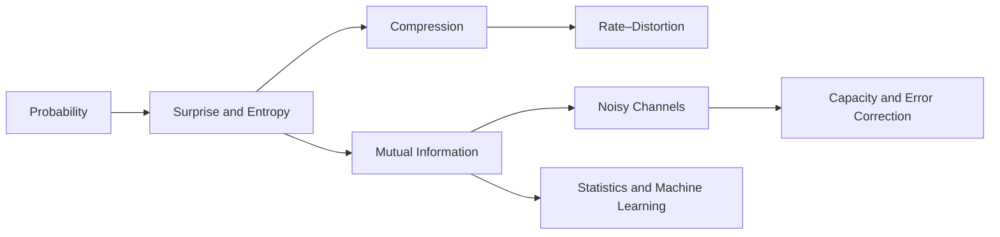

# Information Theory: Surprise, Compression, and Communication

## What This Primer Covers

Information theory gives you a quantitative language for uncertainty, dependence, compression, and communication over noisy systems. This primer develops that language from elementary probability through entropy, source coding, mutual information, noisy channels, channel capacity, error-correcting codes, continuous variables, and rate–distortion theory. It then connects the same quantities to statistical modelling and machine learning, where cross-entropy, likelihood, divergence, and representation learning are often described with information-theoretic vocabulary.

The organising question is simple: when a random source produces an observation, how much can you learn from it, how compactly can you represent it, and how reliably can you transmit it? The answer depends on what is random, what is known, what distortion is acceptable, and what resources the system can use. The mathematics makes those conditions explicit instead of treating "information" as a synonym for data or surprise.

The document is deliberately self-contained at the level of an advanced technical primer. It explains the probability needed for the derivations, computes small examples by hand, and uses Python to make the definitions testable. It is not a coding-theory textbook, a communications-engineering handbook, or a treatment of measure-theoretic probability. Those boundaries are deliberate: the aim is a connected map of the field that lets you recognise which theorem or quantity belongs to a new problem.

## What This Primer Is Not

This is not a complete account of modern coding theory, network information theory, quantum information, cryptographic security proofs, or algorithmic information theory. Each of those subjects has its own definitions, proof techniques, and failure modes. They appear here only when a short comparison prevents a common category error or gives you a useful route into further reading.

The formulas use finite or well-behaved distributions unless a section says otherwise. Continuous variables require care because differential entropy is not invariant under a change of coordinates and can be negative; the primer treats those facts directly rather than silently transferring discrete intuition. Numerical examples illustrate definitions, not universal performance guarantees. A small sample can make an estimator look convincing while giving a poor estimate of a high-dimensional quantity.

## Assumed Background

You should be comfortable with algebra, logarithms, basic calculus, vectors, and introductory probability. You need to know what a random variable, a probability mass function, a conditional probability, an expectation, and a derivative are. You do not need prior information theory. Readers who know basic statistics or machine learning will recognise several later connections, but those sections do not assume that a loss function has already been interpreted as a coding quantity.

The examples use Python 3 with standard-library code unless a section names another dependency. The code is explanatory rather than a benchmark; run it in a disposable environment and check the stated assumptions before adapting it to a production system.

> **Note:** The conceptual and mathematical claims in this primer are checked against the primary references listed in [Further Reading](#further-reading). Product versions, package behaviour, and other time-sensitive claims are not part of the core argument and are either linked at their point of use or explicitly dated.

## Notation

The following notation is used throughout. A symbol may receive a more specific local meaning in a worked example, but the document does not silently change the meaning of a core quantity.

| Symbol | Meaning | First Use |
|---|---|---|
| $X$, $Y$, $Z$ | Random variables | Probability Foundations |
| $x$, $y$, $z$ | Values taken by random variables | Probability Foundations |
| $p(x)$ or $p_X(x)$ | Probability mass or density of $X$ at $x$ | Probability Foundations |
| $p(y\mid x)$ | Conditional probability or density of $Y$ given $X=x$ | Conditional Entropy |
| $\mathbb{E}[X]$ | Expectation of $X$ | Probability Foundations |
| $H(X)$ | Shannon entropy of a discrete random variable | Entropy |
| $H(X\mid Y)$ | Conditional entropy of $X$ given $Y$ | Conditional Entropy |
| $I(X;Y)$ | Mutual information between $X$ and $Y$ | Mutual Information |
| $D_{\mathrm{KL}}(P\|Q)$ | Kullback–Leibler divergence from $Q$ to $P$ | Divergence |
| $\mathcal{X}$, $\mathcal{Y}$ | Input and output alphabets or sample spaces | Channels |
| $W(y\mid x)$ | Channel transition law | Noisy Channels |
| $C$ | Channel capacity, in bits per channel use unless stated otherwise | Channel Capacity |
| $R$ | Code or compression rate | Source and Channel Coding |
| $D$ | Distortion level or distortion measure, as declared locally | Rate–Distortion Theory |
| $\varepsilon$ | A positive error probability or tolerance, declared by context | Coding Theorems |

Unless stated otherwise, logarithms are base 2, so information is measured in bits. Replacing every logarithm by the natural logarithm measures information in nats and changes values by a constant factor; it does not change the ordering or the underlying claims. We use $\varepsilon$ rather than $\epsilon$, blackboard bold for standard number sets, $^{\top}$ for transpose, and semantic operators such as $\operatorname{H}$ only where an operator name improves readability. Displays are introduced by prose and are numbered only when later text refers to them.

## A Map of the Subject

The first half builds quantities for a source. Surprise assigns a number to one outcome; entropy averages that number before the outcome is observed; conditional entropy measures what uncertainty remains after another variable is known; and mutual information measures the reduction in uncertainty supplied by an observation. Divergences compare distributions, but they are not distances and need not be symmetric.

The second half asks what happens when information must be represented or transmitted. Source coding removes predictable structure, channel coding adds carefully chosen redundancy, and capacity marks the boundary between reliable and unreliable communication in an idealised asymptotic model. Rate–distortion theory joins those questions when the receiver is allowed to reconstruct an approximation rather than the exact source.

The path is therefore:



The sections are useful out of order once this map is clear. For example, a reader working on a classifier can go from [Cross-Entropy and KL Divergence](#cross-entropy-and-kl-divergence) to [Connections to Statistics and Machine Learning](#connections-to-statistics-and-machine-learning), while a reader working on a communications system can follow the source-coding and channel-capacity sequence.

## Probability Foundations

Information theory starts with uncertainty represented by a probability distribution. A discrete random variable $X$ takes values in an alphabet $\mathcal{X}$, with probability mass function $p(x)=P(X=x)$ satisfying $p(x)\geq 0$ and $\sum_{x\in\mathcal{X}}p(x)=1$. A joint distribution $p(x,y)$ describes two variables together; its marginal is $p(x)=\sum_y p(x,y)$. When $p(y)>0$, the conditional distribution is $p(x\mid y)=p(x,y)/p(y)$.

Two variables are independent exactly when $p(x,y)=p(x)p(y)$ for every pair of values. Equivalently, observing one does not change the distribution of the other: $p(x\mid y)=p(x)$ whenever the conditional is defined. These definitions matter because information measures quantify features of distributions, not meanings assigned to their outcomes.

## Surprise

The self-information, or surprise, of an outcome $x$ with $p(x)>0$ is $-\log_2 p(x)$ bits. A rare outcome carries more surprise than a common one. The logarithm makes the information of independent outcomes additive: if $X$ and $Y$ are independent, then $-\log_2[p(x)p(y)]=-\log_2p(x)-\log_2p(y)$. Surprise is a property of an outcome relative to a stated distribution; it is not a measure of emotional surprise or semantic importance.

For a biased coin with $P(X=\mathrm{H})=0.4$ and $P(X=\mathrm{T})=0.6$, heads has surprise $-\log_2(0.4)\approx1.322$ bits, while tails has surprise $-\log_2(0.6)\approx0.737$ bits. Thus the less likely outcome is more informative when observed.

## Entropy

Entropy is the expected surprise of a random variable, and therefore measures uncertainty before its value is observed:

$$
H(X)=-\sum_{x\in\mathcal{X}}p(x)\log_2p(x).
$$

For the coin above, $H(X)=-0.4\log_2(0.4)-0.6\log_2(0.6)\approx0.971$ bits per toss. A fair coin has one bit of entropy; a deterministic coin has zero. For an alphabet of size $m$, entropy is at most $\log_2m$, with equality for the uniform distribution. Entropy depends on the distribution and chosen alphabet, not on how outcomes are named.

The chain rule separates joint uncertainty into uncertainty about one variable and the remaining uncertainty after observing another:

$$
H(X,Y)=H(Y)+H(X\mid Y),\qquad
H(X\mid Y)=\sum_y p(y)H(X\mid Y=y).
$$

Conditional entropy is never greater than unconditional entropy: $H(X\mid Y)\leq H(X)$. Equality holds when $X$ and $Y$ are independent. This inequality expresses that access to an observation cannot increase average uncertainty when the joint distribution is known.

## Source Coding

A binary code represents each source symbol as a finite string of 0s and 1s. A prefix code has no codeword that is the prefix of another, so a concatenation can be decoded without separators. If symbol $x$ receives a codeword of length $\ell(x)$, the expected length is $L=\sum_xp(x)\ell(x)$ bits per symbol. For any binary prefix code, Kraft's inequality requires $\sum_x2^{-\ell(x)}\leq1$, and Shannon's source-coding theorem implies $L\geq H(X)$. This is a lower bound on average length, not a claim that every symbol can be encoded in exactly its individual surprise.

Huffman coding constructs an optimal prefix code for a known finite source when each symbol is coded separately and codeword lengths are measured in bits. Consider symbols $a,b,c,d$ with probabilities $0.4,0.3,0.2,0.1$. Repeatedly merge the two least probable nodes: $0.1+0.2=0.3$, then $0.3+0.3=0.6$, then $0.4+0.6=1$. One valid code from this tree is $a\mapsto0$, $b\mapsto10$, $c\mapsto110$, and $d\mapsto111$. It is prefix-free, and its expected length is

$$
L=0.4(1)+0.3(2)+0.2(3)+0.1(3)=1.9\text{ bits per symbol}.
$$

The source entropy is $H(X)\approx1.846$ bits, so the code is within one bit per symbol of the entropy bound, as guaranteed for a binary Huffman code. The exact tree can vary when merge weights tie; the average length remains optimal.

## Cross-Entropy and KL Divergence

Suppose outcomes are generated by a true distribution $p$, but a model or code assigns probabilities according to $q$. The cross-entropy is the expected code length when the ideal lengths are based on $q$ but outcomes follow $p$:

$$
H(p,q)=-\sum_xp(x)\log_2q(x).
$$

If $q(x)=0$ for any outcome with $p(x)>0$, cross-entropy is infinite: the model assigns an impossible probability to an outcome that can occur. Otherwise, cross-entropy decomposes into true uncertainty plus the mismatch penalty:

$$
H(p,q)=H(p)+D_{\mathrm{KL}}(p\|q),\qquad
D_{\mathrm{KL}}(p\|q)=\sum_xp(x)\log_2\frac{p(x)}{q(x)}.
$$

The Kullback–Leibler (KL) divergence is non-negative and equals zero exactly when $p=q$ (on the support of $p$, with distributions normalised). It is not a metric: in general $D_{\mathrm{KL}}(p\|q)\neq D_{\mathrm{KL}}(q\|p)$. Its direction answers a specific question: how much extra expected log loss is incurred by using $q$ when data come from $p$? Cross-entropy minimisation is therefore equivalent to KL minimisation over $q$ for a fixed data distribution $p$.

## Mutual Information

Mutual information measures how much knowing one variable reduces uncertainty about another. It can be written as a difference of entropies, a KL divergence between the joint distribution and the product of its marginals, or an expected log likelihood ratio:

$$
\begin{aligned}
I(X;Y)&=H(X)-H(X\mid Y)\\
&=D_{\mathrm{KL}}\bigl(p(x,y)\|p(x)p(y)\bigr)\\
&=\sum_{x,y}p(x,y)\log_2\frac{p(x,y)}{p(x)p(y)}.
\end{aligned}
$$

Because KL divergence is non-negative, $I(X;Y)\geq0$; it is zero exactly when $X$ and $Y$ are independent. It is symmetric, unlike KL divergence, and is bounded above by $\min(H(X),H(Y))$.

For a computed example, let $X$ be a fair bit and let $Y$ equal $X$ with probability $0.9$, flipping it with probability $0.1$, independently of $X$. Then $Y$ is also fair, so $H(X)=H(Y)=1$ bit. Given either value of $Y$, the conditional distribution of $X$ is $(0.9,0.1)$, hence $H(X\mid Y)=-0.9\log_2(0.9)-0.1\log_2(0.1)\approx0.469$. Therefore $I(X;Y)=1-0.469\approx0.531$ bits. The observation is informative but does not determine $X$ perfectly.

## The Data Processing Inequality

If $X\to Y\to Z$ form a Markov chain — meaning $Z$ is conditionally independent of $X$ given $Y$ — then processing $Y$ into $Z$ cannot increase information about $X$:

$$
I(X;Z)\leq I(X;Y).
$$

This follows from the chain rule: under the Markov condition, $I(X;Y,Z)=I(X;Y)$, while also $I(X;Y,Z)=I(X;Z)+I(X;Y\mid Z)$ and conditional mutual information is non-negative. Equality is possible when the processing preserves all information relevant to $X$; deterministic processing may also lose none if it retains a sufficient representation. The result does not say that a transformation cannot make a task easier for a constrained downstream system; it says that it cannot create statistical information about $X$ absent from its input.

### Dependence, Conditioning, and Bayes' Rule

Information theory uses conditional distributions constantly, so it is worth making the probability bookkeeping explicit. Bayes' rule follows from the definition of a joint distribution:

$$
p(x\mid y)=\frac{p(y\mid x)p(x)}{p(y)},
\qquad
p(y)=\sum_xp(y\mid x)p(x).
$$

The denominator is not a decorative normalisation factor. It is the probability of the observed evidence under every possible explanation, weighted by its prior probability. A model that reports information about $X$ after observing $Y$ must therefore specify both the likelihood $p(y\mid x)$ and the prior or source distribution $p(x)$.

A Markov chain $X\to Y\to Z$ means $p(z\mid x,y)=p(z\mid y)$. It does not necessarily mean that the variables are temporally ordered or causally related; it is a conditional-independence property of a joint distribution. The data-processing inequality follows from this property. If $Z$ is produced by passing $Y$ through a noisy mechanism, then $Z$ cannot reveal more statistical information about $X$ than $Y$ did. A causal interpretation requires additional assumptions beyond the Markov factorisation.

The distinction matters in privacy. If $X$ is sensitive data, $Y$ is a released representation, and $Z$ is a downstream report, then a post-processing guarantee can bound information leakage from $Y$ to $Z$. It does not show that $Y$ itself is private, and it does not measure every operational privacy risk. Membership inference, reconstruction, and attribute inference depend on the adversary, auxiliary data, and decision rule as well as on the distributional information measure.

### A Source-Coding Theorem in Operational Terms

The statement $L\geq H(X)$ for a one-symbol prefix code is only the beginning. Shannon's noiseless coding theorem says that for a stationary memoryless source, long blocks can be encoded at an average rate arbitrarily close to the source entropy, while rates below the entropy cannot support vanishing error under lossless recovery. The word "long" is doing real work: block coding amortises integer-length constraints and captures dependencies when the model includes them.

For an independent source with $m$ symbols, a block of length $n$ has roughly $2^{nH(X)}$ typical sequences. Most probability mass is concentrated in that typical set, even though the full set has $m^n$ members. A code can assign about $nH(X)$ bits to identify a typical sequence and handle atypical sequences separately. The probability of an atypical block approaches zero as $n$ grows under the usual finite-alphabet assumptions. This is the intuition behind the achievability argument; the converse states that a code using substantially fewer bits cannot distinguish the high-probability possibilities reliably.

The typical-set picture should not be mistaken for a universal finite-sample algorithm. A real compressor needs a model, a way to transmit or agree on that model, finite buffers, and a policy for sequences that violate the model. If the model is wrong, the empirical code length reflects cross-entropy rather than entropy. Adaptive compressors trade model overhead against responsiveness to changing sources.

For the four-symbol source in the Huffman example, the entropy is approximately $1.846$ bits per symbol while the best single-symbol prefix code uses $1.9$ bits on average. If we encode long blocks, the average can approach the entropy more closely. That does not mean the compressed output must have exactly $1.846n$ bits for every block. It means the expected rate, with an appropriate coding scheme and asymptotic interpretation, can be made close to that value.

### A Worked Prefix-Code Table

The Huffman construction is easiest to audit as a table. The probabilities below sum to one, and the last column records the code length.

| Symbol | Probability | Codeword | Length |
|---|---:|---|---:|
| $a$ | 0.40 | `0` | 1 |
| $b$ | 0.30 | `10` | 2 |
| $c$ | 0.20 | `110` | 3 |
| $d$ | 0.10 | `111` | 3 |

The expected length is the probability-weighted sum of the lengths, $1.9$ bits per symbol. The code is prefix-free because no listed codeword begins another listed codeword. Kraft's sum is $2^{-1}+2^{-2}+2^{-3}+2^{-3}=1$, so the tree fills the binary code space exactly. The difference $1.9-1.846\approx0.054$ bits per symbol is the redundancy of this particular code for this source.

Changing the names of the symbols changes nothing. Changing their probabilities changes both the optimal tree and the entropy. If the probabilities are estimates rather than known facts, a code built from them can be suboptimal, and a code that assigns zero probability to a future symbol may fail catastrophically. Practical compressors reserve escape mechanisms or use smoothing so that new symbols remain representable.

### A Small Arithmetic-Coding Intuition

Suppose a source emits $A$ with probability $0.75$ and $B$ with probability $0.25$. Start with the interval $[0,1)$. After observing $A$, retain $[0,0.75)$; after observing $B$ next, subdivide that interval and retain its upper quarter, $[0.5625,0.75)$. Any sufficiently precise number in the final interval identifies the sequence `AB` under the model. Its width is $0.75\times0.25=0.1875$, and $-\log_2(0.1875)\approx2.415$ bits is the ideal information assigned by the model to that sequence.

This is not a complete arithmetic coder. A production implementation must represent a finite-precision interval, emit stable leading bits, handle underflow, and agree on the probability model. The example is useful because it connects probability directly to code length: multiplying probabilities adds their negative logarithms.

### Error Correction as Geometry

A code is a subset of the space of possible transmitted sequences. For binary block codes of length $n$, the ambient space has $2^n$ points. A decoder partitions received words into decision regions around codewords. Noise moves the transmitted word. If the movement stays within its region, decoding succeeds; if it crosses a boundary, it fails.

The minimum Hamming distance $d$ between distinct codewords controls a worst-case guarantee. Balls of radius $t$ around codewords are disjoint when $2t<d$, so nearest-neighbour decoding corrects up to $\lfloor(d-1)/2\rfloor$ arbitrary errors. Known erasures are easier: an erased position contributes uncertainty but does not point to a competing value, and unique recovery can tolerate up to $d-1$ erasures in the ideal codeword model.

The geometric guarantee is not the same as average performance on a probabilistic channel. A code may have a good minimum distance but poor distance distribution, or its decoder may be too expensive. Modern capacity-approaching families such as low-density parity-check and polar codes rely on structure that is outside this primer's construction detail. The useful lesson is the separation of four quantities: rate, distance, decoding complexity, and probability of error under a specified channel.

### Finite Blocks and the Limits of Asymptotic Theorems

Capacity is a limit as block length tends to infinity. At finite block length, the relevant questions include the target error probability, latency, computational budget, and whether the channel state is known. A rate slightly below capacity may still be unusable for a short block, while a rate above capacity may appear successful in a small experiment only because the observed noise was unusually favourable.

Fano's inequality makes the converse intuition quantitative. If a message $M$ is selected uniformly from a set of size $|\mathcal{M}|$, and $\widehat{M}$ is the decoder's estimate with error probability $P_e$, then

$$
H(M\mid\widehat{M})\leq h_2(P_e)+P_e\log_2(|\mathcal{M}|-1).
$$

When $P_e$ is small, the decoder has learned almost all the message entropy. When the communication rate exceeds the channel's information supply, the conditional uncertainty cannot vanish. The inequality is a tool in proofs; it is not a formula that predicts the exact error rate of a chosen code.

### Information in Continuous Variables

For a continuous random variable with density $f(x)$, differential entropy is

$$
h(X)=-\int f(x)\log_2f(x)\,dx,
$$

when the integral is well-defined. Unlike discrete entropy, $h(X)$ can be negative and changes under rescaling. If $Y=aX$ for non-zero $a$, then $h(Y)=h(X)+\log_2|a|$. Changing units from metres to millimetres therefore changes differential entropy, which would be impossible for an invariant count of discrete messages.

Mutual information avoids this particular problem because the scale terms cancel in the appropriate density ratio:

$$
I(X;Y)=\int\!\int f(x,y)\log_2\frac{f(x,y)}{f(x)f(y)}\,dx\,dy.
$$

It remains non-negative under the usual conditions and is invariant under invertible smooth reparameterisations. This is why mutual information is safer than differential entropy for describing dependence between continuous measurements. It is still an expectation under a model and can be difficult to estimate from finite data.

The Gaussian distribution maximises differential entropy among distributions with a fixed variance. This fact supports the Gaussian-noise channel formula, but it does not make every measured signal Gaussian or every squared-error objective information-theoretically justified. Check the source model and constraint before applying a Gaussian result.

### Rate–Distortion in More Detail

Lossless compression demands exact reconstruction. Lossy compression changes the goal: the decoder may output $\widehat{X}$ rather than $X$, provided the expected distortion $\mathbb{E}[d(X,\widehat{X})]$ is within a stated limit. The distortion function is part of the problem definition. Squared error penalises large numerical deviations, Hamming distortion counts symbol disagreements, and perceptual metrics encode a different notion of acceptable error.

The rate–distortion function is non-increasing in $D$: allowing more distortion cannot require more rate. It is zero once the allowed distortion is high enough that a constant reconstruction is acceptable. It is generally convex under standard formulations because time-sharing two coding strategies can mix their rates and distortions.

For a binary symmetric source under Hamming distortion, the rate–distortion curve is

$$
R(D)=1-h_2(D),\qquad 0\leq D\leq\frac{1}{2},
$$

and zero for $D\geq1/2$. At zero distortion, one bit per source symbol is required; at distortion one half, a constant guess has no worse average error than an independent reconstruction. The formula is elegant because the source, distortion, and alphabet are all matched to the binary model. It should not be transplanted to images, text, or structured records without redefining the distortion.

### Information Theory and Machine Learning

For a classifier with true class $Y$ and predicted distribution $q_\theta(y\mid x)$, the empirical cross-entropy is the average negative log probability assigned to the observed labels. If the labels are generated from a conditional distribution $p(y\mid x)$, the population objective decomposes into the conditional entropy $H(Y\mid X)$ plus a conditional KL divergence. The best possible model in the chosen family therefore depends on approximation error, while the irreducible term reflects label uncertainty.

This decomposition also explains why a low training loss is not enough. A high-capacity model can assign excellent probabilities to the training sample while learning a conditional distribution that does not transfer. The empirical distribution, data collection process, label noise, and evaluation distribution all matter. Information theory names the mismatch but does not remove the need for held-out evaluation.

Variational autoencoders introduce another useful connection. A latent-variable model uses a variational distribution $q_\phi(z\mid x)$ to approximate a posterior, and the evidence lower bound contains a reconstruction term plus a KL penalty between the approximate posterior and a prior. The KL term is a distribution mismatch penalty, not a direct measurement of the number of human-interpretable facts stored in $z$. Latent dimensions can be entangled, redundant, or unused; interpreting them requires a task and an intervention or evaluation protocol.

The information bottleneck objective is often written as a trade-off between preserving information about a target $Y$ and limiting information retained about an input $X$, for example $I(Z;Y)-\beta I(Z;X)$. The expression is useful as a conceptual lens, but estimating both mutual informations can be hard, and the result depends on the encoder class, noise model, and finite sample. A representation with lower $I(Z;X)$ is not automatically better: it may have discarded information needed for a task that was not included in the objective.

## Finite-Sample Estimation

In applications, the distribution is usually unknown. Given $n$ independent observations $X_1,\ldots,X_n$ from $p$, the empirical distribution is $\widehat{p}(x)=N_x/n$, where $N_x$ counts occurrences of $x$. Substituting these frequencies into the entropy formula gives the plug-in estimate $\widehat{H}=-\sum_x\widehat{p}(x)\log_2\widehat{p}(x)$. It is consistent for a fixed finite alphabet as $n$ grows, but it is generally downward-biased at finite $n$: unseen outcomes receive estimated probability zero and contribute no estimated uncertainty.

For fixed support size $k$ and sufficiently large $n$, a first-order approximation to the bias in bits is $\mathbb{E}[\widehat{H}]-H(p)\approx-(k-1)/(2n\ln2)$, provided the probabilities on that support are positive and the asymptotic approximation is appropriate. This is not a universal correction for sparse or growing alphabets. Smoothing can reduce zero-frequency problems but changes the estimator and introduces its own bias; report the method and assumptions rather than treating a smoothed result as assumption-free.

Plug-in mutual information has an additional finite-sample problem: empirical dependence can arise by chance, so estimated mutual information is often positively biased under independence. The effective alphabet sizes and sample size both matter. Useful checks include reporting sample counts and support sizes, comparing against a permutation-based null distribution that preserves the marginals, and checking whether estimates stabilise as more data are collected. For continuous variables, naive binning changes the quantity being estimated, while differential entropy has different properties from discrete entropy; estimator choice must match the variable type and question.

## Noisy Channels and Reliable Communication

A communication channel maps an input symbol to an output symbol, sometimes changing or erasing it. Channel coding asks how much information can be sent reliably despite those changes. This section develops the discrete memoryless model, the binary symmetric and erasure channels, capacity, and Shannon's coding theorem, then connects the same ideas to continuous-valued systems, rate–distortion, statistics, and machine learning. It is an introduction to the central results and their use, not a proof-based treatment of coding constructions, network information theory, or modern coding standards. Readers should be comfortable with probabilities, logarithms, and finite sums.

The table defines the notation used in the channel and compression arguments.

| Symbol | Meaning | First Use |
|---|---|---|
| $X$, $Y$ | Channel input and output random variables | Discrete channel model |
| $x$, $y$ | Realised input and output symbols | Transition probabilities |
| $W(y\mid x)$ | Probability of output $y$ given input $x$ | Discrete channel model |
| $p(x)$ | Probability assigned to input $x$ | Mutual information |
| $H(X)$ | Entropy of a discrete random variable | Mutual information |
| $I(X;Y)$ | Mutual information between input and output | Capacity |
| $C$ | Channel capacity, in bits per channel use | Capacity |
| $R$ | Communication rate, in bits per channel use | Coding theorem |
| $D$ | Expected distortion per source symbol | Rate–distortion |
| $R(D)$ | Minimum rate needed at distortion level $D$ | Rate–distortion |

## The Discrete Memoryless Channel

A discrete memoryless channel has finite input and output alphabets and a transition law $W(y\mid x)$. For each input $x$, the values $W(y\mid x)$ form a probability distribution over outputs. “Memoryless” means that, conditioned on the input sequence, each output is drawn according to the same transition law independently of other channel uses. It does not mean that successive inputs must be independent.

If an encoder sends $x_1,\ldots,x_n$ and the channel returns $y_1,\ldots,y_n$, the model states

$$
P(y_1,\ldots,y_n\mid x_1,\ldots,x_n)
=\prod_{i=1}^{n} W(y_i\mid x_i).
$$

The model is useful because it separates the physical or abstract channel from the encoder and decoder. It can be a poor fit when errors are correlated, channel conditions drift, feedback changes future inputs, or the alphabet omits meaningful outcomes such as packet delay.

For a chosen input distribution $p(x)$, entropy measures uncertainty in the input:

$$
H(X)=-\sum_x p(x)\log_2 p(x).
$$

Mutual information measures how much observing the output reduces uncertainty about the input:

$$
I(X;Y)=\sum_{x,y}p(x)W(y\mid x)
\log_2\frac{W(y\mid x)}{p_Y(y)},
$$

where $p_Y(y)=\sum_x p(x)W(y\mid x)$. Equivalently, $I(X;Y)=H(X)-H(X\mid Y)$. It is an average over the stipulated input and channel distributions, not a guarantee about every message.

## Binary Symmetric and Erasure Channels

A binary symmetric channel (BSC) transmits bits and flips each bit independently with probability $p$, where $0\leq p\leq 1$. Its transition probabilities are $W(1\mid0)=W(0\mid1)=p$ and $W(0\mid0)=W(1\mid1)=1-p$. For a uniform input, the output is also uniform and the uncertainty remaining about the input is the binary entropy

$$
h_2(p)=-p\log_2p-(1-p)\log_2(1-p),
$$

with endpoint values defined by continuity. The BSC's capacity is therefore $1-h_2(p)$ bits per use.

**Worked Example 1 (Binary Symmetric Channel).** Suppose each transmitted bit is flipped with probability $p=0.1$, independently. Then $h_2(0.1)=-0.1\log_2(0.1)-0.9\log_2(0.9)\approx0.469$. The capacity is approximately $1-0.469=0.531$ bits per use. Thus a long block can carry about 0.531 information bits per use with arbitrarily small decoding error under the coding theorem's assumptions; it does not say that sending uncoded bits has this performance.

A binary erasure channel (BEC) has input alphabet $\{0,1\}$ and output alphabet $\{0,1,?\}$. Each bit is either received correctly or replaced by a visible erasure marker `?`, independently with probability $e$. The receiver knows which positions were erased. With a uniform input, each unerased output reveals one bit and each erased output reveals none, so the capacity is $1-e$ bits per use.

**Worked Example 2 (Binary Erasure Channel).** If $e=0.2$, then over 1,000 channel uses the expected number of unerased bits is $1,000(1-0.2)=800$. Capacity is $0.8$ bits per use. This expectation is not a promise of exactly 800 received bits in each block: the erasure count varies, and a finite-length code can fail even when the realised count is below its nominal correction limit.

The BSC and BEC illustrate different error information. An erasure announces that a symbol was lost; a flip gives a plausible but wrong symbol. This distinction explains why codes can often recover from more erasures than arbitrary errors at the same block length.

## Capacity and Shannon's Coding Theorem

For a discrete memoryless channel, capacity is the largest mutual information attainable by choosing an input distribution:

$$
C=\max_{p(x)} I(X;Y).
$$

The maximisation matters: a non-uniform input can be best for an asymmetric channel. Capacity is an asymptotic limit measured in bits per channel use. It is not the rate of a particular code, nor does it specify its latency, computational cost, or finite-block error probability.

**Theorem (Shannon's Channel Coding Theorem).** For a discrete memoryless channel with finite alphabets and transition law $W$, let $C=\max_{p(x)}I(X;Y)$. For any rate $R<C$, there exist length-$n$ codes whose average probability of decoding error tends to zero as $n$ tends to infinity. For any $R>C$, no sequence of length-$n$ codes can make that error probability tend to zero.

**Proof Sketch.** For achievability, choose codewords randomly with symbols drawn from an input distribution approaching the capacity-achieving distribution. A typicality decoder looks for a unique codeword jointly typical with the received sequence. When $R<I(X;Y)$, the transmitted codeword is typical with high probability, while the chance that any of roughly $2^{nR}$ competing codewords also passes the test tends to zero. Optimising the input law reaches rates below $C$. For the converse, Fano's inequality bounds the message information that can be recovered from the output. The chain rule and memorylessness bound that information by $nC$; if the rate exceeds $C$, the error probability cannot vanish. The full theorem distinguishes average from maximal error conventions and handles boundary details; this statement uses average error and does not assert reliable operation at $R=C$ for every channel.

The result is an existence theorem. It does not construct a practical code or claim that a short block behaves like the limit. Real designs choose a rate below capacity to accommodate finite length, implementation constraints, and a target error rate.

## How Error-Correcting Codes Help

An error-correcting code maps each message to a longer codeword, adding structured redundancy. A decoder uses that structure to distinguish likely transmitted codewords from corrupted received words. In a simple repetition code, encoding one bit as `000` or `111` lets majority vote correct one flip, but it uses three channel symbols per information bit and is far from capacity in many regimes.

More generally, if codewords have minimum Hamming distance $d$, unique decoding can correct up to $\lfloor(d-1)/2\rfloor$ arbitrary bit errors, or up to $d-1$ erasures when erased locations are known. This geometric picture does not by itself give a good long code: distance, rate, decoding complexity, and the channel's probabilistic structure all matter. Capacity says that suitable code families exist below a limit; coding theory supplies constructions and algorithms that approach it.

## Continuous-Valued Channels

For continuous inputs and outputs, probabilities of individual exact values are generally zero, so densities replace probability masses and differential entropy replaces discrete entropy. Differential entropy depends on the coordinate scale and can be negative; by itself it is not an invariant measure of information. Mutual information remains meaningful when defined through densities or relative entropy, subject to the relevant integrability conditions.

For the real additive white Gaussian noise channel $Y=X+Z$, let $Z$ be independent Gaussian noise with mean zero and variance $N$, and constrain average input power by $\mathbb{E}[X^2]\leq P$. Its capacity is

$$
C=\frac{1}{2}\log_2\left(1+\frac{P}{N}\right)
\quad\text{bits per real channel use}.
$$

The Gaussian input maximises output entropy under the power constraint, giving the formula; a converse follows because no admissible input can produce greater output entropy. The assumptions include a memoryless real channel, independent Gaussian noise, and an average power constraint. Bandwidth conventions can change the units: the complex baseband form often has no factor of one half because one complex use represents two real dimensions. The formula is not directly applicable to coloured noise, peak-power constraints, or channels with memory without further analysis.

## Rate–Distortion and Lossy Compression

Channel capacity concerns reliable communication through a noisy channel. Rate–distortion theory instead asks how compactly a source can be represented while tolerating a specified average loss. Let source symbol $X$ be reconstructed as $\hat X$, with distortion measure $d(x,\hat x)$. The rate–distortion function is

$$
R(D)=\min_{p(\hat x\mid x):\,\mathbb{E}[d(X,\hat X)]\leq D}
I(X;\hat X).
$$

For a memoryless source and a single-letter distortion measure, this is the asymptotic minimum number of bits per source symbol needed to achieve expected distortion at most $D$, up to arbitrarily small slack. The rate–distortion theorem's achievability and converse are source-coding counterparts to Shannon's channel theorem. They concern expected distortion over long blocks, not a per-item maximum or a guarantee for every input.

As a familiar case, a Gaussian source of variance $\sigma^2$ under mean-squared error has $R(D)=\frac{1}{2}\log_2(\sigma^2/D)$ for $0<D<\sigma^2$, and zero rate suffices for $D\geq\sigma^2$. This result assumes an independent identically distributed Gaussian source and squared-error distortion. Perceptual quality, structured data, and non-stationary sources require different distortion models or source assumptions.

## Connections to Statistics and Machine Learning

Mutual information appears in statistics as a measure of dependence and in machine learning as a feature-selection, representation-learning, and privacy-analysis objective. The data processing inequality states that if $X\to Y\to Z$ forms a Markov chain — meaning $Z$ is conditionally independent of $X$ given $Y$ — then $I(X;Z)\leq I(X;Y)$. A deterministic or stochastic post-processing step cannot create information about $X$ that was absent from $Y$. This is useful when reasoning about lossy representations, privacy mechanisms, and prediction pipelines, but it does not say that every downstream task's performance decreases monotonically under every metric.

The coding viewpoint also clarifies noisy labels and finite datasets. A model sees examples through a data-generation channel: labels may be flipped, measurements quantised, or features erased. Estimating the channel and its assumptions is part of the statistical problem. A high mutual information estimate from a finite sample can reflect overfitting or estimator bias; it is not evidence by itself that a learned representation generalises or causes an outcome. Likewise, the information bottleneck objective balances predictive information about a target against retained information about an input, but its usefulness depends on the chosen distributions, estimator, and task.

These connections are conceptual and mathematical, not a claim that every learning problem is best solved as a communication problem. The channel model helps name uncertainty and information loss; empirical validation and domain assumptions still determine whether a model is useful.

## Failure Modes and Boundaries

The most common errors are treating capacity as the guaranteed throughput of a finite system; applying an independent-error formula to bursty or stateful failures; confusing erasures, whose positions are known, with substitutions; and using differential entropy as if it were discrete entropy. Another is reporting mutual information without specifying the joint distribution or estimator. Capacity and rate–distortion are limits under stated models, not performance guarantees independent of assumptions.

This introduction stops at single-user memoryless channels and single-letter distortion. It does not cover feedback capacity, network coding, fading-channel water-filling, quantum channels, finite-blocklength bounds, practical code construction, or perceptual distortion design. Those topics change assumptions or require additional machinery and should be introduced as separate sections with their own notation and hypotheses.

## Entropy as a Constraint and an Optimisation Problem

The entropy formula is more useful when you can recognise what controls it. For a fixed finite alphabet, the uniform distribution has the largest entropy. This is not merely an intuitive statement that "many possibilities mean more uncertainty"; it is an optimisation result. If $X$ has $m$ possible values, then

$$
H(X)\leq\log_2m,
$$

with equality only when $p(x)=1/m$ for every value. One proof uses the non-negativity of KL divergence. Let $u$ be the uniform distribution. Then $D_{\mathrm{KL}}(p\|u)\geq0$, so

$$
\sum_xp(x)\log_2\frac{p(x)}{1/m}
=-H(X)+\log_2m\geq0.
$$

Rearranging gives the bound. The proof also explains the equality condition: divergence is zero only when the distributions match.

The constraint matters. If you know only that $X$ is real-valued and has a particular variance, the maximum-entropy distribution is Gaussian, not uniform over the whole real line. There is no uniform distribution on all of $\mathbb{R}$ with a finite normalising constant. When a maximum-entropy argument appears in modelling, ask which constraints define the feasible distributions and whether the resulting distribution is being used as a representation of ignorance, a physical model, or a computational convenience.

Conditional entropy has a parallel interpretation. The chain rule

$$
H(X,Y)=H(X)+H(Y\mid X)=H(Y)+H(X\mid Y)
$$

is an accounting identity for uncertainty revealed in stages. It does not say that $X$ causes $Y$, and it does not require a causal model. The order of conditioning changes the two terms but not the joint entropy. Mutual information is the difference between the uncertainty before and after the observation:

$$
I(X;Y)=H(X)-H(X\mid Y)=H(Y)-H(Y\mid X).
$$

This makes the units and the interpretation explicit. If $I(X;Y)=0.5$ bits, then the average reduction in uncertainty about $X$ supplied by observing $Y$ is half a bit under the stated joint distribution. It does not mean that every observation reduces uncertainty by exactly half a bit, nor that $Y$ is causally responsible for $X$.

## Conditional Information and Interaction

Pairwise mutual information is not enough when several variables interact. Conditional mutual information measures the information two variables share after a third variable is known:

$$
I(X;Y\mid Z)=H(X\mid Z)-H(X\mid Y,Z).
$$

It is always non-negative and can be written as an expected KL divergence between conditional distributions. If $X$ and $Y$ become independent after conditioning on $Z$, then $I(X;Y\mid Z)=0$. This is the information-theoretic form of a conditional independence statement.

The chain rule for mutual information is

$$
I(X;Y,Z)=I(X;Z)+I(X;Y\mid Z).
$$

Read from left to right, the total information supplied by $(Y,Z)$ is the information supplied by $Z$ plus the additional information supplied by $Y$ once $Z$ is already known. The word "additional" is essential. Adding correlated features can increase the raw number of inputs while adding little conditional information.

A practical feature-selection workflow can therefore compare $I(X;Y)$ with $I(X;Y\mid Z)$, but it must also account for estimation error, leakage, and the prediction task. A feature can have low marginal mutual information and still be useful in combination with another feature; XOR is the smallest familiar example. Conversely, a feature can have high mutual information because it records a training-set identifier that will not exist at deployment.

## Source Coding Beyond Huffman Codes

Huffman coding is optimal among binary prefix codes that assign one codeword to each source symbol. It is not optimal for every compression problem. If symbols are strongly dependent, a symbol-by-symbol model wastes the dependence. A compressor can model sequences, encode blocks, or transform the source before coding it.

Arithmetic coding takes a different route. It represents a whole message by an interval whose width is approximately the message probability. As symbols arrive, the interval is narrowed according to the model's conditional probabilities. A message with probability $p$ needs roughly $-\log_2p$ bits in an ideal arithmetic representation, so the method can approach the entropy rate more closely than an integer-length prefix code. Practical implementations use finite precision, renormalisation, and a model that assigns non-zero probability to every symbol that may occur.

Dictionary methods such as LZ77 and LZ78 exploit repeated substrings rather than an explicitly supplied probability model. A repeated phrase can be represented by a reference to an earlier occurrence. Their performance depends on the source's repetition structure and the available window or dictionary, not only on the single-symbol histogram. This is why a file with a nearly uniform byte histogram can still compress well if it contains long repeated patterns, and why a file with a skewed histogram can resist a dictionary method if it has little repetition.

The entropy rate of a stationary source captures the asymptotic uncertainty per symbol when dependence is included. For a sequence $X_1,X_2,\ldots$, define

$$
\mathcal{H}(X)=\lim_{n\to\infty}\frac{1}{n}H(X_1,\ldots,X_n),
$$

when the limit exists. Independent identically distributed symbols have entropy rate $H(X_1)$. A Markov source generally has a lower entropy rate because past symbols help predict the next one. The limit is the right comparison for long-stream compression; a marginal entropy calculation can overstate the irreducible rate when it ignores dependence.

## Cross-Entropy as Log Loss

Cross-entropy is both a coding quantity and a statistical scoring rule. If a model assigns $q(x)$ to an observation drawn from $p(x)$, the expected log loss is

$$
H(p,q)=-\mathbb{E}_{X\sim p}[\log_2q(X)].
$$

The decomposition $H(p,q)=H(p)+D_{\mathrm{KL}}(p\|q)$ says that the irreducible uncertainty is fixed while model mismatch is the excess. This is why minimising expected cross-entropy is a proper objective for probability forecasts: the true distribution minimises the expected score.

The same formula clarifies several practical mistakes. Accuracy discards the probabilities assigned to incorrect classes, while log loss penalises confident wrong predictions heavily. A model that predicts $(0.51,0.49)$ for every binary example may have the same accuracy as a model that predicts $(0.99,0.01)$ on correct examples and $(0.99,0.01)$ on the wrong side for a few cases, but its cross-entropy will be much worse when it is confidently wrong. Calibration and discrimination are different properties; cross-entropy rewards both in different ways.

For a dataset $x_1,\ldots,x_n$, the average negative log likelihood is the empirical cross-entropy. If the observations are independent under the model, the joint likelihood is the product of per-observation probabilities and the negative log likelihood is the sum of their log losses. The independence assumption may be wrong, but the algebra explains why language models, classifiers, and probabilistic regressors commonly train with cross-entropy.

## Divergences, Distances, and Model Comparison

KL divergence is not a distance. It is non-negative and zero only for equal distributions, but it is asymmetric and does not generally satisfy the triangle inequality. The direction is not cosmetic. In variational inference, minimising $D_{\mathrm{KL}}(q\|p)$ can favour a distribution $q$ that concentrates on one plausible mode, while minimising $D_{\mathrm{KL}}(p\|q)$ penalises assigning too little probability to regions where $p$ has mass. The choice produces different behaviour when distributions are multimodal.

The Jensen–Shannon divergence symmetrises KL through a mixture $m=(p+q)/2$:

$$
\operatorname{JSD}(p,q)=\frac{1}{2}D_{\mathrm{KL}}(p\|m)+\frac{1}{2}D_{\mathrm{KL}}(q\|m).
$$

It is symmetric and bounded for discrete distributions, and its square root is a metric under standard conditions. It is still a distribution-level comparison, not a guarantee that two samples look similar under a task-specific notion of quality. Wasserstein distance, total variation, Hellinger distance, and other measures answer different questions; choose one by the geometry and decision consequences of the problem rather than by familiarity.

## Estimating Information in Practice

The following small Python function computes a plug-in entropy estimate for a list of discrete observations. It deliberately exposes the support rather than hiding it in a library call.

```python
from collections import Counter
from math import log2

def plug_in_entropy(observations):
    counts = Counter(observations)
    total = len(observations)
    return -sum(
        (count / total) * log2(count / total)
        for count in counts.values()
    )

print(plug_in_entropy("HHHTTTTT"))
```

The result is the entropy of the empirical distribution, not an unbiased estimate of the source entropy. The distinction is important when the sample is small or the support is large. A result with three observed categories may conceal dozens of unobserved categories. Report the number of observations, the support definition, the estimator, and any smoothing or bias correction.

For mutual information, construct a contingency table and estimate the joint and marginal distributions from the same observations. Do not estimate the marginals from a different subset unless the missingness mechanism justifies it. Under a null hypothesis of independence, a permutation test can preserve the observed marginal counts while breaking the association between variables. The permutation distribution is not a proof that the estimator is unbiased, but it provides a useful check against interpreting a small empirical association as substantive evidence.

The curse of dimensionality becomes severe when the joint alphabet grows. If each of five binary variables is observed jointly, there are already 32 cells; if each has 20 possible values, there are 3.2 million. Most cells will be empty unless the sample grows accordingly. Binning continuous variables can make a computation possible, but changing the bins changes the question. Kernel, nearest-neighbour, Bayesian, and variational estimators introduce different assumptions; compare their sensitivity rather than presenting one number as ground truth.

## A Practical Decision Guide

Use the following questions to choose a quantity:

- If you need the uncertainty of one discrete source, calculate entropy.
- If you need uncertainty remaining after an observation, calculate conditional entropy.
- If you need dependence between variables, calculate mutual information and state the joint distribution or estimator.
- If you need to compare a model distribution with a reference distribution, choose a divergence and its direction.
- If you need compact exact representation, reason about source coding and entropy rate.
- If you need reliable transmission through a specified noisy channel, calculate capacity and then choose a finite-length code below it.
- If approximation is allowed, specify the distortion measure and use rate–distortion reasoning.

Do not use entropy as a generic synonym for disorder, mutual information as evidence of causation, or capacity as the measured throughput of a finite implementation. Each quantity answers a narrowly defined question under a model.

## Exercises

1. A source emits four symbols with probabilities $(0.5,0.25,0.125,0.125)$. Calculate its entropy and compare it with the expected length of the code lengths $(1,2,3,3)$.
2. Show that the entropy of a fair six-sided die is $\log_2 6$ bits and explain why no fixed-length binary code can represent every outcome in exactly that many bits.
3. For a BSC with crossover probability $0.25$, calculate the capacity to three decimal places. What changes if the input distribution is not uniform?
4. Construct the joint table for a fair bit passed through a BSC with crossover probability $0.1$ and verify the mutual-information calculation in the core example.
5. Explain why a plug-in entropy estimate can be downward-biased when rare outcomes are not observed. Give one reason smoothing may improve a decision and one reason it may mislead.
6. Choose a distortion measure for a lossy text-compression system and explain what kinds of errors it would treat as equivalent or different. Compare your choice with squared error.

Outline solutions: (1) the entropy is $1.75$ bits and the stated code has expected length $1.75$ bits; (2) entropy is the expected surprise, while a fixed binary code needs an integer number of bits per symbol and must use at least three bits for six symbols; (3) capacity is $1-h_2(0.25)\approx0.189$ bits per use, and the capacity-achieving input need not be uniform for an asymmetric channel; (4) the diagonal joint probabilities are $0.45$ each and the off-diagonal probabilities are $0.05$ each, giving conditional entropy $h_2(0.1)$; (5) unseen outcomes contribute zero to the plug-in estimate, while smoothing can reduce variance but adds a modelling choice; and (6) the answer depends on the application, so justify the distortion rather than importing a continuous-valued metric.

## Glossary

**Alphabet.** The set of symbols a random variable or code can take.

**Capacity.** The supremum rate at which reliable communication is possible under a specified channel model and asymptotic convention.

**Cross-entropy.** Expected negative log probability assigned by one distribution to observations from another.

**Divergence.** A non-negative discrepancy measure between distributions that need not be symmetric or obey the triangle inequality.

**Entropy.** Expected self-information of a random variable.

**Erasure.** A channel error whose location or missing-value marker is known to the receiver.

**Mutual information.** The reduction in uncertainty about one variable supplied by observing another.

**Prefix code.** A code in which no codeword is the prefix of another codeword.

**Rate–distortion function.** The minimum asymptotic rate needed to reconstruct a source within a specified expected distortion.

**Source coding.** Representing a source efficiently, usually by removing redundancy.

**Channel coding.** Adding structured redundancy so a receiver can recover a message after channel corruption.

## Further Reading

- Claude E. Shannon, ["A Mathematical Theory of Communication"](https://doi.org/10.1002/j.1538-7305.1948.tb00917.x), *Bell System Technical Journal* 27 (1948). Read this for the original definitions of entropy, channel capacity, and the coding-theorem framework.
- Thomas M. Cover and Joy A. Thomas, [*Elements of Information Theory*, 2nd ed.](https://onlinelibrary.wiley.com/doi/book/10.1002/047174882X), Wiley, 2006. This is the most systematic next reference for entropy identities, divergence, mutual information, and channel coding.
- David J. C. MacKay, [*Information Theory, Inference, and Learning Algorithms*](https://www.inference.phy.cam.ac.uk/itila/book.html), Cambridge University Press, 2003. The author’s freely available edition connects coding and inference with practical algorithms.
- David A. Huffman, ["A Method for the Construction of Minimum-Redundancy Codes"](https://doi.org/10.1109/jrproc.1952.273898), *Proceedings of the IRE* 40 (1952), 1098–1101. The original prefix-code construction.
- Liam Paninski, ["Estimation of Entropy and Mutual Information"](https://doi.org/10.1162/089976603321780272), *Neural Computation* 15 (2003), 1191–1253. A focused treatment of finite-sample bias and consistency.
- Thomas Berger, [*Rate Distortion Theory and Its Applications to Speech*](https://ieeexplore.ieee.org/document/1162269), Prentice-Hall, 1971. An early systematic treatment of lossy source coding and distortion.

