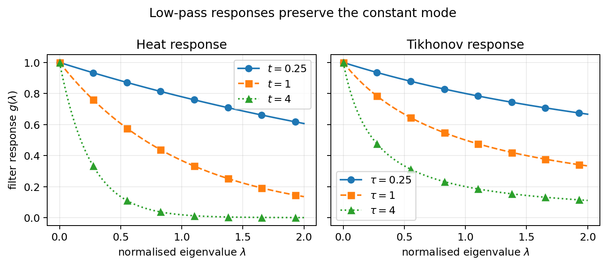
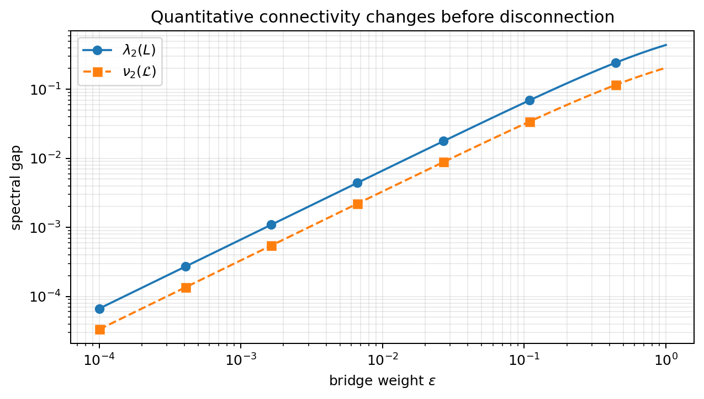
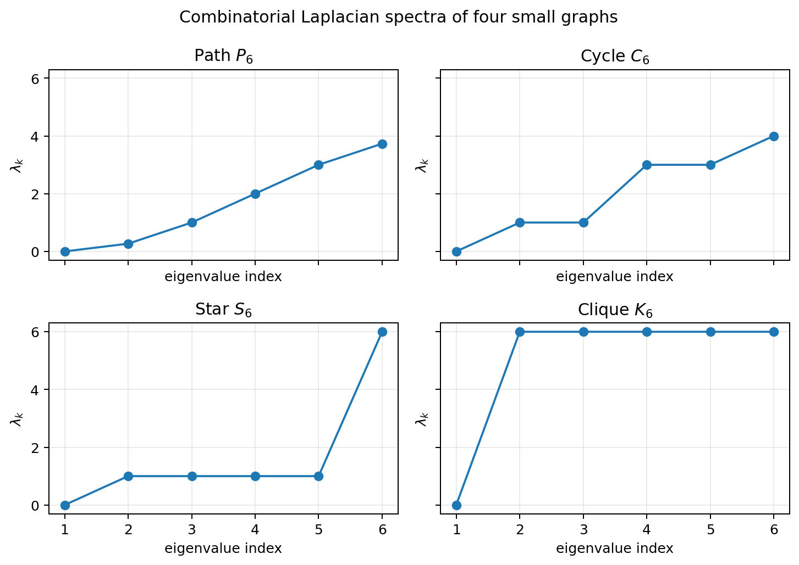

# Spectral Graph Theory: Connectivity, Diffusion, and Computation

## Introduction

A graph represents objects and relationships. A vertex might represent a junction, a document, an airport, or a person; an edge records a relationship whose meaning must be specified before any matrix is calculated. Spectral graph theory studies matrices associated with such graphs through their eigenvalues and eigenvectors. Its central move is to turn local comparison — how different are the values at the endpoints of an edge? — into global statements about connectivity, diffusion, clustering, robustness, and computation.

The approach exists because ordinary row-wise summaries lose the routes by which information or influence travels. Assessing a transport bottleneck, finding coherent document topics, or detecting an anomalous sensor reading requires combining local information along paths of different lengths. Counting neighbours answers a one-step question; shortest paths emphasise a single route and can be unstable under ties. Two data sets can have identical degree counts but very different bottlenecks. Two pairs of vertices can have the same shortest-path distance but very different numbers of alternative routes. Two clusters can have the same within-group density but different volume relative to their boundary. Spectral quantities compress these global relationships into coordinates, modes, gaps, and quadratic forms that can be compared across scales.

These global questions share a mathematical starting point: several apparently different problems reduce to the same quadratic form. If an edge means that two vertices should have similar values, then a useful signal should make $(x_i-x_j)^2$ small on heavily weighted edges. Summing those penalties gives the Laplacian energy. Minimising energy under constraints produces smooth coordinates; evolving according to the associated operator produces diffusion; and relaxing a discrete partition objective produces spectral clustering. The shared operator is a modelling advantage, but it is also a risk: an incorrect edge meaning propagates into every downstream interpretation.

That compression is useful precisely because it is selective. A Laplacian spectrum preserves some global geometry while discarding vertex labels and much of the original edge-level detail. An eigenvector supplies a coordinate that can make a cut or diffusion pattern visible, but it does not preserve every property of the graph. The right question is therefore not whether spectral analysis finds “the structure”, but which structure the chosen operator preserves and which information it deliberately ignores.

The matrices are not neutral summaries of data. A connection whose weight means conductance behaves differently from one whose weight means distance: larger conductance strengthens coupling, whereas larger distance often weakens similarity. Directed and undirected graphs answer different questions, and normalising by degree changes the unit of comparison. We therefore state the graph model and operator convention before interpreting a spectrum.

Before asking for an eigenvalue, write down the graph-construction contract. Specify the vertex universe and stable key; what an edge means; whether direction and loops are retained; how duplicate or reverse records are aggregated; whether a larger weight means stronger coupling; how distances, similarities, exposure, and missing values are transformed; and how isolates and disconnected components are retained or handled. The baseline route in this primer uses a finite, loopless, undirected graph with finite strictly positive weights on retained edges. Its Laplacian treats a larger weight as a stronger penalty for disagreement. Passing a distance directly as a weight reverses that interpretation, so distances must be transformed or handled by a different model. Every spectrum reported later is conditional on this contract.

The mathematical running example is two dense groups joined by one bridge of weight $\varepsilon$. For every $\varepsilon>0$ the graph is connected, but as $\varepsilon$ becomes small the bridge is a weak route between otherwise coherent regions. This one graph lets us ask the same question in several languages: how much edge energy does a separating signal require, how does the second Laplacian eigenvalue respond, what cut does a sweep recover, and how quickly does diffusion cross the bridge? A small eigenvalue is evidence of a bottleneck in the declared weighted graph, not proof of a social, physical, or causal boundary.

Three questions should be separated throughout:

1. **What is connected?** Zero modes and small Laplacian eigenvalues describe
   exact components and approximate bottlenecks.
2. **What mixes or diffuses?** Random-walk and heat operators describe how a
   local perturbation spreads, with eigenvalues setting decay rates.
3. **What can be computed reliably?** Sparse structure, normalisation,
   repeated eigenvalues, and numerical tolerances determine whether a reported spectrum supports the claimed conclusion.

These questions form a dependency chain. A connectivity statement requires a graph construction and a nullspace policy. A diffusion statement requires a transition or generator convention. A numerical statement requires a target eigenspace or linear system, a solver, and a validation criterion. Starting with an algorithm name reverses that chain and encourages a package default to decide the model. Starting with the question makes the later computation easier to explain and audit.

The same eigenvector can answer more than one question only when the model assumptions line up. On a connected graph, a Fiedler vector (an eigenvector for the second-smallest Laplacian eigenvalue) is a useful cut heuristic, but it is not automatically a causal explanation of a social division. The primer therefore treats interpretation, validation, and sensitivity analysis as part of the mathematics rather than as post-processing.

The applied examples use three kinds of evidence. A small offline route-table fixture with invented airport identifiers isolates sensitivity to binary versus count aggregation. Two public-data cases then analyse the karate-club friendship network and a digitised topographic grid supplied with R. The first compares community partitions with external membership metadata; the second evaluates graph-based interpolation and smoothing on held-out elevations. Their purposes differ: controlled construction, empirical network description, and spatial prediction. Each case states what its data and validation can support.

The route is dependency-led. We first construct adjacency and Laplacian operators and derive their energy identity. That identity explains why zero eigenvalues count connected components and why low eigenvalues correspond to slowly varying signals. We then develop variational principles, normalised cuts, Cheeger's inequality, random walks, diffusion, graph signals, spectral clustering, electrical networks, spanning trees, sparsification, and numerical practice. Paths, cycles, stars, cliques, and weighted bridges recur as small laboratories. The public-data cases connect these calculations to graph construction, rounding, prediction, and validation.

Use the primer by starting with the graph contract and the four-vertex laboratory if you need a reliable operator implementation. Follow the connectivity route through the energy identity, kernel, Rayleigh quotient, and cuts if your question is about components or bottlenecks. Follow the diffusion and graph-signal route if your question concerns random walks, smoothing, filtering, or mixing; elementary probability becomes useful there. Follow the numerical-practice and case-study route if your question concerns sparse construction, solver output, reproducibility, or sensitivity to preprocessing.

The common background is vectors, matrix multiplication, quadratic forms, and eigenvalues; the Minimal Linear-Algebra Background subsection supplies a short refresher. You do not need prior graph theory; you need probability for the random-walk route and basic sparse linear-algebra ideas for the large-scale computational route. Exact small graphs, synthetic fixtures, executable examples, and measured data are labelled as such rather than treated as interchangeable evidence.

*Verification note. The mathematical claims are checked against the listed primary sources, and the executable examples are checked against the repository's pinned Python and R runtimes. Claims about package interfaces are dated where they may change; the synthetic case study is verified against its checked-in fixture rather than external route data.*

### Notation and Conventions

The table provides a reference for the main symbols; each derivation defines its variables locally.

| Symbol | Meaning | First Use |
|---|---|---|
| $A$ | Weighted adjacency matrix, $A_{ij}=w_{ij}$ on an edge and $0$ otherwise | From Relationships to Operators |
| $d_i$, $D$ | Weighted degree $d_i=\sum_jA_{ij}$ and $D=\operatorname{diag}(d_1,\ldots,d_n)$ | From Relationships to Operators |
| $B$, $W$ | Oriented vertex-by-edge incidence matrix and $W=\operatorname{diag}(w_e)$ | From Relationships to Operators |
| $L$ | Combinatorial Laplacian, $L=D-A$ | From Relationships to Operators |
| $\mathcal{L}$ | Symmetric normalised Laplacian, $(D^\dagger)^{\frac{1}{2}}L(D^\dagger)^{\frac{1}{2}}$ | From Relationships to Operators |
| $P$, $L_{\mathrm{rw}}$ | Random-walk matrix $P=D^{-1}A$ and $L_{\mathrm{rw}}=I-P$ when degrees are positive | From Relationships to Operators |
| $\operatorname{vol}(S)$ | Degree volume $\sum_{i\in S}d_i$ | Which Cut Objective Is Being Relaxed? |
| $b(S)$ | Weight of edges crossing $S$ and its complement, counted once | Which Cut Objective Is Being Relaxed? |
| $C_1,\ldots,C_c$ | Connected components of the positive-weight graph | Components and the Kernel |
| $\varepsilon$ | Positive bridge or perturbation weight in small-graph examples | Two Triangles Joined by a Weak Bridge |

The main symbols are introduced here and defined again locally when a derivation first uses them.

Let $G=(V,E,w)$ be a finite undirected graph with $n=|V|\geq1$ vertices and $m=|E|$ edges. Vertices are labelled $1,\ldots,n$ only to fix matrix coordinates. An edge $\{i,j\}$ is an unordered pair of distinct vertices, so the baseline graph has no self-loops and at most one edge between a pair. Each edge has a finite, strictly positive weight $w_{ij}=w_{ji}$. An unweighted graph is the special case $w_{ij}=1$. Isolated vertices are permitted in the combinatorial theory and are handled explicitly for normalised operators.

Vectors are columns, $\mathbf{1}$ is an all-ones vector, and $\top$ denotes transpose. A vertex signal is a vector $\mathbf{x}\in\mathbb{R}^n$ with value $x_i$ at vertex $i$. An eigenpair of a square matrix $M$ is a non-zero vector $\mathbf{x}$ and scalar $\lambda$ satisfying $M\mathbf{x}=\lambda\mathbf{x}$. Eigenvalues are counted with multiplicity; when an eigenvalue is repeated, its eigenspace rather than an individual eigenvector is the invariant object.

Order Laplacian eigenvalues increasingly as $0=\lambda_1\leq\cdots\leq\lambda_n$. This notation refers to $L$ unless another operator is named. Eigenvectors have arbitrary scale and sign.

### Minimal Linear-Algebra Background

For vectors $\mathbf{x},\mathbf{y}\in\mathbb{R}^n$, the inner product is $\mathbf{x}^{\top}\mathbf{y}$ and the Euclidean norm is $\|\mathbf{x}\|_2=\sqrt{\mathbf{x}^{\top}\mathbf{x}}$. A symmetric matrix has real eigenvalues and an orthonormal eigenbasis. If $M=Q\Lambda Q^{\top}$, then the quadratic form is $\mathbf{x}^{\top}M\mathbf{x}=\sum_k\lambda_k(q_k^{\top}\mathbf{x})^2$. This identity is why an eigenbasis turns a coupled calculation into a sum of independent modes.

The Rayleigh quotient of a non-zero vector is $R_M(\mathbf{x})=\frac{\mathbf{x}^{\top}M\mathbf{x}}{\mathbf{x}^{\top}\mathbf{x}}$. For a symmetric matrix, the smallest and largest eigenvalues are the minimum and maximum of this quotient. With orthogonality constraints, the same principle exposes successive eigenvalues. We will use the principle repeatedly, but a numerical eigenvector is not a proof: residuals and the constraints must still be checked.

Two matrix facts are especially useful. First, $M\succeq0$ means that every quadratic form is non-negative; it does not mean that every entry is positive. Second, a pseudoinverse is an inverse on the range and zero on the nullspace. For a disconnected Laplacian, this distinction is essential because constants on components are in the nullspace. It is often safer to ground one vertex per component and solve a nonsingular reduced system than to silently invert a singular matrix.

## From Data to Graph Operators

Spectral analysis starts with a graph-construction decision, even when that decision is hidden inside a convenience function. A data set may contain observations, coordinates, events, or pairwise similarities; none of these is automatically an edge list. The construction determines which observations can borrow information and which partitions are considered plausible.

### Graph Construction and the Vertex Universe

For feature vectors, common constructions include a radius graph, a $k$-nearest-neighbour graph, and a fully connected similarity graph with a kernel weight such as

$$
w_{ij}=\exp\left(-\frac{\|\mathbf{x}_i-\mathbf{x}_j\|^2}{2\sigma^2}\right).
$$

A radius graph has a transparent locality parameter but can disconnect when the sampling density varies. A $k$-nearest-neighbour graph controls the number of outgoing choices but is directed until symmetrised. The union rule retains an edge when either endpoint selects the other; the mutual rule retains it only when both do. These choices produce different degree distributions and therefore different normalised operators. A kernel graph avoids a hard neighbourhood boundary but can be dense and sensitive to the bandwidth $\sigma$.

For event or route data, repeated records may mean repeated evidence, parallel edges, or duplicate observations. Aggregating them into a count weight is reasonable only if a larger count should strengthen coupling. A binary graph answers whether a relationship was observed at least once. A directed graph retains who points to whom; symmetrising it answers a different question about mutual connectivity. Record the transformation rather than relying on the reader to infer it from a matrix.

The baseline theory excludes negative weights because the energy identity then no longer guarantees positive semidefiniteness. Signed graphs can represent friend/enemy or agreement/disagreement relations, but they require a signed Laplacian and a different interpretation of smoothness. Hypergraphs and multilayer networks can also be reduced to matrices, but the reduction itself becomes part of the model. A spectral result is only as portable as the operator contract that produced it.

Before computing a spectrum, retain a construction manifest with the source data identifier, preprocessing steps, vertex key, duplicate policy, loop and direction policy, weight formula, missing-value rule, component policy, and software versions. Then inspect the degree distribution and component sizes. An unexpectedly large hub, many isolates, or a long tail of tiny components is often evidence of a join or threshold problem rather than an interesting spectral phenomenon. Sensitivity analysis over plausible graph constructions is usually more informative than printing additional decimal places of one eigenvalue.

The graph-construction decision can be made concrete with a nearest-neighbour example. Suppose four observations lie in two tight pairs, but one pair is much denser than the other. A fixed-radius graph may connect the dense pair and leave the sparse pair disconnected. A $k$-nearest-neighbour graph may connect both pairs but introduce a one-way edge from a sparse observation into a dense region. Symmetrising by union preserves more observations and can create a hub; symmetrising by mutual agreement gives a cleaner reciprocal relation but can delete the sparse pair. The resulting component structure and normalised degrees are not implementation details. They encode different beliefs about which observations are comparable.

The same issue appears with kernel weights. A Gaussian kernel with bandwidth $\sigma$ gives every pair a positive weight in a fully connected graph, so exact components disappear even when most weights are numerically negligible. Truncating the kernel at a neighbourhood radius restores sparsity and can create real zero-weight separations. A very small bandwidth makes the graph local and potentially disconnected; a very large bandwidth makes it nearly complete and can wash out local structure. Selecting $\sigma$ is therefore analogous to choosing a resolution or observation scale, not merely tuning a numerical parameter.

A small coordinate laboratory makes these choices testable. Take six synthetic observations at positions $x=(0,1,2,5,6,10)$ on a line, retain every observation as a vertex, and use ordinary distance. Give every retained undirected edge weight one. A radius of $1.1$ retains edges $12$, $23$, and $45$. For two-nearest-neighbour construction, each vertex chooses two distinct other vertices; break equal-distance ties by the smaller vertex index before applying union or mutual symmetrisation. This makes the construction deterministic, including at the ends of the line.

The resulting edge sets and diagnostics are as follows. Here an edge such as $13$ joins vertices 1 and 3; $\lambda_2$ refers to the combinatorial Laplacian, whose definition and component interpretation follow below.

| Rule | Undirected Edges | Degree Sequence in Vertex Order | Components | $\lambda_2$ |
|---|---|---|---|---|
| Radius $1.1$ | $12,23,45$ | $(1,2,1,1,1,0)$ | 3 | $0$ |
| Union two-nearest-neighbour | $12,13,23,34,35,45,46,56$ | $(2,2,4,3,3,2)$ | 1 | $0.763932$ |
| Mutual two-nearest-neighbour | $12,13,23,45$ | $(2,2,2,1,1,0)$ | 3 | $0$ |

For example, vertex 6 selects vertices 5 and 4 because their distances are 4 and 5. Neither selects vertex 6: each has two nearer candidates. Union therefore connects the outlying observation; mutual leaves it isolated. Vertex 3 acquires degree four under union because selections from the sparse region add edges to its own choices. A fixed outgoing-neighbour count has not produced a regular undirected graph. The union graph's positive second eigenvalue records its connectedness; it does not certify that the long edges describe a meaningful relationship.

The following illustrative base-R construction reproduces the three adjacency matrices without a graph-construction package. The later operator section explains the last diagnostic.

```r
x <- c(0, 1, 2, 5, 6, 10)
distance <- abs(outer(x, x, "-"))
radius <- 1 * (distance <= 1.1)
diag(radius) <- 0
knn <- matrix(0, 6, 6)
for (i in seq_along(x)) {
  candidates <- setdiff(seq_along(x), i)
  nearest <- order(distance[i, candidates], candidates)[1:2]
  knn[i, candidates[nearest]] <- 1
}
graphs <- list(radius = radius, union = pmax(knn, t(knn)),
               mutual = pmin(knn, t(knn)))
lapply(graphs, function(A) {
  values <- sort(eigen(diag(rowSums(A)) - A, symmetric = TRUE)$values)
  list(degree = rowSums(A), lambda2 = values[2])
})
```

Keeping the universe fixed is essential to this comparison. Deleting vertex 6 from the mutual graph would change the question and hide a construction failure. Likewise, replacing every edge by a Gaussian affinity would introduce a second decision about distance decay. First compare which pairs may exchange information, then compare the weights on those pairs. The topographic case later uses this distinction to compare four-neighbour and eight-neighbour graphs without using held-out heights to choose edges.

For event data, distinguish three aggregation rules. A binary rule records whether a relationship appeared at least once. A count rule gives repeated records greater weight. A rate rule may divide counts by exposure time or opportunity. The first two are graph transformations; the third introduces a denominator and can create asymmetric uncertainty or zero-exposure cases. If a weight is a statistical estimate rather than a raw count, record its uncertainty and consider whether a single deterministic Laplacian is adequate. Spectral theory can analyse the resulting matrix, but it cannot decide which aggregation represents the phenomenon.

A construction manifest should also preserve the vertex universe. If vertices are created only from observed edges, isolates disappear before the component count is calculated. If vertices come from a master table, unmatched endpoints can become implicit isolates or be silently dropped by a join. Both choices can be reasonable, but they answer different questions. A route network that includes every registered airport is not the same graph as one containing only airports observed in the route file. Report the universe before filtering and after filtering so that a zero mode is interpretable.

> **Scope note.** The baseline model is a finite, loopless, undirected graph with non-negative edge weights. Directed spectra, signed graphs, hypergraphs, graphons, and infinite graphs are outside the main route.

### From Relationships to Operators

For distinct vertices define $A_{ij}=w_{ij}$ when $\{i,j\}\in E$ and zero otherwise. Undirectedness gives $A=A^\top$, and the absence of loops gives $A_{ii}=0$. The weighted degree is total incident weight, not necessarily the number of neighbours. The combinatorial Laplacian is $L=D-A$, whose action is

$$
(L\mathbf{x})_i=d_ix_i-\sum_jA_{ij}x_j
=\sum_jA_{ij}(x_i-x_j).
$$

At a vertex, the operator sums differences from neighbouring values. A constant signal has no local differences, so $L\mathbf{1}=\mathbf{0}$. The sign convention here makes $L$ positive semidefinite and diffusion take the form $\frac{d\mathbf{x}}{dt}=-L\mathbf{x}$; other fields use the opposite sign for a Laplace operator.

Orient each undirected edge arbitrarily for calculation. If edge $e$ goes from $i$ to $j$, its incidence column is $\mathbf{b}_e=\mathbf{e}_i-\mathbf{e}_j$. Put these columns into $B\in\mathbb{R}^{n\times m}$ and let $W=\operatorname{diag}(w_e)$. Reversing an orientation changes a column's sign but not its outer product, so orientation is an accounting device rather than a directed-graph assumption. Summing the edge contributions gives

$$
L=D-A=BWB^\top
=\sum_{e=\{i,j\}\in E}w_e\mathbf{b}_e\mathbf{b}_e^\top.
$$

Therefore

$$
\mathbf{x}^\top L\mathbf{x}
=(B^\top\mathbf{x})^\top W(B^\top\mathbf{x})
=\sum_{\{i,j\}\in E}w_{ij}(x_i-x_j)^2.
$$

This Dirichlet energy measures variation across available edges, not absolute signal magnitude. Adding a constant to every vertex leaves it unchanged, while a weight-three edge penalises a discrepancy three times as strongly as a unit edge. Since the energy is non-negative, $L$ is positive semidefinite. For a non-zero eigenvector,

$$
\lambda=\frac{\mathbf{x}^\top L\mathbf{x}}
{\mathbf{x}^\top\mathbf{x}}\geq0.
$$

This Rayleigh quotient motivates the phrase “low-frequency graph mode”: a low-eigenvalue vector varies little across edges relative to its norm.

For an isolated vertex, define $(D^\dagger)^{\frac{1}{2}}$ to have diagonal entry $\frac{1}{\sqrt{d_i}}$ when $d_i>0$ and zero otherwise. Our symmetric normalised operator is

$$
\mathcal{L}=(D^\dagger)^{\frac{1}{2}}L(D^\dagger)^{\frac{1}{2}}.
$$

Thus an isolate contributes a zero row and column. Some libraries instead use $I-D^{-\frac{1}{2}}AD^{-\frac{1}{2}}$ with an ordinary identity, placing a one on each isolated diagonal. Both conventions are coherent, but their zero-eigenvalue counts differ. State the convention whenever reporting a result.

The three common Laplacian forms answer the same local-comparison question in different coordinates. The combinatorial form $L$ measures absolute edge variation. The random-walk form $L_{\mathrm{rw}}=I-P$, with $P=D^{-1}A$ for positive degrees, averages relative to the degree at the starting vertex. The symmetric normalised form $\mathcal{L}$ moves the same degree correction into a symmetric inner product. When every degree is positive,

$$
L_{\mathrm{rw}}=D^{-\frac{1}{2}}\mathcal{L}D^{\frac{1}{2}},
$$

so the matrices have the same eigenvalues. Their eigenvectors are transformed, however, and the transformed coordinates have different probabilistic or geometric meanings. This is why a package returning an eigenvector of one form cannot be passed directly to a sweep or diffusion calculation defined for another form. The similarity relation is a translation rule, not permission to omit the operator name.

The incidence factorisation gives an additional interpretation of sparsity. Each edge contributes one rank-one matrix to $L$, and a matrix-vector product can be evaluated by first taking endpoint differences, scaling by edge weights, and scattering the result back to the endpoints. This operation never needs the dense matrix. It is the algebra behind sparse Laplacian multiplication, finite-element stiffness matrices, electrical-network solves, and many message-passing updates. The same local operation can support several algorithms, but the objective and normalisation still determine what the result means.

### Components and the Kernel

**Theorem (Laplacian kernel and components).** If $G$ has connected components $C_1,\ldots,C_c$, then $\ker L$ consists exactly of signals constant on each component. The component indicators form a basis of the kernel, so zero has multiplicity $c$.

**Proof.** If $L\mathbf{x}=\mathbf{0}$, its energy is zero. Every term in the energy is non-negative and every edge weight is positive, so each edge has equal endpoint values. Equality propagates along paths, making $\mathbf{x}$ constant on each component. Conversely, a componentwise-constant signal has zero difference across every edge. The component indicators are linearly independent and span all such signals. Hence the kernel has dimension $c$, which is the zero multiplicity for the symmetric matrix $L$. ∎

This identifies exact disconnection, not numerical near-zero values. A bridge of weight $\varepsilon>0$ keeps a graph connected for every positive $\varepsilon$, even though its second eigenvalue may become very small. A numerical zero test must account for matrix scale, solver error, and the edge data.

The factorisation also gives a practical debugging rule. If a claimed Laplacian has a positive off-diagonal entry under the present convention, either the edge sign convention has been reversed or the matrix is not the Laplacian described in the prose. If the row sums do not vanish, a degree has been calculated from a different edge table or a loop convention has entered unnoticed. If the energy computed from the matrix disagrees with the edge sum, the likely causes are double-counted undirected edges, an inconsistent weight vector, or a vertex-order mismatch. These are modelling defects, not symptoms that a more sophisticated eigensolver should cure.

The energy identity is also a bridge between local and global reasoning. Increasing one edge weight by $a>0$ adds the rank-one positive semidefinite matrix $a(\mathbf{e}_i-\mathbf{e}_j)(\mathbf{e}_i-\mathbf{e}_j)^{\top}$ to $L$. Every fixed-vector energy can therefore only increase, and the min–max principle transfers this monotonicity to the combinatorial eigenvalues. The normalised Laplacian does not inherit the same simple statement because the degree matrix changes at the same time. This distinction prevents a correct unnormalised argument from being applied accidentally to a different operator.

### The Four-Vertex Laboratory

Take unit-weight edges $\{1,2\}$ and $\{2,3\}$, with vertex 4 isolated. In the order $1,2,3,4$,

$$
A=\begin{pmatrix}0&1&0&0\\1&0&1&0\\0&1&0&0\\0&0&0&0\end{pmatrix},\quad
D=\begin{pmatrix}1&0&0&0\\0&2&0&0\\0&0&1&0\\0&0&0&0\end{pmatrix},\quad
L=\begin{pmatrix}1&-1&0&0\\-1&2&-1&0\\0&-1&1&0\\0&0&0&0\end{pmatrix}.
$$

The checks $A=A^\top$, $L=L^\top$, $L\mathbf{1}=\mathbf{0}$, and $\operatorname{tr}(L)=2\sum_e w_e$ detect many construction mistakes. With orientation $1\to2$ and $2\to3$,

$$
B=\begin{pmatrix}1&0\\-1&1\\0&-1\\0&0\end{pmatrix},\qquad
W=I_2,\qquad L=BWB^\top.
$$

For $\mathbf{x}=(0,1,2,7)^\top$, the energy is $1+1=2$; the isolated value contributes nothing. The vector $(5,5,5,-20)^\top$ has zero energy despite not being globally constant, because it is constant on each component. The spectrum is $(0,0,1,3)$: two zeros for the path component and isolate, and two positive modes within the path.

## Connectivity, Variational Principles, and Cuts

A low eigenvalue expresses an optimisation statement: some non-zero signal has little edge energy compared with its magnitude. Orthogonality constraints decide which signals are eligible. We first prove the variational principle, then use it both to interpret connectivity and to distinguish valid upper bounds from lower bounds.

### Rayleigh Quotients and Algebraic Connectivity

For a real symmetric matrix $H$ and non-zero $\mathbf{x}$, define its Rayleigh quotient by $R_H(\mathbf{x})=\frac{\mathbf{x}^{\top}H\mathbf{x}}{\mathbf{x}^{\top}\mathbf{x}}$. Choose orthonormal eigenvectors $\mathbf{u}_1,\ldots,\mathbf{u}_n$ with eigenvalues $\eta_1\leq\cdots\leq\eta_n$. Writing $\mathbf{x}=\sum_j c_j\mathbf{u}_j$ gives

$$
R_H(\mathbf{x})
=\frac{\sum_j\eta_jc_j^2}{\sum_jc_j^2}.
$$

The quotient is a weighted average of eigenvalues. Its minimum is $\eta_1$; if we remove the first $k-1$ basis directions by orthogonality, its minimum becomes $\eta_k$. When an eigenvalue repeats, these constraints refer to a chosen orthonormal eigenbasis, and the minimising vector need not be unique. The following form avoids naming individual constrained eigenvectors.

There are two useful readings of this quotient. Geometrically, it measures the energy of a direction on the unit sphere. As a modelling statement, it asks for a signal that changes as little as possible under the declared edge relation. The second reading connects eigenvectors to applications, but it is conditional: if edges encode distance rather than similarity, the desired smoothness may be the opposite of the one represented by $L$. Interpret the numerator before calling a mode smooth.

**Theorem (Courant–Fischer variational principle).** For a real symmetric matrix $H$ of order $n$ and $1\leq k\leq n$,

$$
\eta_k
=\min_{\dim U=k}\ \max_{\mathbf{0}\ne\mathbf{x}\in U}R_H(\mathbf{x})
=\max_{\dim Q=n-k+1}\ \min_{\mathbf{0}\ne\mathbf{x}\in Q}R_H(\mathbf{x}).
$$

Here $U$ and $Q$ range over real linear subspaces of the displayed dimensions.

**Proof.** The subspace spanned by $\mathbf{u}_1,\ldots,\mathbf{u}_k$ has maximum quotient $\eta_k$, so the first minimum is at most $\eta_k$. Every $k$-dimensional subspace intersects $\operatorname{span}(\mathbf{u}_k,\ldots,\mathbf{u}_n)$ non-trivially: their dimensions sum to $n+1$. A non-zero vector in that intersection has quotient at least $\eta_k$, making every candidate maximum at least $\eta_k$. This proves the first equality.

For the second equality, $Q=\operatorname{span}(\mathbf{u}_k,\ldots,\mathbf{u}_n)$ has minimum quotient $\eta_k$. Every $(n-k+1)$-dimensional subspace also intersects $\operatorname{span}(\mathbf{u}_1,\ldots,\mathbf{u}_k)$ non-trivially, so its minimum quotient is at most $\eta_k$. Together these statements prove the second equality. ∎

The dimensions depend on ascending eigenvalue order. Reversing the order without rewriting the dimensions changes the theorem. Spielman's [lecture on bounding eigenvalues](https://www.cs.yale.edu/homes/spielman/561/lect04-15.pdf) provides a further treatment of this variational viewpoint.

### Connectivity, Poincaré Inequalities, and Weight Scale

The energy identity shows that $L$ is positive semidefinite and that its kernel consists of signals constant on each connected component: zero energy forces equality across every positive-weight edge, and equality propagates along paths. A connected graph therefore has $\lambda_1=0$ with eigenvector $\frac{\mathbf{1}}{\sqrt n}$, and $\lambda_2>0$.

**Theorem (Algebraic connectivity).** For a connected graph on at least two vertices,

$$
\lambda_2
=\min_{\mathbf{x}\ne\mathbf{0},\;\mathbf{x}^{\top}\mathbf{1}=0}
\frac{\sum_{\{i,j\}\in E}w_{ij}(x_i-x_j)^2}{\sum_i x_i^2}.
$$

A minimising vector is a Fiedler vector. For a graph with at least two connected components, the same minimum is zero and $\lambda_2=0$.

**Proof.** On a connected graph, orthogonality to $\mathbf{1}$ removes the sole zero eigenvector. The eigenbasis expansion of the quotient then has minimum $\lambda_2$. On a disconnected graph, the kernel has dimension at least two, so it contains a non-zero vector orthogonal to $\mathbf{1}$, giving minimum zero. ∎

The constraint means ordinary mean zero. Without it, a constant signal would attain zero on every graph and reveal nothing about connectivity. A small positive $\lambda_2$ says there is a non-constant pattern with little energy relative to its ordinary squared norm. It does not state that a specific edge is the weakest, that the graph has a uniquely determined pair of communities, or that removing one vertex will disconnect it. A star will demonstrate the last distinction.

For any signal, let $\bar x=n^{-1}\sum_i x_i$. Subtracting this mean preserves edge differences and gives the following equivalent statement.

**Proposition (Combinatorial Poincaré inequality).** On a connected graph,

$$
\sum_i(x_i-\bar x)^2
\leq\frac{1}{\lambda_2}\mathbf{x}^{\top}L\mathbf{x}.
$$

The constant $\frac{1}{\lambda_2}$ is optimal.

**Proof.** Apply the algebraic-connectivity formula to $\mathbf{x}-\bar x\mathbf{1}$; if that vector is zero, both sides vanish. A Fiedler vector gives equality, so the constant cannot decrease. ∎

This inequality controls every signal, rather than exhibiting one slow pattern. A trial signal supplies an upper bound on $\lambda_2$. A lower bound requires an estimate valid for all mean-zero signals. On a disconnected graph, a componentwise-constant signal can have positive global variance and zero energy, so no finite constant gives this global inequality.

For the unit-weight path $1-2-3-4$, the trial vector $\mathbf{x}=(3,1,-1,-3)^{\top}$ is mean zero. Its three edge differences are all two, giving

$$
R_L(\mathbf{x})=\frac{4+4+4}{9+1+1+9}=\frac35.
$$

Thus $\lambda_2\leq0.6$. The exact value is $2-\sqrt2\approx0.585786$, derived later. The trial vector proves neither this exact value nor a positive lower bound. A non-centred vector would not even be admissible for this comparison.

Adding an edge of weight $a>0$ between vertices $i$ and $j$ adds the positive semidefinite matrix $a(\mathbf{e}_i-\mathbf{e}_j)(\mathbf{e}_i-\mathbf{e}_j)^{\top}$ to $L$. It increases every signal's energy by $a(x_i-x_j)^2$, so Courant–Fischer shows that no combinatorial eigenvalue decreases. Equality can occur. This argument keeps the denominator fixed; it does not establish monotonicity for a degree-normalised quotient, whose denominator changes with the graph.

The variational statement is useful because it separates a graph property from a particular coordinate representation. If an eigenvalue is simple, its eigenvector is determined up to scale and sign. If it is repeated, every orthonormal basis of the eigenspace is equally valid. A symmetric graph can therefore have many visually different “second eigenvectors” that encode the same invariant subspace. Downstream procedures that depend on one coordinate should check the eigenvalue gap and compare the subspace when the gap is small.

The trial vector also illustrates the direction of approximation. It gives an upper bound because the minimum is no larger than the value at any admissible point. A lower bound requires a statement valid for every admissible vector. In applied work, a small observed quotient is evidence that a bottleneck may exist, but it is not a certificate that no better cut or slower mode exists unless the relevant optimisation has been solved or bounded.

Multiplying every edge weight by a positive constant $c$ multiplies $L$ and all $\lambda_k$ by $c$. Algebraic connectivity therefore carries the scale of the weights. Comparing its magnitude across graphs requires comparable units, size, and degree structure. Degree normalisation will remove a uniform weight scale, while retaining other modelling choices.

### Cuts, Volume, and Degree Normalisation

A cut partitions $V$ into a non-empty proper subset $S$ and its complement $\bar S$. Its raw boundary $b(S)$ measures how much weight crosses the partition. A useful separation criterion also specifies what counts as a substantial side: vertex cardinality and degree volume answer different questions. We derive their distinct relaxations before introducing an algorithm.

#### Which Cut Objective Is Being Relaxed?

Degree volume counts all incident edge weight. If $w(E(S))$ denotes the sum of weights of edges entirely inside $S$, then

$$
\operatorname{vol}(S)=2w(E(S))+b(S).
$$

Internal edges contribute twice, once at each endpoint; crossing edges contribute once. Consequently $M=\operatorname{vol}(V)=2\sum_e w_e$. Boundary weight is counted once throughout. Replacing volume by internal-edge weight would change every result below.

For positive degrees define conductance by

$$
\phi(S)=\frac{b(S)}{\min(\operatorname{vol}(S),\operatorname{vol}(\bar S))},
\qquad
\Phi=\min_{\varnothing\ne S\subsetneq V}\phi(S).
$$

Conductance is symmetric under complementation. Since $b(S)$ is at most either side's volume, $0\leq\phi(S)\leq1$. On a connected graph every proper boundary is positive, so $\Phi>0$; on a disconnected graph with positive degrees, a union of whole components gives $\Phi=0$.

For intuition, choose a starting vertex in $S$ with probability proportional to its degree there, then choose an incident neighbour with probability proportional to edge weight. The probability of leaving $S$ in that one step is $\frac{b(S)}{\operatorname{vol}(S)}$: each crossing edge contributes $\frac{d_i}{\operatorname{vol}(S)}$ times $\frac{w_{ij}}{d_i}$. Conductance uses this escape fraction on the smaller-volume side. This calculation explains the denominator; it does not assert that an observed process follows this walk.

The objectives commonly compared with conductance are displayed below. All denominators refer to the two original sides of the cut.

| Objective | Definition | Size Convention |
|---|---|---|
| Cardinality expansion $h(S)$ | $\frac{b(S)}{\min(|S|,|\bar S|)}$ | Smaller vertex count |
| Ratio cut $\operatorname{RatioCut}(S)$ | $b(S)\left(\frac{1}{|S|}+\frac{1}{|\bar S|}\right)$ | Both vertex counts |
| Normalised cut $\operatorname{Ncut}(S)$ | $b(S)\left(\frac{1}{\operatorname{vol}(S)}+\frac{1}{\operatorname{vol}(\bar S)}\right)$ | Both degree volumes |
| Conductance $\phi(S)$ | $\frac{b(S)}{\min(\operatorname{vol}(S),\operatorname{vol}(\bar S))}$ | Smaller degree volume |

Write $a=\operatorname{vol}(S)\leq c=\operatorname{vol}(\bar S)$. Then

$$
\operatorname{Ncut}(S)=\phi(S)\left(1+\frac ac\right),
\qquad
\phi(S)\leq\operatorname{Ncut}(S)\leq2\phi(S).
$$

The factor depends on the cut, so the two objectives can rank cuts differently. Degree normalisation discourages a small *volume* relative to its boundary; it does not enforce equal vertex counts or prescribe a minimum permitted group size. The normalised-cut formulation of [Shi and Malik](https://doi.org/10.1109/34.868688) is a primary reference for the associated spectral relaxation. Here the algebra is developed explicitly, and conductance remains a separately defined objective.

#### Centred Indicators Give Exact Discrete Quotients

Let $s=|S|$ and define the ordinary centred indicator $\mathbf{x}=\mathbf{1}_S-\frac{s}{n}\mathbf{1}$. It has mean zero, and its two values differ by one. Only crossing edges contribute to its energy, so

$$
\mathbf{x}^{\top}L\mathbf{x}=b(S),
\qquad
\mathbf{x}^{\top}\mathbf{x}=\frac{s(n-s)}n.
$$

Its Rayleigh quotient is therefore exactly $\operatorname{RatioCut}(S)$. Minimising over all non-zero mean-zero real signals enlarges the admissible set beyond these two-valued indicators, yielding $\lambda_2\leq\min_S\operatorname{RatioCut}(S)$. This is a relaxation: dropping the two-value restriction produces a lower bound on the discrete optimum, without necessarily producing a partition attaining it.

For degree volume, write $a=\operatorname{vol}(S)$ and define $\mathbf{f}=\mathbf{1}_S-\frac{a}{M}\mathbf{1}$. Now $\sum_i d_if_i=0$. Directly summing the two constant values gives

$$
\mathbf{f}^{\top}L\mathbf{f}=b(S),
\qquad
\mathbf{f}^{\top}D\mathbf{f}
=a\left(1-\frac aM\right)^2+(M-a)\left(\frac aM\right)^2
=\frac{a(M-a)}M.
$$

Thus the generalised quotient is exactly

$$
\mathcal{R}(\mathbf{f})
=\frac{b(S)M}{a(M-a)}
=\operatorname{Ncut}(S).
$$

The numerator has stayed the same; the norm and centring changed together. An ordinary mean-zero constraint combined with a degree-weighted norm would solve a different optimisation problem. This distinction is easily hidden on regular graphs and material on a star.

#### The Symmetric Normalised Eigenproblem

Assume all degrees are positive. Set $\mathbf{z}=D^{1/2}\mathbf{f}$. Then

$$
\mathcal{R}(\mathbf{f})
=\frac{\mathbf{z}^{\top}\mathcal{L}\mathbf{z}}{\mathbf{z}^{\top}\mathbf{z}},
\qquad
\mathcal{L}=D^{-1/2}LD^{-1/2}
=I-D^{-1/2}AD^{-1/2}.
$$

This expression is the positive-degree case of the primer's $(D^\dagger)^{\frac{1}{2}}L(D^\dagger)^{\frac{1}{2}}$ convention. The kernel vector is $D^{1/2}\mathbf{1}$, whose coordinates are $\sqrt{d_i}$, rather than generally $\mathbf{1}$. Orthogonality to it translates exactly to $\sum_i d_if_i=0$.

**Proposition (Normalised variational principle).** On a connected weighted graph on at least two vertices,

$$
\nu_2
=\min_{\mathbf{f}\ne\mathbf{0},\;\mathbf{f}^{\top}D\mathbf{1}=0}
\frac{\mathbf{f}^{\top}L\mathbf{f}}{\mathbf{f}^{\top}D\mathbf{f}}.
$$

A minimiser satisfies $L\mathbf{f}=\nu_2D\mathbf{f}$; its transformed vector satisfies $\mathcal{L}\mathbf{z}=\nu_2\mathbf{z}$.

**Proof.** The invertible change of coordinates above takes the weighted-mean-zero constraint to Euclidean orthogonality to the sole zero eigenvector of $\mathcal{L}$. Apply the symmetric Rayleigh principle. Multiplying the symmetric eigenproblem by $D^{1/2}$ gives the displayed generalised eigenproblem. ∎

For the degree-weighted average $\bar f_D=M^{-1}\sum_i d_if_i$, the corresponding optimal Poincaré inequality is

$$
\sum_i d_i(f_i-\bar f_D)^2
\leq\frac1{\nu_2}\mathbf{f}^{\top}L\mathbf{f}.
$$

Subtracting $\bar f_D\mathbf{1}$ proves it exactly as before, with equality for a non-trivial generalised eigenfunction. The quantity controlled is now degree-weighted variation. From the centred-indicator calculation we also obtain $\nu_2\leq\min_S\operatorname{Ncut}(S)$, explaining precisely what the continuous relaxation optimises before thresholding.

Every normalised eigenvalue lies in $[0,2]$. Non-negativity follows from energy, and the upper bound follows from

$$
\sum_{\{i,j\}\in E}w_{ij}(f_i-f_j)^2
\leq2\sum_{\{i,j\}\in E}w_{ij}(f_i^2+f_j^2)
=2\sum_i d_if_i^2.
$$

On a $d$-regular graph, $\mathcal{L}=\frac{L}{d}$ and $\nu_k=\frac{\lambda_k}{d}$. On an irregular graph there is no single average degree that makes this identity true. Uniformly scaling all weights leaves $\mathcal{L}$, $\mathcal{R}$, $\operatorname{Ncut}$, and $\phi$ unchanged, while scaling every $\lambda_k$. This provides a useful consistency check on calculations and software outputs.

The cut relaxation explains both the power and the limit of the method. A discrete indicator is restricted to two values, so its quotient is tied to one partition. The relaxed problem permits every real-valued signal and can spread a transition over several vertices. That extra freedom can lower the objective, which is why the relaxed eigenvalue is a bound rather than the cut value itself. Thresholding recovers a discrete answer, and the sweep theorem says that at least one threshold is controlled by the relaxed value.

This is why the sign threshold is only a first visualisation. The eigenvector's zero may fall in a region of dense degree, while a different threshold can give much lower conductance. Sorting and evaluating all non-trivial prefixes uses the entire one-dimensional ordering. With tied values, the ordering inside a tied block is arbitrary; a reproducible implementation should process the block as one threshold or document its tie-break. Near a repeated eigenvalue, the ordering itself can rotate under a small perturbation, so partition stability is more meaningful than the exact coordinates.

### Spectral Sweeps and Cheeger's Inequality

The normalised eigenvector is continuous, while a cut is discrete. Let $\mathbf{z}$ be a second eigenvector of $\mathcal{L}$ and define the degree-corrected vertex function $f_i=(D^{-\frac{1}{2}}\mathbf{z})_i$. Sort vertices by $f_i$, form every non-trivial prefix, and return the prefix with smallest conductance. Sorting $z_i$ directly is not equivalent on an irregular graph. Checking only the sign cut is also insufficient: the best threshold can occur at another coordinate.

For the path $1-2-3-4$, the three prefix cuts have conductances $1$, $\frac{1}{3}$, and $1$ when the vertices are ordered from one endpoint to the other. The middle edge is selected. Once the eigenvector is available, a sweep costs $O(n\log n+m)$: sorting costs $O(n\log n)$ and an adjacency-list pass can update the boundary and volume incrementally. Tied coordinates should be processed as a block when literal threshold sets matter.

The sweep has a guarantee because the normalised spectral gap and minimum conductance satisfy the Cheeger bounds

$$
\frac{\nu_2}{2}\leq\Phi\leq\sqrt{2\nu_2}
$$

for a connected weighted graph with positive degrees under the present normalisation. The left inequality follows by inserting the degree-centred indicator of any cut into the variational formula. If $a=\operatorname{vol}(S)\leq M/2$, its quotient is $\frac{b(S)M}{a(M-a)}\leq2\phi(S)$, so $\nu_2\leq2\phi(S)$; minimising over $S$ gives $\nu_2\leq2\Phi$.

The upper bound explains why a sweep is useful. Take a second eigenfunction, choose its sign so that its positive support has volume at most $M/2$, and truncate it to $g_i=\max(f_i,0)$. For every edge,

$$
(g_i-g_j)^2\leq(g_i-g_j)(f_i-f_j),
$$

so $g^\top Lg\leq\nu_2g^\top Dg$. For threshold sets $S_t=\{i:g_i^2>t\}$, layer-cake identities give

$$
\int\operatorname{vol}(S_t)\,dt=\sum_i d_ig_i^2,
\qquad
\int b(S_t)\,dt=\sum_{\{i,j\}}w_{ij}|g_i^2-g_j^2|.
$$

Applying Cauchy–Schwarz to $|g_i^2-g_j^2|=|g_i-g_j|(g_i+g_j)$ bounds the second integral by the square root of the energy times the square root of a degree-weighted norm. Therefore some threshold has conductance at most $\sqrt{2\nu_2}$.

The proof is also an implementation checklist. It needs the transformed eigenvector $D^{-\frac{1}{2}}\mathbf{z}$, the volume denominator, and all thresholds. A plot using a raw eigenvector sign is not the Cheeger sweep algorithm. The constants depend on the normalisation and conductance convention; importing a bound from a source that uses a different factor of two without translating definitions is a common source of apparently contradictory results.

The inequality guarantees a good threshold somewhere in the sweep, not that every threshold is good, that the cut is unique, or that the resulting groups are causally meaningful. It also concerns a non-negative weighted undirected graph with positive degrees and the particular conductance convention used here. Changing to an unnormalised ratio cut changes both the relaxed problem and the constants. These hypotheses should travel with the theorem whenever it is used in an application.

## Random Walks, Diffusion, and Graph Signals

A graph can describe a traveller moving between places, a quantity spreading between locations, or measurements whose neighbouring values ought to be similar. These interpretations use related operators, but they answer different questions: a walk describes transition probabilities, heat describes a time-dependent signal, and a spectral embedding turns vertices into coordinates. The graph and its weights are modelling choices in every case.

The shared eigenbasis gives a common language for time scales. A mode with a large Laplacian eigenvalue decays quickly under heat diffusion, while a mode near zero persists. For a random walk, eigenvalues near one persist under repeated transitions, and a negative eigenvalue can encode alternation rather than slow spatial variation. These operators are related by similarity or a change of scale only under the relevant degree and symmetry assumptions. Treating “the spectrum” as a single object without naming the operator hides these distinctions.

### Random Walks, Bipartite Alternation, and Laziness

For positive degrees, $P=D^{-1}A$ is row-stochastic. A random walk makes these local weights into a rule for moving: at vertex $i$, the walker chooses neighbour $j$ with probability $P_{ij}=\frac{A_{ij}}{d_i}$. The random-walk Laplacian is similar to the symmetric normalised Laplacian but need not itself be symmetric. This model is useful when a step should favour stronger connections, for example when exploring a weighted transport network or estimating how quickly a local influence can reach other vertices. A time step is an abstract move; treating it as a minute or a physical journey requires a separate model of travel times.

If $\mu_t$ is the row distribution of the walker's position after $t$ integer steps, then $\mu_{t+1}=\mu_tP$ and $\mu_t=\mu_0P^t$. In contrast, for a column function $\mathbf{x}$ on vertices, $(P\mathbf{x})_i=\sum_jP_{ij}x_j$ is the expected value of $\mathbf{x}$ one step from a walk started at $i$. The two views agree through the scalar expectation $(\mu P)\mathbf{x}=\mu(P\mathbf{x})$. If a distribution is stored as a column instead, it evolves by $P^{\top}$, not $P$.

For a connected graph with positive degrees, the stationary distribution is $\pi_i=\frac{d_i}{\operatorname{vol}(V)}$. Indeed, $\pi_iP_{ij}=\frac{A_{ij}}{\operatorname{vol}(V)}=\pi_jP_{ji}$, so flow along each edge balances in both directions and $\pi P=\pi$. The stationary distribution is unique, but stationarity alone does not guarantee that a walk started at a particular vertex converges to it. Degree bias is a modelling consequence: visiting a busy junction more often is not evidence that it is intrinsically more important under every definition.

Consider the unit-weight path $1-2-3$, which is the non-isolated component of the four-vertex laboratory. Its transition matrix and stationary distribution are

$$
P=\begin{pmatrix}0&1&0\\1/2&0&1/2\\0&1&0\end{pmatrix},
\qquad \pi=\left(\frac14,\frac12,\frac14\right).
$$

Starting at vertex 1 gives $\mu_0=(1,0,0)$, $\mu_1=(0,1,0)$, and $\mu_2=(\frac{1}{2},0,\frac{1}{2})$. All even steps lie at an endpoint and all odd steps lie at the middle, so the sequence cannot converge to $\pi$. This period-two behaviour occurs on every connected loopless bipartite graph: each move switches sides. The eigenvalue $-1$ records the alternating mode. If the laboratory's isolated vertex 4 is retained, $D^{-1}A$ is undefined there; one may declare it absorbing, with $P_{44}=1$, but that is an added transition convention. The resulting chain has separate closed components, and its limiting distribution depends on the initial mass in each.

Bipartite graphs have a characteristic adjacency symmetry: if $\alpha$ is an adjacency eigenvalue, then $-\alpha$ is also an eigenvalue. This matters for ordinary random walks because the negative endpoint can create periodicity. User-item recommendation graphs are often bipartite by construction, so a one-step walk alternates between user and item sides. A lazy walk, a two-step operator, or a singular-value factorisation may be more natural than applying an undirected clustering recipe without acknowledging the alternation.

A lazy walk adds a holding probability without changing the underlying loopless graph. For the standard half-lazy choice, put $P_{\mathrm{lazy}}=\frac{I+P}{2}$: at each step the walker stays with probability $\frac{1}{2}$ and otherwise makes an ordinary move. Its stationary distribution remains $\pi$. On the three-vertex path, the first lazy step from vertex 1 is $(\frac{1}{2},\frac{1}{2},0)$ and the second is $(\frac{3}{8},\frac{1}{2},\frac{1}{8})$. The alternating eigenvalue $-1$ becomes zero; more generally a $P$ eigenvalue $\theta$ becomes $\frac{1+\theta}{2}$. On a finite connected graph with positive degrees, holding makes the chain aperiodic and the lazy distribution converges to $\pi$. Laziness removes periodicity, but it also changes the time scale: comparisons with the original walk must specify which clock is used.

### Heat Diffusion and the Walk Bridge

Heat diffusion turns the edge-difference operator into a continuous-time evolution. For an initial column signal $\mathbf{x}(0)$, define

$$
\frac{d\mathbf{x}}{dt}=-L\mathbf{x},\qquad
\mathbf{x}(t)=e^{-tL}\mathbf{x}(0),\qquad t\geq0.
$$

At vertex $i$, the derivative is $\sum_j A_{ij}(x_j-x_i)$: each neighbour pulls the value towards its own, in proportion to the edge weight. This is a simple model of smoothing sensor measurements over a network or of diffusion between equal-capacity compartments. It does not assert that an arbitrary edge weight is a measured thermal conductance, or that real compartments have equal capacity.

Because $L$ is symmetric, choose an orthonormal eigenbasis $\mathbf{u}_1,\ldots,\mathbf{u}_n$ with $L\mathbf{u}_r=\lambda_r\mathbf{u}_r$. If $a_r=\mathbf{u}_r^{\top}\mathbf{x}(0)$, then

$$
\mathbf{x}(t)=\sum_{r=1}^n e^{-t\lambda_r}a_r\mathbf{u}_r.
$$

Each non-zero mode decays exponentially, with high eigenvalues suppressed faster. On a connected graph, the limit is the constant ordinary mean of the initial values. On a disconnected graph, the limit is the initial mean separately within each component; an isolate keeps its initial value. The total $\mathbf{1}^{\top}\mathbf{x}(t)$ is conserved, and $\frac{d\|\mathbf{x}(t)\|^2}{dt}=-2\mathbf{x}(t)^{\top}L\mathbf{x}(t)\leq0$.

For an exact example, use the path $1-2-3$ and the initial signal $\mathbf{x}(0)=(1,0,-1)^{\top}$. Since $L\mathbf{x}(0)=\mathbf{x}(0)$, the entire solution is $\mathbf{x}(t)=e^{-t}(1,0,-1)^{\top}$. Its mean remains zero while the endpoint difference decays from 2 to $2e^{-t}$. This mode illustrates smoothing, but a general signal is a sum of modes with different decay rates.

There is also a degree-normalised diffusion, $\frac{d\mathbf{x}}{dt}=-L_{\mathrm{rw}}\mathbf{x}$. It has the walk representation

$$
e^{-tL_{\mathrm{rw}}}=e^{-t}\sum_{k=0}^{\infty}\frac{t^k}{k!}P^k.
$$

The coefficients are probabilities for a Poisson number of discrete steps with mean $t$. Thus this semigroup acts on a column function by expected values, while a probability row evolves as $\mu(t)=\mu(0)e^{-tL_{\mathrm{rw}}}$. Equivalently, a column distribution evolves under the transposed generator. Continuous time mixes step counts of both parities and removes the discrete walk's period-two oscillation on a connected graph. The normalised signal diffusion tends to the degree-weighted mean $\pi\mathbf{x}(0)$; the probability row tends to $\pi$. By contrast, combinatorial heat tends to the ordinary mean. They coincide on regular graphs after accounting for the degree-dependent time scale, but not generally.

More explicitly, the phrase “degree-weighted mean” refers to the scalar $\pi\mathbf{x}(0)$; the limiting signal is the vector $\mathbf{1}\,(\pi\mathbf{x}(0))$, not that scalar by itself.

The two normalised operators are similar: $L_{\mathrm{rw}}=D^{-\frac{1}{2}}\mathcal{L}D^{\frac{1}{2}}$. This identity permits stable symmetric eigensolvers for $\mathcal{L}$ while retaining the random-walk interpretation. It requires positive degrees; isolate conventions must be chosen before applying inverses. For computation, sparse matrix-vector products, Krylov methods, or polynomial approximations can apply a heat operator without constructing its generally dense matrix exponential. If using explicit Euler for combinatorial heat, $\mathbf{x}_{k+1}=(I-hL)\mathbf{x}_k$, a sufficient condition for a non-negative averaging update is $0<h\leq\frac{1}{\max_i d_i}$; a larger step can overshoot or become unstable.

### Adjacency Spectra, Expansion, and Mixing

The adjacency matrix has its own useful questions, especially when the number of walks or the concentration of connectivity matters more than an energy-minimising cut. For a connected graph with non-negative adjacency matrix $A$, the Perron--Frobenius theorem gives a positive spectral radius $\rho(A)$ and a non-negative eigenvector that records a degree-like pattern. In an irregular graph this Perron vector is not the constant vector, so the top adjacency mode is not interchangeable with the Laplacian's zero mode.

The trace also has a direct combinatorial meaning. The diagonal entry $(A^k)_{ii}$ counts weighted closed walks of length $k$ starting and ending at $i$, so $\operatorname{tr}(A^k)$ counts all weighted closed walks of that length. Triangles contribute to $\operatorname{tr}(A^3)$, but the same trace can arise from different arrangements of walks. Spectra summarise these counts rather than identifying a unique graph.

For every graph, $\rho(A)$ is bounded between the average degree and the maximum degree in the usual connected non-negative setting, with equality conditions that reflect regularity. A star makes the distinction visible: its largest adjacency eigenvalue is $\sqrt{n-1}$, its Perron vector places a larger coordinate on the hub, and its Laplacian's largest eigenvalue is $n$. The adjacency mode therefore highlights hub concentration, while the Laplacian modes describe disagreement and connectivity. The two operators answer related but different questions.

Interlacing gives another reason to use adjacency spectra diagnostically. The eigenvalues of a principal subgraph sit between those of the full symmetric matrix, so deleting vertices or examining an induced subgraph constrains how much the spectrum can change. Interlacing is not a stability guarantee for arbitrary edge perturbations, and it does not make a subgraph representative of the whole network. It is useful when a reduced graph is being used as a check rather than as an unqualified replacement.

The regular-graph case gives a direct translation between adjacency and Laplacian eigenvalues. On a $d$-regular unweighted graph, $D=dI$ and $L=dI-A$, so an adjacency eigenvector with eigenvalue $\alpha$ is also a Laplacian eigenvector with eigenvalue $d-\alpha$. On an irregular graph this simple shift fails: $D$ is not a scalar matrix. In particular, adjacency eigenvectors can emphasise high-degree vertices, while normalised operators compare against degree volume. Neither interpretation is automatically the right one for a given data set.

Expansion asks whether sets have many edges leading out of them. For a nonempty set $S$ with $|S|\leq n/2$ in a $d$-regular graph, define its edge expansion as $\frac{b(S)}{|S|}$, where $b(S)$ counts crossing edges. The graph's edge expansion is the minimum of this quantity over such sets. Large minimum expansion rules out a small set that is weakly attached to the rest; this helps distribute communication load and makes bottlenecks harder to create. Expansion is a property of a specified graph or graph family, not a claim that every pair of vertices is adjacent.

For a connected $d$-regular graph, write adjacency eigenvalues as $d=\alpha_1\geq\alpha_2\geq\cdots\geq\alpha_n$. The gap $d-\alpha_2$ is the second eigenvalue of $L$ and quantifies the absence of low-energy, slowly varying cuts. For a set $S$ of size $s\leq n/2$, the centred indicator $\mathbf{x}=\mathbf{1}_S-\frac{s}{n}\mathbf{1}$ has energy $b(S)$ and squared norm $s(1-\frac{s}{n})$. The variational characterisation therefore gives $\frac{b(S)}{s}\geq(d-\alpha_2)(1-\frac{s}{n})\geq\frac{d-\alpha_2}{2}$. A spectral gap consequently certifies a lower bound on every such cut; it need not give the exact minimum.

Mixing of the *ordinary* discrete walk needs both ends of the adjacency spectrum. On the subspace orthogonal to constants, the largest absolute transition eigenvalue is $\rho=\max_{r\geq2}\frac{|\alpha_r|}{d}$. When $\rho<1$, deviations from the uniform stationary distribution contract at most by a factor $\rho$ per step in Euclidean norm. A large gap at the top alone does not exclude an eigenvalue near $-d$, which causes near-alternation. For the half-lazy walk the nontrivial eigenvalues become $\frac{1+\alpha_r/d}{2}$, so the negative end no longer obstructs convergence. The triangle has adjacency spectrum $(2,-1,-1)$, edge expansion 2, and ordinary-walk contraction factor $\frac{1}{2}$; the four-cycle has spectrum $(2,0,0,-2)$ and period two despite a positive top gap. This contrast separates a cut guarantee from a periodicity guarantee.

Diameter is a geometric obstruction to fast global communication, but it is not by itself a mixing-time bound. A path has diameter $n-1$ and mixes slowly; a graph can have small diameter and still retain a poorly attached set or a highly non-uniform stationary distribution. For a connected $d$-regular graph, the spectral estimate gives a useful bridge: if $\rho<1$, then a target tolerance $\delta$ is reached once $t\geq\log(1/\delta)/(-\log\rho)$ in the corresponding Euclidean contraction bound. The estimate is spectral rather than a claim that diameter alone determines mixing; the negative end of the spectrum still matters, as the four-cycle shows.

For a $d$-regular graph, the expander mixing lemma gives another bridge from eigenvalues to edge counts. If $S,T\subseteq V$, let $e(S,T)=\sum_{i\in S,j\in T}A_{ij}$ count ordered incidences, including both orientations inside an overlap. With $\beta=\max_{r\geq2}|\alpha_r|$, the bound is

$$
\left|e(S,T)-\frac{d|S||T|}{n}\right|
\leq\beta\sqrt{|S||T|}.
$$

It says that a small nontrivial absolute spectrum limits departures from a uniform edge-count baseline. It does not say the graph was sampled randomly, nor does it give a useful relative error when the expected count is tiny. See the [MIT notes on expander mixing](https://www.ocw.mit.edu/courses/18-217-graph-theory-and-additive-combinatorics-fall-2019/1e1f95086235c68bc727d7e3bdcdfdac_MIT18_217F19_ch4.pdf) for the regular-graph setting.

The triangle and four-cycle can be extended into a small comparison that separates three quantities often called a spectral gap. The following values use unit edge weights, minimum edge expansion $h=\min_{0<|S|\leq n/2}b(S)/|S|$, and the ordinary and half-lazy contraction factors defined above. Multiplicities in an adjacency spectrum are shown in parentheses.

| Graph | Adjacency Spectrum | $h$ | Conductance $h/d$ | Ordinary $\rho$ | Half-Lazy $\rho$ |
|---|---|---|---|---|---|
| Triangle | $2,-1\ (2)$ | $2$ | $1$ | $1/2$ | $1/4$ |
| Four-cycle | $2,0\ (2),-2$ | $1$ | $1/2$ | $1$ | $1/2$ |
| Petersen graph | $3,1\ (5),-2\ (4)$ | $1$ | $1/3$ | $2/3$ | $2/3$ |
| Ten-vertex clique | $9,-1\ (9)$ | $5$ | $5/9$ | $1/9$ | $4/9$ |

The Petersen graph is a concrete sparse contrast to a clique. Construct it from outer vertices $a_0,\ldots,a_4$, inner vertices $b_0,\ldots,b_4$, outer cycle edges $a_i a_{i+1}$, spokes $a_i b_i$, and inner star edges $b_i b_{i+2}$, with indices modulo five. It has ten vertices, degree three, and fifteen edges. Enumerating sets of at most five vertices gives $h=1$; taking the five outer vertices attains this value because precisely five spokes cross the boundary. The spectral lower bound gives only $(3-1)/2=1$, which in this graph happens to match the exact minimum. The conductance is $1/3$ because volume is three times cardinality.

Take the outer vertices as $S$ and the inner vertices as $T$. We can check expander mixing numerically: $e(S,T)=5$, while the uniform baseline is $3\cdot5\cdot5/10=7.5$. The discrepancy is $2.5$. The displayed mixing bound permits $2\sqrt{25}=10$, so it is valid but loose. A spectral certificate can control all pairs of sets without accurately predicting the edge count for one selected pair. Reporting that looseness is part of using the theorem, rather than a reason to replace the actual count by its baseline.

The ordinary walk on this graph contracts a nonconstant Euclidean deviation by at most $2/3$ each step. After ten steps the bound is $(2/3)^{10}\approx0.01734$ times the initial norm. This is a relative Euclidean bound; converting it to total variation from a point mass introduces the relevant norm and graph-size factors. For the four-cycle, the same calculation with $\rho=1$ gives no decay, although its top adjacency gap is two. This is the practical reason to inspect the negative spectrum or add laziness when mixing is the question.

An *expander family* is a sequence of growing sparse graphs whose expansion stays bounded away from zero, usually with bounded degree. One ten-vertex graph cannot establish that family property. Cycles have conductance of order $1/n$: a contiguous half-cycle has two crossing edges and volume of order $n$. A two-dimensional periodic square grid has conductance of order $1/\sqrt{n}$ because boundary grows like side length and volume like area. A bounded-degree expander instead keeps a constant conductance as it grows. Cliques also have high conductance, but their degree and storage grow with $n$; they solve a different resource problem.

This distinction explains the algorithmic interest. Sparse graphs with no large bottlenecks offer short mixing scales and many routes for distributing communication; expansion also supplies combinatorial constraints used in coding constructions. Neither property alone specifies routing capacities, congestion under a particular demand, or a code's decoding algorithm. Those require an additional model. The comparison supplies a useful diagnostic question: has a graph achieved connectivity by retaining many edges, or does its sparse structure itself prevent poorly attached large regions?

### Graph Signals, Embeddings, and Clustering

A graph signal is any value attached to each vertex: a sensor reading, document score, or measured phenotype. The Laplacian energy provides a notion of smoothness that follows the graph rather than an arbitrary Euclidean ordering. The first $k$ low-frequency eigenvectors give a coordinate map $i\mapsto(u_1(i),\ldots,u_k(i))$. Distances in this embedding compare how vertices participate in the low-energy modes. Repeated eigenvalues make the coordinate axes non-unique, so conclusions should be invariant under rotations of the selected eigenspace.

Spectral clustering is a pipeline, not just an eigensolver. Given a similarity graph, it constructs an operator whose low-energy directions vary slowly across strong edges, uses several of those directions as coordinates, and rounds the coordinates into labels. Each stage is part of the model. A stable eigensolver cannot rescue a graph in which a distance was treated as a similarity, duplicate records were aggregated unintentionally, or a degree-heavy hub dominates the intended notion of neighbourhood.

#### An End-to-End Normalised Spectral-Clustering Pipeline

Suppose $A$ is a symmetric, non-negative similarity matrix with zero diagonal, $D=\operatorname{diag}(d_1,\ldots,d_n)$, and $d_i=\sum_jA_{ij}$. First decide what an edge means and construct $A$ accordingly. Record the vertex order, whether duplicate observations are summed or binarised, the treatment of self-loops and missing values, and the rule used to turn distances or features into similarities. For a $k$-nearest-neighbour graph, also record whether the neighbour relation is directed before symmetrisation, whether the union or mutual-neighbour rule is used, and the value of $k$. For a kernel graph, record the bandwidth and any sparsification or threshold.

For a degree-aware baseline, form the symmetric normalised Laplacian $\mathcal{L}=I-D^{-1/2}AD^{-1/2}$ on the positive-degree vertices. Compute the $k$ eigenvectors associated with the smallest eigenvalues, including the zero mode proportional to $D^{1/2}\mathbf{1}$ when the graph is connected, and put them into an $n\times k$ matrix $U$. This mode becomes a constant function after degree correction; its raw symmetric coordinates are constant only on a regular graph. For an exactly disconnected graph, its first eigenvectors may reproduce components; report those components before treating the result as a discovered multiway structure.

Normalise each non-zero row of $U$ to unit Euclidean length:

$$
Y_{ir}=\frac{U_{ir}}{\sqrt{\sum_{s=1}^{k}U_{is}^{2}}}.
$$

The row normalisation removes the arbitrary magnitude of a vertex's spectral coordinate and retains its direction in the selected eigenspace. It is the standard step in the symmetric normalised algorithm. An isolated vertex has no such degree-aware coordinate under this construction: remove it for a walk-based analysis, assign it a documented convention, or report it as a separate policy outcome rather than silently dividing by zero.

Cluster the rows of $Y$ into $k$ groups, commonly with $k$-means. Use several initialisations or a fixed seed with a stated number of restarts, because $k$-means itself is a non-convex rounding step. The labels are arbitrary up to permutation. For each candidate $k$, report the eigenvalue sequence or gaps, the chosen rounding rule, the within-embedding criterion, and a graph-level criterion such as normalised cut or conductance. Repeat the complete pipeline over plausible graph-construction settings and compare label stability, not only the eigenvalues.

For two groups, a sweep is an alternative rounding method. Take the second normalised eigenvector in degree-corrected vertex coordinates, sort vertices by that scalar, evaluate every non-trivial prefix, and retain the prefix with the best conductance. The sign threshold is only one candidate. A sweep is often preferable when the scientific output is one degree-aware bottleneck and the conductance guarantee matters. $k$-means on several rows is more natural when the output is a multiway embedding, but its labels are not automatically the minimum normalised-cut partition.

#### Three Operators, Three Geometries

The phrase "spectral clustering" hides three related choices. With the combinatorial Laplacian $L=D-A$, the first $k$ eigenvectors minimise variation relative to the ordinary Euclidean norm. The associated relaxation is closest to ratio cut: a high-degree vertex contributes many edge terms, and absolute weight scale remains visible. This is appropriate when edge weights have a common absolute meaning, but it can let degree or sampling intensity dominate the partition.

The symmetric normalised Laplacian compares edge variation with degree volume. Its eigenvalues lie in $[0,2]$ for a non-negative undirected graph, and a uniform rescaling of all weights leaves them unchanged. The eigenvectors $U$ are convenient for the row-normalised embedding above. The corresponding relaxation is the normalised-cut geometry: a boundary is judged relative to the volume of both sides rather than only their vertex counts.

The random-walk Laplacian is $L_{\mathrm{rw}}=I-D^{-1}A$. It describes one-step averaging by a degree-biased random walk and is generally not symmetric in the ordinary Euclidean inner product. On positive-degree vertices it is similar to the symmetric operator, $L_{\mathrm{rw}}=D^{-1/2}\mathcal{L}D^{1/2}$, so the two operators have the same eigenvalues. If $u$ is a symmetric normalised eigenvector, $f=D^{-1/2}u$ is the corresponding right eigenvector of $L_{\mathrm{rw}}$. The random-walk coordinates make the stationary, degree-weighted interpretation explicit; the symmetric coordinates are usually safer numerically because a standard symmetric eigensolver applies. Without row normalisation, they are different embeddings and must not be interchanged.

The unnormalised and normalised methods are not competing implementations of one answer. They relax different objectives. If a result changes when moving from $L$ to $\mathcal{L}$, that is evidence that degree scale is material to the data, not by itself evidence of numerical failure.

#### A Small Worked Clustering Example

Consider four vertices in the order $(1,2,3,4)$. Join $1$ to $2$ and $3$ to $4$ with weight $1$, and join $2$ to $3$ with weight $0.2$. This connected graph has two strongly coupled pairs and one weak bridge. Its degree sequence is $(1,1.2,1.2,1)$, and the symmetric normalised eigenvalues are approximately $0$, $0.1667$, $1.8333$, and $2$.

The gap after the second eigenvalue supports a two-dimensional embedding: one coordinate is the stationary zero direction proportional to $(1,\sqrt{1.2},\sqrt{1.2},1)^{\top}$, and the second changes sign across the weak bridge. Row normalisation places vertices 1 and 2 on one side of the embedding and vertices 3 and 4 on the other. Two-means returns the natural partition $\{1,2\}$ and $\{3,4\}$, up to label permutation. A two-way sweep on the second degree-corrected eigenvector reaches the same split, with boundary weight $0.2$. The example demonstrates why the low mode is useful: it spreads a continuous transition over the bridge, after which rounding recovers a discrete cut.

The example is not evidence that every weak edge defines a community. If the bridge weight increases, the row separation can shrink. If a high-degree hub is attached across both pairs, the unnormalised embedding can move towards degree structure, while the normalised embedding asks a different degree-relative question. If the graph is made disconnected, the zero eigenspace records components exactly and $k$-means should not disguise that fact as a novel community result.

#### Failure Modes to Check Before Interpreting Labels

Sorting or thresholding the rows of $U$ without transforming a symmetric eigenvector to the degree-corrected function is wrong for a normalised cut. Omitting row normalisation can make row magnitude, rather than eigenspace direction, drive $k$-means. Treating a distance as an affinity reverses the intended edge semantics, while an extreme kernel bandwidth can fragment or erase local structure. Directed nearest-neighbour graphs require an explicit union or mutual symmetrisation policy. Duplicate records, self-loops, and isolates alter degrees and the nullspace. Finally, $k$-means can return different local optima, and repeated eigenvalues make individual coordinates unstable up to rotation. Compare subspaces, pairwise embedding distances, graph-level objectives, and label stability under graph perturbations rather than matching raw eigenvector signs or columns.

#### A Probabilistic Community Example

The weak bridge establishes a deterministic bottleneck. A stochastic block model adds a different question: can an algorithm recover labels used to generate random edges? Give forty vertices two fixed groups of twenty. Independently retain each unordered pair with probability $p$ within a group and $q$ across groups; exclude loops. This is a two-block stochastic block model. Setting $p=q$ reduces it to an Erdős--Rényi graph, in which every pair has the same edge probability and the planted labels have no effect on the data distribution.

Write $\overline{A}=\mathbb{E}[A]$ for the expected adjacency matrix. Every expected degree is $\overline{d}=19p+20q$. The all-ones vector has adjacency eigenvalue $\overline{d}$. The contrast vector that is $+1$ on the first group and $-1$ on the second has eigenvalue $19p-20q$: a vertex receives nineteen same-group contributions and twenty opposite-group contributions. The remaining thirty-eight eigenvalues are $-p$. These are exact statements about the expectation, not eigenvalues promised for any sampled graph.

The calculation below varies separation while keeping the group sizes fixed. The last column is the contrast eigenvalue of the normalised Laplacian built from $\overline{A}$, equal to $1-(19p-20q)/\overline{d}$.

| Within $p$ | Across $q$ | Expected Degree | Adjacency Contrast | Normalised Contrast |
|---|---|---|---|---|
| $0.45$ | $0.05$ | $9.55$ | $7.55$ | $0.20942$ |
| $0.25$ | $0.20$ | $8.75$ | $0.75$ | $0.91429$ |
| $0.25$ | $0.25$ | $9.75$ | $-0.25$ | $1.02564$ |

In the first model the population contrast is separated from the $-p$ adjacency bulk by eight. In the last, it is indistinguishable from the other nonconstant directions. The model has supplied no statistical reason to prefer its assigned grouping. A finite random graph can still exhibit a low-conductance partition, because fluctuations create structure; finding such a partition is different from recovering labels that influence edge probabilities. Also distinguish normalising the expectation from taking the expectation of a normalised random operator: random degrees make these operations differ.

A self-contained illustrative base-R experiment uses one common matrix of independent uniform draws for the three constructions. It constructs the symmetric normalised Laplacian explicitly, includes its zero mode in a two-column embedding, normalises rows, and uses reproducible two-means rounding. The assertions restrict this calculation to connected realisations with positive degrees; changing the probabilities requires reviewing that policy.

```r
set.seed(2026)
truth <- rep(1:2, each = 20)
draw <- matrix(runif(40^2), 40, 40)
for (pq in list(c(0.45, 0.05), c(0.25, 0.20), c(0.25, 0.25))) {
  prob <- ifelse(outer(truth, truth, "=="), pq[1], pq[2])
  A <- 1 * (draw < prob) * upper.tri(draw)
  A <- A + t(A)
  degree <- rowSums(A)
  stopifnot(all(degree > 0))
  M <- (diag(degree) - A) / sqrt(outer(degree, degree))
  es <- eigen(M, symmetric = TRUE)
  ix <- order(es$values)
  stopifnot(sum(abs(es$values) < 1e-10) == 1L)
  U <- es$vectors[, ix[1:2], drop = FALSE]
  U <- U / sqrt(rowSums(U^2))
  set.seed(2026)
  z <- kmeans(U, centers = 2, nstart = 50)$cluster
  matched <- max(sum(z == truth), sum((3L - z) == truth))
  print(c(p = pq[1], q = pq[2], edges = sum(A) / 2,
          lambda2 = es$values[ix[2]], matched = matched))
}
```

In the checked R runtime these single draws have 183, 167, and 190 edges, and the recovered labels match 40, 25, and 21 of the forty assigned labels after allowing a global label swap. The three realised second normalised eigenvalues are approximately $0.1482$, $0.4458$, and $0.4542$. In particular, a gap below one occurs even when $p=q$ and there is no planted signal to recover. These three outcomes demonstrate the mechanism; they do not estimate recovery probabilities. That would require many independent draws, uncertainty intervals, and a policy for disconnected samples rather than discarding them unnoticed.

The population calculation also explains why degree heterogeneity needs care. The equal expected degrees here make the contrast unusually clean. Unequal group sizes or vertex-specific activity can put degree variation into prominent eigenvectors, so normalisation, regularisation, or a different probabilistic model becomes material. A small residual validates the numerical eigenpair; a perturbation bound validates proximity to a separated population subspace under its hypotheses; neither establishes statistical consistency by itself. Consistency concerns a stated sequence of data-generating models and graph constructions as sample size grows. See [von Luxburg's tutorial](https://arxiv.org/abs/0711.0189) and [von Luxburg, Belkin, and Bousquet on consistency](https://arxiv.org/abs/0804.0678) for the distinction.

### Graph Fourier Analysis and Spectral Filtering

The same eigenbasis that supplies embedding coordinates also supplies a filtering basis. Here the object of interest is not the position of a vertex in an embedding, but the response of an operator applied to a signal. A graph signal is a quantity indexed by vertices: temperature at sensors, relevance scores on documents, or a measured attribute of people. The graph supplies the neighbourhood relation against which variation is judged. There is no required Euclidean ordering of the vertices, so adjacent labels need not be nearby in any physical or semantic space.

For a connected graph, choose orthonormal Laplacian eigenvectors $\mathbf{u}_1,\ldots,\mathbf{u}_n$. Every signal has the expansion

$$
\mathbf{x}=\sum_{k=1}^n\widehat{x}_k\mathbf{u}_k,
\qquad
\widehat{x}_k=\mathbf{u}_k^\top\mathbf{x}.
$$

This is a change of coordinates, not a claim that the graph has a hidden Euclidean frequency axis. The eigenvalue orders the modes by their relative edge variation. The energy identity makes this precise:

$$
\mathbf{x}^\top L\mathbf{x}
=\sum_{k=1}^n\lambda_k\widehat{x}_k^2.
$$

Low modes are inexpensive in the Dirichlet geometry; high modes represent rapid disagreement across edges. A measured signal may contain either. Calling a signal smooth is a modelling preference or regularisation assumption, not a fact forced by the graph.

Given a scalar function $g$ on the spectrum, the spectral filter is

$$
g(L)\mathbf{x}=\sum_{k=1}^n g(\lambda_k)\widehat{x}_k\mathbf{u}_k.
$$

A low-pass filter attenuates high eigenvalues and a high-pass filter emphasises them. Repeated eigenvalues cause no ambiguity in $g(L)$: the same scalar is applied to the whole eigenspace, even though a library may return different individual basis vectors on different runs. The heat kernel, $g_t(\lambda)=\exp(-t\lambda)$, gives the diffusion solution already seen above. Its scale parameter is not universal: multiplying every edge weight multiplies $L$ and changes the effective time scale.

Polynomial filters avoid a full eigendecomposition. If $p(\lambda)=\sum_{r=0}^R a_r\lambda^r$, then

$$
p(L)\mathbf{x}=\sum_{r=0}^R a_rL^r\mathbf{x}.
$$

For a sparse graph, each multiplication by $L$ is a local edge operation, and the support of $L^r\mathbf{x}$ reaches at most $r$ graph hops from the initial support. Chebyshev polynomials are a practical way to approximate a desired response, but their spectral interval must match the chosen operator. The normalised Laplacian has eigenvalues in $[0,2]$ under the stated convention; the unnormalised Laplacian generally does not.

Filter choice should follow the meaning of the signal. Heat filtering is natural when the signal is expected to diffuse over a time scale. Tikhonov filtering is natural when the output balances fidelity to noisy observations against edge disagreement. An ideal low-pass filter is useful as a conceptual projector but is sharp in the spectrum and can create long-range effects in the vertex domain. A polynomial approximation is useful when repeated sparse matrix-vector products are cheaper than eigenvectors, but its coefficients and scaling must be reported because two filters with the same name can have different responses.

The vertex-domain interpretation is equally important. A polynomial of degree $r$ cannot propagate a signal more than $r$ graph hops in a sparse loopless graph, although different paths can combine and cancellation can occur. A heat kernel has non-zero influence at every distance in exact arithmetic, with distant influence controlled by time and graph geometry. Thus “local graph filtering” can mean a finite-hop approximation or a rapidly decaying diffusion process. State which one is implemented when locality matters.

#### A Worked Smoothing Example

Consider a path of three vertices with unit weights and observed values $\mathbf{y}=(0,10,0)^\top$. The central value disagrees with both neighbours, so

$$
\mathbf{y}^\top L\mathbf{y}
=(10-0)^2+(0-10)^2=200.
$$

The penalised estimate

$$
\widehat{\mathbf{x}}=\operatorname*{arg\,min}_{\mathbf{x}}
\{\|\mathbf{x}-\mathbf{y}\|_2^2+\tau\mathbf{x}^\top L\mathbf{x}\}
$$

satisfies $(I+\tau L)\widehat{\mathbf{x}}=\mathbf{y}$. For $\tau=1$, $I+L$ is

$$
\begin{pmatrix}2&-1&0\\-1&3&-1\\0&-1&2\end{pmatrix},
$$

and symmetry gives $\widehat{\mathbf{x}}=(a,b,a)^\top$ with $2a-b=0$ and $-2a+3b=10$. Thus $a=5/2$ and $b=5$. The estimate retains the broad peak but removes the edge disagreement. Increasing $\tau$ moves the solution towards a constant; decreasing it preserves more of the observation. This is a transparent example of the bias-variance choice hidden in a graph smoothness prior.

The same calculation can be interpreted as interpolation or semi-supervised learning when some entries are fixed labels. If a connected component has no labelled vertex, the minimum-energy extension is not identified by the labels: an arbitrary componentwise constant adds no edge penalty. Components and isolates should therefore be checked before fitting a graph-based predictor.

The graph neural-network analogy should be used carefully. Repeated neighbour aggregation often creates a low-pass tendency, sometimes called oversmoothing, but the exact response depends on weights, normalisation, non-linearities, residual paths, and the training objective. A spectral filter is an explicit linear operator; message passing need not be.



The figure is generated by `generate_figures.py` from the displayed filter responses. It illustrates the response of an operator, not the distribution of eigenvalues in a particular data set.

## Electrical Networks, Resistance, and Spanning Trees

Interpret every edge $\{i,j\}$ as a resistor with conductance $w_{ij}$, hence resistance $\frac{1}{w_{ij}}$. Assign a potential $v_i$ to each vertex. Ohm's law gives the current from $i$ to $j$ as

$$
I_{ij}=w_{ij}(v_i-v_j).
$$

The net current injected at vertex $i$ is

$$
\sum_jw_{ij}(v_i-v_j)=(L\mathbf{v})_i.
$$

If $\mathbf{b}$ records external injections, Kirchhoff's current law is $L\mathbf{v}=\mathbf{b}$. On a connected graph, a feasible injection vector must satisfy $\mathbf{1}^{\top}\mathbf{b}=0$, and potentials are determined only up to an additive constant. Adding a constant changes no voltage difference or current. Fixing one potential to zero, or imposing $\mathbf{1}^{\top}\mathbf{v}=0$, selects a representative.

Inject one unit at $s$ and remove one unit at $t$, so $\mathbf{b}=\mathbf{e}_s-\mathbf{e}_t$. The voltage drop $v_s-v_t$ is the effective resistance $R_{st}$ because the imposed current is one unit. Using the Moore–Penrose pseudoinverse gives the convention-independent expression

$$
R_{st}=(\mathbf{e}_s-\mathbf{e}_t)^{\top}L^+
(\mathbf{e}_s-\mathbf{e}_t).
$$

The expression is meaningful as a finite resistance only when $s$ and $t$ are in the same connected component. Across separate components no finite unit-current solution exists, and the physical resistance is infinite. A pseudoinverse calculation should therefore be preceded by a component check rather than interpreted blindly.

The dissipated power is

$$
\mathcal{E}(\mathbf{v})=\sum_{\{i,j\}\in E}w_{ij}(v_i-v_j)^2=\mathbf{v}^{\top}L\mathbf{v}.
$$

For a unit injection, power equals current times voltage drop, so $\mathcal{E}(\mathbf{v})=R_{st}$. This leads to two complementary variational principles. Among all unit flows from $s$ to $t$, the physical current minimises total energy — Thomson's principle. Among all potentials with $v_s=1$ and $v_t=0$, the harmonic potential minimises the Dirichlet energy subject to those boundary values — Dirichlet's principle. These principles are developed in [Doyle and Snell's treatment of electrical networks](https://math.dartmouth.edu/~doyle/docs/walks/walks.pdf); the finite-dimensional minimisation can also be derived directly from the positive semidefiniteness of $L$.

The principles explain series and parallel laws. In series, the same current crosses each edge, so energy adds and resistances add. In parallel, a fixed voltage drop is shared, currents add, and conductances add. On the unit path $1-2-3$, two unit resistors give $R_{13}=2$. On the unit triangle between 1 and 2, the direct edge has conductance 1 and the two-edge path has equivalent conductance $1/2$, so the total conductance is $3/2$ and the resistance is $2/3$.

The variational form is often more useful than the circuit analogy itself. To calculate $R_{st}$, impose a unit potential difference between $s$ and $t$ and minimise the energy over all other vertex potentials. The minimiser is harmonic at every interior vertex because changing one potential in either direction would otherwise reduce the energy. The minimum energy is the effective conductance, so the reciprocal is the effective resistance. This formulation extends immediately to a graph whose edges are similarity weights, provided the report says that resistance is a structural quantity in the similarity geometry rather than a literal physical resistance.

Grounding is a coordinate choice, not a change to the network. Delete row and column $r$ from a connected Laplacian, solve the positive-definite reduced system, and set $v_r=0$. If a different vertex is grounded, every potential changes by a constant but every difference and current remains the same. A pseudoinverse returns the centred representative instead. These solutions should agree on voltage differences; comparing the full vectors without accounting for the gauge can make identical physical solutions look different.

For multiple right-hand sides, factorisation and solve costs should be separated. A sparse direct factorisation may be expensive once but efficient for many injections. An iterative method may have low setup cost but require a strong preconditioner to solve many related systems. A spectral sparsifier can reduce the cost of repeated multiplication or act as a preconditioner while preserving the energy geometry approximately. The appropriate choice depends on whether the analysis needs one resistance query, an all-pairs approximation, many boundary-value solves, or a repeated time evolution.

Resistance is a metric on the vertices of a connected graph, called effective-resistance distance, although it is not the same as shortest-path distance. The triangle example makes the distinction concrete: the shortest-path distance between adjacent vertices is 1, while the effective resistance is $2/3$ because an alternative route reduces the response to a unit injection. [Doyle and Snell](https://math.dartmouth.edu/~doyle/docs/walks/walks.pdf) provide the standard electrical-network background for this interpretation.

### Spanning Trees and Resistance

A spanning tree is a connected, acyclic subgraph containing every vertex. If edge weights are conductances, assign a tree $T$ weight

$$
w(T)=\prod_{e\in T}w_e.
$$

The weighted matrix-tree theorem states that any principal cofactor of $L$ equals

$$
\sum_{T\text{ spanning tree}}w(T).
$$

For an unweighted graph this is the number of spanning trees. A cofactor is obtained by deleting the same one row and column from $L$.

The theorem is not an isolated determinant trick. It connects the Laplacian spectrum, electrical response, and random spanning trees. If a weighted spanning tree is sampled with probability proportional to $w(T)$, then the probability that edge $e$ is present is

$$
\Pr(e\in T)=w_eR_e,
$$

where $R_e$ is the effective resistance between the endpoints of $e$. This quantity lies between zero and one: a high-conductance edge can still have low inclusion probability if many redundant routes make it unnecessary, while a bridge has $R_e=1/w_e$ and is present with probability one. The edge-marginal result is part of the effective-resistance framework developed by [Spielman and Srivastava](https://doi.org/10.1137/08074489X); edge events are not independent.

#### Triangle Check

The unweighted triangle has three spanning trees, one for each choice of the omitted edge. Its Laplacian is

$$
L=\begin{pmatrix}2&-1&-1\\-1&2&-1\\-1&-1&2\end{pmatrix}.
$$

Deleting the third row and column leaves a $2$ by $2$ matrix with determinant $3$, matching the three trees. For any edge, $w_e=1$ and the endpoint resistance is $2/3$, so the marginal inclusion probability is $2/3$. Summing the three marginals gives $2$, the number of edges in every spanning tree on three vertices. This last equality is a useful sanity check, but it does not establish independence: the sampled tree always contains exactly two edges.

The same edge-marginal identity gives a useful interpretation of resistance. An edge has high resistance when its endpoints are difficult to connect through the rest of the network, so it is structurally important to a random spanning tree. An edge with low resistance is replaceable by many alternative paths. This interpretation is probabilistic and global; it should not be confused with the local resistance $1/w_e$ of the edge considered in isolation.

Resistance also links directly to random-walk time. For a connected undirected graph with total volume $M$, the expected commute time from $s$ to $t$ and back is

$$
\mathbb{E}_s[T_t]+\mathbb{E}_t[T_s]=M R_{st}.
$$

The identity explains why a high-resistance pair is hard to traverse in both directions on average, but it does not say that every one-way hitting time is large in the same way. The two directed hitting times can be very unequal when degrees differ; only their sum is fixed by the resistance identity. In the unit path $1-2-3$, $M=4$ and $R_{13}=2$, so the commute time is eight steps. A direct edge added between the endpoints lowers resistance and therefore lowers the round-trip time, even though the original shortest path was already only two edges.

The electrical and walk views also clarify scaling. If all conductances are multiplied by $c$, a discrete walk is unchanged because each transition ratio is unchanged, while physical resistance is divided by $c$ and volume is multiplied by $c$. Their product, and hence discrete commute time, is unchanged. Continuous-time diffusion with generator $-L$ is different: its rates are multiplied by $c$, so the same physical evolution occurs on a clock accelerated by $c$. Confusing these clocks is a common source of incorrect comparisons between simulations and formulas.

### What the Analogy Does and Does Not Preserve

The walk, diffusion, and network descriptions agree because they are built from the same symmetric conductance matrix. The stationary measure is degree volume, the Laplacian energy is expected squared voltage disagreement under a stationary edge traversal, hitting times solve grounded Laplacian systems, commute times equal volume times resistance, and spanning-tree weights are Laplacian cofactors. These are linked statements, not interchangeable definitions.

Several convention changes break a careless transfer. Multiplying all conductances by $c>0$ leaves $P$ and $\pi$ unchanged, because both numerator and degree scale by $c$, but multiplies $L$ by $c$, divides physical resistances by $c$, and therefore leaves the discrete commute time $MR_{st}$ unchanged because $M$ also scales by $c$. Continuous-time diffusion with generator $-L$ does change speed under this scaling: its clock runs $c$ times as fast. A statement about “time” must therefore specify discrete steps or the continuous-time generator.

Disconnected graphs require componentwise statements. The stationary distribution is not unique across components, a walk cannot hit a target in another component, and $L$ has one zero mode per component. Isolated vertices require an explicit convention for $D^{-1/2}$ and for the normalised Laplacian. Directed graphs need not be reversible and generally require a different stationary analysis; the symmetric electrical analogy does not transfer merely because a directed adjacency matrix exists.

Finally, a numerical result should preserve the model choices that make the identities testable. Record whether parallel edges were summed, whether self-loops were retained, whether a route network was symmetrised, and whether weights mean conductance, similarity, count, or distance. Check $L\mathbf{1}=0$, the component count, the energy identity, and a small resistance or hitting-time calculation before trusting a large eigensolve. The most common failure is not a difficult theorem; it is applying a correct theorem to a matrix whose rows, weights, or normalisation represent a different object.

## Worked Graph Laboratories

The following calculations are deliberately explicit. They can be used as unit tests for a graph library and as figures in the primer. All graphs below are unweighted unless an edge weight is displayed.

### The Path: Boundary Conditions Matter

The earlier path calculations checked the operator and bounded one eigenvalue. This revisit adds the whole graph family's spectrum, exposing how endpoint boundary conditions and graph size affect the low modes. For the path $P_n$, the combinatorial Laplacian is tridiagonal with endpoint diagonal entries one, interior diagonal entries two, and $-1$ on neighbouring off-diagonals. Its eigenvalues are

$$
\lambda_k(L)=2-2\cos\left(\frac{\pi k}{n}\right),
\qquad k=0,1,\ldots,n-1.
$$

The $k=0$ mode is constant. For $P_4$, the spectrum is $0,2-\sqrt2,2,2+\sqrt2$, so $\lambda_2=2-\sqrt2\approx0.585786$. The trial vector $x=(3,1,-1,-3)^{\top}$ gives $R_L(x)=3/5=0.6$, a valid upper bound but not the exact eigenvalue.

For $P_4$, the cut after vertex two has boundary one and both sides have volume three, so $\phi=\frac{1}{3}$. A singleton endpoint has boundary one and volume one, so its conductance is one. The balanced cut is therefore the relevant one for conductance. The normalised spectrum is

$$
\nu_k=1-\cos\left(\frac{\pi k}{n-1}\right),
\qquad k=0,1,\ldots,n-1,
$$

under the positive-degree convention. For $P_4$ this is $0,\frac{1}{2},\frac{3}{2},2$. The combinatorial and normalised second eigenvalues are close enough to invite confusion, but they have different units and different eigenvectors.

### The Cycle: Fourier Modes and No Boundary Endpoints

For the cycle $C_n$, each vertex has degree two and the adjacency eigenvectors are discrete Fourier modes. The real Laplacian eigenvalues are

$$
\lambda_k(L)=2-2\cos\left(\frac{2\pi k}{n}\right),
\qquad k=0,1,\ldots,n-1.
$$

Because the graph is regular, the normalised values are $\nu_k=\lambda_k/2$ and the adjacency values are $\alpha_k=2\cos(2\pi k/n)$. For $C_4$ the adjacency spectrum is $(2,0,0,-2)$. The eigenvalue $-2$ gives the alternating mode and explains the period-two ordinary walk; a positive top gap alone does not guarantee convergence without laziness.

For an even cycle, a contiguous set of $n/2$ vertices has two boundary edges and volume $n$, giving conductance $2/n$. Any non-empty proper set with more than one interval has at least as much boundary for its volume, so this contiguous balanced cut is optimal. The cycle's low modes vary smoothly around the ring, while the path's endpoint boundary changes the eigenfunctions. A plot should show the first non-constant mode on the vertex order around the cycle, not an arbitrary force-directed layout.

### The Star: Degree Bias Is Not a Numerical Detail

Let $S_n$ have centre $0$ and leaves $1,\ldots,n-1$. Its combinatorial Laplacian is

$$
L=
\begin{pmatrix}
n-1&-1&-1&\cdots&-1\\
-1&1&0&\cdots&0\\
-1&0&1&\cdots&0\\
\vdots&\vdots&\vdots&\ddots&\vdots\\
-1&0&0&\cdots&1
\end{pmatrix}.
$$

There are three invariant types of vector. The constant vector has eigenvalue zero. A leaf-contrast vector with centre value zero and leaf values summing to zero has eigenvalue one; this space has dimension $n-2$. The remaining vector, constant on the leaves and opposite at the centre, has eigenvalue $n$. Thus

$$
\operatorname{spec}(L)=\{0,1^{(n-2)},n\}.
$$

The symmetric normalised adjacency has centre-to-leaf entries $1/\sqrt{n-1}$ and no other off-diagonal entries. Its eigenvalues are $1,-1,0^{(n-2)}$, so

$$
\operatorname{spec}(\mathcal{L})=\{0,2,1^{(n-2)}\}.
$$

The combinatorial second eigenvalue is one regardless of the number of leaves, whereas the normalised second eigenvalue is also one but lives in a different coordinate geometry. A singleton leaf has $b=1$ and volume one, hence $\phi=1$. A set containing the centre and $k$ leaves has boundary $n-1-k$; its complement has exactly that volume, so its conductance is also one. The star has no low-conductance volume bottleneck despite its poor ordinary vertex-to-vertex geometry. This is why a small algebraic connectivity should not be described as a universal measure of vertex-removal resilience.

### The Clique: Expansion Without a Preferred Direction

For the complete graph $K_n$, every vertex has degree $n-1$ and

$$
A=J-I,\qquad L=nI-J.
$$

The constant vector has eigenvalue zero and every mean-zero vector has eigenvalue $n$. The non-zero eigenspace is $(n-1)$-fold degenerate. Individual eigenvectors returned by a numerical routine have no graph-intrinsic meaning; the projector onto the mean-zero space is the invariant object.

For a set of size $s\leq n/2$, $b(S)=s(n-s)$ and $\operatorname{vol}(S)=s(n-1)$. Hence

$$
\phi(S)=\frac{n-s}{n-1},
\qquad
\operatorname{Ncut}(S)=\frac{n}{n-1}.
$$

Every cut has the same normalised-cut value, although conductance is smallest for the most balanced cut. This is a useful warning: a relaxed objective can be degenerate even when the graph is maximally connected. A clustering routine fed only the clique's non-zero eigenspace must obtain its labels from an extra criterion or from numerical accident.

### Two Triangles Joined by a Weak Bridge

We now turn the opening's weak-bridge mechanism into an explicit cut and variational bound, then derive the exact eigenvalue and record its sensitivity to the bridge weight. Take triangles $A$ and $B$, join one vertex in each by an edge of weight $\varepsilon>0$, and leave all other triangle edges at weight one. The graph is connected for every positive $\varepsilon$, so $L$ has one zero eigenvalue. The cut separating the triangles has boundary $\varepsilon$ and each side has volume $6+\varepsilon$. Therefore

$$
\phi(A)=\frac{\varepsilon}{6+\varepsilon},
\qquad
\operatorname{Ncut}(A)=\frac{2\varepsilon}{6+\varepsilon}.
$$

Take the trial vector equal to $+1$ on $A$ and $-1$ on $B$. Its only non-zero edge difference is across the bridge, so

$$
\frac{x^{\top}Lx}{x^{\top}x}
=\frac{4\varepsilon}{6}=\frac{2\varepsilon}{3}.
$$

This is an upper bound on the combinatorial $\lambda_2$. For the normalised quotient, the degree-weighted norm is $12+2\varepsilon$ and the energy is $4\varepsilon$, giving

$$
\nu_2\leq\frac{4\varepsilon}{12+2\varepsilon}
=\frac{2\varepsilon}{6+\varepsilon}
=\operatorname{Ncut}(A).
$$

The equality at the end is expected: the trial vector is exactly the centred two-valued indicator for this equal-volume cut. It does not prove that the second eigenvalue equals this value, because the bridge endpoints can adjust their values and lower the energy further. It does prove the correct scaling: as $\varepsilon\downarrow0$, the spectral gap is at most linear in the bridge weight. The component count changes discontinuously at $\varepsilon=0$, whereas the gap records the continuous approach to disconnection.

This example is also a unit test for weight semantics. Replacing the one bridge by two parallel edges of weights $\varepsilon_1$ and $\varepsilon_2$ gives the same Laplacian as one aggregated edge of weight $\varepsilon_1+\varepsilon_2$. Treating a distance as that weight reverses the intended effect: a longer distance would strengthen the coupling. A similarity map such as $w=\exp(-d^2/(2\sigma^2))$ is an additional modelling decision, not a spectral identity.



The curves are generated from the six-vertex weighted graph in `generate_figures.py`. The logarithmic horizontal axis makes the continuous approach to disconnection visible across several orders of magnitude.

#### An Exact Weak-Bridge Eigenvalue

The preceding weak-bridge calculation supplied an upper bound. Here we calculate the eigenvalue itself and identify the adjustment that makes the bound strict. Let $A$ and $B$ be triangles, let their bridge endpoints have values $a$ and $-a$, and let the other two vertices in each triangle have values $b$ and $-b$. This antisymmetric subspace is invariant under the Laplacian. The bridge endpoint receives the two internal triangle contributions and the weighted bridge contribution, so its eigen-equation is

$$
\lambda a=(2+2\varepsilon)a-2b.
$$

At a non-bridge triangle vertex, the eigen-equation is

$$
\lambda b=b-a.
$$

The determinant condition is therefore

$$
\begin{vmatrix}
2+2\varepsilon-\lambda&-2\\
-1&1-\lambda
\end{vmatrix}=0,
\qquad
\lambda^2-(3+2\varepsilon)\lambda+2\varepsilon=0.
$$

The smaller root is

$$
\lambda_{\mathrm{bridge}}
=\frac{3+2\varepsilon-\sqrt{9+4\varepsilon+4\varepsilon^2}}2.
$$

It is the algebraic-connectivity mode for the connected graph in the weak-bridge regime. Expanding the square root at zero gives

$$
\lambda_{\mathrm{bridge}}
=\frac{2}{3}\varepsilon+O(\varepsilon^2).
$$

The piecewise-constant trial vector gave $2\varepsilon/3$ exactly as its Rayleigh quotient, so it captures the leading scale. The exact eigenvector allows the bridge endpoints to move slightly relative to the other triangle vertices, lowering the eigenvalue at higher orders. This is a useful lesson about trial vectors: they can identify scaling and certify an upper bound without being the true mode.

The normalised operator sees the same bridge through a different denominator. The bridge endpoints have degree $2+\varepsilon$, while the other vertices have degree two. The equal-sign piecewise vector remains degree-balanced by symmetry, and its quotient is

$$
\frac{4\varepsilon}{12+2\varepsilon}
=\frac{2\varepsilon}{6+\varepsilon}.
$$

Unlike the combinatorial calculation, the endpoint adjustment for the exact normalised eigenvector must account for the changed endpoint degrees. The important invariant is not that the two eigenvalues are numerically equal; it is that both become small linearly with the weak coupling while the graph remains mathematically connected.

#### A Perturbation Ledger for the Weak Bridge

The trial bound and exact eigenvalue above describe one bridge weight at a time. This ledger adds a parameter experiment: it records which numerical and downstream quantities change together as the bridge weight varies.

The weak-bridge graph supplies a second integrated test. At $\varepsilon=0$, the two triangles are disconnected and the Laplacian has two zero modes. For every $\varepsilon>0$, there is one zero mode and a small positive bridge mode. The zero multiplicity is discontinuous at the exact deletion, while the positive eigenvalue approaches zero continuously. This is why a component count and an algebraic-connectivity value answer different robustness questions.

The perturbation ledger should record the bridge weight, component count, $\lambda_2$, the normalised gap, the cut boundary, the cut volume, and the residual of the reported eigenpair. It should also record the eigenvector's group means and within-group deviations. In the weak-bridge regime the group means dominate and the deviations are small; as the bridge becomes stronger, the mode ceases to be a pair of nearly constant group indicators. That transition is more informative than a single threshold saying “community” or “no community”.

The ledger also exposes scale dependence. Multiplying every edge weight by $c$ multiplies the combinatorial gap and divides effective resistances by $c$, but leaves the random-walk matrix and normalised spectrum unchanged. Increasing only the bridge weight changes all of these quantities because it changes both connectivity and, for normalised methods, local degree. A report that lists only a normalised eigenvalue would miss the absolute conductance scale; a report that lists only $\lambda_2$ would miss degree-relative behaviour. Preserve both when the application could plausibly depend on either.

### Worked Cut Ledger for the Four-Vertex Path

The earlier sweep introduced thresholding; this revisit audits the discrete objectives for its candidate cuts. The path $P_4$ is small enough to calculate every quantity without a black-box routine. Its degrees in vertex order are $(1,2,2,1)$ and its total volume is $M=6$. Consider first the endpoint cut $S_1=\{1\}$. The boundary weight is one, the two volumes are one and five, and therefore

$$
\phi(S_1)=1,
\qquad
\operatorname{Ncut}(S_1)=1\left(1+\frac15\right)=\frac65.
$$

The cardinality ratio cut is also easy to calculate:

$$
\operatorname{RatioCut}(S_1)=1\left(1+\frac13\right)=\frac43.
$$

The endpoint is a poor conductance cut because its boundary is as large as the entire volume of the small side. It is not rejected because it has few vertices; it is rejected because one unit of boundary is large relative to one unit of incident weight.

Now take $S_2=\{1,2\}$. Its boundary is still one, but both sides have volume three. Consequently,

$$
\phi(S_2)=\frac13,
\qquad
\operatorname{Ncut}(S_2)=1\left(\frac13+\frac13\right)=\frac23,
\qquad
\operatorname{RatioCut}(S_2)=1\left(\frac12+\frac12\right)=1.
$$

The degree-centred indicator for $S_2$ has values $+1/2$ on vertices one and two and $-1/2$ on vertices three and four. Its symmetric coordinate is

$$
z=D^{1/2}f
=\left(\frac12,\frac1{\sqrt2},-\frac1{\sqrt2},-\frac12\right)^{\top}.
$$

Substituting it into the normalised Rayleigh quotient gives $2/3$, exactly the normalised-cut value. The second normalised eigenvalue is $1/2$, so the relaxed optimum is below the best two-valued cut, as the variational argument predicts. The lower Cheeger bound gives $\nu_2/2=1/4\leq\Phi=1/3$, while the general upper bound gives $\Phi\leq\sqrt{2\nu_2}=1$. On this tiny graph the upper constant is loose, but the lower bound has the correct order.

This ledger is also a useful check on denominators. If the endpoint cut is reported with $\operatorname{vol}(S)=1$ and the complement volume is stated as four, an edge has been counted incorrectly: the complement contains the internal edge between vertices two and three, and its total incident weight is five. The boundary is counted once; internal edges contribute twice to volume. Writing those two counting rules beside a numerical result prevents many normalised-cut discrepancies.

### A Fully Worked Three-Vertex Filter

The heat and Tikhonov examples evaluated particular smoothing operators. This revisit exposes the signal's modal coefficients so that we can compare several filter responses on exactly the same input. Take the unit path $P_3$ and the observation $y=(0,10,0)^{\top}$. The Laplacian eigenvectors can be chosen as

$$
u_0=\frac1{\sqrt3}(1,1,1)^{\top},\quad
u_1=\frac1{\sqrt2}(1,0,-1)^{\top},\quad
u_2=\frac1{\sqrt6}(1,-2,1)^{\top},
$$

with eigenvalues $0$, $1$, and $3$. The observation is symmetric, so its coefficient on the antisymmetric mode is zero. The other coefficients are

$$
\widehat y_0=u_0^{\top}y=\frac{10}{\sqrt3},
\qquad
\widehat y_2=u_2^{\top}y=-\frac{20}{\sqrt6}.
$$

For heat time $t=1$, the filtered coefficients are $\widehat x_0=10/\sqrt3$ and $\widehat x_2=-20e^{-3}/\sqrt6$. Reconstructing gives

$$
x_{\mathrm{heat}}(1)
=\frac{10}{3}(1,1,1)^{\top}
-\frac{10e^{-3}}3(1,-2,1)^{\top}.
$$

The central value is therefore $10/3+20e^{-3}/3$, and each endpoint is $10/3-10e^{-3}/3$. Heat filtering retains the ordinary mean and substantially reduces the isolated high-frequency peak.

For Tikhonov smoothing with $\tau=1$, the high-mode coefficient is multiplied by $1/(1+3)=1/4$. Thus

$$
x_{\mathrm{Tik}}
=\frac{10}{3}(1,1,1)^{\top}
-\frac56(1,-2,1)^{\top}
=\left(\frac52,5,\frac52\right)^{\top}.
$$

This result can also be checked directly. The first-order system is

$$
\begin{pmatrix}2&-1&0\\-1&3&-1\\0&-1&2\end{pmatrix}
\begin{pmatrix}a\\b\\a\end{pmatrix}
=\begin{pmatrix}0\\10\\0\end{pmatrix},
$$

so $2a-b=0$ and $-2a+3b=10$, which give $a=5/2$ and $b=5$. The modal calculation therefore agrees with the vertex-domain solve and makes the different attenuation factors explicit.

The two filters make the same qualitative choice but not the same numerical choice. At $\lambda=3$, heat at unit time multiplies by $e^{-3}\approx0.0498$, whereas Tikhonov at unit strength multiplies by $1/4$. A figure that compares them should label the parameter values rather than calling both settings "one step".

### What the Derivations Do Not Prove

The inequalities connect graph quantities, but they do not remove the need for model validation. A small $\nu_2$ proves that some degree-weighted signal varies slowly across the graph. It does not identify the cause of that slow variation. The cause may be a meaningful community, a duplicated identifier, an omitted edge, or a weight convention that turned distance into similarity. The theorem is about the supplied weighted graph; the scientific interpretation needs an additional argument.

The conductance guarantee also concerns a particular graph and its volume measure. If a similarity graph is rebuilt after changing a nearest-neighbour parameter, the guarantee applies separately to each new graph. Comparing the two resulting eigenvalues without recording the changes in component count, degree distribution, and weight scale confounds spectral sensitivity with graph construction sensitivity. A useful robustness table should include the edge rule, number of vertices and edges, number of components, total volume, target eigenvalue, residual, sweep conductance, and the overlap of the resulting partition with the reference partition.

There is a second distinction between theorem and computation. An exact zero eigenvalue corresponds to a component in exact arithmetic, but a floating-point solver reports a small number. The decision threshold should be tied to a matrix norm and a residual, not copied from a different graph. A weak bridge can generate a small positive eigenvalue, while a disconnected graph can generate a numerically tiny value that is exactly zero in the mathematical model. Run a component algorithm on the edge data before deciding how many eigenvectors to request.

Finally, a repeated eigenvalue makes individual coordinates non-identifiable. The clique's mean-zero eigenspace is the clearest example, but nearly repeated eigenvalues occur in many symmetric or weakly perturbed graphs. Compare the projectors $QQ^{\top}$ for the selected subspaces, or compare downstream invariants such as pairwise embedding distances and cut values. A sign flip of one eigenvector is harmless; a rotation within a repeated eigenspace is also harmless, but it can make a column-by-column comparison look unstable. This validation rule is part of the expansion argument because a claimed community boundary is a property of the rounded subspace, not of an arbitrary basis returned by one eigensolver.
### A Compact Portfolio of Small Graphs

This portfolio is a reference synthesis of the preceding laboratories. Its new task is to assemble their results into a regression suite: which graph tests boundary effects, degree bias, degeneracy, or sensitivity? The family descriptions below recall the mechanisms rather than introduce additional derivations.

On the path $P_n$, a low-frequency mode changes gradually from one endpoint to the other. Its small second eigenvalue reflects the single-dimensional bottleneck: removing any interior edge disconnects the graph. On the cycle $C_n$, there are two directions around the ring, so the same-scale variation can spread in either direction. The cycle's Laplacian eigenvectors can be chosen as discrete sine and cosine waves, making it the closest elementary analogue of a periodic Fourier domain. The complete graph $K_n$ has no sparse geometric bottleneck. Its Laplacian is $nI-J$, with eigenvalue $0$ on constants and eigenvalue $n$ on every mean-zero vector. The repeated non-zero eigenvalue means that no particular mean-zero direction is preferred by the graph.

These examples separate geometry from degree. A path and a cycle can have similar local degrees but different global routes. A complete graph has very high connectivity, yet its non-constant eigenspace is maximally degenerate. Consequently, a stable eigenvalue can coexist with unstable individual eigenvectors when multiplicity is present.

The star $S_n$ has one central vertex joined to $n-1$ leaves. Its combinatorial Laplacian has eigenvalues $0$, $1$ with multiplicity $n-2$, and $n$. A signal that changes between leaves can have the same energy regardless of which leaf-to-leaf contrast is selected; the graph sees all leaves symmetrically. The normalised operator changes the coordinates because the hub has degree $n-1$ while each leaf has degree one. This is a compact warning against interpreting an unnormalised embedding as if every vertex had equal exposure.

For a random walk, the hub is visited more often in stationarity than an individual leaf, but the walk leaves it immediately in an unweighted star. The stationary distribution and the one-step dynamics therefore tell different stories: degree controls equilibrium mass, while the transition row controls local persistence.

Take two triangles and join one vertex in each by an edge of weight $\varepsilon$. For every $\varepsilon>0$ the graph is connected, so the combinatorial Laplacian has exactly one zero eigenvalue. As $\varepsilon$ decreases, the second eigenvalue approaches zero because the vector that is approximately constant and opposite on the two triangles pays energy mainly on the bridge. The corresponding normalised eigenvector supplies a natural two-way cut. The example demonstrates why a component count alone is a weak robustness summary: it cannot distinguish a strong connection from an almost severed one.

The same graph gives a controlled sensitivity experiment. Replace the bridge by two parallel edges, aggregate them into one weight, and compare with a single edge of the same total weight. The Laplacian is unchanged if the parallel weights are summed. Replace the edge by a distance and use that distance directly as a weight, however, and the model changes direction: a longer “connection” would become stronger. Similarity transformations such as $w=\exp(-d^2/(2\sigma^2))$ are modelling choices that should be reported.



The spectra show why graph families with similar vertex counts can have very different low modes and why the clique's repeated non-zero eigenvalue leaves no preferred direction inside its mean-zero eigenspace.

The path checks boundary effects, the cycle checks periodic modes, the clique checks degeneracy, the star checks degree normalisation, and the weak bridge checks quantitative connectivity. A compact regression suite can assert the following without relying on a particular eigenvector sign:

- the number of Laplacian zeros agrees with the component count;
- the sorted eigenvalues are non-negative up to numerical tolerance;
- $L\mathbf{1}=0$ and the trace equals twice total edge weight;
- a repeated eigenspace is compared by a projector or residual, not by a
  named individual vector;
- rescaling all weights rescales $L$ but leaves $P$ unchanged; and
- a normalised Laplacian has spectrum in the stated interval under the chosen
  isolate convention.

These tests are small enough to run in both Python and R. They belong beside the analysis rather than in an informal notebook because they encode the operator contract on which every later interpretation depends.

### One Graph Through Five Spectral Lenses

This revisit translates between operators while holding the original four-vertex laboratory fixed: a three-vertex path and one isolate. Its purpose is to test consistency across interpretations, after the earlier laboratories tested individual calculations.

Ask five different questions of that three-vertex path and isolate. The combinatorial Laplacian says that the path component has two positive internal modes and that the isolate contributes an additional null direction. The normalised Laplacian says how those modes change when the path's higher-degree centre is accounted for. The random walk says that the isolate has no transition rule until one is specified and that the path's ordinary walk alternates between bipartite sides. Heat diffusion says that a signal on the path smooths towards its component mean while the isolate retains its own value. The electrical model says that no current can cross from the path to the isolate.

These are not five unrelated analyses. They are five questions asked of the same edge relation, with different state spaces, normalisations, and time interpretations. The shared Laplacian energy explains why the answers are related, while the differences explain why a result should not be copied from one view into another without translation. For example, a degree-weighted stationary limit is appropriate for a random-walk function but is not the ordinary mean of combinatorial heat. A normalised eigenvalue in $[0,2]$ cannot be compared numerically with a combinatorial eigenvalue whose units are the edge weights.

This single-graph exercise is a useful pre-flight check for an applied analysis. Write down what a vertex value means, what an edge weight means, and what conservation law or objective the operator should respect. Then calculate one invariant for each interpretation: component count, energy, stationary mass, conserved sum, or residual. If the implementation cannot explain these small answers, a large graph result is not ready for interpretation.

## What Problems Spectral Methods Solve

Spectral graph theory is useful when the important structure is relational and global rather than attached to individual rows of a data table. The following use cases are deliberately stated as problem formulations, because the same algorithm can be appropriate in one setting and misleading in another.

### Community Detection and Network Segmentation

Suppose a network contains dense groups connected by relatively few edges. A community-detection task asks for a partition whose within-group connections are strong relative to its boundary. The combinatorial Laplacian sees a weak bridge through a small energy cost, while the normalised Laplacian prevents a large-volume group from winning solely because it has more edges. The second normalised eigenvector gives a continuous ordering; a sweep turns that ordering into a candidate cut, and several eigenvectors can be rounded into multiple groups.

The method solves a relaxation problem, not an oracle-labelled classification problem. It is valuable when the researcher can defend the similarity graph and wants a global partition objective with a certificate such as conductance. It is less suitable when communities are defined by metadata that was never encoded in the edges, or when direction, signed interaction, or temporal order is the scientific signal. Report the graph-construction rule, the operator, the number of modes, the rounding rule, and the sensitivity of the partition to each of them.

For a practical comparison, take a social graph with two dense groups and one high-degree hub that links to both. Raw degree does not identify the groups; the hub may be the most important vertex by centrality while being unhelpful as a boundary marker. A normalised spectral embedding can place the two groups apart while keeping the hub near the interface. If the hub is instead a data integration artefact caused by duplicated identifiers, no choice of eigenvalue solver fixes the problem. The distinction between structural ambiguity and numerical error is central to a defensible result.

The same reasoning applies to document, biological, and transaction graphs, but the edge semantics change the claim. A document graph built from cosine similarity asks which documents have similar observed features. A protein-interaction graph asks which recorded interactions are connected, often with substantial uncertainty about missing edges. A transaction graph can encode repeated activity, but high weight may then reflect exposure or reporting intensity rather than affinity. Spectral clustering does not remove these differences; it makes them visible through the energy being optimised.

Use the two-triangle bridge as a controlled benchmark before interpreting a data-derived partition. Let the internal triangle edges have weight one and the bridge have weight $\varepsilon$. A vector that is nearly constant on each triangle pays little energy inside either group and pays approximately $4\varepsilon$ across the bridge when the two group levels differ by two. Its Rayleigh quotient therefore decreases with $\varepsilon$, which explains why the low mode separates the triangles. The calculation demonstrates a mechanism, not a universal community law: a graph with several comparable bridges, heterogeneous degree, or overlapping groups can produce a rotated or unstable low-dimensional subspace.

For more than two groups, the first $k$ non-trivial modes form an embedding rather than a partition. The rows of the embedding can be clustered, but that second clustering step introduces its own distance, scaling, and number-of-clusters choices. A useful report gives the eigenvalue gaps, the embedding dimension, the rounding method, the cut or modularity-like score used for comparison, and the stability under resampling or edge perturbation. If the graph has an exact component structure, component labels should be reported before any spectral clustering result because the first modes may reproduce that structure.

The number of groups is not supplied by the Laplacian automatically. A visible gap after the first few eigenvalues can motivate an embedding dimension, but the gap can disappear when the similarity bandwidth or edge threshold changes. Compare candidate dimensions against a downstream objective and against stability. If the result is exploratory, show several plausible dimensions; if it drives an allocation, pre-specify the rounding rule and report how the allocation changes under the alternatives.

A useful graphical workflow is to calculate the cut first, then add its result to the graph. An `igraph` object can carry `component`, `degree`, and `spectral_value` vertex attributes; `as_tbl_graph()` and `activate(nodes)` can make those attributes available for tidy summaries and `ggraph` aesthetics. Keep a separate cut ledger containing threshold, side volume, boundary weight, conductance, and vertex count. The ledger is more auditable than a plot, while the plot can show which vertices and edges the selected threshold contains.

If a repeated eigenvalue means that the embedding can rotate, do not interpret one coordinate as a discovered axis. Compare pairwise distances in the embedding, the projector onto the selected eigenspace, or the stability of the rounded partition. A sign flip is harmless; a rotation within a repeated eigenspace is not a numerical error. This is why a clique belongs in the laboratory: its repeated eigenvalue makes non-uniqueness visible before it appears in a large data set.

### Semi-Supervised Learning and Signal Completion

Graph-based learning uses a small set of labelled vertices to infer labels or values on unlabelled vertices. The smoothness prior says that strongly linked vertices should have similar predictions. In its simplest form, labelled values are fixed and unlabelled values minimise the Dirichlet energy. The first-order condition on every unlabelled vertex is harmonicity:

$$
(L\mathbf{x})_i=0,
\qquad i\text{ unlabelled}.
$$

This solves a concrete missing-information problem when the graph captures which observations should borrow strength from one another. It also exposes two failure modes. A graph component with no label has an undetermined componentwise constant. A weak or incorrect bridge transmits a label across a boundary that should have been preserved. Component counts, bridge weights, and held-out labels should therefore be part of validation.

The same framework supports graph-regularised regression. Given observations $\mathbf{y}$, minimise a data-fit term plus $\tau\mathbf{x}^{\top}L\mathbf{x}$. The parameter $\tau$ controls how much the model trusts relational smoothness, while the edge weights decide where that smoothness is imposed. Cross-validation can choose $\tau$ for prediction, but it cannot by itself validate that the edge semantics are scientifically meaningful.

The harmonic calculation is worth deriving because it gives a direct interpretation of the matrix blocks. Partition the vertices into labelled set $L$ and unlabelled set $U$, and write the Laplacian in the corresponding order. Fixing $\mathbf{x}_L$ leaves the unlabelled objective

$$
\frac{1}{2}\mathbf{x}_U^{\top}L_{UU}\mathbf{x}_U
+\mathbf{x}_U^{\top}L_{UL}\mathbf{x}_L
\text{constant}.
$$

Differentiating gives $L_{UU}\mathbf{x}_U=-L_{UL}\mathbf{x}_L$. If every connected component contains a labelled vertex, $L_{UU}$ is positive definite and the solution is unique. At an unlabelled vertex the equation is a weighted average of neighbouring values, so the algebra and the intuitive “smooth interpolation” story agree. If a component has no label, its block retains a constant null direction and no amount of numerical precision identifies an absolute prediction there.

This model also clarifies what a validation set must test. A low-energy prediction may be deliberately wrong when labels change sharply across a strong edge. Hold out labels within each component, compare against a non-graph baseline, and vary the graph bandwidth, neighbourhood size, and weight transform. If performance changes substantially under plausible graph constructions, the graph is acting as an influential prior and the uncertainty should be reported as model sensitivity rather than hidden in a single selected spectrum.

For a six-vertex path, suppose the first and last vertices have fixed values 1 and 0. The unlabelled solution is a linear interpolation, because every interior vertex has zero Laplacian residual. If the middle edge is weakened, the interpolation develops a sharper change there: the graph is saying that the two sides are less obliged to agree. If the middle edge is removed, the problem separates into components and one side has no fixed value unless another label is supplied. The nullspace theorem is therefore an identifiability condition for a prediction problem.

The regularised version makes the trade-off explicit. With observations on all vertices, minimise

$$
\frac{1}{2}\|\mathbf{x}-\mathbf{y}\|_2^2
+\frac{\tau}{2}\mathbf{x}^{\top}L\mathbf{x}.
$$

The solution is $(I+\tau L)^{-1}\mathbf{y}$, so the Laplacian mode with eigenvalue $\lambda$ is multiplied by $1/(1+\tau\lambda)$. Low-frequency components survive and high-frequency components are attenuated. This connects graph-regularised regression directly to the filtering section and gives a diagnostic: if the desired signal is expected to change sharply across strong edges, the smoothness prior is structurally inappropriate rather than merely under-tuned.

The path example can be solved by hand. Label the two endpoints of $P_4$ with values 1 and 0, and let the two interior values be $a$ and $b$. Harmonicity gives $2a-b=1$ and $2b-a=0$, so $a=2/3$ and $b=1/3$. The values interpolate linearly because every interior vertex averages its neighbours. If the middle edge receives weight $\varepsilon$, the equations change and the solution becomes less willing to transmit a label across the weak link. The exact formula is less important than the mechanism: edge weights control how strongly labels borrow information.

For classification, thresholding the harmonic scores introduces another error source. A score of $0.51$ and a score of $0.99$ can receive the same class label while representing different confidence under the graph model. A held-out loss should therefore be computed from the scores where possible, not only from hard labels. Calibration can also fail when a component has very few labels or when the graph contains a bridge that crosses a class boundary. The graph regulariser supplies a prior, not a probability model, unless a probabilistic observation model is added.

### Ranking, Diffusion, and Information Flow

Random-walk and diffusion operators solve ranking problems by repeatedly redistributing mass through a graph. A restart or damping term prevents mass from circulating indefinitely and makes the linear system nonsingular. The result can rank pages, recommend items, prioritise proteins, or identify vertices reached quickly from a set of seeds. The spectral gap explains why some networks forget their starting set rapidly while a bottleneck preserves a local ranking for a long time.

The interpretation depends on what a step means. In a transport network a step might be a transition along a route; in a citation network it might be an abstract endorsement; in a recommendation graph it might be a similarity link. These are not interchangeable. A high-degree vertex receives large stationary mass under the standard walk, which may be desirable for exposure or may be an unwanted popularity bias. Degree normalisation, teleportation, and edge reweighting are choices about the ranking question, not merely implementation options.

Consider a seed set $S$ and an initial distribution concentrated on it. A short diffusion time answers a local question — which vertices are reached before the walk crosses a bottleneck — whereas a long time approaches the stationary distribution when the chain is connected and aperiodic. The same graph can therefore support a family of rankings indexed by time or restart strength. Reporting only the final ranking hides this scale choice. Plotting a few time points, or reporting the cumulative mass in the seed-side component, makes the effect of the spectral gap concrete.

For a restart walk, one common form is $\mathbf{r}_{t+1}=\alpha P^{\top}\mathbf{r}_t+(1-\alpha)\mathbf{s}$ for a seed distribution $\mathbf{s}$. At equilibrium, $(I-\alpha P^{\top})\mathbf{r}=(1-\alpha)\mathbf{s}$. The parameter $\alpha$ is not merely a stabiliser: it specifies how far relevance is allowed to travel before the process returns to the seed. A large value emphasises global popularity and a small value emphasises local similarity. In an applied report, show sensitivity to $\alpha$ and explain which operational decision the chosen value represents.

The stationary distribution supplies a simple fairness warning. Under an undirected random walk, a vertex's long-run mass is proportional to weighted degree. If degree reflects popularity, that may be the intended ranking. If degree reflects exposure, duplicated records, or unequal observation effort, the same ranking can amplify a measurement artefact. A restart distribution can make the score local, but it does not remove the need to audit degree semantics. Compare rankings under binary and count weights, and report rank changes for vertices whose degree is most affected by aggregation.

Diffusion time is another substantive parameter. At time zero, a seed score is completely local. At intermediate times, it follows paths whose lengths are controlled by the spectrum. At long times, it approaches the stationary or componentwise limit. A single equilibrium score can hide the speed and direction of spread that motivated diffusion. A useful worked result reports a short trajectory or a heat-kernel distance at several times, then explains which time scale corresponds to the application.

### Images, Meshes, and Spatially Irregular Data

An image grid is a graph in which pixels are connected to nearby pixels, often with weights based on intensity similarity. A mesh graph connects vertices of a geometric discretisation. Spectral coordinates and diffusion then provide ways to denoise, segment, interpolate, or compare shapes without insisting on a rectangular ordering. The graph Laplacian is especially useful when the neighbourhood is irregular or when a surface has holes and varying degree.

The edge-weight rule controls whether an image boundary is preserved. If weights are high only between pixels with similar intensity, the energy penalises variation within a region more than across an edge. If weights are set solely by geometric distance, a sharp intensity boundary can be smoothed away. In either case, a spectral result should be interpreted as a property of the constructed graph, not as a property of the raw image independent of that construction.

### Resilience, Redundancy, and Infrastructure

Effective resistance measures how much a network responds to a unit injection between two vertices. It is useful for assessing redundancy: a pair connected by many alternative paths has lower effective resistance than a pair joined by a single route, even when their shortest-path distance is the same. Electrical flows, random-walk commute times, and spanning-tree edge probabilities provide three ways to operationalise this idea.

In a power, communication, or transport network, this can guide the search for critical edges and candidate upgrades. It does not by itself model capacity, failure probabilities, congestion, or demand. A route edge with high effective resistance may be structurally important under the conductance model while carrying little real traffic. To make an infrastructure claim, combine the spectral diagnostic with a capacity or demand model and state the mapping between them.

The distinction between vulnerability and redundancy is easiest to see on three graphs with the same endpoints. A path has one available route, so its effective resistance is the sum of the edge resistances. A triangle has a direct route and an indirect route, so the two routes share the current and the resistance falls. A graph with many short routes can still have a high resistance if those routes all pass through one bridge. Shortest-path distance records one geodesic; effective resistance aggregates all routes through the energy-minimising flow. This is why resistance is useful as a screening statistic for network design, while it is not a substitute for a failure model.

Consider an infrastructure graph with two routes between a source and a sink. In the first graph the routes are disjoint; in the second they share one intermediate bridge. The shortest source-to-sink distance can be identical, but the second graph has higher effective resistance because one failure point carries all current between the sides. If a third parallel route is added, resistance falls. This makes resistance a natural feature for redundancy screening. It does not say which component will fail first, because failure probability and load are absent from the Laplacian model.

Spectral connectivity can also be used as a scenario comparison. Remove a candidate edge, recompute the relevant component count, algebraic connectivity, or resistance, and compare the change with the same operation on an alternative edge. The result ranks structural consequences under the declared weights. A resilience study should add demand-weighted or capacity-weighted scenarios when those are available, because a graph can be structurally resilient while operationally overloaded. A low spectral gap is a warning about a bottleneck; it is not a forecast of an outage.

If edge weights represent reliability rather than conductance, the electrical interpretation requires care. A reliability probability is not automatically additive under parallel and series composition, and transforming it into a conductance changes the quantity being modelled. The safe workflow is to state the transformation, use resistance as a structural feature under that transformation, and then test whether the feature improves a downstream reliability or demand model. The spectral calculation can suggest where to look; it cannot supply the missing operational semantics.

### Scientific Networks and Multi-Scale Structure

In biological or neuroscience networks, vertices may be genes, brain regions, or species and edges may encode similarity, interaction, or co-occurrence. Low-frequency modes can reveal broad modules; higher modes can expose finer contrasts. Heat kernels and diffusion distances compare vertices across a chosen scale and can be less sensitive to indirect paths than shortest-path distance.

The danger is that correlation is not causation and an undirected similarity graph does not encode temporal direction. Spectral structure can be a useful descriptive compression or a feature for a downstream model, but it should not be presented as evidence of a mechanism without an additional identification argument. Reproducibility requires preserving the original data, graph construction, preprocessing, and operator convention, not only the final eigenvalues.

The spatial case also exposes the difference between geometric and signal smoothness. A $k$-nearest-neighbour graph connects points that are close in coordinate space, while a kernel-weighted graph can weaken a geometrically close pair whose measured features differ sharply. On a synthetic two-region point cloud, heat diffusion on the distance graph crosses the boundary readily; the similarity-weighted graph preserves the boundary for longer because the cross-boundary edges have lower conductance. Neither result is “the” geometry of the data. Each is a consequence of a different prior about which local comparisons should be trusted.

For spatial meshes, the same scenario logic applies to discretisation choices. Compare a mesh Laplacian with and without a narrow bridge, a boundary connection, or a region of low conductance. If the first low mode changes dramatically under a refinement that should preserve the physical geometry, the discretisation or boundary condition needs investigation. If it changes as expected, the mode can be used as a reduced coordinate, but the reduction error should be checked against the original field or solution rather than inferred from eigenvalue ordering alone.

### A Decision Checklist

Before choosing a spectral method, answer five questions:

1. What does an edge weight mean, and should larger values strengthen or weaken
   coupling?
2. Is the graph undirected, or is direction part of the phenomenon?
3. Is the target exact connectivity, a balanced cut, diffusion, resistance,
   an embedding, or a numerical solve?
4. Which vertices and components are scientifically in scope, including
   isolates?
5. What observable quantity will be checked after the spectrum is computed?

If the answer to the last question is only “the eigenvectors look plausible”, the analysis is not yet specified. A conductance value, held-out prediction, residual, resistance calculation, or stability measure makes the spectral output answerable to the problem it was meant to solve.

The checklist can be turned into a compact method-selection map. Use a component count and the smallest Laplacian eigenvalues when the question is whether the network is connected or nearly separated. Use a normalised sweep when the question is a degree-aware bottleneck. Use several low modes when vertices need coordinates for clustering or visual comparison. Use heat or a lazy walk when the question concerns spread over a time scale. Use a grounded Laplacian solve when the question specifies injections, boundary values, or graph-regularised predictions. Use effective resistance when alternative routes, not one shortest route, are part of the problem.

Each choice has a matching validation object. Connectivity uses components and nullity. A cut uses a boundary ledger and conductance. An embedding uses subspace or downstream stability. Diffusion uses conservation and time trajectories. A linear solve uses residual and energy identities. Resistance uses endpoint symmetry and, where applicable, commute time. This pairing is more reliable than validating every method with the same generic eigenvalue printout.

The map also identifies when spectral methods are the wrong first tool. If direction is the phenomenon, preserve it and use a directed model. If negative edges encode antagonism, use a signed formulation. If the primary question is a single shortest route, Dijkstra-like methods are more direct. If edge weights are uncertain and the decision is a failure probability, combine spectral diagnostics with a stochastic reliability model. Spectral analysis is a family of relaxations and coordinates, not a universal replacement for graph algorithms or domain models.

## Numerical Practice and Reproducible Computation

Build the operator, choose the numerical target, validate the result, and only then interpret or stress the output. Construction, normalisation, and component policy establish the problem before solver choice. The later guidance covers approximation and linear systems; failure diagnosis and twelve practice exercises then test the full operator contract.

### Build the Operator Before Choosing the Algorithm

An eigensolver cannot repair a graph-construction error. Fix a vertex order and preserve it through the edge table, adjacency matrix, Laplacian, eigenvectors, and any plot. Audit whether repeated records represent parallel edges, duplicate observations of one relationship, or evidence that should be aggregated into a weight. Decide whether self-loops carry meaning. For the baseline loopless theory, remove or explicitly account for them rather than allowing a package's default convention to decide silently. Similarly, a directed route table must not become an undirected graph merely because an undirected Laplacian is convenient.

For an undirected weighted graph, check symmetry and calculate weighted degrees from the same edge weights used in the off-diagonal entries. The basic identities are cheap and catch errors before an expensive decomposition:

$$
L=L^{\top},\qquad L\mathbf{1}=\mathbf{0},\qquad
\operatorname{tr}(L)=2\sum_{e\in E}w_e,
$$

and, for a test signal $\mathbf{x}$,

$$
\mathbf{x}^{\top}L\mathbf{x}=
\sum_{\{i,j\}\in E}w_{ij}(x_i-x_j)^2.
$$

The trace identity assumes that each undirected edge is counted once in the edge sum. If the input stores both orientations, aggregate or halve deliberately; do not apply the identity to an ambiguous edge table. A further useful check is that every off-diagonal non-zero in $L$ is non-positive for non-negative conductance weights, and that the row sums are zero up to floating-point round-off.

Dense storage has $n^2$ entries even when the graph has only $m=O(n)$ edges. A dense double-precision matrix needs approximately $8n^2$ bytes before workspace: $n=10,000$ needs about 800 MB for one matrix, and a dense eigendecomposition usually needs additional working memory. Sparse storage represents the non-zeros and their indices, with storage proportional to $n+m$ for a simple graph. The practical crossover depends on the matrix format, hardware, and algorithm, but the conceptual rule is stable: sparse structure matters only if the computation preserves it.

### Normalised and Unnormalised Operators Must Not Be Interchanged

The combinatorial Laplacian preserves the physical scale of the weights. Multiplying every conductance by $c$ multiplies $L$ and all its eigenvalues by $c$. This is appropriate when weights represent conductance, capacity, or a count whose absolute magnitude matters. It also means that two graphs with the same topology but different measurement units have different combinatorial spectra.

The symmetric normalised Laplacian instead compares edge coupling with local degree:

$$
\mathcal{L}=D^{\dagger/2}LD^{\dagger/2}
=I-D^{\dagger/2}AD^{\dagger/2}
$$

on the positive-degree subspace. It is invariant to a global rescaling of all weights and has eigenvalues in $[0,2]$ under the usual non-negative undirected assumptions. That makes it useful for degree-imbalanced graphs and for normalised-cut objectives, but it changes the geometry. A high-degree vertex is no longer allowed to dominate solely because it carries more incident weight.

The equivalent generalised eigenproblem is often the clearest statement of the distinction:

$$
L\mathbf{f}=\nu D\mathbf{f}.
$$

The symmetric problem uses $\mathbf{z}=D^{1/2}\mathbf{f}$, so the vectors returned by an eigensolver for $\mathcal{L}$ are not the same coordinates as the generalised eigenvectors $\mathbf{f}$. In a spectral sweep, sorting $f_i=D^{-1/2}z_i$ is the relevant operation; sorting $z_i$ directly can produce a different cut on an irregular graph. The random-walk operator $I-P$ is generally non-symmetric, but when all degrees are positive it is similar to $\mathcal{L}$ and has the same eigenvalues. A symmetric solver is usually preferable when the symmetric representation is available.

In R, make the convention visible in the call. As of November 2026, the [`igraph` Laplacian documentation](https://r.igraph.org/reference/laplacian_matrix.html) describes `normalization = "unnormalized"`, `"symmetric"`, `"left"`, and `"right"`, and distinguishes the deprecated `normalized` argument. Do not rely on a default that is invisible in a report.

```r
library(igraph)

vertices <- data.frame(name = as.character(1:5))
edges <- data.frame(
  from = c("1", "2", "3"),
  to = c("2", "3", "4"),
  weight = c(1, 4, 1)
)
g <- graph_from_data_frame(edges, directed = FALSE, vertices = vertices)

L <- laplacian_matrix(
  g,
  weights = E(g)$weight,
  normalization = "unnormalized",
  sparse = FALSE
)
Lsym <- laplacian_matrix(
  g,
  weights = E(g)$weight,
  normalization = "symmetric",
  sparse = FALSE
)

stopifnot(max(abs(L - t(L))) < 1e-12)
stopifnot(max(abs(L %*% rep(1, vcount(g)))) < 1e-12)
eigen(L, symmetric = TRUE, only.values = TRUE)$values
eigen(Lsym, symmetric = TRUE, only.values = TRUE)$values
```

This example is intentionally dense and small. It contains an isolate, so the package's convention for the symmetric normalised operator must be checked before interpreting the zero eigenvalues. As of November 2026, the [`igraph` Laplacian documentation](https://r.igraph.org/reference/laplacian_matrix.html) describes the symmetric normalisation as $I-D^{-1/2}AD^{-1/2}$, while this primer defines the isolated diagonal through the pseudoinverse convention. For positive-degree vertices the formulas agree; for isolates, state which convention was used and test it rather than assuming that two libraries count null vectors in the same way. The `sparse = FALSE` argument is also deliberate: base R's `eigen()` expects a dense matrix, and converting a large graph this way defeats sparse storage.

### Disconnected Graphs and Isolated Vertices Need a Policy

For the combinatorial Laplacian, the multiplicity of zero is the number of connected components, including singleton isolated vertices. A solver returning several values near zero is not necessarily failing; it may be revealing disconnected structure or a weak bridge. Conversely, a tiny positive value does not prove disconnection. A bridge of weight $10^{-12}$ keeps the mathematical graph connected, although its algebraic connectivity can be below a practical tolerance.

Start with graph components, not eigenvalues. Record the number of components and their sizes, identify isolates, and decide whether the scientific question concerns the full graph or each non-trivial component. If a spectral embedding is intended to describe one connected population, compute it component by component or select the relevant component explicitly. If an isolate represents a meaningful observation, retain it and report that it has no edge-based coordinate information. Removing it is a modelling decision, not a numerical clean-up.

The normalised case is more delicate because $D^{-1}$ is undefined at degree zero. Three policies are common: remove isolates for a walk-based analysis; define inverse degree entries as zero and use a zero row and column in the symmetric operator; or use an identity-based convention that places a one on an isolated diagonal. These choices produce different nullities and different embeddings. None should be hidden inside a convenience function. The random-walk matrix also needs a policy for zero-degree rows; a row of zeros is not stochastic, while assigning a self-loop changes the model.

Laplacian solves expose the same structure. The equation $L\mathbf{v}=\mathbf{b}$ has a solution only when the injection vector sums to zero on every connected component. Potentials are non-unique because adding a componentwise constant changes nothing. An isolate has a zero row; it cannot absorb a non-zero injection. Check compatibility before calling a solver, and either ground one vertex in each relevant component or work in the orthogonal complement of the nullspace. Silently adding a small diagonal ridge makes a nonsingular system, but it also changes the physical problem.

### Dense and Sparse Eigensolvers Answer Different Computational Questions

For a small or moderately sized symmetric matrix, a dense symmetric eigensolver is the simplest reference method. It computes the full spectrum and an orthonormal basis, normally through a LAPACK routine. That is valuable when you need all modes, when you are testing a new graph construction, or when you need a trusted answer against which to compare an iterative method. The cost is typically cubic in $n$ and the storage is quadratic. It is not a sensible default merely because a graph has a convenient adjacency matrix.

For a large sparse Laplacian, the usual question is narrower: obtain the first few non-zero eigenpairs, or obtain a few eigenvectors near a selected spectral region. Lanczos-type methods, including ARPACK implementations, use matrix-vector products and do not need to store every dense entry. A sparse multiplication with $L$ costs roughly $O(m)$ for a graph with $m$ edges. The total cost depends on the requested number of eigenpairs, eigenvalue separation, reorthogonalisation, stopping tolerance, and the cost of the sparse linear solves used by some modes. It is therefore misleading to promise that a sparse eigensolver costs only $O(m)$: that is the cost of one multiplication, not the whole convergence process.

The smallest eigenvalues are often the difficult ones. Lanczos convergence is governed by spectral separation, and a cluster of nearly equal eigenvalues can require many iterations. Shift-invert methods transform the problem so that eigenvalues near a shift become dominant, but each iteration then requires solving a system involving $L-\sigma I$. For a Laplacian, a shift can make the system nonsingular, but factorisation may introduce fill-in and consume much more memory than the original graph. A preconditioned locally optimal block method can be preferable when several close eigenvalues are required, provided that a good preconditioner is available.

The choice should follow the output, not the package name. Use a dense method when you need the complete small spectrum or a diagnostic reference. Use a sparse iterative method when $n$ is large, the graph is genuinely sparse, and only a small number of modes is required. Use an operator callback when forming even a sparse matrix is inconvenient, but retain an independent way to evaluate residuals. If a method is asked for a Fiedler vector, make sure it is seeking the second-smallest eigenvalue rather than the eigenvalue of largest magnitude. For a normalised Laplacian, the spectrum lies in a bounded interval, while the combinatorial spectrum scales with the weights and can have a very different numerical range.

There is a practical indexing trap in “the first few eigenpairs”. If a graph has $c$ components, the combinatorial Laplacian has $c$ zero modes, so the first non-trivial mode is at index $c+1$ in one-based ascending order. A nearly disconnected graph has one exact zero and a small positive mode instead. Asking an iterative routine for two smallest eigenvalues and then taking the second column can consequently return a component indicator, a weak-bridge mode, or a vector in a nearly repeated nullspace. Compute components first and specify whether the target is the first positive eigenvalue, the first non-zero eigenvalue above a tolerance, or a fixed index.

Shift-invert methods deserve a separate caution. Transforming $M q=\lambda q$ around a shift $\sigma$ makes eigenvalues near $\sigma$ easier to find by applying $(M-\sigma I)^{-1}$. For a Laplacian, this requires repeated linear solves and can destroy the memory advantage if a factorisation fills in. A shift just above zero can separate small positive modes from the bulk, but it also interacts with exact nullspaces and component policies. The method is powerful when the factorisation is affordable, not a universal upgrade over ordinary Lanczos iterations.

For a large graph, a matrix-free implementation can apply the Laplacian without assembling $A$ or $D$. Given an edge list, one matrix-vector product can accumulate $w_e(x_i-x_j)$ at each endpoint. This makes the $O(m)$ structure explicit and is often useful for heat-kernel or Krylov calculations. It also removes some convenient invariant checks, so retain a smaller assembled operator or periodically compare the callback against a sparse matrix on random test vectors. Matrix-free is a storage strategy, not permission to omit validation.

Repeated and nearly repeated eigenvalues change what can be validated. A solver may return a different orthonormal basis for the same eigenspace on two runs, even when both results are correct. Comparing columns one by one then reports a false discrepancy. Compare the projectors $QQ^{\top}$, principal angles, or the residual of the whole invariant subspace. Eigenvector signs are arbitrary even for a simple eigenvalue; orienting a vector by making its largest-magnitude entry positive is a display convention, not a mathematical correction.

### Convergence and Validation Are Part of the Result

An eigensolver's “converged” flag is evidence about its internal stopping rule, not a proof that the intended graph and operator were used. For an approximate eigenpair $(\widehat{\lambda},\widehat{q})$, compute the residual

$$
r=\|M\widehat{q}-\widehat{\lambda}\widehat{q}\|_2.
$$

Report it relative to a scale such as $\|M\|_2$ or $\|M\|_F$, and verify that $\widehat{q}^{\top}\widehat{q}\approx1$. For several vectors, inspect $Q^{\top}Q-I$ and the subspace residual $\|MQ-Q\widehat{\Lambda}\|$. A small absolute residual can be meaningless for a matrix whose entries are $10^{-15}$, while a residual of $10^{-10}$ may be excellent for a matrix scaled by $10^8$. Choose tolerances with the matrix scale and the downstream decision in mind.

The spectral gap matters as much as the residual. If the target eigenvalue is separated from its neighbours, a small residual generally implies a stable eigenvector up to sign. If the gap is tiny, the eigenvalue may be accurate while the individual eigenvector is sensitive to round-off, edge-order changes, or small perturbations in weights. For a cut, measure stability of the thresholded partition and its conductance. For an embedding, compare distances or subspaces, not column labels. For a reported near-zero count, show the threshold, matrix scale, component count, and residuals together.

A compact perturbation statement makes this distinction quantitative. Let $M$ be symmetric, let $\widehat{M}=M+E$ be a perturbed operator, and let $Q$ and $\widehat{Q}$ contain orthonormal bases for a target invariant subspace and its perturbed counterpart. Write $\|E\|_2$ for the spectral norm of the perturbation, and let $\delta$ be the separation between the target eigenvalue interval of $M$ and the rest of $M$'s spectrum. A Davis--Kahan-style bound has the form
$$
\|\sin\Theta(Q,\widehat{Q})\|_2
\;\leq\;
\frac{\|E\|_2}{\delta},
$$
under the usual separation conditions and provided the perturbation does not close the relevant gap; variants differ in the precise definition of $\delta$ and may carry a small convention-dependent constant. For a simple eigenvector this controls the angle up to its arbitrary sign. It controls subspace rotation, not the stability of a subsequent k-means assignment, sweep threshold, or other rounding step: those require a separate margin or downstream stability check.

A useful validation ladder is: test the construction on a hand-checkable graph; compare sparse and dense methods on a small induced graph; perturb edge order and confirm that invariant quantities are stable; then compare the production result under tighter tolerances or a second algorithm. The small graph should include an isolate, a repeated or nearly repeated eigenvalue, and a weak bridge if those cases occur in production. Also check that the requested number of eigenpairs is compatible with the number of components: asking for the second non-zero mode without accounting for five null modes targets the wrong index.

Validation should be matched to the downstream use. If the output is a cut, recompute its boundary and volume directly from the edge list rather than trusting the sweep implementation. If it is a heat trajectory, check conservation, monotone energy decay, and agreement with an exact small-graph solution. If it is an effective resistance, check the original Laplacian residual and the symmetry $R_{st}=R_{ts}$. If it is an embedding, compare pairwise distances or subspace projectors under repeated runs. A single residual answers whether an eigenpair satisfies a matrix equation; it does not answer whether the matrix, rounding, or application interpretation is correct.

Conditioning matters even when the graph is sparse. A weak bridge produces a small non-zero eigenvalue and a large Poincare constant, so small changes in edge weights can produce large changes in the associated slow mode. A graph with weights spanning many orders of magnitude can make the unnormalised operator poorly scaled; rescaling all weights helps numerical units but does not change the normalised geometry. Record the weight range, the spectral gap around the target, and the scale used for tolerances. If a downstream decision changes under a perturbation smaller than the estimated data uncertainty, the result is not practically identified.

```r
# Small-graph validation with a dense symmetric eigensolver.
L <- laplacian_matrix(g, weights = E(g)$weight,
                      normalization = "unnormalized", sparse = FALSE)
decomp <- eigen(L, symmetric = TRUE)
Q <- decomp$vectors
lambda <- decomp$values
residuals <- vapply(seq_along(lambda), function(k) {
  sqrt(sum((L %*% Q[, k] - lambda[k] * Q[, k])^2))
}, numeric(1))

data.frame(
  eigenvalue = lambda,
  residual = residuals,
  orthogonality_error = max(abs(crossprod(Q) - diag(nrow(Q))))
)
```

For a large graph, compute the same residuals using sparse matrix-vector products; there is no need to densify the operator. Keep the vertex order and the input data checksum with the result. Deterministic seeds help with randomised sparsification and layouts, but a seed does not make an ill-conditioned eigenspace unique. It only makes one algorithmic path repeatable.

### Spectral Sparsification Preserves More Than a Few Eigenvalues

Sparsification is useful when the input graph is too large or dense for the desired repeated computations. A spectral sparsifier is a weighted subgraph $H$ whose Laplacian quadratic form approximates that of $G$ for every vector:

$$
(1-\varepsilon)\mathbf{x}^{\top}L_G\mathbf{x}
\leq \mathbf{x}^{\top}L_H\mathbf{x}
\leq(1+\varepsilon)\mathbf{x}^{\top}L_G\mathbf{x}.
$$

The same statement is written in Loewner order as $(1-\varepsilon)L_G\preceq L_H\preceq(1+\varepsilon)L_G$, where $A\preceq B$ means $\mathbf{x}^{\top}A\mathbf{x}\leq\mathbf{x}^{\top}B\mathbf{x}$ for every vector. Laplacians are singular, so this comparison is understood on the common range, or component by component after removing the constant directions. On a grounded connected component, the principal minors are positive definite and their inverses reverse the order:

$$
\frac{1}{1+\varepsilon}L_{G,r}^{-1}
\preceq L_{H,r}^{-1}
\preceq \frac{1}{1-\varepsilon}L_{G,r}^{-1}.
$$

Consequently, grounded quadratic-form solves, effective-resistance energies, and preconditioned conjugate-gradient convergence can be compared in the same energy geometry. This does not guarantee that every eigenvector or downstream cluster label is close. For a normalised Laplacian, degree changes and the chosen normalisation must also be controlled; an unnormalised sparsifier guarantee cannot be silently transferred to that operator.

This all-vectors guarantee preserves the energy geometry and implies eigenvalue and effective-resistance controls under the appropriate hypotheses. It is stronger than preserving a selected list of eigenvalues, a sample of cuts, or the degree sequence. Matching those summaries can still distort a vector that was not included in the validation set.

A common randomised construction samples edges with probabilities related to leverage or effective resistance and increases the retained edge weight to keep the estimator unbiased. Uniform edge sampling can work for some homogeneous graphs but can miss a low-conductance bridge or under-represent an edge that carries a large fraction of the network's effective resistance. Resistance estimates themselves can be approximated, and the resulting sparsifier can be used as a preconditioner; this is one reason sparsification and Laplacian solving are closely linked.

Sparsification has failure modes that are easy to overlook. Sampling can create a disconnected subgraph even when the original graph was connected, especially when a small number of bridge edges carry important connectivity. A sampled graph can also have zero or negative weights if a custom routine mishandles probabilities or reweighting; non-negative Laplacian theory no longer applies in the same way. Validate component structure, weighted degrees, energy ratios on held-out test vectors, selected cuts, and effective resistances relevant to the application. Preserve the original graph for audit and compare results on both graphs; a sparsifier is an approximation layer, not a replacement for provenance.

### Laplacian Linear Systems and Preconditioning

Many applications need $L\mathbf{v}=\mathbf{b}$ rather than an eigenvector. Effective resistance, current flow, diffusion equilibria, and graph-based regression all lead to such systems. The matrix is symmetric positive semidefinite, not positive definite, so an ordinary Cholesky or conjugate-gradient call needs a nullspace policy. For a connected graph, choose a grounded vertex $r$, delete row and column $r$, solve the positive-definite principal minor, and set $v_r=0$. For several components, ground one vertex per component and ensure that the right-hand side is balanced within each component.

Grounding fixes the additive gauge; it does not alter voltage differences between non-grounded vertices in a compatible physical problem. After solving, reconstruct the full potential and check both the original residual $\|L\mathbf{v}-\mathbf{b}\|$ and the energy identity $\mathbf{v}^{\top}L\mathbf{v}=\mathbf{v}^{\top}\mathbf{b}$. For a unit injection from $s$ to $t$, the latter equals the effective resistance between those vertices. A pseudoinverse solve is convenient for a small dense example, but explicitly forming $L^+$ is usually wasteful and can magnify numerical noise.

```r
# A small grounded solve. Matrix and a sparse Cholesky or CG method are
# preferable for a large graph; this base-R solve is a readable diagnostic.
L <- matrix(c(1, -1, 0,
              -1, 2, -1,
              0, -1, 1), nrow = 3, byrow = TRUE)
b <- c(1, 0, -1)
ground <- 3L
keep <- setdiff(seq_along(b), ground)
potential <- numeric(length(b))
potential[keep] <- solve(L[keep, keep, drop = FALSE], b[keep])

stopifnot(max(abs(L %*% potential - b)) < 1e-12)
resistance <- potential[1] - potential[3]
stopifnot(abs(resistance - 2) < 1e-12)
```

### Schur Complements Expose the Boundary Problem

Grounding is one way to remove the Laplacian nullspace. A related operation is to eliminate interior vertices while retaining an exact operator on a selected boundary. Partition a grounded positive-definite Laplacian by boundary vertices $B$ and interior vertices $I$:

$$
L_r=\begin{pmatrix}L_{BB}&L_{BI}\\L_{IB}&L_{II}\end{pmatrix}.
$$

If $L_{II}$ is nonsingular, eliminating the interior potential gives the Schur complement $S_B=L_{BB}-L_{BI}L_{II}^{-1}L_{IB}$. For prescribed boundary potentials, solving the interior equations and substituting them back produces the same boundary currents as $S_B$. The fill-in in $S_B$ records paths through eliminated vertices; it is therefore an exact reduced boundary model, not an induced subgraph. In an electrical interpretation this is Kron reduction. In a numerical solver, approximate Schur complements and nested dissection trade setup cost and fill-in against faster repeated boundary or right-hand-side solves.

The same nullspace caveat remains: for an ungrounded connected Laplacian, constants prevent an ordinary inverse. Ground one vertex first, or formulate the elimination on a compatible quotient space. Do not replace a singular block with $L+\eta I$ merely to make a library call succeed; that changes the boundary response and the physical conservation law. After a reduced solve, lift the solution to the original vertices and check the original residual and energy identity, not only the residual of the Schur system.

A numerical reduction shows what fill-in means. Take boundary vertices 1, 2, and 3, each joined only to interior vertex 4, with conductances 1, 2, and 3 respectively. The full four-vertex Laplacian is singular, but its interior block is the invertible scalar 6. This is enough to eliminate vertex 4 while retaining all three boundary potentials; grounding the full graph is unnecessary for this Dirichlet calculation. The reduced operator is

$$
S_B=\begin{pmatrix}1&0&0\\0&2&0\\0&0&3\end{pmatrix}
-\frac{1}{6}\begin{pmatrix}1&2&3\\2&4&6\\3&6&9\end{pmatrix}
=\begin{pmatrix}5/6&-1/3&-1/2\\-1/3&4/3&-1\\-1/2&-1&3/2\end{pmatrix}.
$$

The three terminals now form a triangle with conductances $1/3$, $1/2$, and $1$. These are new edges induced by paths through vertex 4. Every row still sums to zero, and the reduced boundary operator retains a constant nullspace. We inverted the interior block, not the singular full Laplacian.

Fix boundary potentials $\mathbf{v}_B=(1,0,0)^{\top}$. Kirchhoff's equation gives the interior potential $v_4=(1\cdot1+2\cdot0+3\cdot0)/6=1/6$. The boundary currents in the full graph are $(5/6,-1/3,-1/2)^{\top}$; multiplying $S_B\mathbf{v}_B$ gives the same vector. The full energy is $1(5/6)^2+2(1/6)^2+3(1/6)^2=5/6$, also equal to $\mathbf{v}_B^{\top}S_B\mathbf{v}_B$. This checks current response and energy, rather than only comparing matrix entries.

The following illustrative code verifies the calculation with a linear solve instead of forming an inverse.

```r
A_star <- matrix(0, 4, 4)
A_star[1:3, 4] <- c(1, 2, 3)
A_star[4, 1:3] <- c(1, 2, 3)
L_star <- diag(rowSums(A_star)) - A_star
B <- 1:3
I <- 4L
S <- L_star[B, B] - L_star[B, I, drop = FALSE] %*%
  solve(L_star[I, I, drop = FALSE], L_star[I, B, drop = FALSE])
v_B <- c(1, 0, 0)
v_I <- solve(L_star[I, I, drop = FALSE],
             -L_star[I, B, drop = FALSE] %*% v_B)
current <- L_star %*% c(v_B, v_I)
stopifnot(max(abs(current[B] - S %*% v_B)) < 1e-12,
          abs(current[I]) < 1e-12, max(abs(rowSums(S))) < 1e-12)
```

Deleting the interior vertex without this fill-in would instead leave three isolated terminals and zero boundary response. Exact elimination preserves the response for every prescribed boundary potential, although it changes the vertex set and can increase edge density. It does not promise to preserve the original nonzero eigenvalues or the appearance of an embedding. This is why a reduced electrical model and a spectral sparsifier have different contracts, even when both help accelerate a solve.

For large sparse systems, preconditioned conjugate gradients exploit symmetry and positive definiteness after grounding, or they operate in a projected subspace that removes the constant vector. Algebraic multigrid, incomplete factorisations, low-stretch spanning-tree constructions, and spectral sparsifiers are different preconditioning strategies with different setup costs and robustness. The right choice depends on the graph family and on whether one solve or thousands of solves are required. A sparse direct factorisation can be excellent for repeated right-hand sides on a graph with little fill-in, while an iterative method can win when memory is the limiting resource. Always measure setup and solve time separately.

Do not use a normalised Laplacian automatically because it is easier to bound spectrally. If $L$ represents conductance and $\mathbf{b}$ represents physical current injection, replacing $L$ by $\mathcal{L}$ changes the units and the conservation law. Normalisation is appropriate when the model is explicitly degree-relative; it is not a generic numerical stabiliser.

### Common Failure Modes

The most expensive mistakes occur before the eigensolver. Duplicate route rows may be aggregated when they should be binary, or treated as parallel edges when they are repeated observations. A distance may be used as a similarity, reversing the intended effect of a large value. A directed graph may be symmetrised without recording which information was discarded. Every one of these choices changes the matrix while leaving the code syntactically valid.

The second class of mistakes concerns indexing. The second eigenvalue of a connected combinatorial Laplacian is not the second *non-zero* eigenvalue of a disconnected graph. A normalised eigenvector returned in symmetric coordinates is not automatically the degree-corrected vector to sort in a sweep. A package whose `which` argument means largest magnitude does not necessarily return a Fiedler mode when asked for a small integer index.

The third class concerns interpretation. A layout is not an embedding, a centrality score is not a causal effect, a conductance guarantee is not proof of a unique community, and an effective resistance is not a capacity or a traffic forecast. These distinctions should appear in captions and methods, not only in private notes. A short limitation statement often prevents a technically correct calculation from becoming a misleading claim.

Finally, numerical zero is not mathematical zero. Record tolerances relative to matrix scale, residuals, component counts, and the eigenvalue gap. When the target eigenspace is repeated or nearly repeated, compare projectors or the stability of the downstream statistic. Re-running with a different seed is useful, but it cannot make an underidentified direction scientifically unique.

There are several less obvious failure modes worth testing deliberately. A self-loop changes a degree but contributes no endpoint difference to the usual incidence energy, so a library that includes it in $D$ but not in the off-diagonal adjacency changes the normalisation. Parallel edges can be represented explicitly or aggregated; these are equivalent for the linear Laplacian only when their weights are summed exactly. A negative or missing weight can invalidate positive-semidefinite reasoning even if the matrix remains numerically symmetric. A directed edge list can have a symmetric-looking count after aggregation while having discarded the direction that mattered to the question.

A second group of errors occurs during interpretation. A graph layout uses an optimisation criterion that is usually unrelated to the Laplacian eigenproblem. A high-degree vertex is not necessarily a bridge, and a low-degree vertex is not necessarily peripheral after normalisation. A low conductance cut can be caused by a data-collection boundary rather than a meaningful community. An effective-resistance ranking can identify structural redundancy while missing demand concentration. The calculation should therefore be accompanied by a sentence naming the strongest claim it supports and the strongest claim it does not support.

Reproducibility has its own failure modes. Randomised eigensolvers and layouts need seeds, but a seed cannot resolve repeated eigenspaces. Package defaults can change between versions, especially for normalised Laplacians, sparse solver settings, and isolate handling. Embedded resources can make an HTML look self-contained while the source still depends on an unrecorded generated figure. A reproducible project retains the source edge table, the construction manifest, the package environment, the generated figures, and the numerical result metadata. A PDF of the final plot is not enough to reconstruct the operator.

When a result is surprising, reduce the graph before increasing solver sophistication. Extract a connected component, preserve a small induced subgraph around the claimed bottleneck, calculate the dense spectrum, and compare the matrix entries with the edge ledger by hand. If the reduced graph reproduces the phenomenon, inspect the modelling assumptions. If it does not, inspect vertex order, weights, and solver targeting. This debugging order is usually faster than tuning an iterative routine against a matrix whose meaning is uncertain.

### Practice and Self-Checks

The exercises are designed to force the operator convention into the open. For every numerical answer, state the vertex order, edge-weight meaning, and whether the graph is connected.

1. **Incidence factorisation.** Orient the edges of the path $1-2-3-4$ from
  left to right, write its incidence matrix, and verify $L=B B^\top$. Repeat with the middle edge given weight $3$ by inserting a diagonal weight matrix $W$.
2. **Kernel.** Construct a graph consisting of a triangle and an isolated
  vertex. Predict the multiplicity of zero before calculating an eigenvalue. Give a non-constant global signal with zero energy and explain why this does not contradict positive semidefiniteness.
3. **Trial bounds.** Use two different mean-zero signals on $P_4$ to produce
  upper bounds on $\lambda_2$. Which signal is better, and why can neither trial certify a lower bound?
4. **Weight scaling.** Multiply every edge weight in a connected graph by
  $10$. Predict what changes for $L$, $P$, $\mathcal{L}$, effective resistance, and discrete commute time. Verify the predictions on a path.
5. **Cut objectives.** For a star on five vertices, calculate the conductance,
  ratio cut, and normalised cut of the singleton leaf and of the centre plus one leaf. Explain which size convention favours which partition.
6. **Sweep rounding.** Given a degree-corrected Fiedler vector with values
  $(2,1,-1,-2)$ on a four-vertex path, list every non-trivial prefix after sorting and calculate its conductance. Explain why checking only the sign threshold is incomplete.
7. **Walk orientation.** For the unit path $1-2-3$, calculate $P^2$ and the
  distribution after two steps from vertex 1. Separately calculate $(P\mathbf{x})_2$ for $\mathbf{x}=(4,10,0)^\top$. Explain why one is a row distribution and the other is a column-function average.
8. **Heat.** Solve the heat equation on the path $1-2-3$ for initial signal
  $(1,0,-1)^\top$. Check conservation of the ordinary sum and calculate the time at which the endpoint difference has halved.
9. **Filtering.** For a signal expressed in three Laplacian modes, compare the
  coefficients after heat filtering at $t=1$ and Tikhonov filtering with $\tau=1$. Which high-frequency modes are more strongly attenuated?
10. **Resistance.** Ground vertex 3 and solve the unit injection system on the path $1-2-3$. Compare the voltage drop with the pseudoinverse formula and with the commute-time identity.
11. **Spanning trees.** Calculate the three cofactors of the triangle Laplacian. Verify the matrix-tree count and sum the edge-marginal probabilities $w_eR_e$.
12. **Numerical policy.** Create a graph with an isolate and ask a software package for a normalised Laplacian. Document the package's isolate convention and compare it with the pseudoinverse convention in this primer. Explain how the zero count changes.

The exercises form a useful acceptance test for an implementation. A correct answer should not depend on the sign of an eigenvector, and repeated eigenvalues should be handled as subspaces. For the computational exercises, include residuals and compare a dense reference calculation with the chosen sparse or package-backed method on the small graph.

For self-checking, the essential outcomes are these: incidence factorisation reproduces the Laplacian exactly; the triangle-plus-isolate graph has two zero modes under the stated isolate convention; trial vectors give upper bounds only; uniform weight scaling leaves $P$ and $\mathcal{L}$ unchanged while scaling $L$; every sweep prefix must be considered; row distributions and column-function updates use different orientations; combinatorial heat conserves the ordinary sum; heat and Tikhonov apply different spectral responses; the unit path has resistance two between its endpoints; the triangle has three spanning trees; and an isolate policy changes the normalised zero count. A wrong answer to any of these checks usually indicates an operator, ordering, or convention error rather than an eigensolver problem.

## Computational Workflows and Case Studies

The preceding sections establish numerical policies and validation checks; this section connects them to saved analysis records, language-specific implementations, and three case studies. Begin with the operational recipe, then use the R workflow or Python operator reference as appropriate. The synthetic route fixture tests aggregation under controlled inputs; the karate-club network and topographic grid then test empirical description and prediction. Keep graph construction, operator order, numerical results, and visual inspection as explicit objects throughout.

### An End-to-End Spectral Analysis Recipe

This operational recipe applies to the finite, loopless, undirected graph with non-negative weights used throughout the main route. When direction, signed weights, higher-order relations, or changing layers are part of the model, use Beyond the Baseline Model to identify the additional choices before applying it. The concise steps expose where a result can diverge from the mathematical contract; the analysis record below specifies what to save.

1. **State the question.** Decide whether the output is a connectivity
  diagnostic, cut, diffusion trajectory, embedding, resistance, ranking, or linear-system solution. Name the decision that the output is meant to support.
2. **Define vertices and edges.** Give each vertex a stable key. State whether
  an edge is directed, whether duplicate records aggregate, whether loops are meaningful, and what a larger weight means.
3. **Construct and audit.** Build $A$, $D$, and the component inventory. Check
  symmetry, diagonal policy, finite non-negative weights, row sums, isolates, degree distribution, and the trace identity.
4. **Choose the operator.** Use $L$ when absolute conductance scale matters;
  use $\mathcal{L}$ or $L_{\mathrm{rw}}$ when degree-relative behaviour is intended. Record the isolate convention and eigenvalue ordering.
5. **Choose the numerical target.** For a small graph, compute a dense
  reference spectrum. For a large sparse graph, request only the modes needed and preserve sparse multiplication. For a solve, remove the nullspace by grounding or projection rather than adding an unexplained ridge.
6. **Validate the result.** Check residuals, orthogonality, component counts,
  eigenvalue bounds, and energy identities. Compare a second method or a smaller dense graph when the result controls an important decision.
7. **Translate modes into an output.** For a cut, run all degree-corrected
  sweep thresholds. For a clustering, state the operator, embedding dimension,
  row-normalisation rule, rounding method, initialisation policy, and graph-level
  comparison metric. For a filter, plot or report the response. For a resistance,
  check endpoint connectivity and the original Laplacian residual.
8. **Stress the graph construction.** Vary neighbourhood parameters,
  deduplication, direction handling, weights, and component policy. Compare the downstream object — cut overlap, prediction, resistance, or diffusion — rather than only comparing eigenvalues.
9. **Report limits.** Explain what the spectrum cannot establish: causality,
  traffic, capacity, unique communities, or physical time without an explicit mapping. Preserve the source data and construction manifest alongside the generated matrices and figures.

This sequence prevents a common category error: treating the eigensolver as the analysis. The eigensolver is one numerical step inside a model, validation, and interpretation pipeline. A smaller, correctly specified graph is more useful than a larger graph whose edge semantics and nullspace policy are implicit.

#### A Reproducible Analysis Record

The recipe becomes auditable when each stage has a saved object. An analysis notebook should make the data-to-claim path visible in its object names and output tables. Start with `vertices_raw` and `edges_raw`, then create a documented `vertices` table and an `edges_model` table. The latter should contain one row per model edge, a stable integer endpoint index, and the final weight used by the operator. Keep the raw and model tables side by side rather than overwriting the input. A later reviewer should be able to answer whether a repeated record was dropped, aggregated, or transformed without reading every plotting cell.

The following record links the checklist to the artefacts needed to reproduce its decisions.

| Recipe Stage | Saved Object and Required Detail |
|---|---|
| Define and construct | Raw and model tables, source identifiers, construction manifest, and stable vertex keys |
| Audit | Vertex-universe and model-edge counts; self-loops, duplicates before aggregation, missing endpoints, finite-weight failures, negative weights, components, isolates, and weighted-degree summaries |
| Choose the operator | Matrix or operator callback, vertex-index table, normalisation and isolate policy, and invariant-check results |
| Solve and validate | Solver configuration, convergence status, eigenvalues or solution, target eigenspace, and residuals |
| Translate the output | All sweep thresholds, rounding choices, or the diffusion initial signal, time grid, and conservation checks |
| Stress and report | Alternative constructions and operators, uncertainty perturbations, downstream comparisons, and interpretation limits |

A duplicated identifier can create a hub that dominates the Fiedler vector, while a failed endpoint join can turn a connected graph into many isolates. Save invariant checks with the audit: symmetry, row sums, trace, energy on known signals, and agreement between components and the near-zero spectrum. For a normalised operator, record the selected isolate convention and eigenvalue interval. For a transition matrix, check that positive-degree rows sum to one and identify zero-degree rows before normalising. Fail early if an invariant is violated; both construction defects can produce a cleanly rendered spectrum.

Save an explicit vertex order with the operator. In R, `igraph` stores a vertex sequence, but a later `dplyr::arrange()` can change the order of a separate table. In Python, a dictionary or set can introduce a different order unless keys are sorted or an index is carried explicitly. The operator-building function should return both the matrix and the index table, so an eigenvector cannot be attached to a node table without an explicit join.

For the numerical result, save the solver name, requested dimension, tolerance, maximum iterations, shift or preconditioner, and convergence status. Store eigenvalues and vectors in a result object with residuals. For a repeated target, store the whole basis and its projector rather than only one column. For a sweep, save every threshold candidate, not just the winning prefix. For a diffusion calculation, save the initial signal, time grid, operator, and conservation checks. A result that cannot be regenerated from these objects is a screenshot, not a reproducible analysis.

The sensitivity record should show how the downstream result responds to at least one plausible alternative graph construction, a change of normalisation when both absolute and degree-relative interpretations are defensible, and weight perturbations within measurement uncertainty where available. Compare cut overlap, held-out prediction, diffusion mass, resistance, or resource allocation. If only the eigenvector changes while the decision does not, say so. If the decision changes, report the graph choice as a material source of uncertainty. Keep interpretation and sensitivity in the final notebook cells so that later preprocessing cannot silently alter an earlier claim.

The document's examples follow this pattern at different scales. The four-vertex laboratory supplies exact invariants. The registered Python examples provide deterministic numerical checks, and the registered R smoke example demonstrates package-layer integration and visual output. The illustrative karate-club workflow adds a complete spectral fit, rounding, keyed attachment, and explicit-coordinate plot. The illustrative topographic workflow adds held-out prediction and construction sensitivity. The registered synthetic route case shows how aggregation changes a result while remaining offline. Their execution status differs, but each records the data-to-claim contract.

### An Idiomatic R Workflow with `igraph`, `tidygraph`, and `ggraph`

`igraph` is a natural construction and matrix layer, `tidygraph` is useful when node and edge metadata need tidy transformations, and `ggraph` is a visual inspection layer. Keep those roles separate. Construct and validate the operator with numerical code, attach component labels and computed diagnostics as graph attributes, and only then plot. A force-directed or stress layout is useful for checking labels and missing edges, but it is not a spectral embedding, a geographic map, or evidence of metric distance.

The repository provides a separate pinned `r-graph` example image; the [example manifest](examples/manifest.toml) records its package versions. The manifest's `igraph-tidygraph-smoke` example is the executable smoke example: it runs the construction, Laplacian invariants, tidy node mutation, stress layout, and PNG output offline. The profile is separate from the minimal shared R image because the graph package dependency closure is substantial. The snippets below are illustrative companion snippets, not individually manifest-backed scripts; some also assume objects created by earlier snippets. The dense base-R examples remain useful diagnostics that do not require the graph image.

```r
library(igraph)
library(tidygraph)
library(dplyr)
library(ggraph)
library(ggplot2)

vertices <- tibble::tibble(name = as.character(1:5))
edges <- tibble::tibble(
  from = c("1", "2", "3", "4"),
  to = c("2", "3", "4", "5"),
  weight = c(1, 2, 1, 1)
)

g <- graph_from_data_frame(edges, directed = FALSE, vertices = vertices)
comp <- components(g)
node_strength <- strength(g, weights = E(g)$weight)
tg <- as_tbl_graph(g) |>
  activate(nodes) |>
  mutate(
    component = comp$membership,
    degree = node_strength
  )

ggraph(tg, layout = "stress") +
  geom_edge_link(alpha = 0.35) +
  geom_node_point(aes(colour = factor(component), size = degree)) +
  theme_graph()
```

The `activate(nodes)` call makes it explicit that the mutation is adding node attributes; an edge mutation would use `activate(edges)`. The stress layout is a display diagnostic, not a spectral embedding, geographic map, or metric distance. Pin the package set for a reproducible figure. For a spectral plot, calculate the coordinates first and pass them as node attributes or a supplied layout; do not infer them from the display layout.

For a small graph, a dense eigendecomposition can be paired with `igraph` and `tidygraph` without hiding the operator choice:

```r
L <- as.matrix(laplacian_matrix(
  g,
  weights = E(g)$weight,
  normalization = "symmetric",
  sparse = FALSE
))
spec <- eigen(L, symmetric = TRUE)
ordered <- order(spec$values)
nonzero <- ordered[spec$values[ordered] > 1e-10]
mode <- nonzero[1]

tg <- tg |>
  activate(nodes) |>
  mutate(
    spectral_value = spec$vectors[, mode],
    residual = as.numeric(abs(L %*% spec$vectors[, mode] -
                              spec$values[mode] * spec$vectors[, mode]))
  )
```

This R eigenvector selection is connected-example-only: it assumes that `g` is connected and has positive degree at every vertex, so the first eigenvalue above the teaching tolerance is the Fiedler eigenvalue. In production, compute components first, select the declared positive-degree target component, remove or explicitly handle isolates according to the operator policy, and then select the first positive eigenvalue above a scale-aware tolerance within that component. If the target is a fixed component-level Fiedler vector, request the second-smallest eigenpair of that connected component rather than taking a global column by position.

For a large graph, retain a sparse matrix and use a package that exposes an iterative symmetric eigensolver, or use an `igraph` embedding function whose documented algorithm and operator type match the question. `igraph::embed_laplacian_matrix()` exposes an ARPACK-backed option and several Laplacian types, but its defaults and returned coordinates are not interchangeable with the second eigenvector of the symmetric normalised Laplacian. Read the installed version's documentation, specify `type`, `which`, `weights`, and the requested dimension, then validate the returned coordinates with an independently constructed operator. A package call is a computational implementation, not a definition of which spectrum you meant.

The reliable R workflow is therefore short but strict: construct the graph with an explicit vertex table; audit duplicates, weights, loops, components, and isolates; choose and name the operator; keep it sparse when scale requires; request only the modes needed; compute residuals and subspace checks; and use `tidygraph` and `ggraph` to attach and inspect results without confusing visual layout with numerical evidence. The same discipline makes a dense four-vertex example and a million-edge production graph comparable: both are interpretations of a declared operator checked against invariants.

It is useful to separate three objects in an analysis script. The first is the graph object, which owns vertex identifiers, edge weights, and metadata. The second is the numerical operator, whose row and column order must be explicitly tied to the graph's vertex order. The third is a result table, with one row per vertex and columns for component membership, degree, eigenvector coordinates, residuals, and any downstream labels. Keeping these objects distinct makes it harder for a join or a tidy transformation to reorder a matrix silently.

For example, after calculating an eigenvector in the order returned by `igraph`, attach it only after checking the names or an explicit integer index. A defensible result table can carry both `name` and `matrix_index`, then join diagnostics back to a `tbl_graph` by `name`. Never assume that the order of a filtered or arranged tidy table is still the order used by `laplacian_matrix()`. This is a mundane point, but vertex-order corruption can produce a visually convincing plot with mathematically meaningless coordinates.

```r
vertex_index <- tibble::tibble(
  name = V(g)$name,
  matrix_index = seq_len(vcount(g))
)

mode_table <- vertex_index |>
  dplyr::mutate(
    value = spec$vectors[matrix_index, mode],
    residual = as.numeric(abs(
      (L %*% spec$vectors[, mode] - spec$values[mode] *
         spec$vectors[, mode])[matrix_index]
    ))
  )

tg <- tg |>
  activate(nodes) |>
  left_join(mode_table, by = "name")
```

The plot should then be a diagnostic view of a declared result. If the aim is to show the spectral coordinate, pass `x` and `y` explicitly from two calculated modes or construct a layout matrix with the correct row order. If the aim is to inspect the original graph, use a stress or Fruchterman–Reingold layout and say so in the caption. These figures answer different questions and should not share a caption that calls both of them “the graph structure”.

The same separation helps with sparse computation. `igraph` can build a graph from an edge list, but a large graph should not be converted to a dense base-R matrix merely to satisfy a small example. Use a sparse matrix representation for matrix-vector products, request a small number of modes from an iterative routine, and retain a dense induced subgraph or hand-checkable fixture as a reference. The reference is not a miniature version of the production result; it is a test that the production operator, indexing, and interpretation agree on a case where the answer is independently known.

Numerical output should be stored with its contract. At minimum, record the vertex order, graph-construction parameters, operator name, normalisation and isolate policy, requested tolerance, solver, number of iterations or convergence status, eigenvalue residuals, and the downstream thresholding rule. A serialised vector without this information is difficult to audit and easy to misinterpret. For a reproducible primer example, the local manifest and deterministic fixture provide this context; for an applied analysis, the same information belongs in the analysis artefact rather than only in a notebook cell.

The following small R pattern makes a spectral sweep explicit. It is intentionally written for a small graph so that each intermediate quantity can be inspected; a production implementation should update boundary weights incrementally rather than recomputing them for every prefix.

```r
Lsym <- as.matrix(laplacian_matrix(
  g, weights = E(g)$weight, normalization = "symmetric", sparse = FALSE
))
decomp <- eigen(Lsym, symmetric = TRUE)
positive <- which(decomp$values > 1e-10)
mode <- positive[which.min(decomp$values[positive])]
z <- decomp$vectors[, mode]
degree <- strength(g, weights = E(g)$weight)
f <- z / sqrt(pmax(degree, .Machine$double.eps))
ord <- order(f)

prefixes <- lapply(seq_len(vcount(g) - 1L), function(k) ord[seq_len(k)])
ends <- ends(g, E(g), names = FALSE)
edge_weight <- E(g)$weight
conductance <- vapply(prefixes, function(side) {
  outside <- setdiff(seq_len(vcount(g)), side)
  boundary <- sum(edge_weight[
    xor(ends[, 1] %in% side, ends[, 2] %in% side)
  ])
  boundary / min(sum(degree[side]), sum(degree[outside]))
}, numeric(1))

data.frame(threshold = seq_len(vcount(g) - 1L), conductance)
```

The code is a teaching pattern rather than a general sparse implementation. It is connected-example-only: it uses a tolerance only for the small, unit-scale example, does not define how an isolate should be handled, and selects the smallest positive eigenvalue as the desired mode. In a disconnected graph, compute components first, choose the positive-degree target component explicitly, and apply the same component-level Fiedler policy before forming the sweep coordinate. The value of the snippet is that it exposes the transformation from the symmetric eigenvector to the degree-corrected sweep coordinate instead of hiding it inside a convenience function.

For graph-regularised prediction, the same R workflow can solve a labelled/unlabelled block without introducing a machine-learning package. Construct a Laplacian in the declared vertex order, keep the label vector keyed by vertex name, and solve the unlabelled block. Then compare the result with the known labels in a held-out experiment. A graph that gives a smooth interpolation but poor held-out error is not rescued by a visually attractive embedding; it tells you that the smoothness prior or its weight scale is not suitable for that prediction task.

The computational section should therefore be read as a decision framework. Use the combinatorial operator when the absolute weight scale is part of the question, the normalised operator when degree-relative behaviour is intended, and a random-walk operator when a step has a meaningful transition interpretation. Use dense decomposition for a reference graph and sparse iterative methods for large graphs with a small spectral target. Use a grounded solve for a Laplacian system, not an unexplained ridge. At every branch, preserve the operator contract and validate the downstream quantity that motivated the calculation.

### A Python Operator and Validation Reference

This distinct five-vertex example checks operator construction in Python without a graph-package abstraction: it uses a weighted four-vertex path and an explicit isolate. The explicit edge list makes the vertex order, isolate, degree calculation, operator choice, and residual visible; this mirrors the preceding R construction rather than replacing the sparse-package discussion.

```python
import numpy as np

vertices = np.arange(1, 6)  # vertex 5 is an explicit isolate
edges = np.array([[1, 2], [2, 3], [3, 4]])
weights = np.array([1.0, 4.0, 1.0])
index = {vertex: i for i, vertex in enumerate(vertices)}

A = np.zeros((len(vertices), len(vertices)))
for (left, right), weight in zip(edges, weights):
    i, j = index[left], index[right]
    A[i, j] = A[j, i] = weight
degree = A.sum(axis=1)
L = np.diag(degree) - A

assert np.allclose(A, A.T)
assert np.allclose(L, L.T)
assert np.allclose(L @ np.ones(len(vertices)), 0.0)
assert np.isclose(np.trace(L), 2 * weights.sum())

eigenvalues, eigenvectors = np.linalg.eigh(L)
positive = np.flatnonzero(eigenvalues > 1e-10)
mode = positive[0]
q = eigenvectors[:, mode]
residual = np.linalg.norm(L @ q - eigenvalues[mode] * q)
print({"eigenvalue": eigenvalues[mode], "residual": residual})
```

The example intentionally stops before plotting or calling a sparse eigensolver: the R workflow explains the package-layer and layout roles, while this block supplies a visible Python operator-and-validation analogue. The dense array and threshold are suitable only for this small unit-scale teaching example; a production implementation should determine components first, derive a scale-aware tolerance, and retain a sparse representation.

The selection uses the first positive eigenvalue rather than a fixed column index: a disconnected graph can have several zero eigenvalues, and the first non-zero index depends on the component structure and on the isolated-vertex convention. The tolerance `1e-10` is only suitable for this small, unit-scale illustration. In production, derive it from the matrix norm and solver accuracy, and use a component-aware policy.

### Synthetic Route Case: Binary and Count Aggregation

The repository example uses a small deterministic fixture with the historical shape of an OpenFlights route table. Its airport codes, identifiers, airlines, and route rows are invented; no OpenFlights records are downloaded or copied. This keeps the example offline and reproducible while preserving the modelling questions that arise with a route table. It is not current aviation data, a timetable, a traffic sample, or a measure of passenger capacity.

The fixture contains 27 directional-looking records over ten synthetic airports. The example explicitly converts the rows to an undirected graph and compares two interpretations: a binary edge keeps one edge per unordered pair, whereas a count-weighted edge sums repeated and reverse records. Both variants have 17 undirected edges and one connected component, but their spectra and best sweep cuts differ. The offline script reports:

```text
binary: edges=17; components=1; lambda2=0.184351;
  normalised_lambda2=0.053864; sweep conductance=0.066667
count: edges=17; components=1; lambda2=0.195229;
  normalised_lambda2=0.033835; sweep conductance=0.040000
```

The count-weighted variant produces a smaller conductance for its selected prefix because repeated records strengthen some internal relationships and alter the degree volumes. That is a property of the declared synthetic weight rule, not evidence that the corresponding airports have lower real-world traffic leakage.

The case-study script validates symmetry, component counts, non-negative spectra, normalised eigenvalue bounds, and the sweep calculation. Its local provenance note is part of the fixture. If a reader substitutes actual historical OpenFlights files, a reproducible analysis must pin the supplied files, record retrieval date and checksum, retain licence and attribution information, audit unmatched endpoints and duplicates, and state the conversion from directional records to a simple undirected graph. A binary edge means “at least one retained route record”, not passenger capacity, flight frequency, geographic distance, or electrical conductance.

#### The Graph Contract and the Sensitivity Question

The useful question is not “what is the airport spectrum?” but “which structural separations appear under a specified route-record interpretation?” That wording forces the analysis to distinguish a property of the checked-in graph from a claim about aviation. Define the vertex key, preserve a stable order, and decide whether a route record is evidence of a binary relationship, a repeated observation, or a directed service. The operator can only answer the question represented by those decisions.

The sensitivity question is equally important: does a candidate bottleneck persist when the graph is constructed in another plausible way? Compare the binary and count-weighted graphs using the same vertex set and report component counts, weighted degrees, the first relevant eigenvalues, the selected sweep, and the cut value. A change in the spectrum is expected when repeated records change weights; it becomes evidence of fragility in the conclusion only if the downstream cut or interpretation changes materially. Comparing eigenvalues alone is not enough.

This is a small example of a general analysis pattern. First identify decisions that change the adjacency relation, then keep the numerical method fixed while varying those decisions. Next identify decisions that change the operator, such as combinatorial versus normalised Laplacian, and keep the graph fixed while varying the operator. Finally compare the application output — partition overlap, diffusion mass, prediction error, or resistance — rather than treating a decimal-level eigenvalue difference as intrinsically important.

Report isolates and component sizes before selecting a largest component, and treat sensitivity to direction, deduplication, and weighting as part of the result. No network fetch belongs in the offline example runner.

#### A Reproducible Analysis Design

For this fixture, the reproducible workflow is:

1. retain the raw airport and route files with checksums and attribution;
2. join route endpoints to airport identifiers and report unmatched records;
3. decide whether duplicate route records become one binary edge, a count
   weight, or a directional pair;
4. construct the undirected graph only if the question concerns mutual
   connectivity rather than directional service;
5. report component sizes, isolates, degree distribution, and duplicate policy;
6. compute combinatorial and normalised diagnostics on the same fixed vertex
   order; and
7. test whether candidate bottlenecks and embeddings change under plausible
   deduplication and weighting choices.

The largest-component restriction is often convenient for plotting and random-walk calculations, but it is not innocuous. Removing smaller components can hide disconnected regional systems and changes the stationary distribution. Keep both the full-graph inventory and the restricted analysis in the report. If the graph is symmetrised, a route from A to B and a route from B to A are not evidence of twice the undirected capacity unless the weighting rule says so. Likewise, a high-degree hub is a count of recorded connections, not proof of passenger volume or operational resilience.

An example output table should include vertex count, edge count, component count, isolate count, largest-component size, minimum and median conductance among evaluated sweep cuts, and the smallest non-zero eigenvalues with solver residuals. A figure can show the component-size distribution and a spectral embedding coloured by component or by a transparent route category. Layout coordinates should never be used to imply geographic distance unless geographic coordinates are separately plotted.

The same construction can be expressed idiomatically in R without hiding the aggregation rule. The fixture is comma-separated, so the example uses `read_csv()` and the file's named `source_airport` and `destination_airport` columns. The important step is to canonicalise endpoint order only for the undirected variants; the raw directional-looking rows remain available for an audit.

```r
library(dplyr)
library(igraph)
library(tidygraph)

routes <- readr::read_csv(
  "examples/data/openflights_synthetic_routes.dat",
  show_col_types = FALSE
)

undirected_edges <- routes |>
  transmute(
    from = pmin(source_airport, destination_airport),
    to = pmax(source_airport, destination_airport)
  ) |>
  count(from, to, name = "weight")

vertices <- tibble::tibble(
  name = sort(unique(c(routes$from, routes$to)))
)

binary_edges <- undirected_edges |>
  mutate(weight = 1)

g_count <- graph_from_data_frame(
  undirected_edges, directed = FALSE, vertices = vertices
)
g_binary <- graph_from_data_frame(
  binary_edges, directed = FALSE, vertices = vertices
)

annotate_graph <- function(g) {
  comp <- components(g)
  strength_values <- strength(g, weights = E(g)$weight)
  as_tbl_graph(g) |>
    activate(nodes) |>
    mutate(component = comp$membership, degree = strength_values)
}

count_graph <- annotate_graph(g_count)
binary_graph <- annotate_graph(g_binary)
```

The two graph objects share the same vertex universe and differ only in the weight rule. That makes the subsequent comparison interpretable. A `tidygraph` mutation can add a spectral coordinate after the operator has been calculated, while `ggraph(count_graph, layout = "stress")` can inspect labels and components. If the intended figure is a spectral embedding, calculate two eigenvectors and pass a layout data frame in the same vertex order; a stress layout should not be labelled as spectral. The repository's Python case remains the executable fixture authority, and this R code is an idiomatic companion pattern that reuses its offline input.

The comparison should be reported as a small table rather than only as two coloured plots. Include the aggregation rule, vertex and edge counts, components, isolates, total volume, $\lambda_2$, the normalised gap, selected threshold, and conductance. Then explain which differences are mathematical consequences of the weight rule and which would require external evidence about aviation. This turns an attractive route-network example into a reproducible lesson about graph construction.

This case is valuable precisely because the data invite over-interpretation. The spectral machinery identifies structural bottlenecks in the synthetic graph. If applied to historical route observations, it would describe that recorded graph; it could not turn the record into a current timetable, traffic model, or causal explanation for airline decisions. Those limits are part of the result.

The interpretation ledger should be written beside the output table. A component count describes connectivity in the fixture. A low sweep conductance describes a candidate separation under the selected normalised operator. A high-degree airport is a hub in the recorded graph, not necessarily a high-volume or strategically important airport. A high effective resistance is structural importance under the conductance model, not a failure probability. A difference between the binary and count-weighted spectra demonstrates sensitivity to aggregation, not a change in aviation reality.

If actual route files are substituted later, the offline fixture should remain unchanged as a regression test. The new analysis must retain the input checksum and retrieval date, review licensing and attribution, report unmatched endpoint records, and document how duplicate and reverse-direction rows were treated. It should also retain the full component inventory even if a largest-component analysis is used for a plot. Removing smaller components can make an embedding easier to display while changing the stationary distribution and hiding disconnected systems.

### Public-Data Community Case: Zachary's Karate Club

The question is whether a low-energy partition of observed friendships resembles the club affiliations recorded after a social split, and how much the answer changes with operator and rounding choices. This is an empirical description problem. The external labels are a comparison target; they are neither inputs to the embedding nor a definition of the minimum-conductance cut.

The topology comes from `igraph::make_graph("Zachary")`, a package-carried version of the network in [Wayne Zachary's 1977 study](https://doi.org/10.1086/jar.33.4.3629752). The [igraph constructor documentation](https://r.igraph.org/reference/make_graph.html) identifies the dataset. We retain all 34 members and 78 undirected friendship edges, with no loops, parallel edges, or isolates. Each edge initially has weight one: this case analyses the binary topology, not interaction frequency or the original study's richer information-flow measurements. Vertex names are the original one-based member numbers written as strings, and the matrix order is saved explicitly.

The external affiliation vector is the mapping documented in the [NetworkX dataset implementation](https://networkx.org/documentation/stable/_modules/networkx/generators/social.html), converted from zero-based to one-based identifiers. The group containing member 1 has members $1$–$9$, $11$–$14$, $17$, $18$, $20$, and $22$; the remaining seventeen form the other group. We supply that mapping explicitly because the igraph constructor does not supply these comparison labels. Mixing indexing conventions would corrupt the evaluation while leaving the spectrum unchanged. Record the package versions with any saved output. The analysis uses bundled data offline and introduces no new downloaded dataset or claim that the original observations are public domain.

The first operator is the symmetric normalised Laplacian. Degrees range from 1 to 17, so comparing boundary weight relative to incident volume is a meaningful alternative to comparing cardinalities alone. We cluster the row-normalised first two eigenvectors, including the stationary zero direction, using two-means with a fixed seed and fifty starts. Separately, we sweep the degree-corrected second eigenvector and select the lowest-conductance prefix. We also compare ordinary two-means on the first two combinatorial eigenvectors, without row normalisation, as an explicitly different relaxation. No affiliation labels select the operator, threshold, or random restart.

The following complete R companion snippet constructs the data, fits both operators, evaluates cuts, joins results to a `tidygraph` by vertex name, and supplies calculated coordinates to `ggraph`. It is illustrative and is not registered in the example manifest. It needs the `r-graph` package set described above, but no objects from earlier snippets. Its dense matrices and exhaustive prefix scoring are intended for this small graph.

```r
library(igraph)
library(tidygraph)
library(dplyr)
library(ggraph)

cut_stats <- function(A, group) {
  side <- group == group[1]
  d <- rowSums(A)
  boundary <- sum(A[side, !side, drop = FALSE])
  volumes <- c(sum(d[side]), sum(d[!side]))
  stopifnot(all(volumes > 0))
  c(boundary = boundary, conductance = boundary / min(volumes),
    ncut = sum(boundary / volumes))
}

spectral_fit <- function(g, normalised = TRUE) {
  stopifnot(is_connected(g), is_simple(g), !is_directed(g),
            vcount(g) >= 3L, length(V(g)$name) == vcount(g),
            !anyDuplicated(V(g)$name), all(E(g)$weight > 0))
  A <- as.matrix(as_adjacency_matrix(g, attr = "weight", sparse = FALSE))
  d <- rowSums(A)
  stopifnot(all(d > 0), all(is.finite(A)), all(A >= 0))
  L <- diag(d) - A
  M <- if (normalised) L / sqrt(outer(d, d)) else L
  es <- eigen(M, symmetric = TRUE)
  ix <- order(es$values)
  values <- es$values[ix]
  Q <- es$vectors[, ix, drop = FALSE]
  tol <- 100 * .Machine$double.eps * max(1, norm(M, "2"))
  stopifnot(sum(abs(values) < tol) == 1L)
  U <- Q[, 1:2, drop = FALSE]
  if (normalised) U <- U / sqrt(rowSums(U^2))
  set.seed(2026)
  group <- kmeans(U, centers = 2, nstart = 50)$cluster
  f <- if (normalised) Q[, 2] / sqrt(d) else Q[, 2]
  ord <- order(f, V(g)$name)
  phi <- vapply(seq_len(vcount(g) - 1L), function(j) {
    z <- rep(2L, vcount(g))
    z[ord[seq_len(j)]] <- 1L
    unname(cut_stats(A, z)["conductance"])
  }, numeric(1))
  best <- rep(2L, vcount(g))
  best[ord[seq_len(which.min(phi))]] <- 1L
  residual <- max(sqrt(colSums((M %*% Q[, 1:3] -
    sweep(Q[, 1:3], 2, values[1:3], "*"))^2)))
  stopifnot(residual < 1e-10 * max(1, norm(M, "2")))
  list(A = A, Q = Q, values = values, group = group, best = best,
       residual = residual, sweep_conductance = phi)
}

g_case <- make_graph("Zachary")
V(g_case)$name <- as.character(seq_len(vcount(g_case)))
E(g_case)$weight <- 1
stopifnot(vcount(g_case) == 34L, ecount(g_case) == 78L)
fit <- spectral_fit(g_case)
other <- spectral_fit(g_case, normalised = FALSE)
hi <- c(1:9, 11:14, 17:18, 20, 22)
external <- ifelse(seq_len(34) %in% hi, 1L, 2L)
assignments <- list(normalised = fit$group, sweep = fit$best,
                    combinatorial = other$group, external = external)
for (method in names(assignments)) {
  z <- assignments[[method]]
  matched <- max(sum(z == external), sum((3L - z) == external))
  print(list(method = method, sizes = table(z), matched = matched,
             cut = cut_stats(fit$A, z)))
}
print(list(eigenvalues = fit$values[1:4], residual = fit$residual))

result <- tibble(name = V(g_case)$name,
                 matrix_index = seq_len(vcount(g_case)),
                 sx = fit$Q[, 2], sy = fit$Q[, 3],
                 cluster = factor(fit$group))
tg_case <- as_tbl_graph(g_case) |>
  activate(nodes) |>
  left_join(result, by = "name")
node_order <- as_tibble(tg_case)
stopifnot(identical(node_order$name, V(g_case)$name),
          identical(node_order$matrix_index, seq_len(vcount(g_case))))
plot_case <- ggraph(tg_case, layout = "manual", x = sx, y = sy) +
  geom_edge_link(alpha = 0.25) +
  geom_node_point(aes(colour = cluster, shape = cluster), size = 3) +
  theme_graph(base_family = "sans")
print(plot_case)
```

The display uses the second and third symmetric eigenvectors as two nonconstant coordinates. The two-means fit uses a different, declared object: the row-normalised first and second eigenvectors. Colour and shape show that fit's labels on the display; the picture is not a claim that two-means was applied to the displayed plane. A zero symmetric mode is proportional to square-root degree, whereas the combinatorial zero mode is constant. Retaining the correct zero direction is part of each algorithm. The [ggraph manual-layout documentation](https://ggraph.data-imaginist.com/reference/layout_tbl_graph_manual.html) requires coordinates to follow node order; the keyed join and index assertions enforce that condition.

In the checked R 4.5.3 graph runtime, the first four normalised eigenvalues are approximately $0$, $0.132272$, $0.287049$, and $0.387313$. The maximum residual among the first three eigenpairs is below $10^{-12}$. Evaluating each proposed partition directly on the original unit-weight adjacency gives the following results; group sizes are unordered, and agreement allows a global swap of the two labels.

| Method | Group Sizes | Crossing Edges | Conductance | Normalised Cut | Affiliation Matches |
|---|---|---|---|---|---|
| Normalised row embedding and two-means | 15 and 19 | 10 | $0.151515$ | $0.262626$ | 32 of 34 |
| Normalised Fiedler sweep | 16 and 18 | 10 | $0.131579$ | $0.256579$ | 33 of 34 |
| Combinatorial embedding and two-means | 10 and 24 | 11 | $0.282051$ | $0.376068$ | 27 of 34 |
| External affiliation grouping | 17 and 17 | 11 | $0.146667$ | $0.282469$ | 34 of 34 by definition |

The normalised two-means group containing member 1 excludes members 3 and 9 from that member's external affiliation group. The sweep includes member 3 and still excludes member 9. Its boundary has the same ten edges as a count, but its smaller-side volume is 76 rather than 66; this accounts for the lower conductance. The external grouping has eleven crossing edges and a different volume balance. There is no contradiction: affiliation agreement, conductance, and within-embedding squared distance are different objectives. The combinatorial result also demonstrates that an accurate eigensolve need not reproduce the normalised partition.

A weight sensitivity check retains every observed edge but assigns $w_{ij}=1/\sqrt{d_i d_j}$ using the original binary degrees. This is a modelling alternative that discounts edges incident to high-degree members; the new numbers are not measured tie strengths. It also exercises the same workflow on a connected graph with nonuniform positive weights. Run the following continuation after the complete snippet.

```r
g_weighted <- g_case
ep <- ends(g_weighted, E(g_weighted), names = FALSE)
d_binary <- rowSums(fit$A)
E(g_weighted)$weight <- 1 / sqrt(d_binary[ep[, 1]] * d_binary[ep[, 2]])
weighted_fit <- spectral_fit(g_weighted)
print(cut_stats(weighted_fit$A, weighted_fit$group))
print(cut_stats(fit$A, weighted_fit$group))
print(all(outer(fit$group, fit$group, "==") ==
          outer(weighted_fit$group, weighted_fit$group, "==")))
```

For this check the normalised two-means membership is unchanged up to relabelling. Its conductance in the reweighted graph is about $0.100733$; rescoring on the binary graph returns $0.151515$. The first number does not establish an improved community fit, because the scoring graph changed. The unchanged membership is evidence of stability under this particular declared reweighting. It supplies no guarantee for other weights, missing edges, or a different number of groups.

The interpretation ledger is therefore limited but useful. The eigenpair residuals validate the calculated operator modes. The cut ledger describes partitions of the supplied friendship topology. External agreement compares those partitions with one historical outcome. Neither the graph nor the calculation supplies an out-of-sample test of social fission, causal effects of friendships, or a universal definition of community. The metadata were observed after the split, this benchmark is small and extensively studied, and the binary transcription discards interaction detail. A claim of predictive performance would require a time-respecting design with labels and choices withheld during model development.

### Public-Data Signal Case: Interpolating the `volcano` Grid

The second case asks whether a local graph can recover hidden topographic values better than a constant or nearest-observation baseline, and whether stronger smoothing or more neighbours improves that recovery. It connects graph construction, harmonic extension, and graph-signal regularisation in one calculation. The response is numerical prediction on a fixed digitised surface; there is no geological mechanism or physical diffusion time in the model.

R's bundled [`datasets::volcano`](https://stat.ethz.ch/R-manual/R-devel/library/datasets/html/volcano.html) contains an $87\times61$ topographic grid for Maunga Whau / Mount Eden, digitised from a map by Ross Ihaka. The documentation gives a 10 m grid spacing and explicitly cautions against treating the data as accurate. This is a public, empirical map-derived teaching dataset, rather than a synthetic surface or a modern survey. We analyse its recorded values and report errors in dataset height units. The snippet uses the copy supplied with R, requires no download, and retains the source attribution; no new data file or independent data-licensing claim is introduced.

To keep every matrix inspectable, select rows $1,11,\ldots,81$ and columns $1,11,\ldots,61$. This gives a $9\times7$ grid of 63 vertices at 100 m spacing. It subsamples the source, rather than averaging cells, and omits the final six source rows. Name a vertex by its sampled row and column, and flatten heights in R's column-major order. Coordinates, heights, masks, and matrix indices must all use that order. The sampled heights range from 95 to 190 in the dataset's units.

The baseline graph joins horizontal and vertical neighbours with unit weights. It has 110 edges, one component, positive degrees, and no loops or duplicates. The alternative adds diagonal neighbours with weight $1/\sqrt{2}$, giving 206 edges. The diagonal weight discounts the longer step relative to an axial edge; it is a declared spatial affinity, not a measured hydraulic conductance. Both graphs use coordinates alone. The hidden heights do not select edges or weights, and all 63 locations remain available during prediction, so the evaluation assumes that prediction locations are known.

Use the combinatorial Laplacian because the model penalises absolute neighbouring height differences, $\mathbf{f}^{\top}L\mathbf{f}$. Degree normalisation would change that prior near corners and boundaries. Hide a fixed set of thirteen vertices for which sampled row plus twice sampled column is divisible by five, leaving fifty observed values. This interleaved mask tests local interpolation, not extrapolation into a large unobserved region. Set the mask and candidate weights before inspecting held-out errors.

First hold the observed heights fixed and minimise energy over the hidden heights. Partitioning vertices into hidden $H$ and observed $O$ gives $L_{HH}\mathbf{f}_H=-L_{HO}\mathbf{y}_O$. Every component has observations, so this Dirichlet block is invertible. At a hidden vertex the fitted height is the weighted mean of neighbouring fitted heights. For a second model, allow all heights to move and minimise

$$
\sum_{i\in O}(f_i-y_i)^2+\tau\mathbf{f}^{\top}L\mathbf{f},
\qquad \tau>0.
$$

Writing $J$ for the diagonal matrix with ones on observed vertices and zeros elsewhere, the solution satisfies $(J+\tau L)\mathbf{f}=J\mathbf{y}$. Only observed entries enter the right-hand side. With complete observations this is the Tikhonov graph filter developed earlier; the mask here makes it a related prediction problem, and the simple scalar frequency-response formula no longer applies because $J$ generally does not commute with $L$. The hard-observation harmonic extension is a separate constrained fit. As $\tau$ becomes large in the soft fit, the connected graph instead favours a nearly constant surface; it does not approach the hard-observation solution.

This illustrative companion snippet is self-contained base R and is not manifest-backed. It calculates both graph constructions, both non-spectral baselines, the hard-observation fit, and three fixed soft-fit penalties. The centring in the solve improves numerical scale without changing the solution because $L\mathbf{1}=0$.

```r
height <- datasets::volcano[seq(1, 81, 10), seq(1, 61, 10)]
coords <- expand.grid(row = seq_len(nrow(height)),
                      col = seq_len(ncol(height)))
coords$name <- paste(coords$row, coords$col, sep = ":")
y <- as.vector(height)
held <- (coords$row + 2L * coords$col) %% 5L == 0L
observed <- !held
stopifnot(length(y) == 63L, sum(held) == 13L)
distance <- as.matrix(dist(coords[c("row", "col")]))
A4 <- 1 * (abs(distance - 1) < 1e-10)
A8 <- A4 + (abs(distance - sqrt(2)) < 1e-10) / sqrt(2)

rmse <- function(pred) sqrt(mean((pred[held] - y[held])^2))
fit_grid <- function(A, tau = NULL) {
  L <- diag(rowSums(A)) - A
  stopifnot(max(abs(L - t(L))) < 1e-12,
            max(abs(rowSums(L))) < 1e-12)
  if (is.null(tau)) {
    pred <- numeric(length(y))
    pred[observed] <- y[observed]
    pred[held] <- solve(L[held, held],
                       -L[held, observed] %*% y[observed])
    residual <- max(abs((L %*% pred)[held]))
  } else {
    stopifnot(is.finite(tau), tau > 0)
    centre <- mean(y[observed])
    M <- diag(as.numeric(observed)) + tau * L
    rhs <- numeric(length(y))
    rhs[observed] <- y[observed] - centre
    pred <- centre + as.numeric(solve(M, rhs))
    residual <- max(abs(M %*% (pred - centre) - rhs))
  }
  stopifnot(residual < 1e-8)
  list(pred = pred, rmse = rmse(pred), residual = residual,
       energy = as.numeric(crossprod(pred, L %*% pred)))
}

mean_pred <- rep(mean(y[observed]), length(y))
nearest <- which(observed)[apply(
  distance[held, observed, drop = FALSE], 1, which.min
)]
nearest_pred <- numeric(length(y))
nearest_pred[held] <- y[nearest]
print(c(mean_rmse = rmse(mean_pred), nearest_rmse = rmse(nearest_pred)))
graphs <- list(four_neighbours = A4, eight_neighbours = A8)
for (rule in names(graphs)) {
  A <- graphs[[rule]]
  hard <- fit_grid(A)
  print(c(rule = rule, edges = sum(A > 0) / 2,
          harmonic_rmse = hard$rmse, residual = hard$residual))
  for (tau in c(0.1, 1, 10)) {
    soft <- fit_grid(A, tau)
    print(c(tau = tau, rmse = soft$rmse, energy = soft$energy))
  }
}
```

The nearest-observation baseline uses coordinate distance and breaks equal-distance ties by the first observed vertex in the declared matrix order. It copies only the selected training height. That rule matters on a lattice, where ties are common; a different tie policy is another baseline, not a numerical correction. None of the fitting equations uses held-out heights. Those values enter only the final error calculation.

The checked runtime produces the following root mean squared errors on the same thirteen hidden values. The constant baseline gives $24.0142$ and nearest-observation copying gives $18.6073$.

| Fit | Four-Neighbour Graph, 110 Edges | Eight-Neighbour Graph, 206 Edges |
|---|---|---|
| Hard-observation harmonic extension | $7.8874$ | $9.3015$ |
| Soft fit, $\tau=0.1$ | $8.7449$ | $11.3494$ |
| Soft fit, $\tau=1$ | $14.0720$ | $17.9993$ |
| Soft fit, $\tau=10$ | $21.5679$ | $22.8842$ |

The four-neighbour harmonic extension improves on both simple baselines for this mask. Adding diagonal edges increases error here, despite preserving connectivity and supplying more averaging routes. It changes which directional height differences the model discourages. An unchanged $\tau$ is not the same total smoothing strength after new edges increase degrees. The hard-fit comparison removes the soft penalty parameter and still shows a construction effect; a fair comparison of optimally tuned soft models would tune each graph separately using additional validation data.

Within the four-neighbour graph, the soft-fit energies for $\tau=0.1,1,10$ are about $28,953$, $7,788$, and $325$, while held-out error increases. Smoother is therefore not synonymous with better prediction. The large penalty suppresses real variation in the recorded surface as well as any unwanted variation. Energies should not be compared directly between the two graph constructions: they are different quadratic forms. The linear-system residuals are below $10^{-8}$, and the hard-fit hidden-node residual is below $10^{-10}$ for both graphs. These checks establish accurate solutions of the specified fitting equations; they do not establish the accuracy of the source map.

The case has three interpretation limits. First, errors are measured against digitised values that the data documentation itself cautions about, so the hidden values are a computational reference rather than an independent geodetic survey. Second, one fixed interleaved mask estimates performance for that interpolation task only. Large missing patches, boundaries, and another landscape may behave differently. Third, selecting the best graph or penalty from this table would use these hidden values for model selection. A subsequent performance claim would require another held-out set or a suitable spatial validation scheme. The useful conclusion is conditional: this local smoothness prior recovers this sample under this mask, and both neighbourhood and penalty materially affect the result.

Together the two public-data cases complete different parts of the same workflow. The karate network supplies an observed edge relation and evaluates a rounded partition against external metadata. The topographic case constructs edges from coordinates and evaluates a predicted signal against hidden recorded values. The preceding synthetic route fixture supplies a controlled aggregation experiment. Keeping these evidence types explicit lets the mathematical laboratories support applications without substituting exact toy answers for empirical validation.

## Beyond the Baseline Model

The undirected non-negative model is the right starting point because symmetry gives real eigenvalues, an orthogonal eigenbasis, reversible walks, and a positive Laplacian energy. Many applications do not satisfy all of those conditions. Extending the machinery is possible, but the extension must state which property is being retained and which is being surrendered. The subsections below are an optional roadmap: use them to recognise when the baseline model is inadequate and to identify the properties a specialised method must preserve. Further Reading then groups the sources for these extensions alongside the foundations, applications, and numerical methods.

### Directed Graphs

In a directed graph, $A_{ij}$ and $A_{ji}$ can describe different phenomena. Let $P_{ij}=A_{ij}/\sum_jA_{ij}$ for a vertex with positive out-degree, and choose an explicit dangling-node policy for zero rows, such as a teleportation distribution or a self-loop. A stationary distribution is a row vector $\pi$ satisfying $\pi P=\pi$ and $\sum_i\pi_i=1$; a right eigenvector of $P$ describes a column-function mode, while the stationary distribution is a left eigenvector. Confusing those two vectors is the directed analogue of the row-versus-column error in the reversible case.

For the three-vertex cycle with transition probabilities $1\to2\to3\to1$, the transition matrix is

$$
P=\begin{pmatrix}0&1&0\\0&0&1\\1&0&0\end{pmatrix}.
$$

The stationary distribution is $(1/3,1/3,1/3)$, but the other eigenvalues are the complex cube roots of unity. The walk is periodic, and $P^t$ does not converge to a rank-one stationary limit. Adding laziness, $P_{\mathrm{lazy}}=(I+P)/2$, moves the non-trivial eigenvalues inside the unit circle and removes this exact period-three oscillation. This small example shows why an undirected theorem about real orthogonal modes, spectral gaps, or heat filtering cannot simply be copied to a non-symmetric matrix.

Replacing $A$ by $(A+A^{\top})/2$ produces an undirected similarity graph, not a neutral technical simplification: it discards direction and can create paths that are not traversable in the original network. Directed Laplacians, Chung-style directed normalisations, singular-vector embeddings, and Hermitian dilations are different responses to this problem. Choose one according to whether the question concerns flow, reachability, ranking, or reciprocal similarity. A directed citation network and an undirected co-citation network are related analyses, not two implementations of the same spectrum. See [Chung's directed Laplacian treatment](https://doi.org/10.1007/s00026-005-0237-z) for one directed normalisation, and [Trefethen and Embree's discussion of non-normal spectra](https://doi.org/10.1515/9780691213101) for why eigenvalues alone can be a poor stability diagnostic.

### Signed and Indefinite Weights

Negative weights can encode antagonism or disagreement. Substituting them into $D-A$ can make the quadratic form negative, so low eigenvalues no longer mean low disagreement in the ordinary non-negative energy geometry. Signed graph Laplacians typically alter the degree definition or add a frustration term so that a positive semidefinite operator is recovered. The interpretation of a zero mode then concerns balance or switching structure rather than ordinary connectivity. Do not apply the non-negative Cheeger or random-walk results to a signed matrix without translating the theorem.

### Hypergraphs and Higher-Order Relations

An edge joins two vertices; a hyperedge can join an arbitrary set. Projecting a hypergraph to a pairwise graph is convenient but can overcount a group relation as many pairwise relations. Incidence matrices, clique expansions, star expansions, and nonlinear hypergraph Laplacians retain different amounts of higher-order information. If a meeting links ten people, for example, a clique expansion says that all 45 pairs interacted, while an incidence model can keep the single event as one object. The chosen projection should be reported before a spectral result is interpreted as evidence about pairwise influence.

### Dynamic and Multilayer Graphs

If edges change over time, the spectrum of an aggregated graph describes the aggregation rule, not necessarily any actual time point. Averaging adjacency matrices, taking a union, and multiplying transition matrices answer different questions. A temporal bottleneck can disappear in the union even though no single time slice provides a usable route. For multilayer networks, coupling layers with an interlayer weight introduces another scale parameter; changing it can move the analysis from layer-specific communities to a consensus partition. Report the temporal window, aggregation order, and interlayer coupling rather than presenting the aggregate spectrum as timeless structure.

## Further Reading

Use these annotated sources according to the next task: establish the theory, follow a clustering or signal application, investigate a numerical method, or extend the graph model. Dataset provenance and software documentation are listed separately so that an API reference is not mistaken for a mathematical justification.

This applied route leaves several classical topics within the undirected theory for further study. Eigenvalue bounds for colouring and independent sets turn adjacency information into combinatorial impossibility results. Nodal-domain theorems constrain how signs of eigenvectors divide a graph, with multiplicity and zero-coordinate qualifications. Graph products construct new families whose spectra inherit algebraic structure from their factors. Nearly-linear Laplacian solvers require substantial algorithms for sparsification, elimination, and preconditioning beyond the small calculations here. These are further routes, not consequences established by the primer's brief interlacing or solver discussions; the broader Spielman text below provides a starting point.

**Foundations and Classical Theory:**

- Fan R. K. Chung, [*Spectral Graph Theory*](https://doi.org/10.1090/cbms/092), for normalised Laplacians and their spectral properties.
- James R. Lee, [spectral graph theory lecture notes](https://homes.cs.washington.edu/~jrl/cse422wi24/notes/spectral-graph-theory.html), for the Laplacian energy and connectivity link.
- Pravesh Kothari, [spectral graph theory notes](https://www.cs.cmu.edu/~venkatg/teaching/15252-sp20/notes/Spectral-graph-theory.pdf), for the Rayleigh quotient and variational viewpoint.
- Miroslav Fiedler, [*Algebraic connectivity of graphs*](https://doi.org/10.21136/CMJ.1973.101168), for the original algebraic-connectivity treatment.
- Peter G. Doyle and J. Laurie Snell, [*Random Walks and Electric Networks*](https://math.dartmouth.edu/~doyle/docs/walks/walks.pdf), for the random-walk, harmonic-function, and electrical-network connection.
- Daniel A. Spielman, [*Spectral and Algebraic Graph Theory*](https://www.cs.yale.edu/homes/spielman/sagt/sagt.pdf), for a broader route through classical spectral topics beyond this primer's applied coverage.

**Clustering and Graph Signals:**

- Ulrike von Luxburg, [*A tutorial on spectral clustering*](https://arxiv.org/abs/0711.0189), for alternative normalisations, embeddings, and clustering variants.
- Jianbo Shi and Jitendra Malik, [*Normalized cuts and image segmentation*](https://doi.org/10.1109/34.868688), for the normalised-cut relaxation and its rounding problem.
- David I. Shuman et al., [*The emerging field of signal processing on graphs*](https://doi.org/10.1109/MSP.2012.2235192), for graph Fourier analysis and the boundary between filtering and multiscale graph signal methods.

**Numerical Methods:**

- Dan Spielman and Nikhil Srivastava, [*Graph sparsification by effective resistances*](https://doi.org/10.1137/08074489X), for spectral approximation and resistance-aware sparsification.
- Daniel A. Spielman and Shang-Hua Teng, [*Spectral sparsification of graphs*](https://doi.org/10.1007/s00453-004-1143-y), for all-vector spectral approximation and its algorithmic motivation.
- Richard B. Lehoucq, Danny C. Sorensen, and Chao Yang, [*ARPACK Users' Guide*](https://doi.org/10.1137/1.9780898719628), for implicitly restarted Arnoldi methods and sparse eigenvalue computation.
- Chandler Davis and William M. Kahan, [*The rotation of eigenvectors by a perturbation. III*](https://doi.org/10.1137/0707001), for eigenspace perturbation bounds and the role of spectral gaps.

**Extensions:**

- Fan R. K. Chung, [*Laplacians and the Cheeger inequality for directed graphs*](https://doi.org/10.1007/s00026-005-0237-z), for one directed-graph normalisation and its cut theory.

**Data and Software Documentation:**

- Wayne W. Zachary, [*An information flow model for conflict and fission in small groups*](https://doi.org/10.1086/jar.33.4.3629752), for the empirical origins of the karate-club network; the [igraph constructor](https://r.igraph.org/reference/make_graph.html) supplies the binary topology used here, and the [NetworkX implementation](https://networkx.org/documentation/stable/_modules/networkx/generators/social.html) documents the affiliation mapping and indexing convention.
- The [R `volcano` dataset documentation](https://stat.ethz.ch/R-manual/R-devel/library/datasets/html/volcano.html), for the map-digitisation provenance, source grid spacing, and accuracy limitation of the topographic example.
- The [ggraph manual-layout documentation](https://ggraph.data-imaginist.com/reference/layout_tbl_graph_manual.html), for supplying calculated coordinates in node order rather than requesting a display layout.
- The [igraph Laplacian documentation](https://r.igraph.org/reference/laplacian_matrix.html), [tidygraph activation documentation](https://tidygraph.data-imaginist.com/reference/activate.html), and [ggraph layout documentation](https://ggraph.data-imaginist.com/reference/layout_tbl_graph_eigen.html) for the R APIs discussed in the computational sections.
